# ABOUT ELICA

更新于 2026-10-27  ·  基于 v4.4

目录

|  |  |
|---|---|
| [01 开篇](#01-开篇) | [09 Design 设计：给空气以形式](#09-design-设计给空气以形式) |
| [02 品牌概述](#02-品牌概述) | [10 Experience 体验：艺术、展会与数字触点](#10-experience-体验艺术展会与数字触点) |
| [03 Brand 品牌：从兽医作坊到上市集团](#03-brand-品牌从兽医作坊到上市集团) | [11 Competition 竞品：吸风灶与烟机的双层赛道](#11-competition-竞品吸风灶与烟机的双层赛道) |
| [04 Category 品类与市场：烟机、集成灶与烹饪系统](#04-category-品类与市场烟机集成灶与烹饪系统) | [12 Strategy 战略：从烟机到烹饪系统](#12-strategy-战略从烟机到烹饪系统) |
| [05 User 用户与场景：建筑师、业主与 OEM](#05-user-用户与场景建筑师业主与-oem) | [13 视频与访谈资料](#13-视频与访谈资料) |
| [06 Positioning 定位：让空气有形的烹饪系统公司](#06-positioning-定位让空气有形的烹饪系统公司) | [14 来源与延伸阅读](#14-来源与延伸阅读) |
| [07 Product 产品：从 Om 到 Lhov 的品类发明史](#07-product-产品从-om-到-lhov-的品类发明史) | [15 分析附录](#15-分析附录) |
| [08 Aesthetics 美学：黑玻璃、实心面与吊灯](#08-aesthetics-美学黑玻璃实心面与吊灯) |  |

## 01 开篇

1970 年，意大利马尔凯大区法布里亚诺（Fabriano）的一位兽医 Ermanno Casoli 亲手做出第一台厨房油烟机，并以此创立了 Elica。官方品牌史用一句话概括他的身份："一位来自法布里亚诺的兽医，一个富有远见的艺术爱好者。"一只煤气灶上方的金属罩，从此成了意大利厨房电器史的开端。1972 年，这台机器在巴黎展出，同年公司签下与 Philips 的第一份供货合同。1978 年创始人早逝，遗孀 Gianna Pieralisi 与当时还是青少年的儿子 Francesco Casoli 接手了公司。1995 年，法布里亚诺主厂在一场大火中被完全焚毁，公司用四个月重建复产，官方称之为"凤凰行动"。2024 年，这家从兽医作坊起步的公司被意大利企业与"意大利制造"部列入国家历史品牌名录，并已先后三度获得意大利最高设计奖 Compasso d'Oro——其中两座颁给了同一名设计师的作品。

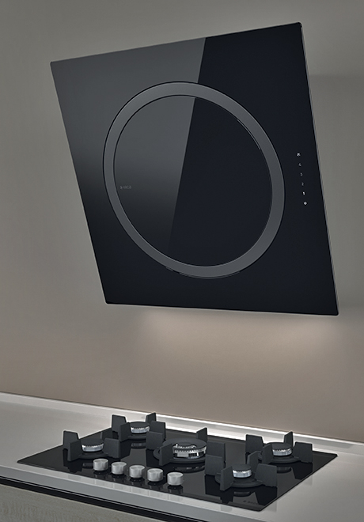

*图：OM（2004）黑色玻璃立式油烟机——一块贴墙竖放的矩形面板，官方称它"把圆与方两种几何结合"。图源：[appliancist 产品页](http://www.appliancist.com/cooking/hoods_vents/elica-om-wall-hood-2014.html)。*

## 02 品牌概述

Elica 是意大利厨房电器公司，1970 年由兽医 Ermanno Casoli 在法布里亚诺创立，现为米兰证交所 Euronext STAR 板块上市公司。它以抽油烟机为核心品类，自称全球厨房油烟机领导者、欧洲家用电器与锅炉电机参考企业；2016 年推出 NikolaTesla 吸风灶，开创"电磁炉与下吸排烟一体"的品类；2022 年发布 Lhov，定义烤箱、灶台与排烟三合一的新品类。官方设计主张把品牌的任务概括为"一种赋予空气以形式的设计"（A design that gives shape to air），企业主口号为"Born Extraordinary"。集团旗下另有 Gutmann、Airforce、Ariafina、Arietta 与电机板块 EMC FIME 等品牌。

| 项目 | 内容 |
|---|---|
| 品牌名 | Elica（Elica S.p.A. · [https://www.elica.com](https://www.elica.com)） |
| 国家/地区 | 意大利（总部马尔凯大区法布里亚诺 Via Ermanno Casoli 2；7 座工厂分布于意大利、波兰、墨西哥、中国） |
| 成立时间 | 1970 年（兽医 Ermanno Casoli 创立；1978 年创始人早逝后家族接掌；2006 年米兰证交所上市） |
| 创始人 | Ermanno Casoli（1970–1978）；第二代 Francesco Casoli（1990 年任 CEO，2006 年起任执行董事长） |
| 代表性设计人物 | Fabrizio Crisà（首席设计官，NikolaTesla/Lhov/AriaChef Pro 等署名设计）；Giorgetto Giugiaro（1982 年 Lego 油烟机合作） |
| 其他关键人物 | Gianna Pieralisi（创始人遗孀，1978 年联合接掌）；Luca Barboni（2026 年起任 CEO）；Cristina Casoli（董事，家族第二代） |
| 官方理念 | "Born Extraordinary"（企业口号）；"Inspire, Aspire"与"给空气以形式"（设计主张）；2024 年列入意大利国家历史品牌名录 |
| 品牌归属 | Elica S.p.A. 上市；Casoli 家族控股公司 F.A.N. S.r.l. 持股 52.81%，TIP S.p.A. 持股 23.2% |
| 核心业务 | 抽油烟机（壁挂/岛式/吊顶/嵌入式/下吸全形态）、吸风灶（NikolaTesla）、烤箱与酒柜（Cooking Collection）、家电与锅炉电机（EMC FIME） |
| 经典产品 | OM（2004，首台垂直烟机）、Star（2005，首台吊灯式岛机）、NikolaTesla One（2016/2018 金圆规）、Lhov（2022/2024 金圆规）、AriaChef Pro（2021/2025 金圆规） |

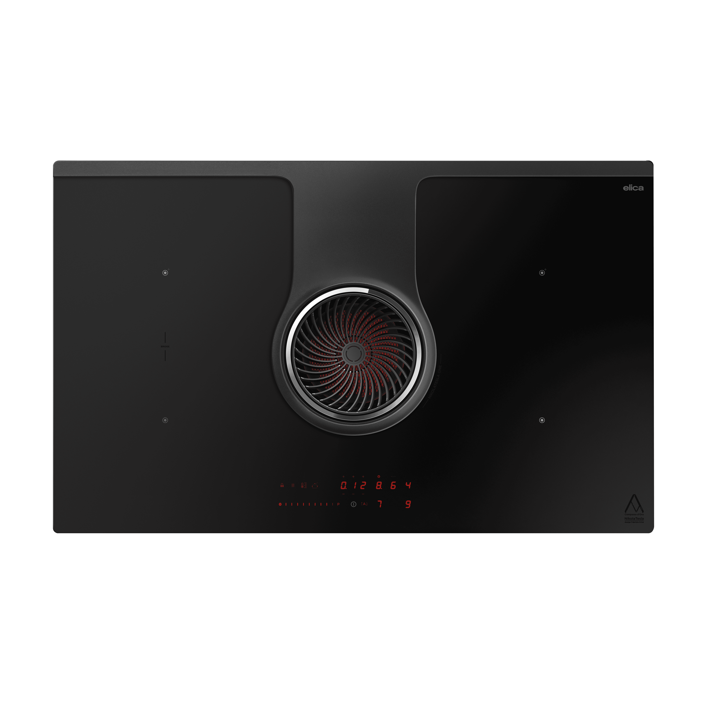

*图：NikolaTesla One 黑色 83 厘米吸风灶官方未编辑产品图——黑色玻璃台面中央嵌入圆形下吸风组件，把烟机从灶台上方搬到台面之下。图源：[Elica 官方产品页](https://www.elica.com/IT-en/hobs/extractor/nikolatesla-one)。*

## 03 Brand 品牌：从兽医作坊到上市集团

### 1970：一位兽医的第一台油烟机

Ermanno Casoli 是法布里亚诺本地兽医，同时热衷艺术。1970 年他做出第一台厨房油烟机并创立 Elica S.p.A.，官方叙事称其为"富有远见的艺术爱好者型企业家"。1972 年，他在巴黎展出第一台外排式（duct-out）厨房油烟机，同年与 Philips 签订第一份供货合同——官方历史用"成功立刻到来、公司垂直增长"概括这段起步。把厨房油烟作为独立空气品质问题产品化，是品牌此后五十余年的原点：创始人与研发团队相信，改善家居空气品质能提升福祉。

> 术语注释：Fabriano——意大利马尔凯大区城市，Elica 总部与主厂所在地。

*图：创始人 Ermanno Casoli 肖像——法布里亚诺兽医，1970 年做出第一台厨房油烟机并创立 Elica。图源：[Elica 官方品牌故事页](https://www.elica.com/SK-sk/brand-story)。*

### 1978：母子接班与 Lego 的诞生

1978 年，Ermanno Casoli 早逝。遗孀 Gianna Pieralisi 与当时尚为青少年的儿子 Francesco Casoli 继承了公司——官方品牌故事记述，他们继承的不仅是企业，还有"负担与责任"。1982 年，公司推出与汽车设计大师 Giorgetto Giugiaro（Italdesign）合作的嵌入式油烟机 Lego，这是 Elica 与外部明星设计师合作的最早官方记录，也是早期嵌入式油烟机的代表型号。家族第二代由此确立了"与大师设计师合作"的产品路线，远早于首席设计官时代。

> 术语注释：Giorgetto Giugiaro——意大利汽车与工业设计大师，Italdesign 创始人，1982 年设计 Elica 嵌入式油烟机 Lego。

*图：Francesco Casoli——创始人之子，1978 年 17 岁随母接手公司，1990 年出任 CEO，2006 年上市后转任董事长。图源：[Elica 官方品牌故事页](https://www.elica.com/SK-sk/brand-story)。*

### 1995：大火与凤凰行动

1995 年，法布里亚诺主厂被一场大火完全焚毁。公司发起代号"Operation Phoenix"（凤凰行动），在全体员工参与下用四个月完成重建复产。这场火灾被官方历史写入"韧性"章节，与创始人早逝、母子接班一起构成家族叙事的转折点：三次重创都没有中断生产，反而把"从零重建"写进企业文化。同年，Ermanno Casoli Award 于 1997 年设立，以纪念创始人对艺术的热爱，颁发给对社会与劳工议题有特别敏感度的艺术家。

> 术语注释：Operation Phoenix——1995 年法布里亚诺工厂大火后四个月重建复产的行动代号。

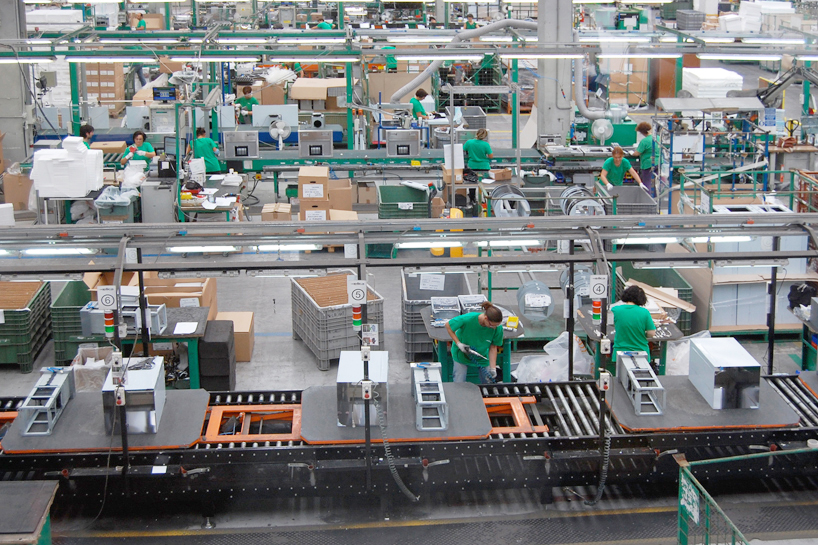

*图：Fabriano 工厂总装线——火灾重建后延续至今的烟机生产现场，工人沿流水线装配罩壳。图源：[designboom 工厂探访](https://www.designboom.com/design/elica-factory-visit/)。*

### 2001–2006：马达、合资与上市

2001 年，Elica 收购电机与风机制造商 FIME 控股权，把油烟机的"心脏"从外购变为自制，这是集团垂直整合的决定性一步；2002 年，与日本企业合资成立 Ariafina，进入日本市场；2006 年，公司在米兰证交所 Euronext STAR 板块上市，同年开设墨西哥工厂。上市前后，产品线以"第一"为标记快速迭代：2004 年推出第一台垂直油烟机 OM，2005 年推出第一台吊灯式岛式油烟机 Star，2007 年推出当时市场最安静的油烟机 Space——官方历史称这一年"设计把技术推得更远"。

> 术语注释：FIME——Elica 2001 年收购控股权的电机设计制造企业，后整合为电机板块 EMC FIME。
> 术语注释：Ariafina——Elica 2002 年在日本成立的合资高端厨电品牌。

### 2016–2025：三个新品类与历史品牌认定

2016 年 NikolaTesla 系列上市，电磁炉与下吸排烟第一次合并在同一台面上；2018 年，NikolaTesla One HP 获第 25 届 Compasso d'Oro，这是 Elica 集团历史首座金圆规奖。2022 年 Lhov 发布，2024 年获第 28 届 Compasso d'Oro；2025 年，AriaChef Pro 在 2025 年大阪世博会获 Compasso d'Oro International Award，完成三连冠。2024 年，Elica 被意大利企业与"意大利制造"部列入国家历史品牌名录；2025 年，集团在荷兰 Haren 开设首个荷兰子公司与展厅。

> 术语注释：Compasso d'Oro——意大利工业设计协会（ADI）颁发的金圆规设计奖，1954 年设立，意大利最高设计荣誉。

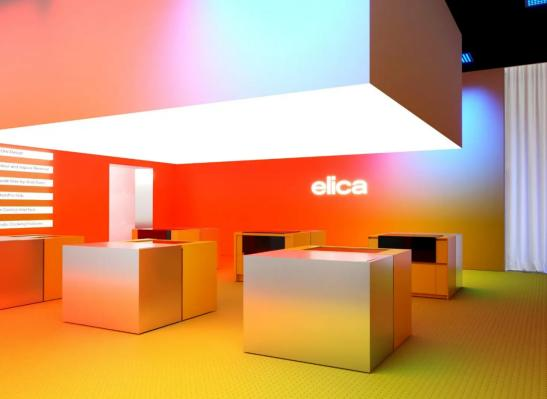

*图：EuroCucina 2024 展位的渐变光环境——展陈空间以光影过渡呼应"烹饪无界"的叙事。图源：[Elica 展位现场报道](http://mp.weixin.qq.com/s?__biz=MjM5NjY3ODE0MA==&idx=2&mid=2652402695)。*

### 艺术基因：从 Premio Ermanno Casoli 到 FEC

创始人 Casoli 对艺术的热爱被制度化延续：1997 年设立 Ermanno Casoli Award；2007 年成立 Fondazione Ermanno Casoli（FEC），让当代艺术家进入工厂创作 site-specific 作品，员工与家属共同参与，作品收入 Elica Corporate Collection。官方把 FEC 称为"意大利企业培训的典范"——艺术不是品牌外围的装饰，而是被当作激发职场创新流程的教育工具。这一制度与 1982 年 Giugiaro 合作一脉相承：Elica 从早期就相信，设计领导地位来自与艺术和设计体系的持续交换。

> 术语注释：Fondazione Ermanno Casoli——2007 年成立的 Elica 企业艺术基金会，推动艺术家驻厂创作与员工艺术参与。

## 04 Category 品类与市场：烟机、集成灶与烹饪系统

### 品类定义与产品线构成

Elica 对外的自我定位已从"抽油烟机制造商"转型为一体化烹饪电器公司（Cooking Company）。核心品类仍为家用抽油烟机，按安装形态分为壁挂、岛式、转角、嵌入式、吊顶、悬挂吊灯式与下吸式；按排风方式分为外排（duct-out）与内循环过滤（recirculating）两类。在此之上，产品线向三个方向延伸：吸风灶（extractor hob，电磁炉与下吸排烟一体，即 NikolaTesla 系列）；三合一 All-in-One 产品 Lhov（烤箱＋电磁炉＋排烟）；以及烤箱、酒柜、灶具构成的 Cooking Collection，美国市场另售冰箱与独立灶。空气处理支线"elica aria nuova"以 Ikona Maxxi Pure 为代表，把油烟机与空气净化器合二为一，配 HEPA 加活性炭复合滤芯全天处理室内空气。现行在售型号逾百款，命名体系部分以人名致敬（NikolaTesla 致敬发明家，Lhov 为"L'Hood＋Oven"缩合），型号代码含尺寸与排风方式信息。

> 术语注释：extractor hob——电磁炉台面内集成下吸排烟系统的一体灶，NikolaTesla 开创的品类。

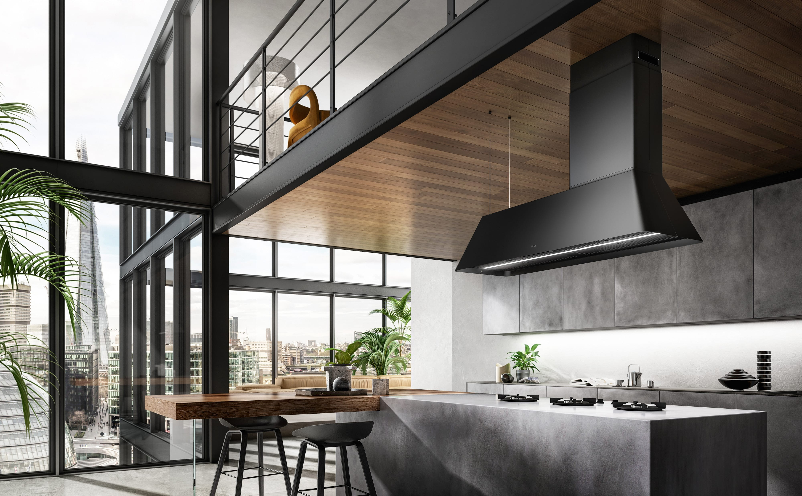

*图：Ikona Maxxi Pure 氛围图——烟机与空气净化二合一的全天候空气管理支线。图源：[Elica 官方产品页](https://www.elica.com/MD-en/ikona-maxxi-pure)。*

### 市场规模的判断口径

集团体量以上市披露为准：FY2025 合并营收 €460.6 百万（同比 +1.9%），调整后 EBITDA €27.7 百万（利润率 6.0%），净利润为 -€8.3 百万；Cooking 分部约占 78%，Motors 分部约占 22%，OEM 业务收入 €148.3 百万。公司口径称，Elica 自有品牌在欧盟 21 国油烟机市场份额由 2023 年的 5.9% 升至 2024 年的 6.3%，自称欧洲市场领导者、意大利与法国第一——该口径来自公司投资者材料，非第三方审计。同一材料估计 2025 年欧洲油烟机市场约 5.8 百万台。区域景气方面，2025 年西欧（意、法、德）市场量约 -4%，东欧约 +3%，美洲约 -4%。

### 价格带：2026 年 10 月渠道实查

Elica 官网不面向个人直销，官方 FAQ 明确"不能直接向厂家购买"。价格以英国 John Lewis、Appliances Direct、PriceRunner 与德国 Geizhals 等渠道 2026-10-26 实查挂价为准：入门嵌入式烟机 ERA-STD-80 £129、LANE-80-SS £499 走量；主流壁挂与岛式款 THIN-90 £749、Cloud Seven £920、Juno 吊灯式 £1,239–1,299；高端吸风灶 NikolaTesla 系列 £1,218–2,399（Fit、One、Prime），Unplugged 在德国渠道 €1,688.9–1,899；旗舰设计款 Ikona Maxxi Pure（烟机加净化二合一）英国渠道 £2,169–2,257.99、德国 €1,649，Lhov 意大利经销商 listino 标价 €7,300。

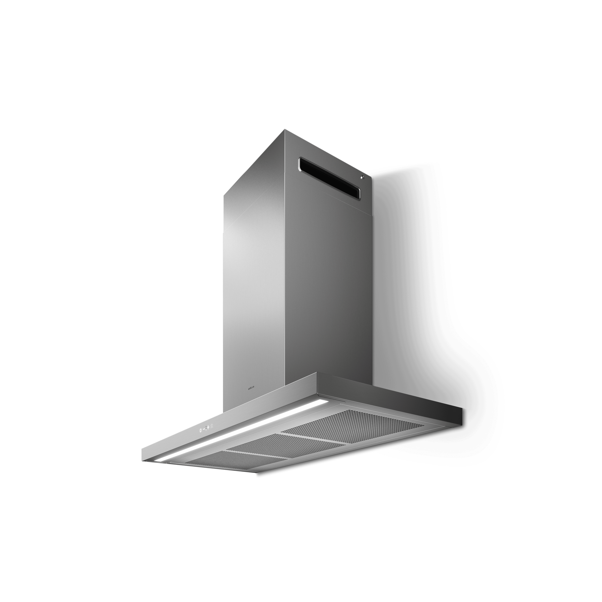

*图：Thin 不锈钢超薄壁挂烟机官方未编辑产品图（90 厘米）——经典 T 形烟机的现代进化版，宽烟囱、薄机身。图源：[Elica 官方产品页](https://www.elica.com/IT-en/hoods/wall/thin)。*

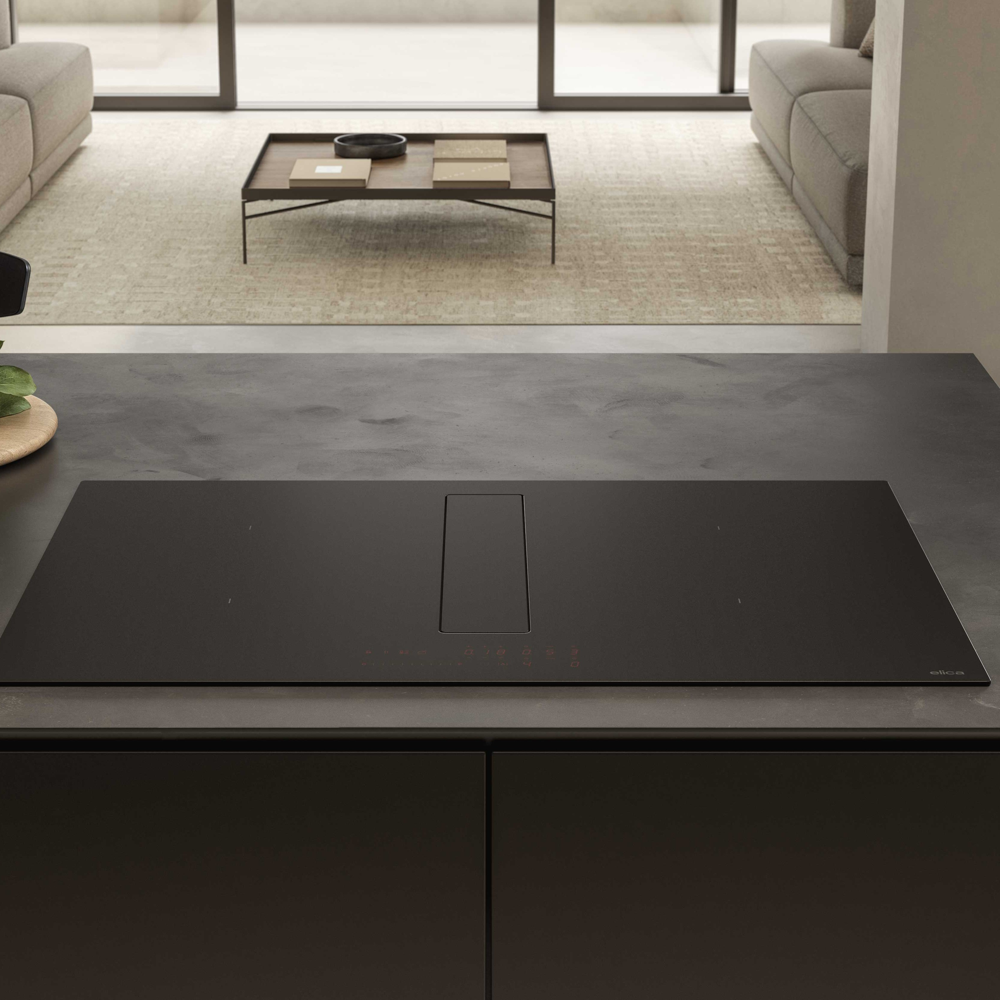

*图：NikolaTesla Prime S 安装于开放厨房岛台——窄幅中央抽排口与电磁炉区落在同一块黑色玻璃台面内。图源：[Elica 官方产品页](https://www.elica.com/IT-en/hobs/extractor/nikolatesla-prime-s)。*

### NikolaTesla 家族年表

NikolaTesla 系列自 2016 年上市后不断扩展，官方意大利价目册列出清晰年表：2016 年首发 Switch 与 One；2018 年 Libra——官方称"第一台带集成秤的吸风灶"，把厨房称量功能嵌入电磁灶台面；2020 年 Fit——"仅 60 厘米宽的吸风灶"，适配小厨房；此后新增 Unplugged、Flame（燃气与电磁混合）、Velvet 等变体。家族型号共享"中央下吸＋炉头联动自动调风"的技术内核，是 Elica 从传统烟机向台面集成系统迁移的主战场。

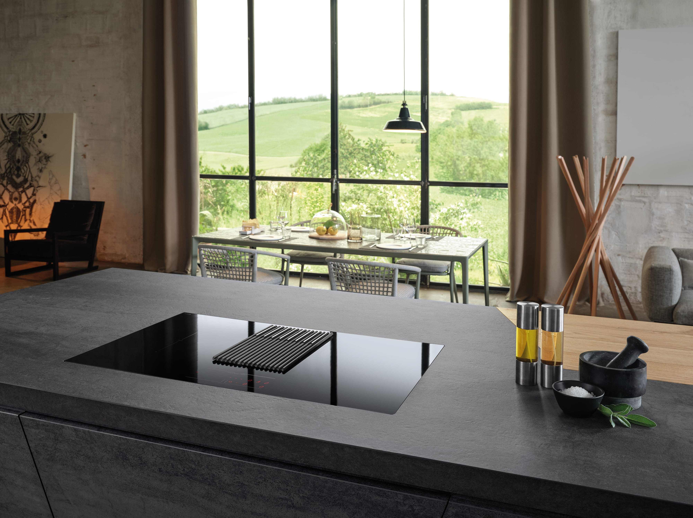

*图：NikolaTesla Libra 黑色 83 厘米吸风灶安装场景——2018 年推出的"第一台带集成秤的吸风灶"，排烟缝在烹饪时升起。图源：[Elica 官方产品页](https://www.elica.com/IT-en/hobs/extractor/nikolatesla-libra)。*

### 传感与静音的技术脉络

2010 年推出的 Feel 是第一台带传感技术的油烟机：可感知油烟浓度并自动调节吸力等级，而非完全依赖手动按键。这一思路后来演化为全系列的 Airmatic 智能传感——官方描述它能"区分油烟质量与烹饪类型，并与正在使用的炉头数量及功率联动"，关火后系统自动渐弱排风、抽走残余油烟，把"人忘记关机"这一体验断点用传感器补上。2007 年的 Space 则以"当时市场最安静的油烟机"立名，是降噪工程最早的产品化表达；此后 NikolaTesla One HP 官方规格给出量化区间：外排模式 35–67 dB(A)、内循环 38–71 dB(A)，最低档接近图书馆环境音，全速档则如实披露偏吵。

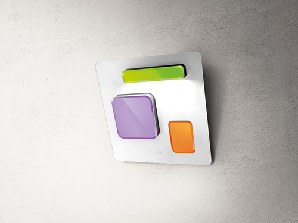

*图：Feel（2010）——第一台带感应技术的油烟机，白色面板与可换彩色面板。图源：[Elica 经销商产品页](https://www.vision-i.com.hk/products/elica-feel-80cm)。*

## 05 User 用户与场景：建筑师、业主与 OEM

### 决策链：指定者、购买者与使用者

Elica 的买家结构呈典型的高端厨电"指定者、购买者、使用者"分离特征。住宅翻新与新建端，指定者为建筑师与室内设计师——油烟机的形态（吊灯式、贴墙式、齐平嵌入式）直接参与厨房立面设计，设计师往往先选定型号再让业主购买；使用者是家庭成员，女性在家电选购决策中的主导地位与烹饪场景绑定。全装修与工程端，购买者是橱柜商与集成商——嵌入式烟机按橱柜开孔尺寸选型，Elica 提供 panel-ready（可与柜门同材质贴合）与窄体规格。OEM 端，集团为其他家电品牌代工电机与烟机，年产量口径官方称从烟机到马达共 2,070 万件，是品牌面向 B 端的重要收入来源。日本市场是特例：AriaChef Pro 等高端型号经 Ariafina 与富士工业（Fujioh）分销，面向追求无管道室内烹饪的都市家庭。

> 术语注释：panel-ready——产品面板可与橱柜/吊顶同材质贴合安装，实现"隐形"一体化的规格。

*图：AriaChef Pro 移动 IH 烹饪车——日本 Ariafina 与富士工业分销的高端无管道烹饪系统。图源：[Elica 集团新闻稿](https://corporate.elica.com/en/media/elica-group-wins-third-compasso-d-oro-and-honourable-mention-at-expo-osaka)。*

### JTBD 与 CEP：被雇来做的事

| 用户任务（JTBD） | 关键体验需求（CEP） | 对应 Elica 产品/功能 |
|---|---|---|
| 让厨房空气在烹饪时快速洁净 | 吸得动、来得快、别溅油 | 下吸式 620 m³/h boost、Airmatic 传感自动调档 |
| 让油烟机不破坏厨房美感 | 像灯具、像家具、像墙面 | Star/Édith 吊灯式、OM 贴墙式、Boxin 全隐藏式 |
| 小厨房放下大吸力 | 占位小、与橱柜齐平 | 35CC 35 cm、NikolaTesla Fit 60 cm、Illusion 天花齐平 |
| 烹饪时不想手动操作 | 自动感知、自动关机、自动清洁提醒 | Airmatic 传感器、关火渐弱排风、滤网寿命监测 |
| 降低长期维护成本 | 滤网耐用、可洗、可再购 | 可再生滤网 5 年寿命、App 一键下单兼容滤网 |
| 缓解过敏与室内空气担忧 | 全天净化、安静后台运行 | Ikona Maxxi Pure（HEPA+活性炭复合滤芯） |

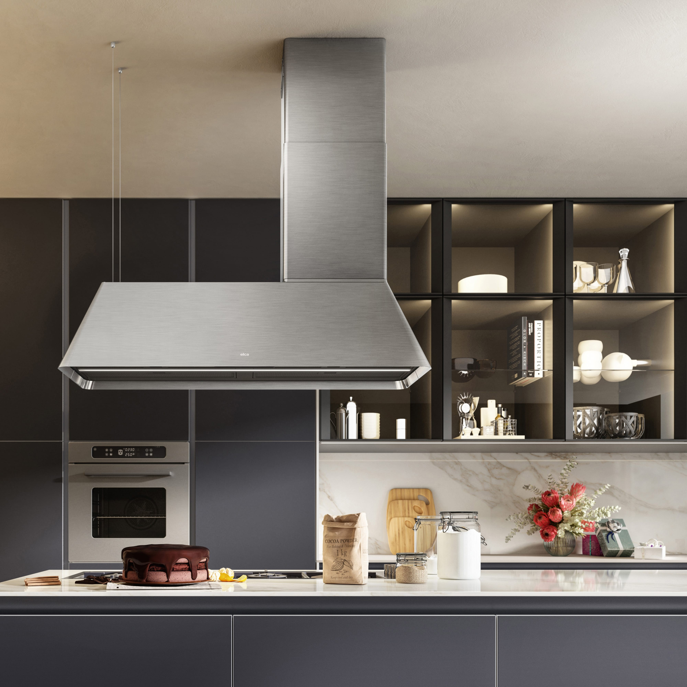

*图：Ikona Maxxi Pure 悬挂烟机房间实景——烟机模块与空气净化模块分离独立工作，面向全天候空气管理场景。图源：[Elica 官方产品页](https://www.elica.com/MD-en/ikona-maxxi-pure)。*

### 使用场景地理

欧洲是基本盘：意大利、法国为传统强势市场（公司口径称在这两国油烟机市场排名第一），德国、英国以高端集成灶与吊灯式烟机见长，集团自有品牌 2024 年欧盟 21 国份额 6.3%。北美通过墨西哥工厂与 Steel Srl 入股（2025 年 28%，主打高端 range cooker 与户外厨房）切入美加高端烹饪与户外场景。日本以 Ariafina 与 Fujioh 渠道运营二十余年，覆盖都市高端烹饪场景。中国市场由品牌持有方运营"普田"品牌与多级经销商网络，官方未披露细分份额，属待核实区间。

## 06 Positioning 定位：让空气有形的烹饪系统公司

### 参照系

Elica 的设计领导地位最常被置于四个参照系中衡量：欧洲独立抽油烟机品牌（Falmec、Faber 等）、德国高端一体灶与吸风灶（Bora）、全品类大家电（BSH 旗下 Bosch/Siemens/Neff、Miele），以及意大利整体厨电（Smeg、ILVE）。其中 Bora 与 Elica 同为"灶面下吸"品类的技术双雄——Bora 先于 Elica 推出嵌入式下吸灶，Elica 则以 NikolaTesla 系列 2016 年大规模铺开并获金圆规，两者经常被专业媒体并列比较。

> 术语注释：Falmec——意大利高端抽油烟机品牌，总部同属马尔凯大区，以"无烟囱"设计著称。
> 术语注释：Bora——奥地利高端一体灶品牌，嵌入式下吸排烟品类的技术开创者之一。

### 差异点与共同点

| 维度 | Elica 的落点 | 主要参照对象 |
|---|---|---|
| 设计奖项密度 | 3×Compasso d'Oro、15×Red Dot、18×iF、22×Good Design、10×ADI Design Index | 高于多数独立烟机品牌，接近大家电集团旗舰线 |
| 品类广度 | 烟机全形态＋吸风灶＋All-in-One＋烤箱＋空气净化 | 独立烟机品牌无此广度；Miele/BSH 有但设计叙事不同 |
| 设计师合作制度 | 内部首席设计官 Crisà 主导，兼外部大师合作（Giugiaro/Giovannoni/Pesce） | 与 Artemide、Flos 等意大利设计品牌同构 |
| 垂直整合 | 自产电机（EMC FIME），马达部门约占收入四分之一 | 多数烟机品牌外购风机 |
| 文化资本 | FEC 基金会、Pescecappa 入藏外交部设计收藏、国家历史品牌 | 意大利设计品牌中的极少数 |

Elica 与竞品共享的行业共同点是：降噪指标、风量（m³/h）、能效等级（A 级/A++）构成消费者可比较的公共语言；以及"与橱柜齐平""超薄""隐形"作为 2020 年代厨房电器的通行美学。差异点集中在三处——品类发明记录（垂直烟机、吊灯烟机、吸风灶、All-in-One 均由 Elica 先行）、奖项目录厚度，以及把油烟机"家具化/灯具化"的设计叙事能力。

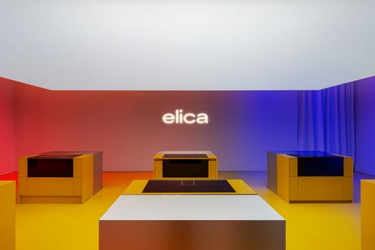

*图：EuroCucina 2024 Elica 展位内部彩色空间——展陈本身即品牌"设计领导地位"主张的证据。图源：[Archiproducts Elica 品牌页](https://www.archiproducts.com/zh/elica)。*

### 承诺链

品牌对消费者承诺的因果链可概括为：设计奖项与历史品牌认定（证据）→ 意大利制造与垂直整合电机（能力）→ 品类首创与专利技术（产品差异）→ 烹饪变成社交与艺术时刻（用户价值）→ "Born Extraordinary"（品牌主张）。其中"A design that gives shape to air"（给空气以形式）是设计层面的总承诺，落到产品上表现为三种兑现方式：把烟机做成灯（Star/Édith/Seashell）、把烟机藏起来（NikolaTesla 下吸、Boxin 隐藏、Illusion 天花齐平）、把烟机变成家具（Open Suite、Lhov 齐平面板）。

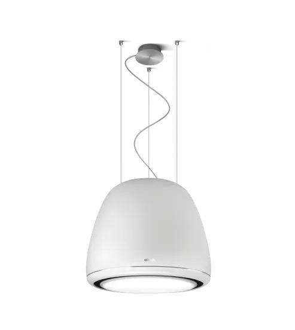

*图：Édith 白色吊灯烟机吊线产品图——"把烟机做成灯"的承诺兑现样本。图源：[Merhi Trading 产品页](https://merhitrading.com/)。*

## 07 Product 产品：从 Om 到 Lhov 的品类发明史

### 产品组合与命名逻辑

Elica 现行在售型号逾百款，命名体系呈三条线索：以科学家/发明家命名致敬——NikolaTesla 系列致敬尼古拉·特斯拉；以诗意名词命名——Om（梵语"宇宙之音"）、Ye、Haiku（日本俳句）、Lhov（L'Hood+Oven 缩合）、AriaChef（"空气厨师"）；以功能/形态命名——Thin（薄）、Cloud Seven、Space、Feel、Juno、Seashell。型号代码后缀含尺寸与排风方式（如 BL/F/60 表示黑色 60 厘米过滤版）。产品线按形态分为壁挂、岛式、吊顶、嵌入式、吊灯式、下吸式六大类，另有烤箱、酒柜、灶具构成的 Cooking Collection 与空气净化支线。下列目录表收录最具代表性、知名度最高的经典与标志性产品，按时间排序。

| 名称 | 设计年份 | 设计师 | 简介 |
|---|---|---|---|
| 第一台厨房油烟机 | 1970 | Ermanno Casoli | 创始人亲手做出的第一台油烟机，Elica 一切叙事的起点 |
| 首台外排式油烟机 | 1972 | Ermanno Casoli | 巴黎首展并签下 Philips 首约，公司由此起飞 |
| Lego 嵌入式油烟机 | 1982 | Giorgetto Giugiaro | Elica 与明星设计师最早的合作记录，模块化嵌入式的代表 |
| Tamaya 不锈钢烟囱机 | 1987 | Phoenix Design + Guy Tienot | 与德国 Phoenix Design 联合开发，设计专业化转型的标志 |
| Wall Carpet | 1999 | David Lewis | B&O 御用设计师之作，把油烟机变成墙上"壁毯"的形式革命 |
| Modula | 2000 | Castiglia Associati | 挤出铝合金、宽度可选的模块化油烟机，千禧开端 |
| OM / Om Air | 2004 | Elica Design Center | 世界第一台垂直油烟机，开启"像画框贴墙"的品类；学术期刊列为类型创新案例 |
| Evolution / Star | 2005 | Elica Design Center | 世界第一台吊灯式岛机，把油烟机重新定义为悬挂灯具 |
| SPACE | 2007 | Elica Design Center | 发布时市场最安静的油烟机，降噪工程里程碑 |
| Pescecappa | 2009 | Gaetano Pesce | 艺术家原型，限量 15 件编号签名，入藏意大利外交部设计收藏 |
| Feel | 2010 | Elica Design Center | 第一台带传感技术的油烟机，自动感应吸力路线开端 |
| Ico | 2011 | Elica Design Center | 发布时能效最高的油烟机，节能标杆 |
| Bubble | 2011 | Stefano Giovannoni | 技术聚合物一体成型球形烟机，跳出金属烟囱类型惯例 |
| Clip | 2011 | Ludovica & Roberto Palomba | 圆角矩形黑红双色 55 cm 小巧机身，"把设计带回本意" |
| Skin | 2011 | Fabrizio Crisà | 薄如皮肤的超薄贴墙面板，2011 Red Dot 产品设计奖 |
| 35CC | 2012 | Elica Design Center | 仅 35 cm 见方的双 C 形壳体立方体，回应小公寓厨房 |
| Sweet | 2012 | Fabrizio Crisà | 柔曲线条现代重译复古设计，铜/锡/铸铁效果饰面 |
| Ye | 2014 | Fabrizio Crisà | 第一台 Cristalplant 固态表面"雕塑烟机"，隐藏式 iGuzzini LED |
| Amélie | 2014 | Fabrizio Crisà | 有独立性格的壁吸，把工业功能伪装成家具 |
| NikolaTesla One / One HP | 2016 | Fabrizio Crisà | 首台吸风灶品类开创者，2018 获第 25 届 Compasso d'Oro（Elica 首座金圆规） |
| NikolaTesla Switch | 2016 | Fabrizio Crisà | 与 One 同期发布的首发吸风灶型号，吸芯完全隐形、旋盖开关启动 |
| Haiku Island | 2018 | Fabrizio Crisà | 8 cm 薄体 Krion 抗菌材料中岛烟机，Eurocucina 2018 首发 |
| NikolaTesla Libra | 2018 | Fabrizio Crisà | 世界第一台带集成秤的吸风灶 |
| Interstellar | 约 2018 | Fabrizio Crisà | Star 概念线的当代延展，镜面钢与 1152 块玻璃棱镜"房间里的天空" |
| NikolaTesla Fit | 2020 | Fabrizio Crisà | 仅 60 cm 宽的吸风灶，让小厨房进入下吸品类 |
| Cloud Seven | 2020 | Fabrizio Crisà | 吊顶式烟机，不锈钢薄板如云悬浮于天花 |
| AriaChef Pro | 2021 | Fabrizio Crisà | 可移动 IH 烹饪车，2025 年获 Compasso d'Oro International Award |
| Boxin Advance | 约 2020 年代 | Fabrizio Crisà | 完全藏入吊柜的智能嵌入式烟机，前挡板自动开启 |
| NikolaTesla Unplugged | 2021 | Fabrizio Crisà | 回潮式物理旋钮的吸风灶，"模拟的超能力" |
| Ikona Maxxi Pure | 2022 | Fabrizio Crisà | 烟机与空气净化器二合一，HEPA+活性炭全天候净化 |
| Open Suite | 2022 | Fabrizio Crisà | 可自由配置的"家具化"烟机系统，Wi-Fi 与语音控制 |
| Lhov | 2022/2024 | Fabrizio Crisà | 市场首台烤箱+灶+烟机 All-in-One，2024 获第 28 届 Compasso d'Oro |
| Juno | 年份待核实 | Fabrizio Crisà | 50 cm 级小型悬挂岛式烟机，面向小中岛与吧台 |
| Seashell | 年份待核实 | Elica Design Center | 贝壳形吊灯式烟机兼灯，Star 脉络的诗意变体 |
| Getup | 约 2021 | Fabrizio Crisà | 台面升降式下吸烟机，"用时升起、不用消失" |
| Illusion | 约 2020 后 | Fabrizio Crisà | 市场首款 panel-ready 全隐藏天花机，与吊顶齐平"消失" |

### Tamaya（1987）：与 Phoenix Design 的不锈钢烟囱

1987 年投产的 Tamaya 是 Elica 早期设计专业化转型的代表：由德国产品设计工作室 Phoenix Design 与 Guy Tienot 联合设计，不锈钢烟囱式（chimney hood）造型，至今目录中仍有 Tamaya 2.0 后继型号，证明这一 1980 年代的造型谱系生命力之长。它出现在 Elica 与 Giugiaro 合作（1982）之后、意大利设计体系全面渗透之前，是"金属烟囱机"作为品类基型的时期产物。

> 术语注释：chimney hood——带竖向排烟道的传统烟囱式油烟机。

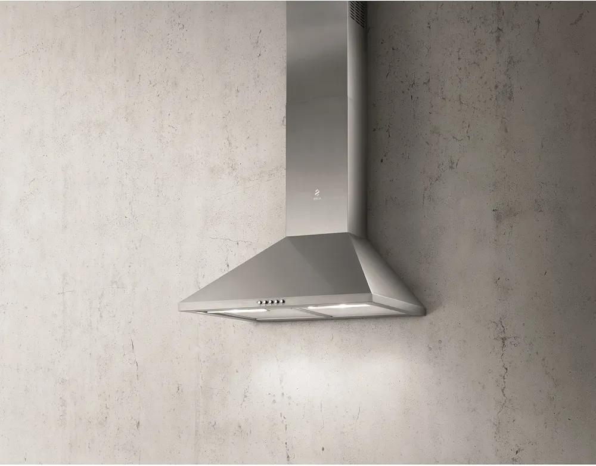

*图：Tamaya（1987）不锈钢烟囱式油烟机——Phoenix Design 与 Guy Tienot 联合设计的经典烟囱造型。图源：[英国零售产品页](https://www.amazon.co.uk/elica-tamaya-60-hp-tamaya-high-performance-60cm-chimney-hood-stainless-steel/dp/B0098JFNFG)。*

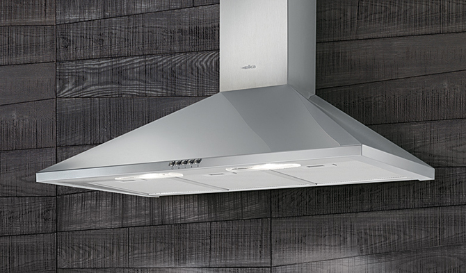

*图：Tamaya 不锈钢烟囱机在深木纹墙面厨房的场景——传统烟囱机作为厨房立面主角的安装方式。图源：[经销商产品页](https://www.myareadesign.it/fr/electromenager/hottes-de-design/hottes-murales/elica-hotte-murale-montee-tamaya.3.1.44.gp.3844.uw)。*

### OM 与 Mini OM（2004/2005）：垂直烟机的开山与普及

2004 年推出的 OM 是世界第一台垂直油烟机（vertical hood）。官方把它的形态创新概括为"squares the circle"——把原型的圆与方两种几何与最新抽吸技术结合，正面带一扇钢化玻璃观察窗，整机如一幅贴墙的画框。设计学术期刊《The Innovation Pyramid》把 Elica Om 列为"类型创新"的教科书案例，与 Zanotta Sacco 沙发、Zanuso/Sapper Grillo 电话并列。Om Air 的现行产品页称它为"Elica 历史上的一个图标"（an icon of Elica's history）。这一形态还催生了 Elica 专有的周边吸风（perimeter aspiration）技术叙事——官方美国规格书写道，这项技术"把市场转了 180 度，为像画框一样贴墙安装的烟机打开了大门"。2005 年推出的 Mini OM 把垂直面板缩小到紧凑尺寸并引入彩色玻璃，让这一形态进入更小的厨房。

> 术语注释：perimeter aspiration——沿面板边缘环形吸风的专利技术，Elica 首创，使贴墙垂直面板也能高效集烟。

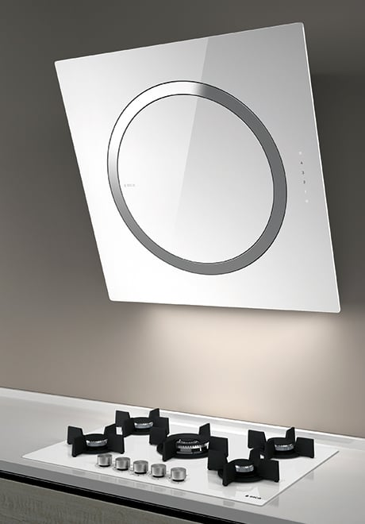

*图：OM（2004）白色玻璃立式油烟机——垂直面板与钢化玻璃观察窗，"像画框一样贴墙"。图源：[appliancist 产品页](http://www.appliancist.com/cooking/hoods_vents/elica-om-wall-hood-2014.html)。*

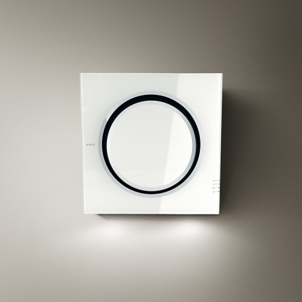

*图：Mini OM 白色玻璃紧凑型立式烟机——OM 垂直形态的缩小普及版。图源：[香港经销商产品页](https://hkele.com.hk/ELICA/MINI-OM-WHITE-)。*

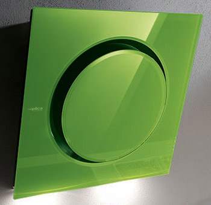

*图：Mini OM 苹果绿玻璃彩色版——垂直面板以色彩进入更年轻的厨房场景。图源：[appliancist 产品页](https://appliancist.com/cooking/hoods_vents/mini-om-range-hood-in-colors.html)。*

### Star 与 Evolution（2005）：吊灯式烟机的诞生

2005 年发布的 Evolution/Star 是世界第一台吊灯式（chandelier-style）岛式油烟机——官方年表称它"变成一盏会换气的吊灯"（transformed into a ventilating chandelier）。Star 把油烟机从厨房的功能性设备重新定义为悬挂于岛台上方的灯具与家具，是 Elica 品类发明的第二座里程碑；其发布年份官方有两处口径（品牌史写 2005，集团史因与上市同年记 2006），经销商官方口径一致指向 2005。2016 年前后该家族以"New Evolution"restyle，衍生 Édith、Audrey 等型号，换装高效电机、周边吸风与 LED；当代的 Interstellar 官方自述"从标志性产品 Star 的概念线出发"，即这一美学谱系的直系后代。

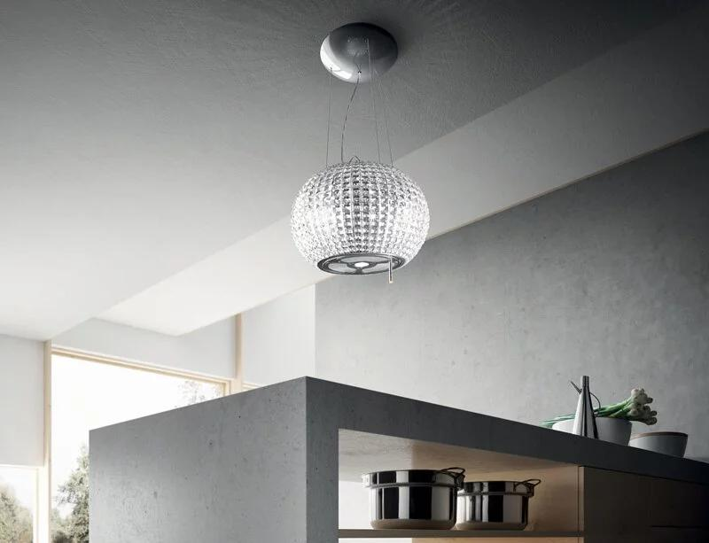

*图：Star（2005）水晶吊灯式岛式油烟机——世界第一台吊灯式烟机，悬挂于岛台上方。图源：[Vision-I 产品页](https://www.vision-i.com.hk/products/elica-star-47cm)。*

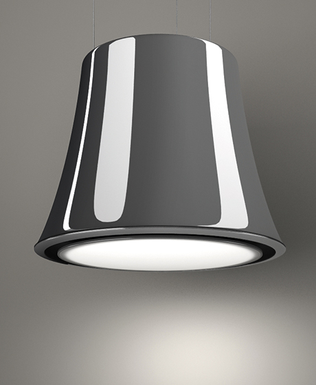

*图：Audrey 深色锥形悬挂烟机——Evolution 吊灯家族的后续成员，延续"烟机即灯"的叙事。图源：[appliancist 产品页](https://appliancist.com/hoods_vents/page/2?start=75)。*

### Space（2007）：把安静做成卖点

2007 年发布的 SPACE 以"当时市场上最安静的油烟机"立名，是 Elica 降噪工程的最早产品化表达。官方年表把它放在"2007，设计把技术推得更远"的节点，与 OM（形态创新）、Evolution/Star（品类创新）并列为 Elica Design Center 早期三大里程碑。圆形面板配合中央不锈钢控制条，是 2000 年代中后期"圆与极简"审美在烟机上的落地。

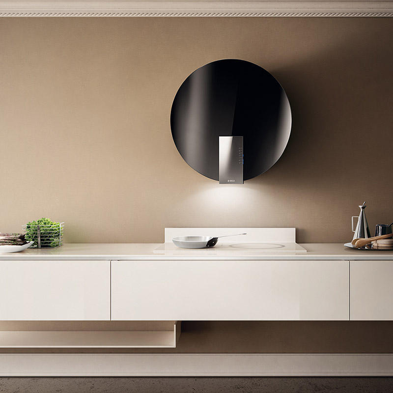

*图：SPACE（2007）黑色玻璃圆形壁挂烟机——发布时市场最安静的型号，中央不锈钢控制条。图源：[busyboo 设计媒体](https://www.busyboo.com/2015/02/02/kitchen-hood-elica/)。*

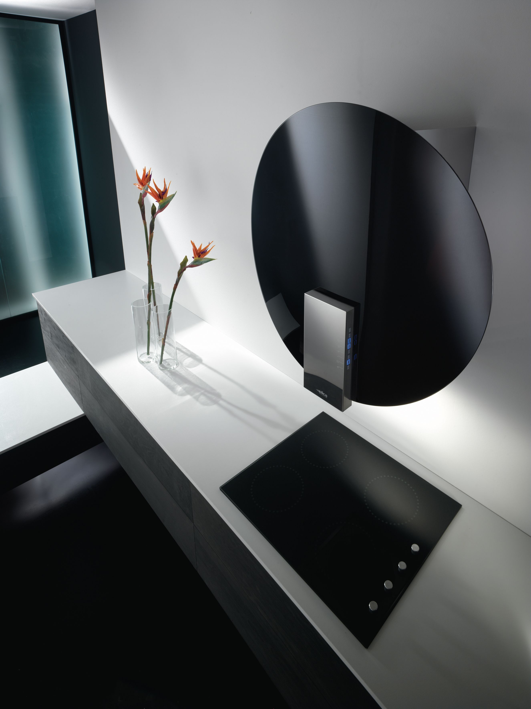

*图：SPACE 圆形烟机在紧凑厨房中的安装场景——圆盘罩体贴近墙面，下方台面与灶具保持连续。图源：[Elica 官方 Pinterest Space 图板](https://in.pinterest.com/elicahilife/space/)。*

### Édith（2015）：灯与烟机的融合

2015 年，Édith 以吊灯式圆穹造型进入市场，同年拿下 iF 与 Red Dot 双料设计奖。Red Dot 评审语把它概括为"灯与紧凑型烟机的成功融合……为中岛带来幸福感氛围"；官方产品页强调大尺寸 LED 承担灶台照明。Édith 的圆润、吊灯灵感轮廓提供白、黑、抛光不锈钢三色，是 Evolution 吊灯家族在 2010 年代的高性能 restyle——换装高效电机、周边吸风与 LED，成为"烟机即厨房主灯"理念的成熟形态。

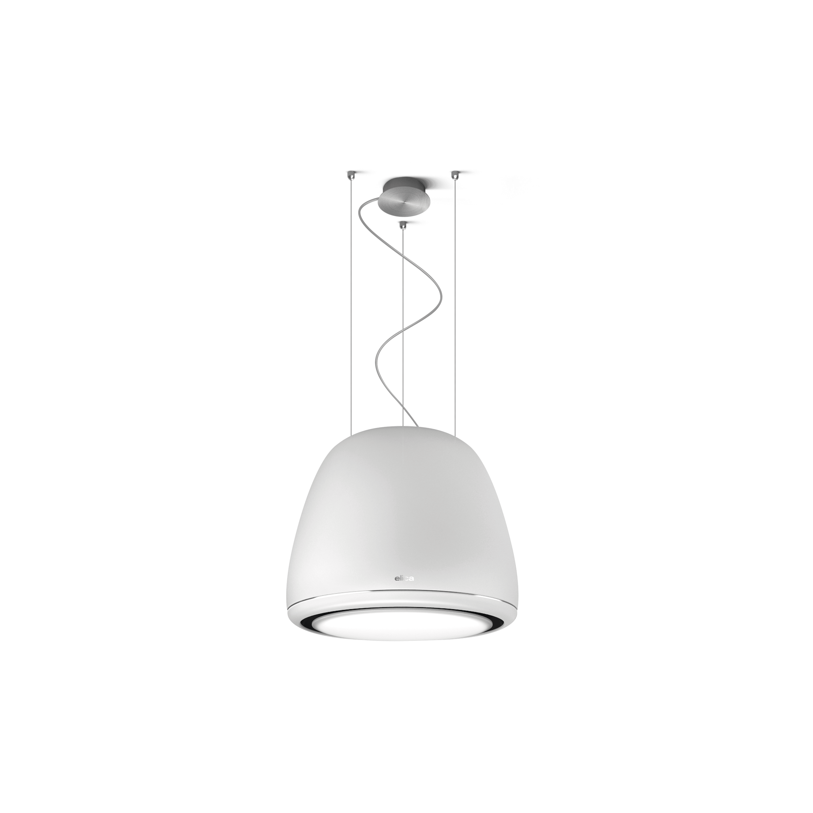

*图：Édith 白色吊灯式烟机官方正面图（2015，iF 与 Red Dot 双料获奖）——圆穹、吊线与底盘构成完整的灯具轮廓。图源：[Elica 官方产品页](https://www.elica.com/IT-en/hoods/island/edith)。*

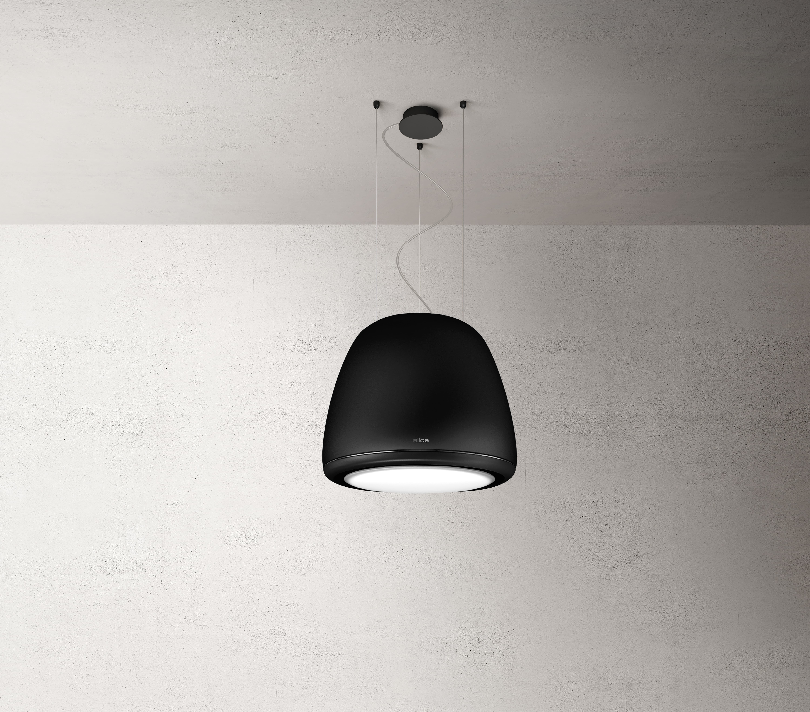

*图：Édith 深色圆穹款官方产品图——黑色外壳把底部照明收成一圈亮边，产品与灯具的关系更接近。图源：[Elica 官方产品页](https://www.elica.com/IT-en/hoods/island/edith)。*

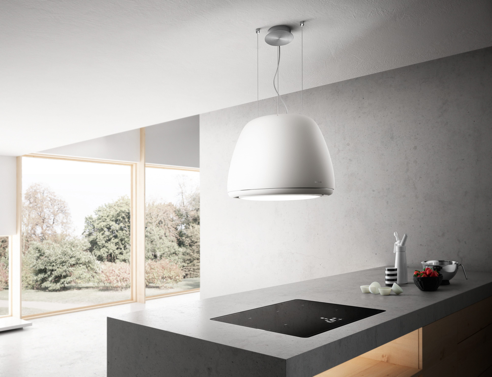

*图：Édith 单灯厨房场景——白色圆穹悬挂于中岛上方，灯具尺度与台面形成清楚的上下关系。图源：[Elica 官方产品页](https://www.elica.com/IT-en/hoods/island/edith)。*

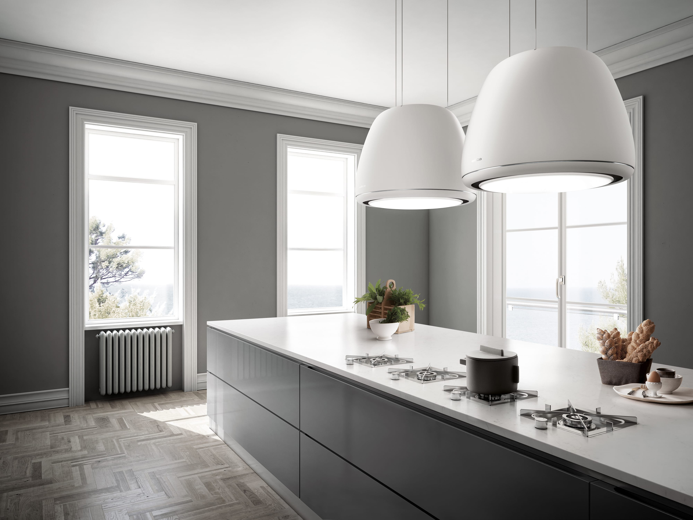

*图：Édith 双灯厨房场景——两台白色圆穹沿长中岛排布，重复的吊灯节奏把烟机转化为空间照明。图源：[Elica 官方产品页](https://www.elica.com/IT-en/hoods/island/edith)。*

### Seashell：悬挂的贝壳与灯

Seashell 是 Star/Interstellar 吊灯烟机脉络上的柔形变体——官方产品页写道："一台烟机，一盏灯，一个贝壳。"（A hood, a lamp, a shell.）悬挂于灶台上方，珍珠白 soft-touch 饰面或镜面不锈钢，配有延时关机，除味滤网寿命可达三年。它的形态把吊灯式烟机从"水晶吊灯"带向"有机壳体"，是 Elica 把烟机家具化叙事中最接近雕塑的一支。

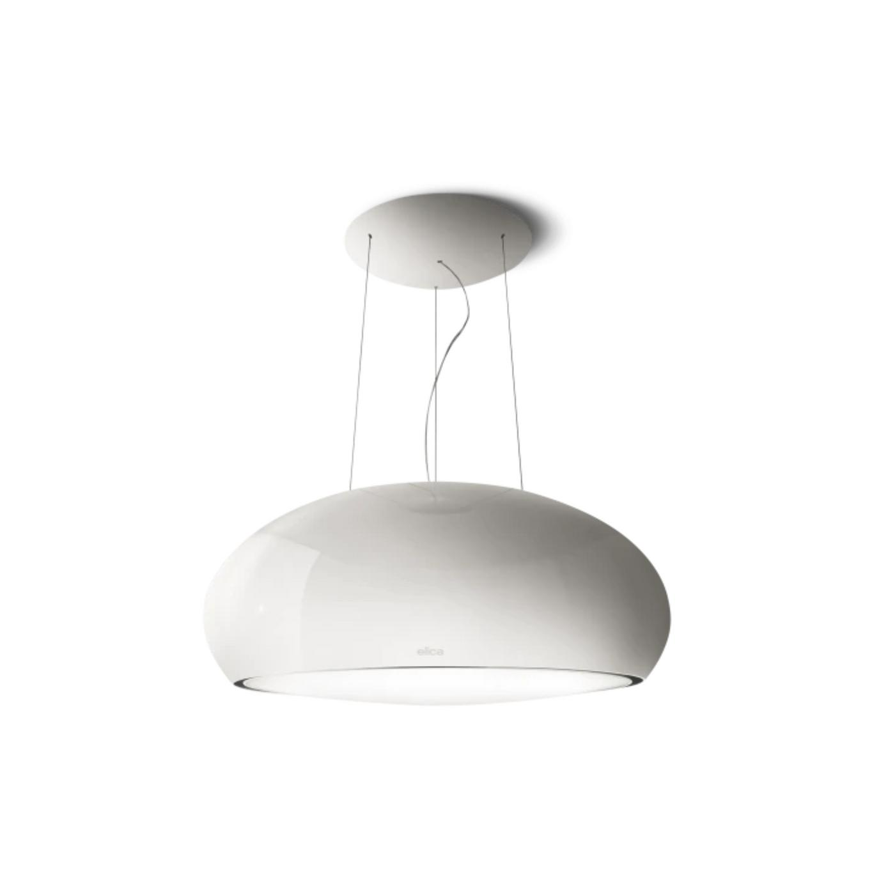

*图：Seashell 珍珠白悬挂椭圆吊灯烟机——"一台烟机，一盏灯，一个贝壳"。图源：[Cuisissimo 产品页](https://www.cuisissimo.com/)。*

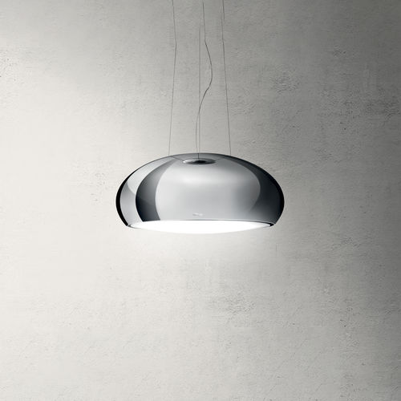

*图：Seashell 镜面不锈钢悬挂款——吊灯烟机的金属反射版本。图源：[Archiexpo 产品页](https://www.archiexpo.cn/prod/elica/product-9829-2530128.html)。*

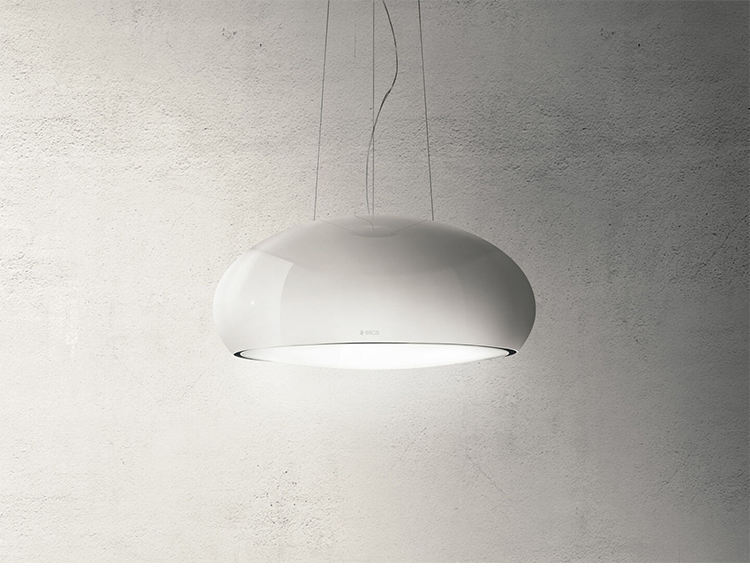

*图：Seashell 白色悬挂烟机于灰墙岛台场景——贝壳形壳体成为厨房视觉焦点。图源：[经销商产品页](https://www.deyeehome.com/mobile/goods.php?goodsid=45606)。*

### Nuage：让烟机隐入墙面

Nuage（法语"云"）是曲面壁挂式烟机，属于 Fabrizio Crisà 主导的"墙面一体化"探索：柔和弧面贴墙而立，提供可换彩色面板，并有混凝土质感背板版本——官方经销商资料称其背板可贴石膏或涂料，让烟机与墙面融为一体。它把 OM 开创的"贴墙"逻辑从垂直画框推进到曲面雕塑，是 2010 年代 Elica 墙面烟机从"设备"转向"墙面元素"的代表。

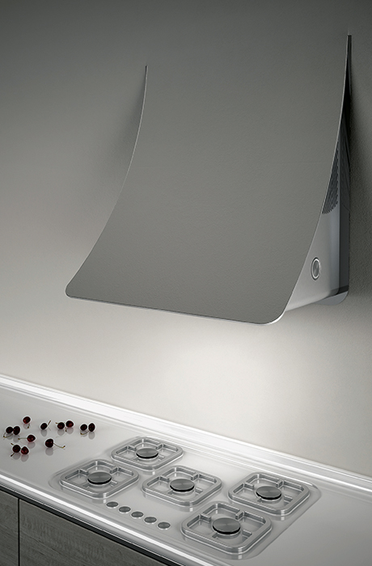

*图：Nuage 曲面壁挂烟机（白灰背板场景）——弧形面板贴墙而立。图源：[appliancist 产品页](https://appliancist.com/cooking/hoods_vents/elica-nuage-wall-range-hood.html)。*

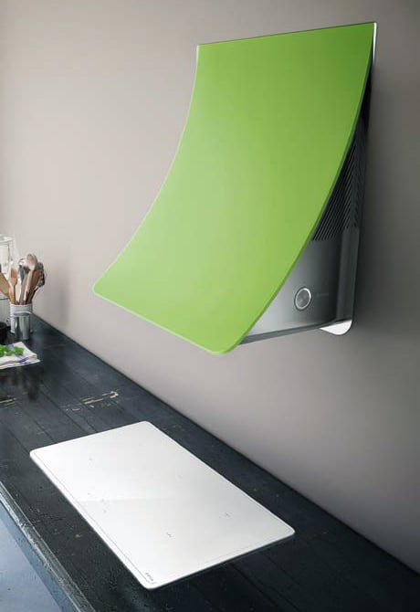

*图：Nuage 绿色可换面板款——曲面形态以色彩融入厨房。图源：[appliancist 产品页](https://appliancist.com/cooking/hoods_vents/elica-nuage-wall-range-hood.html)。*

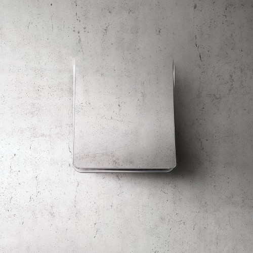

*图：Nuage 混凝土质感背板款——可贴石膏或涂料，烟机与墙面同质融合。图源：[香港经销商产品页](https://hkele.com.hk/en/%E5%BB%8A%E6%88%BF%E9%9B%BB%E5%99%A8-Cooking/%E6%8A%BD%E6%B2%B9%E7%85%99%E6%A9%9F-Hoods/NUAGE)。*

### Haiku Island 与 Haiku Dry Island（2018/2021）：薄体与防冷凝

Haiku 命名取自日本俳句——官方称其"极简的文字形式、丰富的概念内容"正对应烟机的薄与深。Haiku Island 于 2018 年 EuroCucina 首发，白色 Krion 实心面材料与白色烤漆金属结合，机身仅 8 厘米薄，烟机与烟囱完美对齐形成单一棱线；提供 32–180 厘米全宽度段，其中 180 厘米中岛版仍保持全表面抽吸。3D 格栅为铸铁效果铝制，磁铁吸附并带防坠锁定。2021 年推出的 Haiku Dry Island 加装防冷凝系统——官方称它"防止恼人的水滴落到电磁炉上"，解决下吸式烟机长期被诟病的冷凝水滴锅问题。

> 术语注释：Krion——矿物基实心面材料，抗菌、100% 可回收、无孔隙易清洁，用于 Haiku 系列。

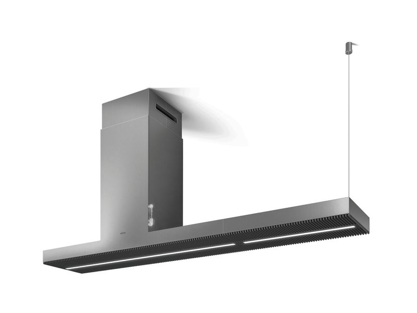

*图：Haiku Island 不锈钢岛式烟机（集成照明）——32–180 厘米全宽度段的中岛型号。图源：[Archiproducts 产品页](https://archiproducts.com/en/products/elica/stainless-steel-island-hood-with-integrated-lighting-haiku-island_711005)。*

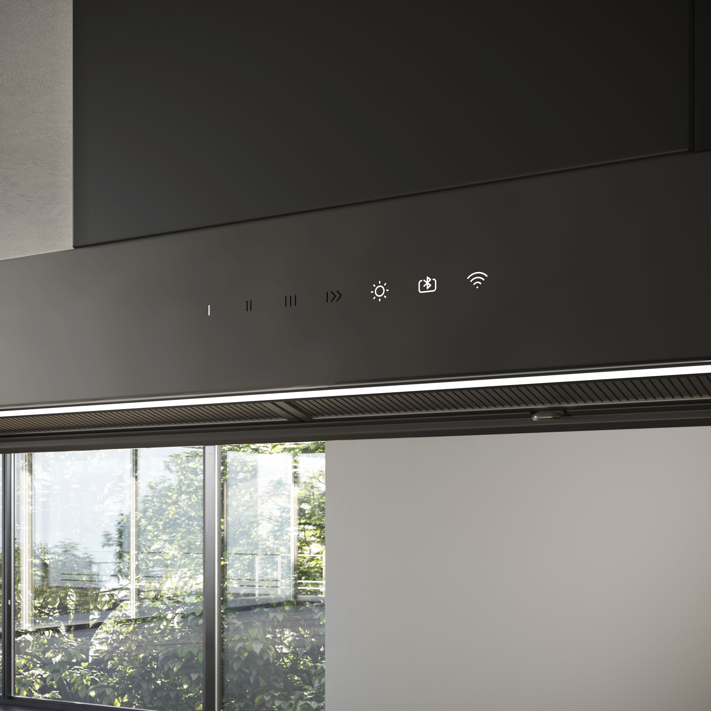

*图：Haiku Dry Island 操作面板细节——黑色薄体前缘嵌入触控界面与工作灯，安装后仍保持极薄轮廓。图源：[Elica 官方产品页](https://www.elica.com/WW-en/hoods/island/haiku-dry-island)。*

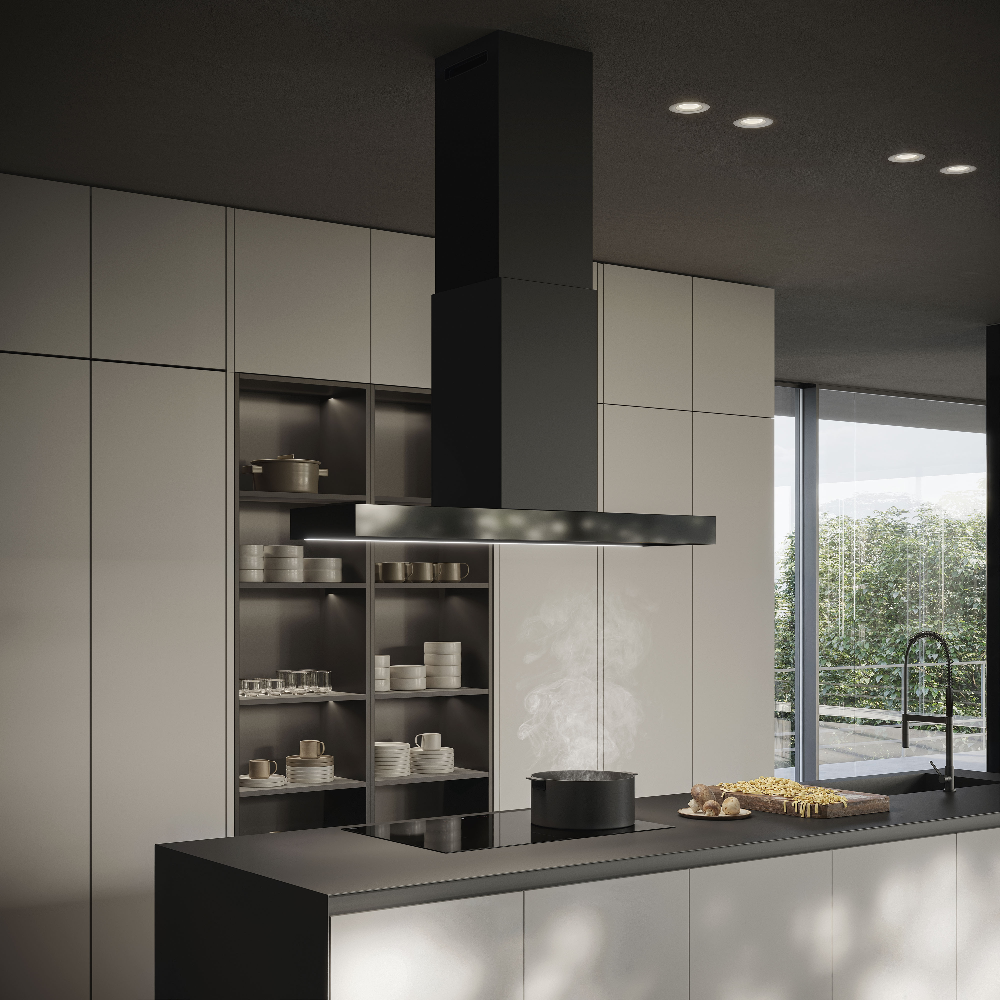

*图：Haiku Dry Island 开放厨房场景——黑色岛式机身与高柜、落地窗并列，薄体比例在空间里得到完整呈现。图源：[Elica 官方产品页](https://www.elica.com/WW-en/hoods/island/haiku-dry-island)。*

### NikolaTesla One / One HP（2016/2018）：第一座金圆规

2016 年上市的 NikolaTesla 系列是 Elica 第一台把电磁灶与吸风系统整合在同一台面的吸风灶（extractor hob）——中央风机嵌入台面中心，近吸下排，省去顶部烟机；吸风与电磁灶区联动，根据烹饪区数量与功率自动调节吸力。产品名致敬尼古拉·特斯拉——官方称这不仅向这位革命性发明家致敬，也指向这些电器背后的概念。One HP 获第 25 届 ADI Compasso d'Oro（2018），是 Elica 集团历史上第一座金圆规奖；官方产品页标注"Class A++"与 Direct Slider 直滑触控界面，提供外排与内循环双模式。2020 年扩展的 Prime S 顶视图可见吸排缝与电磁炉区并置的台面布局。

> 术语注释：extractor hob——电磁炉台面内集成下吸排烟系统的一体灶，NikolaTesla 开创的品类。
> 术语注释：Direct Slider——NikolaTesla 系列的直滑触控交互界面，直观控制各烹饪与排烟区。

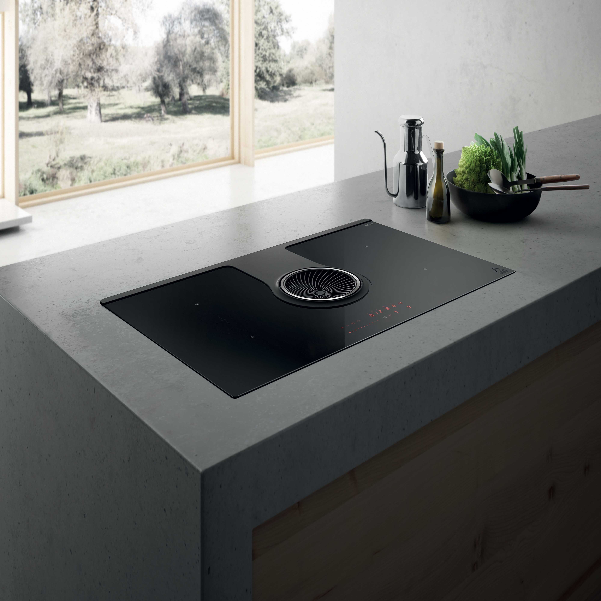

*图：NikolaTesla One 厨房台面实景——灰色石材台面嵌入黑色集成灶，圆形风机组件与触控界面清晰可见。图源：[Elica 官方产品页](https://www.elica.com/IT-en/hobs/extractor/nikolatesla-one)。*

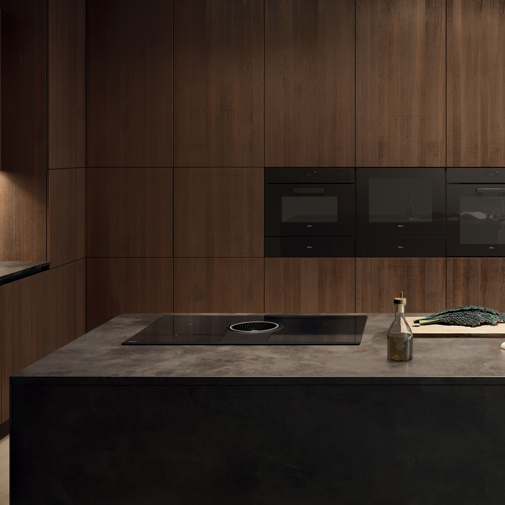

*图：NikolaTesla One 厨房安装实景——深木纹橱柜与嵌入式黑色厨电一体，顶部不再悬挂烟机。图源：[Elica 官方产品页](https://www.elica.com/IT-en/hobs/extractor/nikolatesla-one)。*

### NikolaTesla Switch（2018）：看不见的吸芯

Switch 与 One 同期发布，官方称其为"第一台吸芯完全隐形、一个开关即可启动"的吸风灶——吸排机构完全藏入台面，表面只留一个旋盖式开关。官方把它作为"设计驯服技术"的样本：吸力被做成"开启时出现、关合时消失"的台面细节。英国渠道 2026-10-26 实查挂价 £3,099–£3,249，是 extractor hob 品类中的高端走量型号。

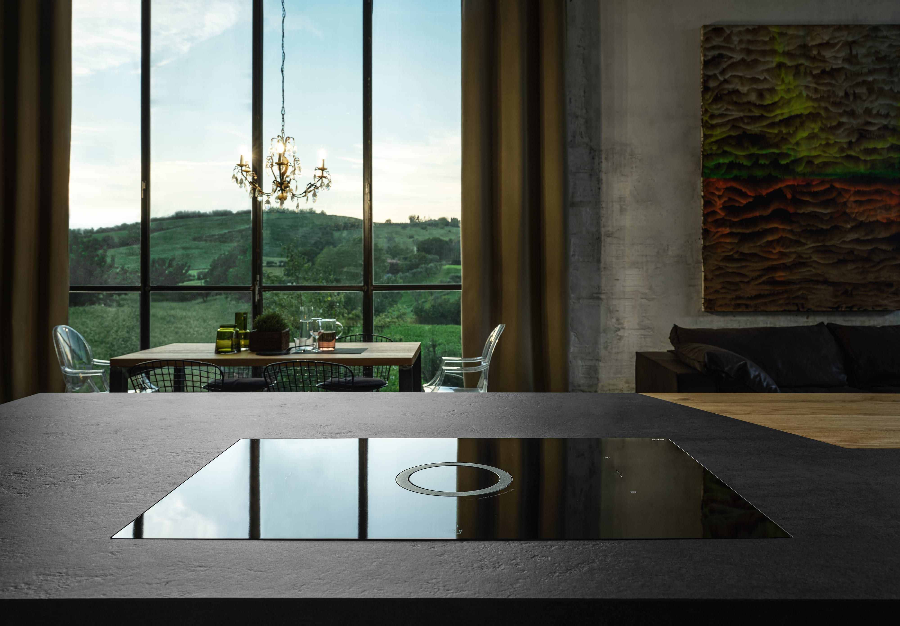

*图：NikolaTesla Switch 开放厨房安装场景——黑色台面与大面积落地窗并置，吸芯在不工作时完全隐入台面。图源：[Elica 官方产品页](https://www.elica.com/CA-en/cooktops/downdraft/nikolatesla-switch)。*

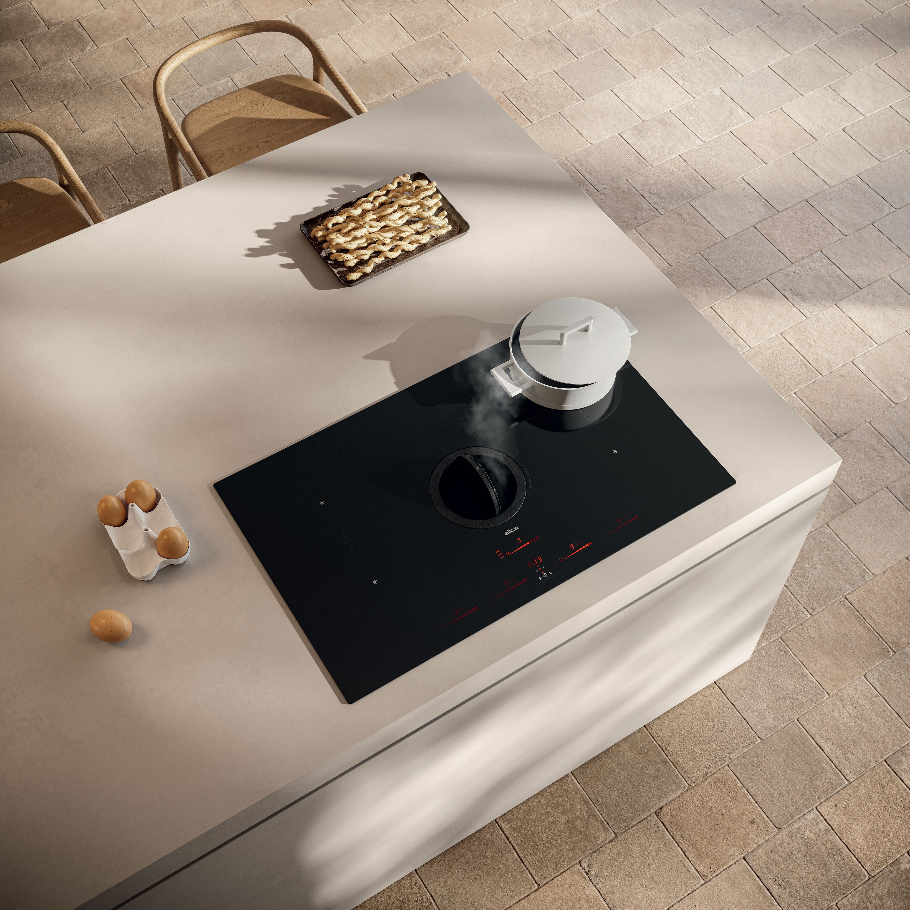

*图：NikolaTesla Switch 主视觉——吸芯隐形、旋盖启动的台面。图源：[Elica 官方产品页](https://www.elica.com/CA-en/cooktops/downdraft/nikolatesla-switch)。*

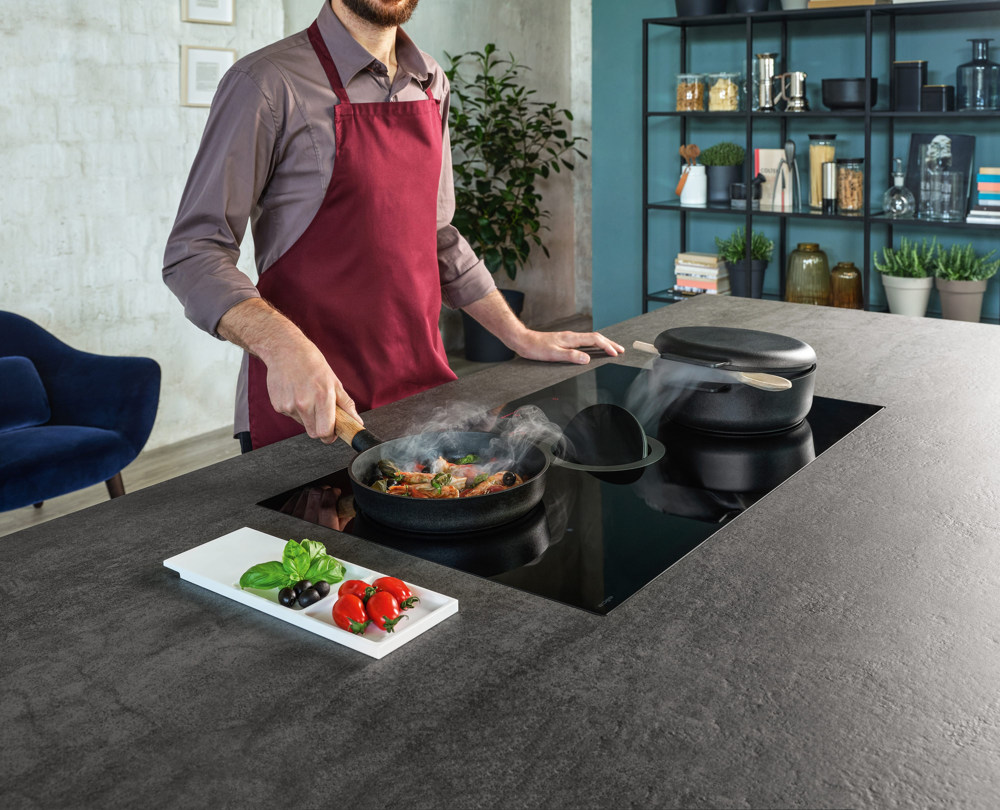

*图：NikolaTesla Switch 画廊场景——关合状态下的齐平台面。图源：[Elica 官方产品页](https://www.elica.com/CA-en/cooktops/downdraft/nikolatesla-switch)。*

### NikolaTesla Fit（2020）：六十厘米的入口

Fit 于 2020 年推出，官方意大利价目册称其为"仅 60 厘米宽的吸风灶"——把下吸品类压缩到紧凑台面，让小厨房也能进入 extractor hob 市场。Fit 与规则款（Rules）同代发布，是 NikolaTesla 家族向大众价位与小型厨房下探的关键型号，顶视图可见其把排烟缝、炉头与触控压缩进 60 厘米宽度内的布局。

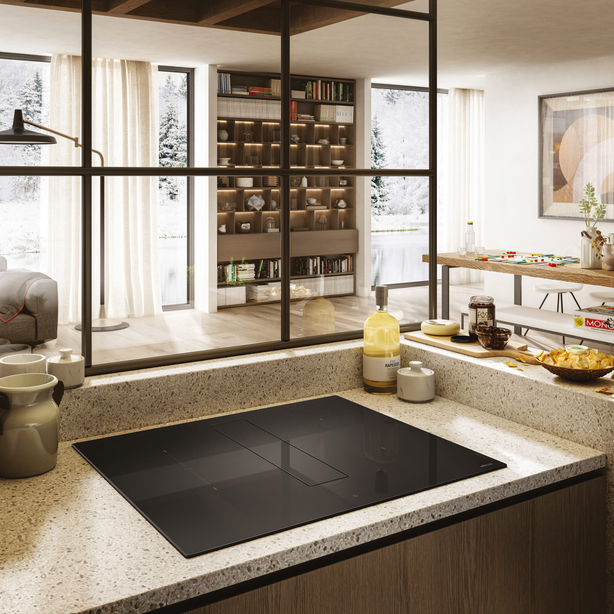

*图：NikolaTesla Fit 紧凑厨房场景——黑色吸风灶嵌入浅色台面，排烟与烹饪区集中在有限宽度内。图源：[Elica 官方产品页](https://www.elica.com/IT-en/hobs/extractor/nikolatesla-fit)。*

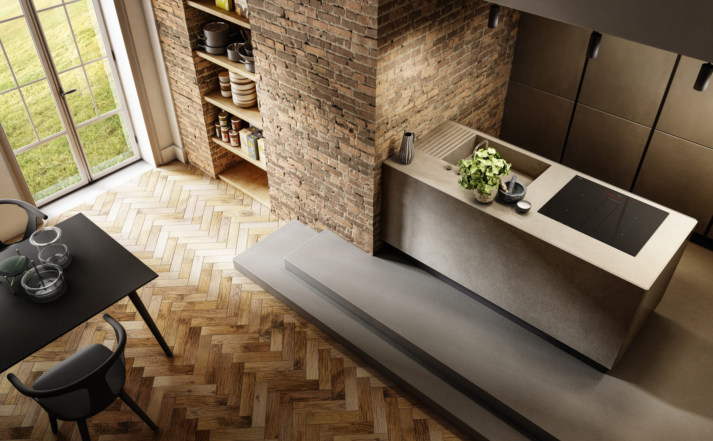

*图：NikolaTesla Fit 60 厘米画廊图——紧凑台面与日常锅具的使用场景。图源：[Elica 官方产品页](https://www.elica.com/IT-en/hobs/extractor/nikolatesla-fit)。*

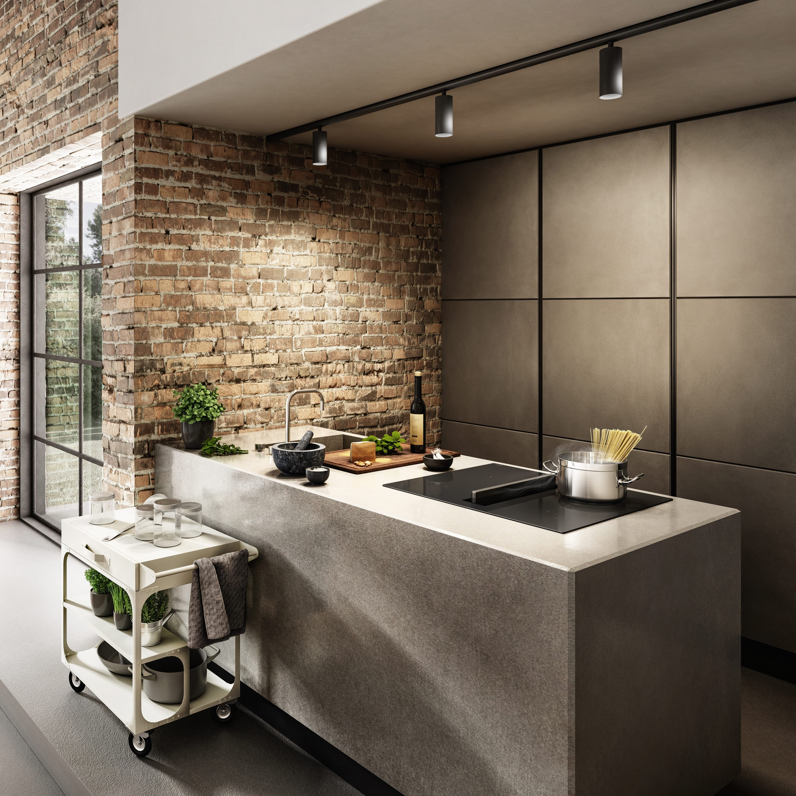

*图：NikolaTesla Fit 房间实景——小厨房台面的一体化安装。图源：[Elica 官方产品页](https://www.elica.com/IT-en/hobs/extractor/nikolatesla-fit)。*

### NikolaTesla Unplugged（2021）：模拟旋钮的回潮

Unplugged 是 NikolaTesla 家族中方向性最鲜明的一款——在触控主导的品类里反向选择物理旋钮，官方称之为"模拟的超能力"（the superpowers of analog）：click-release 旋钮让调节回归直接的触觉反馈。它证明 Elica 在"隐形与智能"的主流叙事之外，同样把"可触的直觉操作"作为设计价值。黑色玻璃台面与旋钮并置，是其界面语言的核心。

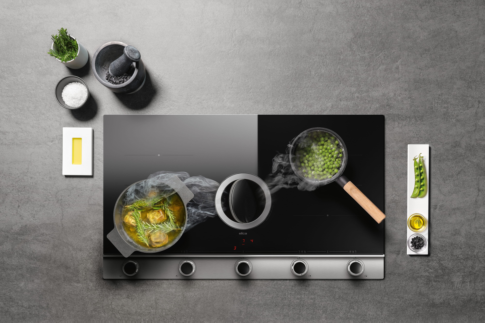

*图：NikolaTesla Unplugged 台面细节——锅具、食材与物理旋钮同时出现在灰色石材台面上，实际使用状态比顶视图更容易读懂旋钮的位置与触感。图源：[Elica 官方产品页](https://www.elica.com/BA-en/hobs/extractor/nikolatesla-unplugged)。*

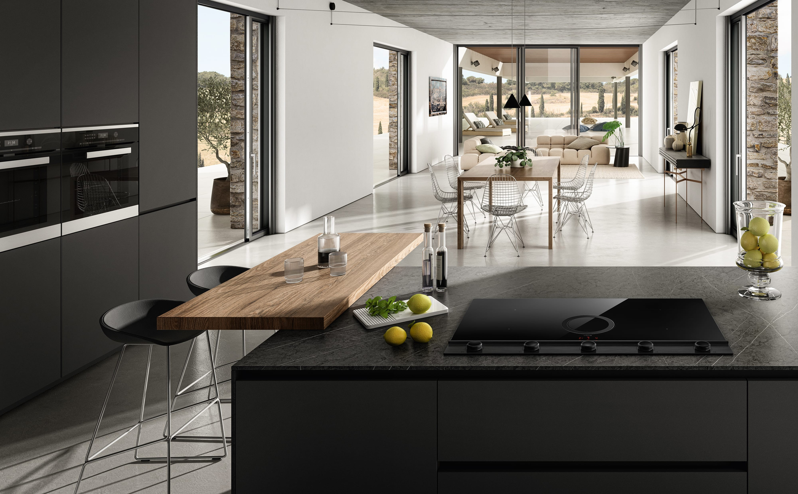

*图：Unplugged 黑色画廊图——旋钮与玻璃台面的材质对比。图源：[Elica 官方产品页](https://www.elica.com/BA-en/hobs/extractor/nikolatesla-unplugged)。*

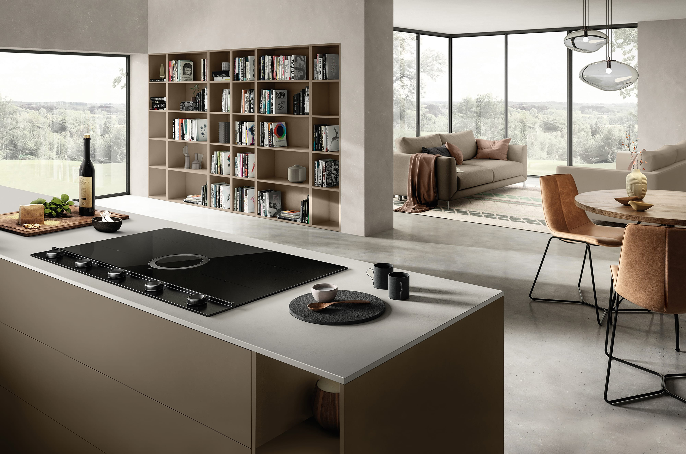

*图：Unplugged 房间实景——开放式厨房中的一体化台面。图源：[Elica 官方产品页](https://www.elica.com/BA-en/hobs/extractor/nikolatesla-unplugged)。*

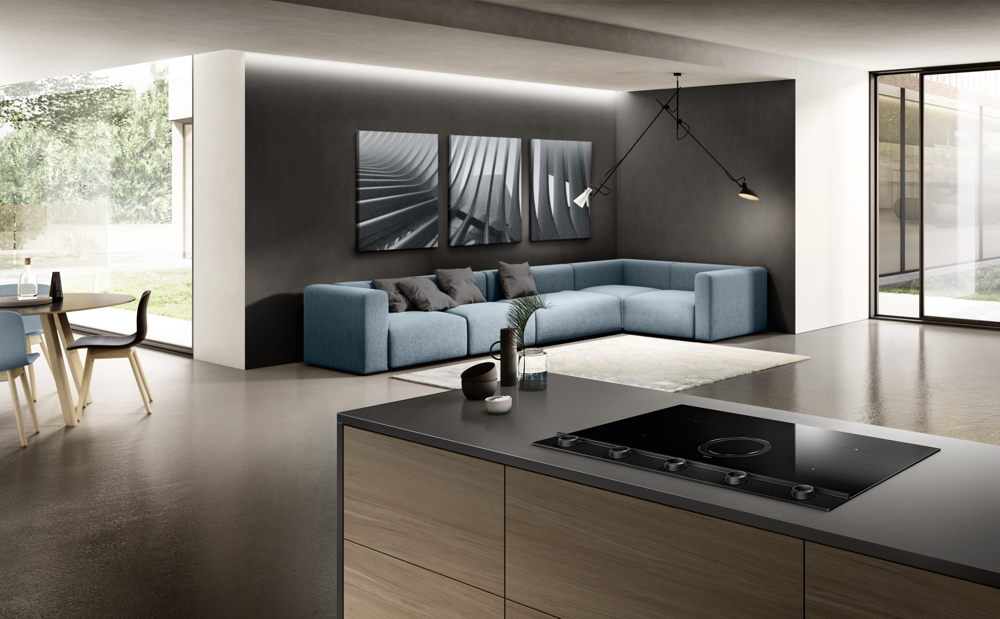

*图：Unplugged 另一房间实景——旋钮操作状态。图源：[Elica 官方产品页](https://www.elica.com/BA-en/hobs/extractor/nikolatesla-unplugged)。*

### Lhov（2022/2024）：烤箱、灶与烟机的合一

Lhov（L'Hood＋Oven 缩合）是市场上第一台把电磁灶、烟机、烤箱集成在单一设备内的 All-in-One 厨电：2022 年 6 月正式发布，2024 年 6 月铺货，同年 6 月 20 日获第 28 届 ADI Compasso d'Oro，是 Elica 第二座金圆规奖，颁奖前已累计 13 项国际设计奖。它的核心工程决定有三：黑玻璃表面无旋钮无把手、烤箱门轻触即开，交互如智能手机；抽排系统首次同时抽取灶面油烟与烤箱内蒸汽与气味；烤箱内腔比标准大 30%，可并排放两个煎锅，五区可组合感应炉头。唯一标准尺寸 90×36 厘米与橱柜齐平。首席设计官 Fabrizio Crisà 自述设计源于"某个灵感之夜，所有拼图都拼合起来……Elica 带着一点疯狂与胆量，纵身一跃"；董事长 Francesco Casoli 称，十年内两度以同一设计师的内部作品赢得金圆规，"是对我们理念、态度与愿景延续性的确认"。2026-10-26 实查意大利经销商 listino 标价 €7,300（型号 LHOV COMBISTEAM BL/A/90）。

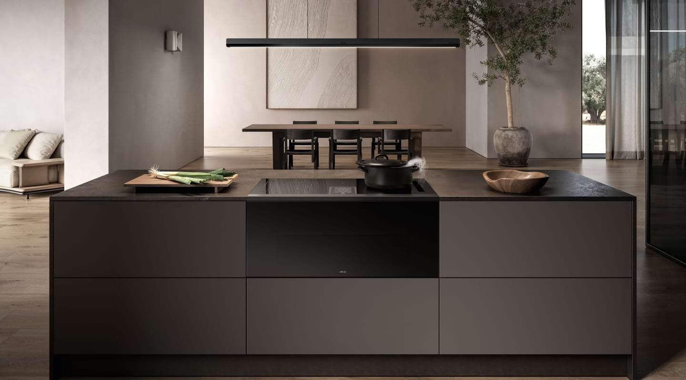

*图：Lhov 主视觉——黑色单体嵌入中岛台面，与橱柜台面齐平。图源：[Elica 官方产品页](https://www.elica.com/GE-ru/lhov)。*

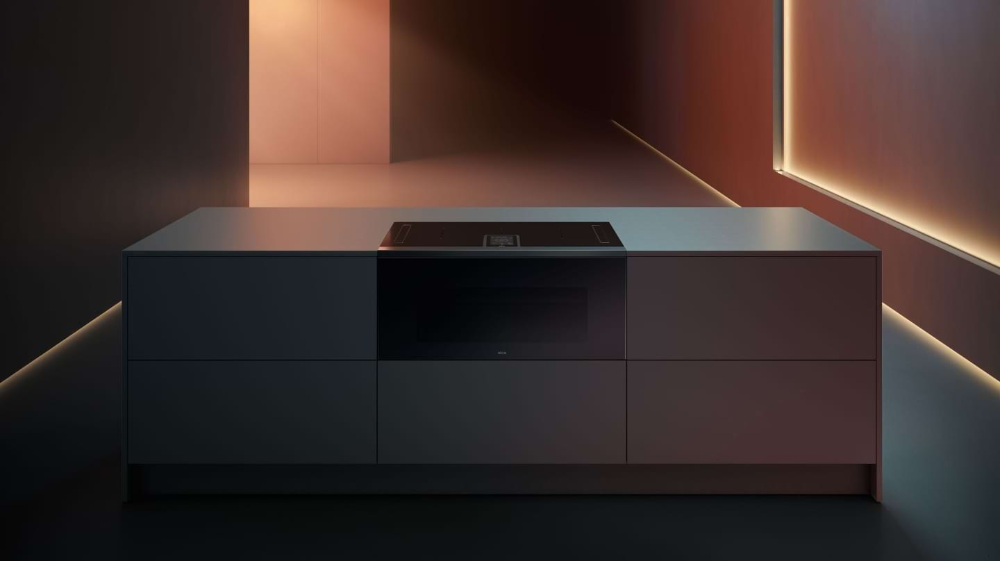

*图：Lhov 集成柜体形态——黑玻璃单体与哑光柜体融为一体，顶部为触控操作区。图源：[Elica 官方产品页](https://www.elica.com/GE-ru/lhov)。*

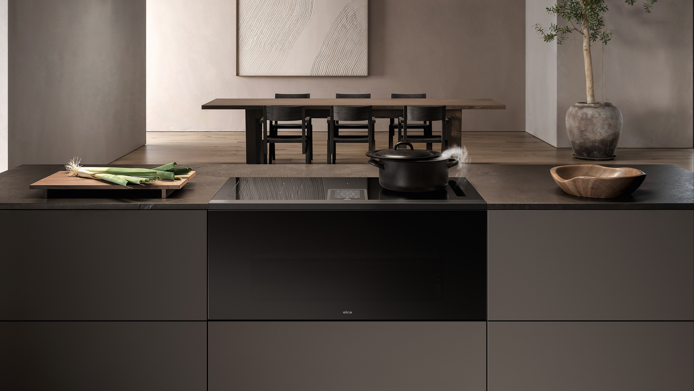

*图：Lhov 厨房与餐厅一体空间实景——深灰台面嵌入 Lhov 单体，汤锅冒汽，呈现烹饪中的日常场景。图源：[Elica 官方杂志页](https://www.elica.com/IT-en/magazine/in-evidence/fabrizio-crisa-brings-home-a-second-compasso-doro-award)。*

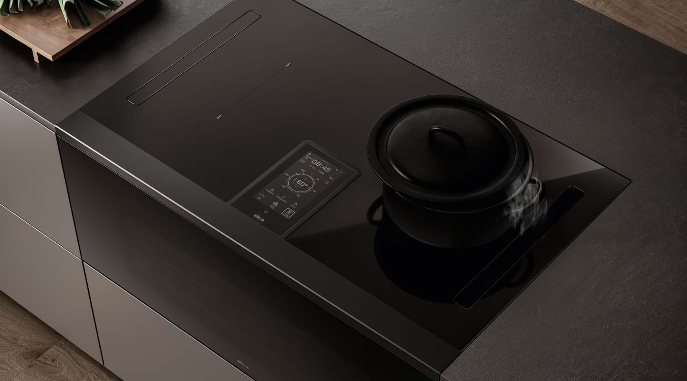

*图：Lhov 灶台上方视角——五区可组合感应炉头。图源：[Elica 官方产品页](https://www.elica.com/GE-ru/lhov)。*

*图：Lhov 烤箱腔特写——内腔比标准大 30%，可并排放两个煎锅。图源：[Elica 官方产品页](https://www.elica.com/GE-ru/lhov)。*

### Ikona Maxxi Pure（2022）：烟机也是空气净化器

Ikona Maxxi Pure 于 2022 年进入价目册，官方产品页写道："烟机与空气净化器，终于合二为一。这台电器全天处理家中空气，缓解过敏症状。"核心是 Combo Pure Filter——HEPA 加活性炭复合滤芯，可捕获 1 微米颗粒；烟机模块与净化模块分离、独立工作；"Super Silent"模式下噪声近乎不可闻，适合整日后台运行。它是 Elica 从"排烟"向"全天候空气管理"品类延伸的代表，也把品牌与过敏、健康人群的需求直接连接。

> 术语注释：Combo Pure Filter——Elica 的 HEPA+活性炭复合滤芯，可捕获 1 微米颗粒。

*图：Ikona Maxxi Pure 三分之四厨房场景——黑色岛式烟机悬在台面上方，空气净化模块从中岛一侧显露。图源：[Elica 官方产品页](https://www.elica.com/MD-en/ikona-maxxi-pure)。*

*图：Ikona Maxxi Pure 开放厨房全景——烟机、岛台与客厅共享同一开阔空间，展示全天候空气管理的使用背景。图源：[Elica 官方产品页](https://www.elica.com/MD-en/ikona-maxxi-pure)。*

*图：Ikona Maxxi Pure 房间实景——全天候空气管理的客厅化场景。图源：[Elica 官方产品页](https://www.elica.com/MD-en/ikona-maxxi-pure)。*

### Boxin Advance（约 2020 年代）：藏在柜内的自动烟机

Boxin Advance 是完全藏入吊柜的嵌入式烟机：前挡板可自动开启 45°，传感器检测到烹饪即自动开机并按油烟量调节档位；Dry 版加装防冷凝、空气质量监测与联网功能。它代表 Elica"隐形烟机＋智能传感"路线的极致——机器不再以"罩"的形式出现在灶台上方，而是从柜体开口处"探出"挡板完成吸排。

*图：Boxin Advance 开启细节——前挡板从吊柜下缘自动翻出，吸烟口与滤网随挡板一同显露。图源：[Elica 官方产品页](https://www.elica.com/MK-en/hoods/integrated/boxin-advance)。*

*图：Boxin Advance 烹饪场景——水汽进入柜下吸烟口时，烟机仍保持贴齐吊柜的嵌入状态。图源：[Elica 官方产品页](https://www.elica.com/MK-en/hoods/integrated/boxin-advance)。*

*图：Boxin Advance 安装场景——橱柜吊柜内嵌一体。图源：[Elica 官方产品页](https://www.elica.com/MK-en/hoods/integrated/boxin-advance)。*

### Cloud Seven（2020）：天花板上的云

Cloud Seven 是吊顶式（ceiling）烟机：不锈钢薄板悬挂于天花，如一片云悬浮在岛台上方，从上方收集油烟，同时把台面视觉完全留白。吊顶式是 Elica 六种安装形态中空间成本最高的一种，适合开放式中岛与无吊柜的高挑厨房，官方提供 90 厘米规格与房间实景配套呈现。

*图：Cloud Seven 开放厨房场景——不锈钢薄板贴近天花安装，岛台与灶具上方不再出现传统烟机立面。图源：[Elica 官方产品页](https://www.elica.com/IT-en/hoods/ceiling/cloud-seven)。*

*图：Cloud Seven 房间实景——开放式中岛上方无吊柜的安装方式。图源：[Elica 官方产品页](https://www.elica.com/IT-en/hoods/ceiling/cloud-seven)。*

### AriaChef Pro（2021/2025）：会走路的厨房

AriaChef Pro 是移动式单体烹饪系统：把室内循环烟机与 IH 电磁灶集成在一台推车上，无需排烟管道，可在室内任意位置使用。2021 年 11 月由日本高端品牌 Ariafina 与富士工业（Fujioh）合作发售；2025 年 9 月获 Compasso d'Oro International Award（ADI 在大阪世博会意大利馆颁发），是 Elica 集团第三座金圆规奖，同届 Lhov 获荣誉提名。首席设计官 Crisà 对它的定位是"把人拉近、走出专业厨房、成为 live cooking 秀的主角"——专业级火力与易运输性结合，服务餐厅现场烹饪与家庭社交场景。

*图：AriaChef Pro 移动烹饪+下吸系统——2025 年大阪世博会金圆规国际奖颁奖现场图。图源：[Elica 集团新闻稿](https://corporate.elica.com/en/media/elica-group-wins-third-compasso-d-oro-and-honourable-mention-at-expo-osaka)。*

*图：AriaChef Pro 场景图——live cooking 现场烹饪演示。图源：[Elica 集团新闻稿](https://corporate.elica.com/en/media/elica-group-wins-third-compasso-d-oro-and-honourable-mention-at-expo-osaka)。*

## 08 Aesthetics 美学：黑玻璃、实心面与吊灯

### 视觉识别与字标演进

Elica 的视觉识别以 2024 年的"Born Extraordinary"品牌重塑为最新节点，官方字标为小写无衬线体（2024 年 Landor 版本），企业年报同期的口号为"Together, Beyond"。字标演变线从 1970 年代的大写字标一路简化，五版更迭记录了一家区域制造商向设计品牌转型的视觉轨迹。视觉体系的底色是黑色玻璃与不锈钢灰，展位、印刷物与产品页共享同一套深色基调。

*图：Elica 字标年代线——1970 年代至 2024 年的五版字标演变，含创始人早期照片。图源：[rologo 品牌档案](https://www.rologo.com/y-j-w-y-y-d-l-d-c-f-d-q-g-s-e-f-b-d-x-b-s.html)。*

### 形态语言：线性、超薄与齐平

当代 Elica 的形态语言以"线性、超薄、与橱柜齐平"为主导。Lhov 官方描述为"超级线性的黑色玻璃设计，与厨房柜体完全齐平"；Haiku 系列以 32 厘米窄条为基本模数，墙面款 32/60/90/120 厘米，岛式款 32×32、120×32、180×32 厘米；Thin 把经典 T 形烟囱压到超薄机身。

### 色彩体系与材料

色彩体系以黑色玻璃、白色玻璃、不锈钢为三大基底，点缀色为抛光不锈钢与彩色灯条（Mini OM 苹果绿、Nuage 绿面板、Bubble 三色）。材料上有两条特色线：实心面材料线——Cristalplant（Ye 首次用于烟机，官方称其"柔软线条与天鹅绒触感"）与 Krion（Haiku 白色生态材料，抗菌可回收）；玻璃+金属线——黑晶面板统领旗舰（Lhov、NikolaTesla 全系、Haiku 主色），Serendipity 等墙面款标注"不锈钢+玻璃"。

### 吊灯式谱系：从 Star 到 Interstellar

吊灯式是 Elica 美学最独特的谱系：2005 年 Star 开创"会换气的吊灯"，2015 年 Édith 圆穹、Juno 50 厘米小型款与 Seashell 贝壳形延续柔形路线，Interstellar 则以镜面抛光钢与 1152 块玻璃棱镜把吊灯烟机推向高定灯具——官方称之为"房间里的天空"。这一谱系把烟机的身份从厨房设备改写为悬挂式灯具，是"给空气以形式"最直观的美学兑现。

*图：Juno 黑色 50 厘米吊灯式悬挂烟机官方未编辑产品图——面向小中岛与吧台的小型吊灯款。图源：[Elica 官方产品页](https://www.elica.com/IT-en/hoods/island/juno)。*

*图：Juno 底部照明与滤网细节——灯带、金属格栅与黑色罩体在仰视角度下形成一个完整的灯具底盘。图源：[Elica 官方产品页](https://www.elica.com/IT-en/hoods/island/juno)。*

### 光与空间氛围

烟机同时承担厨房主照明是 Elica 的设计惯例：Edith 的 LED 照明被评审视为"为中岛带来幸福感氛围"，Lhov 的智能控制界面把灯光、炉头与吸力收敛进一块触控屏。烟机在 Elica 体系里不只是排烟设备，还是厨房的光源、空间的焦点与氛围的制造者。

*图：Lhov 智能控制界面——灯光、炉头与吸力收敛于一块触控屏。图源：[Elica 官方产品页](https://www.elica.com/GE-ru/lhov)。*

## 09 Design 设计：给空气以形式

### 设计哲学与首席设计官

Elica 官方对设计的定义是"一种赋予空气以形式的设计，把厨房里的每一刻转化为建筑感、审美感与功能感兼备的体验"（A design that gives shape to air）。设计同时被描述为"激发与向往"（Inspire, Aspire）的双重动作——向外研究艺术、文化、社会趋势与生活方式，向内捕捉油烟、送出洁净空气、控制蒸汽、去除冷凝、发明功能、降低能耗、把家电与人互联。首席设计官 Fabrizio Crisà（1973 年生，罗马 La Sapienza 工业设计硕士，2005 年加入）是 2005 年后几乎全部标志产品的署名设计师，其设计观原话收录于官方杂志《The Square》："设计是技术富于共情与体贴的表达；它必须让技术人人可及，让技术性感、迷人，把它驯服得不再吓人。""一件产品必须因其所是、其所做而令人兴奋，但更要因其如何做而令人兴奋。"他的方法论是"观察人而非陈列技术"——Lhov 诞生于"观察厨房里的人如何走动、需要什么"，判断依据是"今天家里真正的 living 是厨房，是社交与分享场所、家的真正心脏"。

> 术语注释：Fabrizio Crisà——Elica 首席设计官，1973 年生于罗马，2005 年加入，NikolaTesla/Lhov/AriaChef Pro 等署名设计。

### 制造与工艺：法布里亚诺的钣金体系

集团总部与主厂位于法布里亚诺 Via Ermanno Casoli 2，自称 2,600 名员工、7 座生产基地分布于意大利、波兰、墨西哥与中国，官方产品手册口径为"每年从烟机到马达共 2,070 万件"。1995 年大火后重建的主厂以钣金成形、表面处理与总装为核心：Trumpf 折弯机加工烟机外壳，表面处理线完成抛光与精整，铝制油脂滤网可洗碗机清洗、活性炭滤网可再生。质量体系为 ISO 9001（质量）、ISO 14001（环境）、ISO 45001（职业健康）三体系认证，2021 年非财务报告披露 6/6 工厂 100% 通过 ISO 14001:2015。意大利境内 3 座光伏电站支撑 100% 可再生电力，2023 年起按 ISO 14064-1 方法学完成组织级温室气体盘查。

*图：Fabriano 工厂钣金成形——Trumpf 折弯机加工烟机外壳。图源：[designboom 工厂探访](https://www.designboom.com/design/elica-factory-visit/)。*

*图：Fabriano 工厂表面处理——工人抛光精整烟机罩壳。图源：[designboom 工厂探访](https://www.designboom.com/design/elica-factory-visit/)。*

### 马达心脏：FIME 与 EMC FIME

2001 年控股 FIME 是集团垂直整合的决定性一步，把油烟机的"心脏"（马达与风机）从外购变为自制；2022 年整合为 EMC FIME 电机板块，约占集团收入四分之一。马达技术路线为 BLDC（无刷直流）与 EC（电子换向）高节能电机，并布局可兼容氢能的电机，服务供暖与通风市场的能源转型——这是集团把电机部门定位为"支持能源转型"的具体落点，也是 Elica 与纯烟机品牌最重要的结构差异。

> 术语注释：EMC FIME——Elica 集团电机事业部品牌，总部 Castelfidardo，2022 年整合成立，发展高效与氢能兼容电机。

### 吸力与安静的量化平衡

官方在"吸力 vs 安静"之间给出的量化区间以旗舰 NikolaTesla One HP 为准：吸气速度 5.1 m/s，外排模式 boost 风量 620 m³/h、噪声 35–67 dB(A)；内循环模式噪声 38–71 dB(A)。最低档 35 dB(A) 接近图书馆环境音，最高档如实披露偏吵——官方没有用宣传语软化数值，这也是品牌"技术诚实"的一部分。Airmatic 智能传感是吸力自动化的核心：能区分油烟质量与烹饪类型，并与开启的炉头数量及功率联动，关火后系统自动渐弱排风、抽走残余油烟。

> 术语注释：Airmatic——Elica 的智能油烟传感器，可区分油烟质量与烹饪类型并自动调节风量。

### 人机界面代际与专利交互

Elica 的操作界面经历了四代演进：经典线 3S+B 触控（Serendipity 等型号标注）；NikolaTesla 的 Direct Slider 直滑触控；Unplugged 反向选择的物理旋钮；以及 Magic Wand 专利杆控——一根细长杆，触上半段调吸力、触下半段调照明，多色 LED 指示状态，官方列为 Elica 独家专利。Alba 壁挂烟机即配 Magic Wand 遥控。互联层由 Elica Connect App 承载：可开关机、调吸力、调灯光颜色与强度，支持 Alexa 与 Google Home 语音助手，烟机与 Elica 电磁炉可经蓝牙联动实现"开炉自动开机"，App 内按周期推送滤网状态并直连售后，兼容滤网可一键下单。

*图：Alba 金字塔形壁挂玻璃烟机——配 Magic Wand 专利杆控的型号。图源：[appliancist 产品页](https://appliancist.com/cooking/hoods_vents/elica-ventilation-hoods-new-gorgeous-designs.html)。*

### 齐平安装与厨房一体化

Lhov 的"超级线性、与橱柜齐平"是 2020 年代 Elica 安装美学的终点形态：黑玻璃单机嵌入柜体，无旋钮无把手，烤箱门轻触即开。这一安装方式要求产品与橱柜在尺寸、公差与散热上一体设计，也是 Elica 从"卖单机"转向"参与厨房整体设计"的能力证明。

*图：Lhov 单机黑玻璃齐平安装——与橱柜柜面一体化的终点形态。图源：[Elica 官方产品页](https://www.elica.com/GE-ru/lhov)。*

## 10 Experience 体验：艺术、展会与数字触点

### 体验观：厨房是家的 living 空间

官方设计页把厨房定义为"家的真正 living 空间"，Elica 的任务是"让烹饪变得非凡"（cooking becomes extraordinary）。董事长 Francesco Casoli 在 2025 年大阪颁奖礼上的话把这一体验观落到市场维度："最真实的奖项来自市场；因此这个荣誉不仅是荣誉，更是客户信任的有力信号……我们在全球最先进、最苛刻的竞技场之一有效回应了需求。"

### 机制一：艺术介入职场

1997 年设立的 Ermanno Casoli Award 与 2007 年成立的 Fondazione Ermanno Casoli 让当代艺术家进入 EMC FIME 工厂创作 site-specific 作品，员工与家属共同参与，作品收入 Elica Corporate Collection。2026 年第 24 届得主 Arianna Pace 在 Castelfidardo 工厂完成《Avere fame di vento》（渴望风）。官方把 FEC 称为"意大利企业培训的典范"——艺术体验的接受者首先是员工，再经由作品与展览向公众扩散，这是品牌体验在制造端的延伸。

> 术语注释：Fondazione Ermanno Casoli——2007 年成立的 Elica 企业艺术基金会，推动艺术家驻厂创作与员工艺术参与。

### 机制二：展会展陈

Elica 在米兰 EuroCucina 展持续以展位空间输出品牌叙事：2016 年展位由 Labics 设计，以人像墙装置呈现"人"的主题；2024 年起由米兰事务所 Calvi Brambilla 设计，2026 年展位逾 600 平方米，主题"Where Cooking has no borders"（烹饪无界），并同期发布首条自有 induction 技术线 ID Technology。展位本身即"设计领导地位"的现场证据——空间与产品共享同一套深色玻璃与金属语言。

*图：EuroCucina 2024 Elica 展位外观——Calvi Brambilla 设计的金属格栅框架。图源：[design-hbo 展位报道](https://www.design-hbo.com/archives/12108)。*

### 机制三：渠道与数字触点

渠道端走全球经销商网络，官网提供 store finder；2025 年 6 月 30 日在荷兰 Haren 开设首个荷兰子公司与展厅，由意大利展陈公司 Xilografia 设计。数字端由 Elica Connect App 承载：滤网监测、语音助手、蓝牙炉机联动、售后直通，线上电商在多国站点直售。

### 兑现与断裂

正面证据密度高：三届 Compasso d'Oro（2018/2024/2025）加 4 次荣誉提名、10 次 ADI Design Index、15 Red Dot、18 iF、22 Good Design、21 IDA；2024 年被列入意大利国家历史品牌名录。断裂与边界同样如实可见：NikolaTesla One HP 内循环最高 71 dB(A) 属偏吵区间，官方未做软化；2021–2023 年集团多次新闻稿提及"极具挑战的市场"与"市场需求持续下滑"，说明高端设计溢价在欧洲厨电下行周期中承压。

## 11 Competition 竞品：吸风灶与烟机的双层赛道

### 品牌归属与多品牌矩阵

Elica 集团的品牌矩阵覆盖多层市场：自有品牌 Elica 面向设计驱动的高端；Gutmann（2008 年并入）面向德式严谨的高端厨房工程；Ariafina 面向日本高端市场；Arietta 与"普田"面向大众与中国渠道；EMC FIME 面向 B 端电机。这种"意大利设计品牌＋德式工程品牌＋区域渠道品牌"的组合，使集团在价格带与渠道上比单一品牌更具弹性。

### 直接竞品：独立烟机品牌

独立抽油烟机品牌是 Elica 最直接的交战面。Falmec（意大利马尔凯大区同区竞品）以"无烟囱设计"与悬浮造型见长；Faber（意大利历史品牌）在走量烟机与工程渠道有深厚根基；德国、波兰与土耳其品牌在欧洲大众价位段竞争激烈。在高端设计烟机段，Elica 的差异化来自品类发明记录（垂直、吊灯、吸风灶均为先行者）与金圆规奖的背书，Falmec/Faber 则更依赖造型原创性与渠道效率。

### 技术竞品：Bora 与吸风灶赛道

下吸式一体灶（downdraft/extractor hob）是 Elica 与 Bora 的双雄赛道。Bora 先于 Elica 推出嵌入式下吸灶并以"从源头抽走油烟"（cooktop ventilation）立身，强调无烟罩的开放厨房美学与德式工程；Elica 以 NikolaTesla 系列大规模铺开、获金圆规，并扩展到 60 厘米小尺寸与集成秤等差异化功能。两者共享"台面一体化"的品类叙事，但在材料（Bora 偏金属滤网与玻璃、Elica 黑晶玻璃与旋钮回潮）、尺寸策略与奖项叙事上分化。

> 术语注释：Falmec——意大利高端抽油烟机品牌，以无烟囱设计著称，与 Elica 同属马尔凯大区。

### 全品类大家电：BSH 与 Miele

在整体嵌入式厨房市场，Elica 面对 BSH（Bosch/Siemens/Neff）与 Miele 等全品类玩家的竞争。这些品牌的吸风灶多以"集成于自家嵌入式厨房生态"为卖点，渠道与安装服务体系更完整；Elica 的应对是把烟机品类做深做透——全形态覆盖、三合一 All-in-One、空气净化延伸，并以设计奖与艺术叙事建立品牌溢价。2025 年 28% 入股高端 range cooker 品牌 Steel Srl，则是向美加高端烹饪与户外厨房的侧翼切入。

### 差异化收束

| 维度 | Elica | 独立烟机品牌（Falmec/Faber） | 技术竞品（Bora） | 大家电（BSH/Miele） |
|---|---|---|---|---|
| 品类广度 | 烟机全形态+吸风灶+All-in-One+净化 | 烟机为主 | 下吸灶+部分烟机 | 全厨房电器 |
| 设计奖项 | 3×金圆规、15×Red Dot | 单项奖为主 | 设计奖但无金圆规 | 旗舰线奖项 |
| 技术标签 | 隐形、传感、品类首创 | 造型、风量 | 源头抽吸、德式工程 | 生态互联、渠道 |
| 价格带 | 大众到 €7,300 旗舰 | 大众到高端 | 高端 | 全段 |

## 12 Strategy 战略：从烟机到烹饪系统

### 技术路线与产品规划

集团的技术路线沿三条线展开：其一，从"烟机"扩展到"烹饪系统"——2016 年 NikolaTesla 开创吸风灶品类，2022 年 Lhov 定义三合一 All-in-One 新品类，2023 年宣布与 ILVE 战略合作扩大烹饪品类，2026 年 EuroCucina 发布自有 induction 技术线 ID Technology；其二，马达部门第二曲线——EMC FIME 走 BLDC/EC 高效电机与氢能兼容路线，服务供暖通风的能源转型，约占集团收入四分之一；其三，智能互联——Elica Connect App、蓝牙炉机联动、Airmatic 传感自动排烟自 2021 年起成为产品手册固定章节。2025 年 28% 入股 Steel Srl（高端 range cooker 与户外厨房），切入美加高端市场。

> 术语注释：ID Technology——Elica 2026 年 EuroCucina 发布的自有电磁炉（induction）技术线。

### 定位与品类路线的演进

1970–1980 年代：以第一台厨房外排烟机与 Philips 代工合同起家，1982 年与 Giugiaro 合作确立"外部大师设计"路线。1990 年代：Francesco Casoli 时代从代工转向自有设计品牌，1995 年大火后以凤凰行动重建，1998 年 Mergo 工厂投产。2000 年代：2001 年控股 FIME 垂直整合马达，2004 年第一台垂直烟机 Om，2005 年第一台吊灯烟机 Star，2006 年米兰证交所上市并开设墨西哥工厂。2010 年代：2010 年 Feel 传感烟机，2014 年 Ye 雕塑烟机，2016 年 NikolaTesla 开创吸风灶品类，2018 年凭 One HP 首获金圆规。2020 年代：2022 年 Lhov 开创 All-in-One 品类，2024 年入选国家历史品牌名录并获第二座金圆规，2025 年 AriaChef Pro 获第三座（国际奖），2026 年发布 ID Technology。

### 设计语言与材料体系演进

1980 年代金属烟囱式（Lego/Tamaya）→ 2004 年竖向贴墙 Om → 2005 年吊灯式 Star → 2007 年圆形 Space → 2010 年传感 Feel → 2014 年 Cristalplant 雕塑 Ye → 2016 年隐藏式下吸 NikolaTesla → 2024 年黑玻璃齐平 Lhov。材料线同步演进：不锈钢钣金为主 → Cristalplant（Ye）→ Krion（Haiku）→ 黑晶玻璃一统旗舰线。设计师合作制度从"外部大师主导"（Giugiaro/Giovannoni/Pesce/Palomba）转向"内部首席设计官主导＋外部事务所做空间"（展位交给 Calvi Brambilla），Crisà 2005 年加入后成为这一转折的支点。

### 品牌影响力与行业坐标

奖项密度为意大利厨电品牌中的最高档位：3×Compasso d'Oro、4×荣誉提名、10×ADI Design Index、15×Red Dot、18×iF、22×Good Design、21×IDA。行业地位自称"全球厨房油烟机领导者"与"欧洲家电与锅炉电机参考企业"。资本市场维度：2006 年 Euronext STAR 上市，2025 年三季度约 7.34% 库存股。文化坐标：FEC 被称为"意大利企业培训的典范"，ADI Compasso d'Oro Collection 收藏的 20 件 Elica 作品被意大利文化部认定为"特殊艺术与历史价值"遗产，并在 2025 年大阪世博会意大利馆展出。

*图：EuroCucina 2016 Elica 展位（Labics 设计）人像墙装置——以"人"为主题的品牌空间叙事。图源：[Labics 项目档案](https://vz-1257297167.cos.eu-frankfurt.myqcloud.com/projects/180968/elica-stand-at-eurocucina.html)。*

### 关键取舍与风险

取舍之一：把"隐形、齐平、家具化"放在"大功率传统烟囱"之上——NikolaTesla 下吸系列以 5.1 m/s 吸气速度与 620 m³/h boost 替代大烟囱，代价是内循环最高 71 dB(A)。取舍之二：从纯烟机品牌扩到整体烹饪系统（Lhov/AriaChef Pro/Virtus 烤箱线），意味着与 Bosch、Siemens、Neff 等嵌入式烹饪巨头正面竞争，2026 年 Virtus 烤箱线首获 Red Dot 是这一战略的早期信号。风险维度：欧洲厨电需求 2022–2023 持续下行，集团新闻稿多次以"极具挑战的市场"描述，增长依赖马达部门（能源转型）与美加高端新市场（Steel Srl 入股）。

## 13 视频与访谈资料

| 资料 | 类型 | 说明 | 来源 |
|---|---|---|---|
| 《The Square》杂志 №1/2024 | 官方刊物（PDF） | 首席设计官 Crisà 长访谈与产品叙事，含"设计是技术的共情表达"原话 | [elica.com 官方 PDF](https://www.elica.com/assets/elica/documents/2024-03-28_Elica_The_Square_web.pdf) |
| Elica 官方品牌故事页 | 官方页面 | 创始人、凤凰行动、品类首创的编年叙事 | [elica.com brand-story](https://www.elica.com/WW-en/brand-story) |
| 集团历史页 | 官方页面 | 1970 年至今完整年表与治理沿革 | [corporate.elica.com](https://corporate.elica.com/en/our-history) |
| 大阪世博会金圆规颁奖新闻稿 | 官方新闻稿 | 2025-09-05 第三座金圆规（AriaChef Pro）与 Lhov 荣誉提名现场 | [corporate.elica.com 新闻稿](https://corporate.elica.com/en/media/elica-group-wins-third-compasso-d-oro-and-honourable-mention-at-expo-osaka) |
| FEC 2026 年 Premio 公告 | 基金会新闻 | 第 24 届 Ermanno Casoli Award 得主 Arianna Pace 驻厂作品 | [fondazionecasoli.org](https://www.fondazionecasoli.org/en/news/it-annuncio-premio-ermanno-casoli-2026/) |
| Lhov 发布新闻稿 | 官方新闻稿 | 2022-06-06 EuroCucina/ADI 活动发布 All-in-One 品类 | [investors.elica.com PDF](https://investors.elica.com/files/press_release/pr_elica_s.p.a._eurocucina_adi_event_lhov_launch_june_6_2022.pdf) |
| Elica 2024 产品手册 | 官方手册（PDF） | 全系产品、材料与安装方式总览 | [elica.com PDF](https://www.elica.com/assets/elica/documents/PRODUCT%20GUIDE%202024.pdf) |

## 14 来源与延伸阅读

| 类别 | 来源 |
|---|---|
| 品牌与产品官方 | [elica.com（品牌故事/设计/产品页）](https://www.elica.com/WW-en/brand-story) |
| 集团与治理 | [corporate.elica.com（历史/新闻/媒体）](https://corporate.elica.com/en/our-history) |
| 投资者与财务 | [investors.elica.com（年报/新闻稿/ESG）](https://investors.elica.com/it/perch-investire-in-elica/) |
| 奖项档案 | [adi-design.org（Compasso d'Oro 动机原文）](https://www.adi-design.org/upl/CdO_STORICO/CdO%20storico%20MOTIVAZIONI/Motivazioni_2024.pdf)；[red-dot.org/project/edith-32554](https://www.red-dot.org/project/edith-32554) |
| 设计媒体 | [designboom（Gaetano Pesce 原型/工厂探访）](https://www.designboom.com/design/elica-factory-visit/)；[Architonic（35CC）](https://www.architonic.com/en/p/elica-35cc-wall-mounted-1271201) |
| 学术文献 | [IJDesign《The Innovation Pyramid》（Om 类型创新案例）](https://www.ijdesign.org/index.php/IJDesign/article/view/645/325) |
| 价格渠道 | [John Lewis](https://www.johnlewis.com/brand/hobs/elica/integrated/4+/_/N-48utZ1z140azZ1z0rndsZ6qpe)；[PriceRunner](https://www.pricerunner.com/pl/106-3335664147/)；意大利 listino [Edinov 2024-10](https://www.edinov.it/wp-content/uploads/2025/12/Listino-Elica-Ottobre-2024.pdf) |

## 15 分析附录

### 关键事实证据登记

| 关键事实 | 来源 | 置信度 | 检索日期 |
|---|---|---|---|
| 1970 年兽医 Ermanno Casoli 于 Fabriano 创立；1972 巴黎首展+Philips 首约 | corporate.elica.com/en/our-history | A | 2026-10-26 |
| 1978 创始人早逝、家族接掌；1982 与 Giugiaro 合作 Lego | corporate.elica.com/en/our-history | A | 2026-10-26 |
| 1995 大火、凤凰行动 4 个月重建；1997 Ermanno Casoli Award；2007 FEC | corporate.elica.com/en/our-history | A | 2026-10-26 |
| 2001 控股 FIME；2002 Ariafina；2006 Euronext STAR 上市 | corporate.elica.com/en/our-history | A | 2026-10-26 |
| 2004 第一台垂直烟机 OM；2005 第一台吊灯烟机 Star | elica.com brand-story（Star 年份两说：brand-story 2005/corporate 2006） | A | 2026-10-26 |
| 2010 Feel 首台传感烟机；2011 Ico 最节能；2012 35CC；2014 Ye Cristalplant | elica.com/WW-en/brand-story | A | 2026-10-26 |
| 2016 NikolaTesla 吸风灶上市；2018 One HP 首获第 25 届 Compasso d'Oro | corporate.elica.com/en/our-history | A | 2026-10-26 |
| 2022 Lhov 发布；2024 第 28 届 Compasso d'Oro；2025 AriaChef Pro 国际奖 | corporate.elica.com/en/our-history | A | 2026-10-26 |
| 2024 列入意大利国家历史品牌名录 | corporate.elica.com/en/our-history | A | 2026-10-26 |
| Crisà 履历与设计观原话 | The Square 官方杂志 PDF | A- | 2026-10-26 |
| One HP 规格 5.1 m/s、620 m³/h、35–67 dB(A) 外排/38–71 dB(A) 内循环 | elica.com/IT-en/hobs/extractor/nikolatesla-one | A | 2026-10-26 |
| Lhov listino €7,300（2024-10 意大利） | edinov.it 价目册 | B | 2026-10-26 |
| NikolaTesla 英国渠道价 £2,099–£3,249 | John Lewis/PriceRunner | B | 2026-10-26 |
| 奖项累计 3×CdO/15×Red Dot/18×iF/22×Good Design/21×IDA | elica.com/SK-sk/design | A | 2026-10-26 |
| ISO 9001/14001/45001；意大利厂 100% 可再生电力；ISO 14064-1 盘查自 2023 | investors.elica.com 年报/半年报 | A- | 2026-10-26 |
| 2025 年 28% 入股 Steel Srl；FY2025 营收 €460.6M | investors.elica.com 2025 年报 | A- | 2026-10-26 |

### 待核实清单

1. Foster + Partners 与 Elica 的合作：两路独立检索均未检出任何官方署名产品（foster-us.com 系另一家意大利专业厨电公司 Foster by Pardini），正文未采用，需在 elica.com 新闻栏与 Foster + Partners 项目库再核。
2. Star 首发年份两说：品牌史 2005、集团史 2006（与上市同年），正文取经销商官方口径 2005。
3. Feel/Ico/35CC/SPACE 的确切署名设计师：官方年表只列产品名，未单列设计师，按 Elica Design Center 内部项目标注。
4. Seashell、Nuage、Juno、Thin、Boxin Advance、Getup、Interstellar、Illusion 的精确首发年份：现行官网产品页未给年表年份。
5. Elica 官网不直销、无统一 MSRP：除 Lhov listino 与英国渠道价外，其余型号价格待经销商报价。
6. 安装/售后/长周期使用口碑的独立第三方证据：本轮未系统检索 Trustpilot/Reddit/消费者报告。
7. 米兰与孟买 showroom 现状：老手册提及，是否仍运营未核实。
8. 波兰电机工厂投资细节：2025 年分析师材料提及"Poland Motor Plant"为战略项目，细节待补。
9. 中国市场"普田"品牌的份额与渠道结构：官方未披露细分数据。
10. 2026 Virtus 烤箱线 Red Dot 官方新闻稿 URL：本轮仅见电子媒体转述。

### 产品组合矩阵

| 品类 | 代表型号 | 发布/获奖年 | 形态与定位 |
|---|---|---|---|
| 壁挂式 | OM/Om Air、Space、Feel、Skin、Sweet、Nuage、Thin、Serendipity | 2004–2020s | 贴墙/画框/曲面/超薄，品牌主力形态 |
| 岛式 | Star、Édith、Seashell、Haiku Island、Ikona Maxxi Pure | 2005–2022 | 吊灯式与薄体中岛，设计溢价集中地 |
| 吊顶式 | Cloud Seven、Illusion | 2020s | 天花齐平/悬浮，开放厨房场景 |
| 嵌入式 | Lego、Boxin Advance、Hidden 2.0 | 1982–2020s | 藏入吊柜/台面的隐形路线 |
| 下吸式 | Getup、Rise | 2020s | 台面升降，安全传感 |
| 吸风灶 | NikolaTesla One/One HP、Switch、Fit、Libra、Unplugged、Prime | 2016–2021 | 电磁炉+下吸一体，品类开创与金圆规 |
| All-in-One | Lhov | 2022/2024 | 烤箱+灶+烟三合一，第二座金圆规 |
| 移动烹饪 | AriaChef Pro | 2021/2025 | 可移动 IH 烹饪车，第三座金圆规 |
| 空气净化 | Ikona Maxxi Pure | 2022 | 烟机+净化二合一，全天候空气管理 |
| 烤箱线 | Virtus 系列 | 2023 起 | Cooking Collection 独立烤箱线，Touch to Open |
