# ABOUT USM

更新于 2026-10-26  ·  基于 v4.4

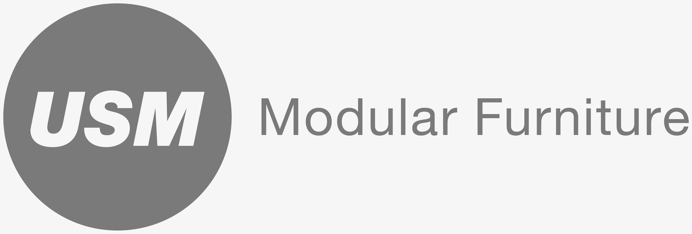

目录

|  |  |
|---|---|
| [01 开篇](#01-开篇) | [09 Design 设计：建筑模块思想缩到家具尺度](#09-design-设计建筑模块思想缩到家具尺度) |
| [02 品牌概述](#02-品牌概述) | [10 Experience 体验：配置器、展厅与 14–16 周交期](#10-experience-体验配置器展厅与-14–16-周交期) |
| [03 Brand 品牌：从 Münsingen 五金作坊到 MoMA 永久馆藏](#03-brand-品牌从-münsingen-五金作坊到-moma-永久馆藏) | [11 Competition 竞品：模块收纳赛道里的设计博物馆阵营](#11-competition-竞品模块收纳赛道里的设计博物馆阵营) |
| [04 Category 品类与市场：钢质模块系统的窄与深](#04-category-品类与市场钢质模块系统的窄与深) | [12 Strategy 战略：从窗五金到可持续设计领导者](#12-strategy-战略从窗五金到可持续设计领导者) |
| [05 User 用户与场景：设计师、业主与一次买齐](#05-user-用户与场景设计师业主与一次买齐) | [13 视频与访谈资料](#13-视频与访谈资料) |
| [06 Positioning 定位：一颗球头与一套六十年的系统](#06-positioning-定位一颗球头与一套六十年的系统) | [14 来源与延伸阅读](#14-来源与延伸阅读) |
| [07 Product 产品：从球头节点到软包面板的六条线](#07-product-产品从球头节点到软包面板的六条线) | [15 分析附录](#15-分析附录) |
| [08 Aesthetics 美学：镀铬、喷粉钢与低饱和色板](#08-aesthetics-美学镀铬喷粉钢与低饱和色板) |  |

## 01 开篇

1885 年，金属工匠 Ulrich Schärer 在瑞士伯尔尼近郊的 Münsingen 村开了一家金属加工与锁匠作坊。这块刻着"Schlosserei u. Eisenwarenhandlung"（锁匠铺与五金商行）的招牌上，经营项目包括工具、建筑五金、炉灶、自行车、童车、缝纫机乃至墓地十字架——一间典型的 19 世纪乡村五金杂货铺。1920 年起，公司开始生产带长杆执手的窗用插销五金（espagnolette），此后四十年靠这门窗五金生意养活家族。

1961 年，第三代传人、苏黎世联邦理工（ETH）毕业的工程师 Paul Schärer Jr. 加入公司，委托建筑师 Fritz Haller 设计一座可随生产流程扩张的新工厂；1962 年，两人为自家新办公室开发配套家具系统；1965 年，带球头连接件的 USM Haller 系统设计定稿并提交专利申请；1969 年量产，第一笔大订单来自巴黎罗斯柴尔德银行，600 个工位。2001 年底，这套系统进入纽约 MoMA 建筑与设计永久馆藏，同年谷口吉生设计的新 MoMA 大楼办公室也全部采用 USM Haller。

系统的核心是一颗直径约 25.4 毫米、重约 47 克的镀铬黄铜球：六个方向各钻一个螺纹孔，六根镀铬钢管旋入球体，无需焊接即可在三维空间任意方向接出框架，再嵌入喷粉钢板面板。这颗被瑞士人称为"魔球"（the magic ball）的节点，让"家具像建筑一样以系统而非单件为基础"成为可能——同一个模数思想从 30 厘米高的床头柜延伸到整墙书架、整层办公室，再延伸到 Haller 本人设计的钢结构厂房与家族私宅。

2025 年，Haller 系统迎来 60 周年，米兰设计周上的装置展与 100 个原创配置的 LookBook 成为周年注脚。2026 年，磁吸软包面板 Soft Panel 正式供货。当前 USM 由第四代家族成员 Alexander Schärer 领导，2000 年起任 CEO；全产品线在瑞士 Münsingen 制造，约 500 名员工，经 70 个国家 900 多家授权销售伙伴出售。这家从乡村五金铺走出的家族企业，把一件"五金件"做到了设计博物馆的永久馆藏里。

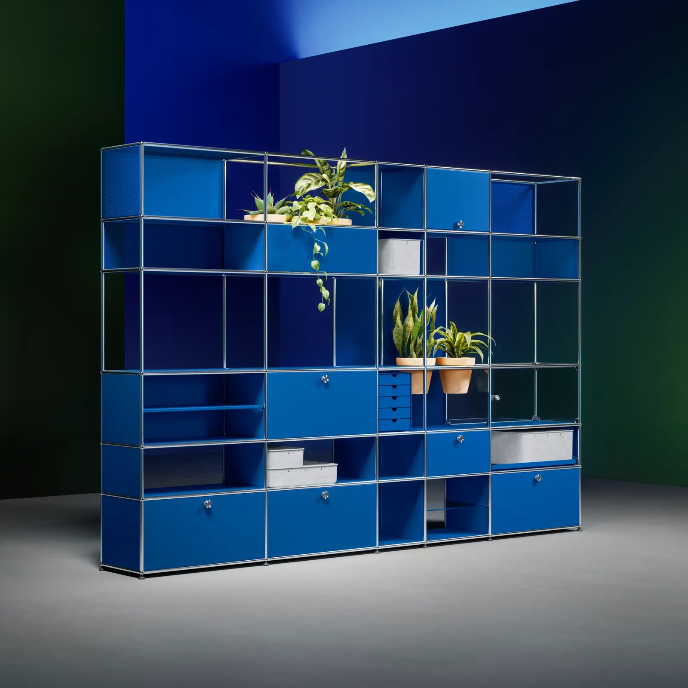

*图：USM Haller 系统整墙置物组合——镀铬钢管框架与蓝色喷粉面板，官方系统页主视觉，1965 年定稿形态的现行延续。图源：[USM 官方 Haller 系统页](https://www.usm.com/en/collections/usm-haller-system/usm-haller)。*

## 02 品牌概述

USM 是 1885 年由金属工匠 Ulrich Schärer 在瑞士伯尔尼近郊 Münsingen 创立的家族企业，1885 年起经营金属加工与锁匠业务，1920 年代起生产窗用插销五金，1965 年推出与建筑师 Fritz Haller 联合开发的模块化钢质家具系统 USM Haller，此后六十年以这套系统为核心，延展为柜类、桌类、办公桌、照明与电气集成件、收纳配件与软包面板的全线"钢质模块系统"品牌。2001 年 USM Haller 进入纽约 MoMA 永久设计馆藏；2025 年系统满 60 周年。官方自我定位为"永恒、可持续、可随代际需求演变的设计"（timeless, sustainable design that adapts to use over generations），并以"可持续设计的世界领导者"（world leader in sustainable design）自称。

| 项目 | 内容 |
|---|---|
| 品牌名 | USM（Ulrich Schärer + Münsingen 缩写）· 法人全称 USM U. Schärer Söhne AG |
| 国家/地区 | 瑞士（1885 年创立于伯尔尼近郊 Münsingen；总部 Thunstrasse 55, 3110 Münsingen） |
| 成立时间 | 1885 年金属与锁匠作坊；1965 年 USM Haller 系统设计定稿；1969 年量产 |
| 创始人 | Ulrich Schärer（19 世纪金属工匠；第三代 Paul Schärer Jr. 1933–2011，ETH 工程师；第四代 Alexander Schärer，2000 年起任 CEO） |
| 代表性设计人物 | Fritz Haller（1924–2012，建筑师，Haller 系统与工厂/私宅的设计者，与 Paul Schärer Jr. 共同开发）；Paul Schärer Jr.（共同开发者与委托方） |
| 官方理念 | "永恒、可持续、可随代际需求演变的设计"；"模块化不是噱头，是信念体系"（Modularity is not just a gimmick, it's a belief system）；"不是围绕单件家具、而是围绕一套可改造可重组的钢模块系统" |
| 品牌归属 | 家族企业，第四代管理，未上市、未被集团收购（Alexander Schärer 2000 年起任 CEO） |
| 核心业务 | 模块化钢质家具系统：柜类/书架/收纳、桌类（Haller Tables）、照明与电气集成（Haller E）、办公桌（Kitos）、收纳配件（Inos）、软包面板（Soft Panel） |
| 经典产品 | USM Haller 系统（1965 定稿/1969 量产）、Haller E（2017）、Kitos（机械升降办公桌）、Soft Panel（2025 米兰首发/2026 年 1 月供货） |

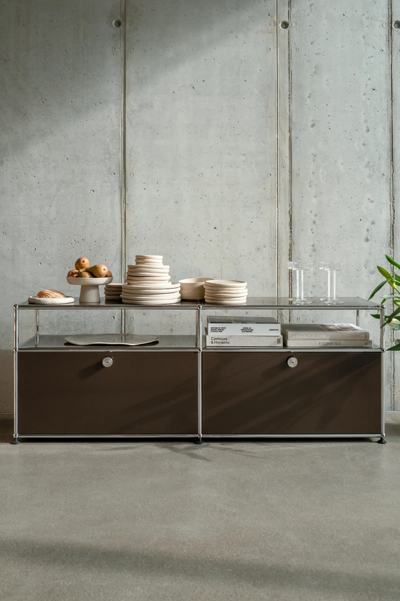

*图：USM Haller 蓝灰配色模块化搁架与门柜组合——镀铬框架统一色系下的多单元拼接。图源：[USM 官方 Haller 系统页](https://www.usm.com/en/collections/usm-haller-system/usm-haller)。*

## 03 Brand 品牌：从 Münsingen 五金作坊到 MoMA 永久馆藏

### 1885：一块招牌上的乡村五金杂业

官方品牌史把起点定在 1885 年："Ulrich Schärer sets up a metal workshop in the Swiss village of Münsingen, just outside Bern."（Ulrich Schärer 在伯尔尼近郊瑞士村庄 Münsingen 开设金属作坊。）作坊的实物证据是一块 19 世纪末的商号招牌，白字黑底，写着"Ulrich Schärer-Joder, Münsingen. Schlosserei u. Eisenwarenhandlung"，经营清单里既有各类工具与建筑五金，也有炉灶、筒式炉、炉管、厨房家居用品、自行车、童车、缝纫机、栏杆、铁皮花圈与墓地十字架——这是它后来全部业务的母体：五金加工，且什么都能做。招牌上的人物写作"Schärer-Joder"（夫姓联合拼写），与后世公司名的"Schärer Söhne"不同，说明此后的传承经过了名称更迭。

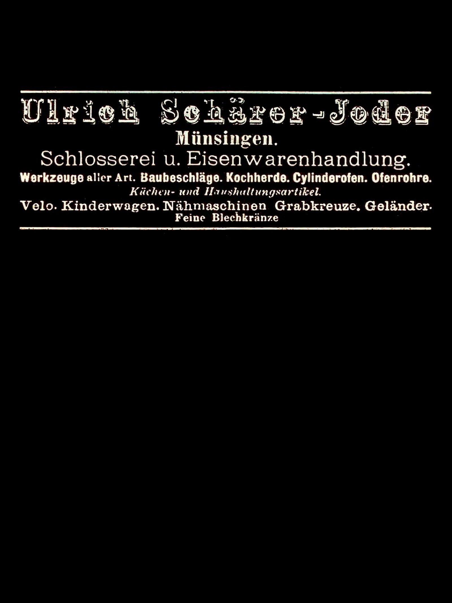

*图：USM 1885 年商号招牌实物——"Ulrich Schärer-Joder, Münsingen. Schlosserei u. Eisenwarenhandlung"，官方 1885 创立节点配图。图源：[USM 官方德文品牌史](https://www.usm.com/de-ch/ueber-usm/geschichte)。*

### 1920：窗五金与战后钣金

1920 年起公司开始生产窗户五金：带长杆执手的窗栓（Drehstangenverschluss，即 espagnolette）。二战后业务扩张到金属结构与钣金加工（Metallbau und Blechbearbeitung），为日后进入金属家具积累下冲压、折弯与焊接能力。窗五金与金属制造业务一直持续到 1992 年，因家具业务做大才停产——五金业务为家具业务服务了近七十年，这段历史常被设计叙事忽略，却是理解 USM"用金属做工"传统的起点。

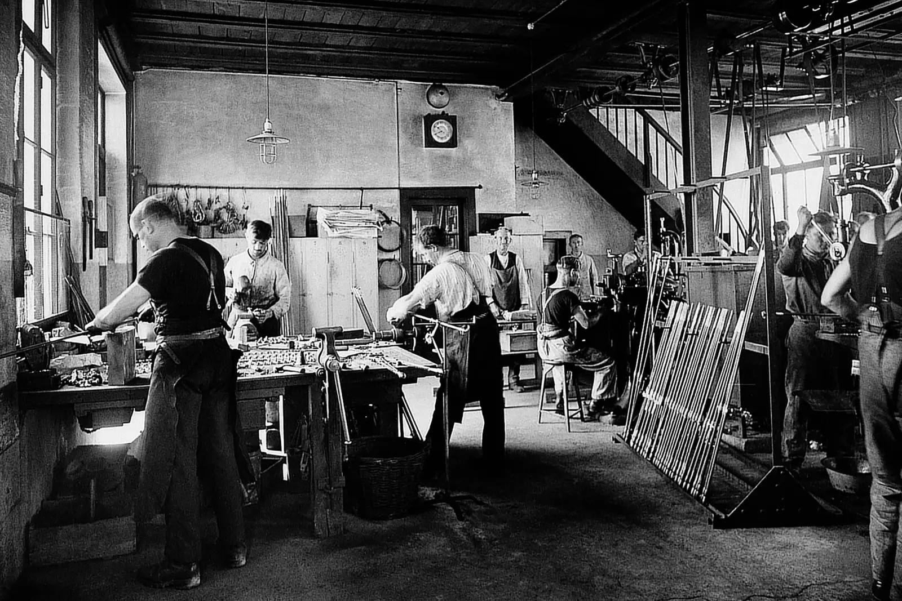

*图：1920 年代窗五金生产时期的作坊工作照——官方 1920 节点配图，多名工人在台前作业。图源：[USM 官方德文品牌史](https://www.usm.com/de-ch/ueber-usm/geschichte)。*

### 1961–1962：一位工程师与一位建筑师

1961 年，第三代传人 Paul Schärer Jr.（Paul Ulrich Schärer，1933–2011）以工程师身份加入公司。他是 ETH 苏黎世联邦理工的毕业生，也是 Mies van der Rohe 与 Le Corbusier 的崇拜者；入司后他决定让工厂现代化，委托建筑师 Fritz Haller（1924–2012，索洛图恩人，木匠出身后学建筑，模块化钢结构先驱，后任卡尔斯鲁厄大学教授）设计一座生产与行政一体、可灵活扩展的新厂。1962 年，两人开始为 USM 自家办公室开发配套家具——官方给出的动机是：当时市面上没有与新建筑功能美学相配的办公家具（"none of the conventional office furniture available at the time went with the new functional aesthetics"）。

*图：Paul Schärer Jr.（第三代，ETH 工程师）与建筑师 Fritz Haller 户外合影——1961–1962 年两人开启工厂与家具系统联合开发。图源：[USM 官方德文品牌史](https://www.usm.com/de-ch/ueber-usm/geschichte)。*

### 1965：新厂揭幕与系统定稿

1965 年，新工厂在 Münsingen 落成揭幕（厂房 1963 年设计、1965 年揭幕，办公 Pavilion 同期建成），带球头连接件的家具系统最终设计定稿，专利申请提交。官方时间线在这一年写下了三件事：新厂揭幕、系统定稿、专利提交。法文官网与 Buchli 专站把建筑与家具的年份区分得更细：新厂房 1963 年设计、1965 年揭幕，办公 Pavilion 1965 年建成——行文中采用"1963 设计、1965 揭幕"的口径。这套由 Haller 用 USM Haller MAXI 钢结构体系建造的厂区，是模块化建筑体系的首个落地项目，也是家具系统的母体：家具不是先于工厂诞生，而是作为"建筑模块思想的缩小版"为匹配新建筑而开发。

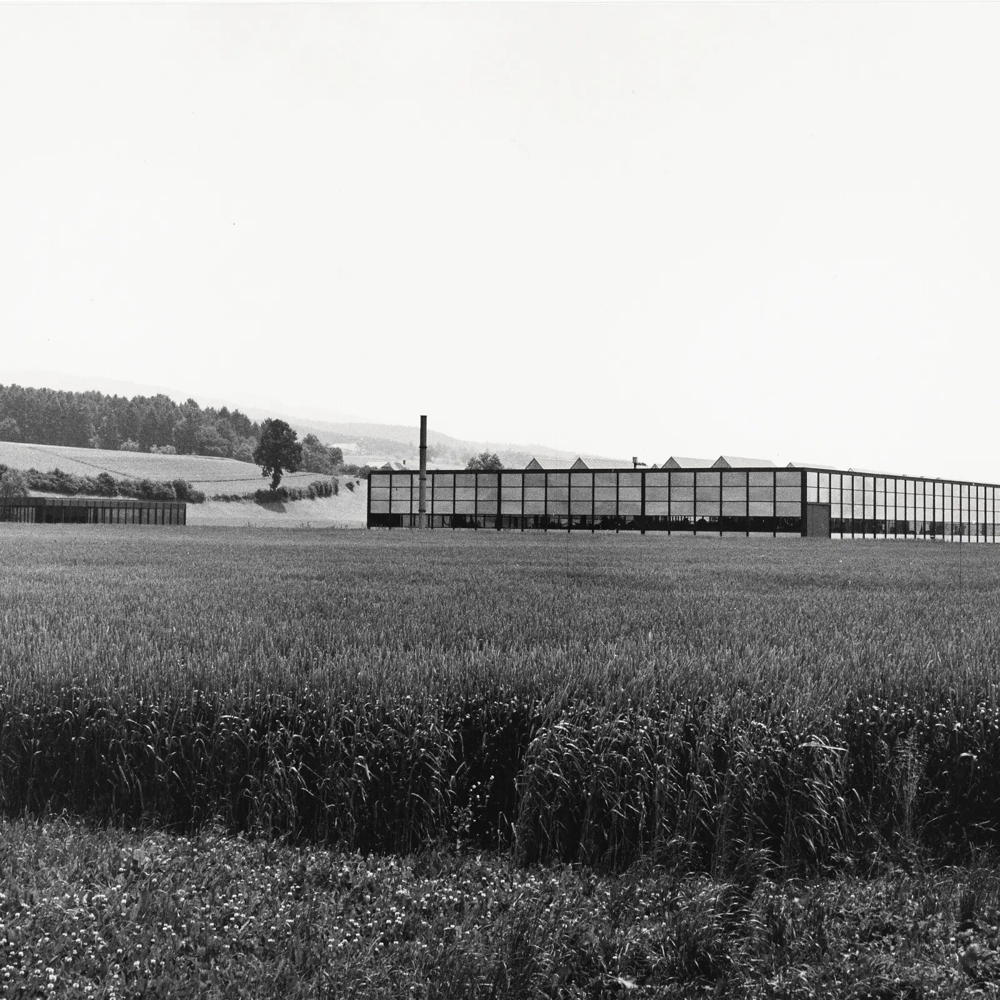

*图：1965 年落成的 Münsingen 总部新厂（Haller 设计，MAXI 钢结构体系）——田野中的长条厂房，Christian Moser 摄影（gta 档案馆）。图源：[USM 官方德文品牌史](https://www.usm.com/de-ch/ueber-usm/geschichte)。*

### 1969：量产与第一笔大订单

1969 年，Haller 系统开始量产。第一笔大额商业订单来自巴黎罗斯柴尔德银行，600 个工位的工作台一次性交付，标志着系统从"家族自用"进入"全球办公家具"阶段。1968 年前后的办公 Pavilion 实景记录了系统初期的使用形态：橙、绿、白面板的柜体与工作台成排出现在落地钢窗的车间式办公室里——这批"首批办公室"影像至今仍是官方档案中的标志性画面。与家具系统并行，Haller 还为 USM 开发了 MINI（住宅/办公）、MIDI（高机电建筑）、MAXI（工业厂房）三套钢结构建筑体系，由 USM 生产至 1994 年；USM Haller 是 Haller 唯一的家具设计作品。

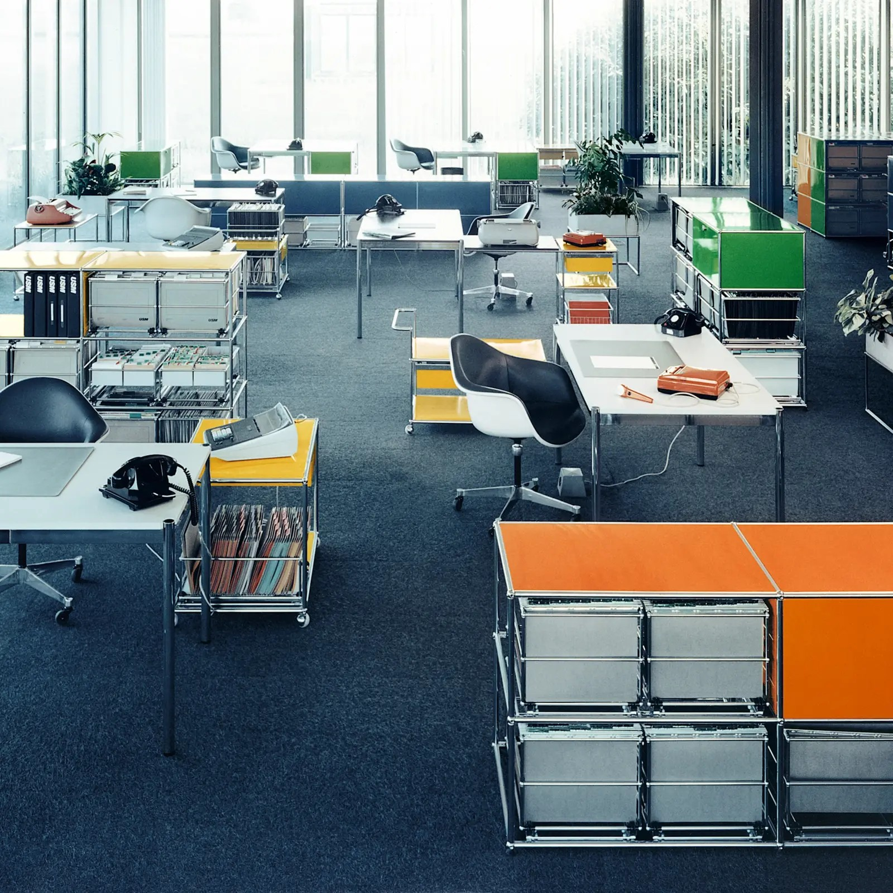

*图：1965 年建成的办公 Pavilion 内景——橙/绿/白面板的早期 Haller 家具成排出现在落地钢窗的车间式办公室里。图源：[USM 官方德文品牌史](https://www.usm.com/de-ch/ueber-usm/geschichte)。*

### 全球化与办公普及：1970–1980 年代

量产之后是全球化：1975 年设德国子公司（Bühl bei Baden-Baden），1994 年设法国子公司（Charnay-lès-Mâcon），1995 年设美国子公司（纽约），1998 年汉堡开出首家展厅。1970–1980 年代，Haller 系统成为欧洲办公家具的常见配置，官方项目档案里留有大量这一时期的应用影像。

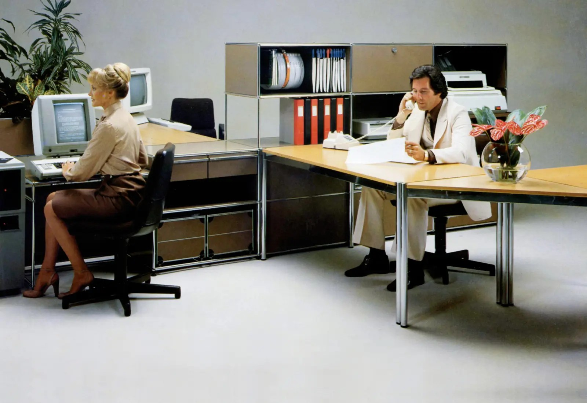

*图：1970–80 年代办公应用实景——全套棕色 USM Haller 桌柜系统配 CRT 电脑与电话，量产初期的日常使用形态。图源：[USM 官方故事页](https://www.usm.com/en/stories/creative-since-1965)。*

### 1968–1969：家族私宅"das Buchli"

1968 年设计、1969 年建成的"das Buchli"（Buchliweg 30, Münsingen）是 Haller 为 Paul Schärer Jr. 一家设计的私人住宅，建在总部上方的山坡上，是首个用 USM Haller MINI 钢结构体系建成的住宅。钢框架、玻璃与预制板构成的两层居住体，将工厂的模块语言直接搬进家庭生活。2015 年起由建筑师事务所 vuotovolume 修缮，2020 年由家族完成整体翻修，官方为其建有专站 buchli.usm.com，建筑杂志 TEC21 于 2021 年刊发翻修专文。这栋住宅常被误当作"Münsingen 工厂被列为文化遗产"的证据——实际被文物保护视角关注并修缮的是这栋私宅，工厂本身的文保级别在瑞士州级档案中未见明确著录。

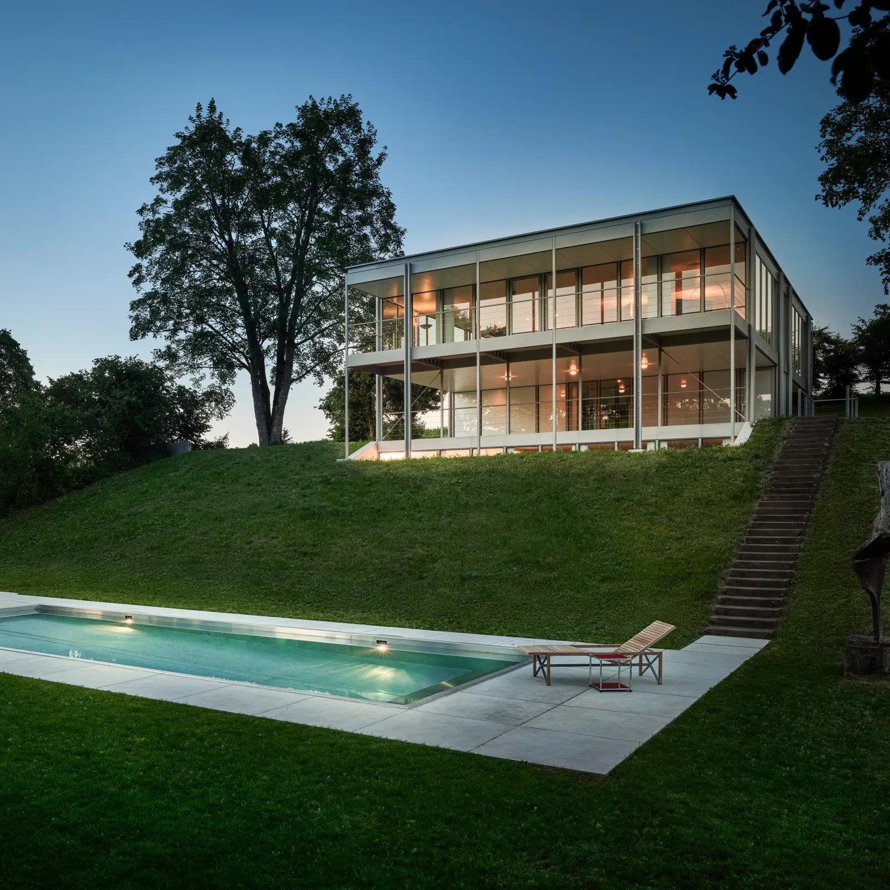

*图：Schärer 家族私宅"das Buchli"（1968/69，Haller 设计，USM Haller MINI 体系首栋住宅）——山坡上的钢玻璃住宅，2020 年翻修后影像。图源：[USM 官方故事页](https://www.usm.com/en/stories/creative-since-1965)。*

### 2001：MoMA 永久馆藏与设计保护

2001 年底，USM Haller 系统进入纽约 MoMA 建筑与设计永久馆藏；同年，谷口吉生设计的新 MoMA 大楼办公室全部采用 USM Haller 家具（项目落地记录另列 2005 年）。MoMA Design Store 在产商品页统一标注"Haller System is represented in MoMA's collection"。这一年的馆藏节点常与另一事件混淆——官方时间线里 2001 年对应的是 MoMA 入藏，并非工厂文保认定。设计保护方面：1988 年德国法院首次裁定 USM Haller 属于受著作权保护的应用艺术作品（work of applied art），为系统在德语区提供强设计保护。奖项轨迹：1971 年获美国 Resources Council 设计奖，1973 年获美国钢铁学会（AISI）最佳钢铁设计奖，2007/2008 年获 GREENGUARD 低排放认证，2018 年 Haller 与 Kitos M 获 Cradle to Cradle 认证。

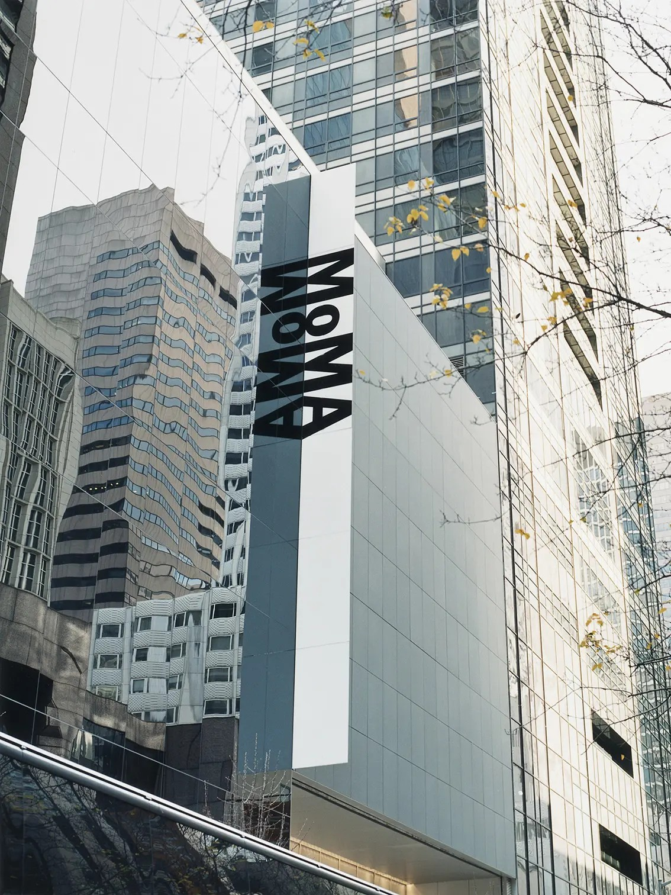

*图：纽约 MoMA 新馆立面（谷口吉生设计）——2001 年 USM Haller 入藏 MoMA 永久设计馆藏，同年新馆办公室全部采用 USM Haller。图源：[USM 官方德文品牌史](https://www.usm.com/de-ch/ueber-usm/geschichte)。*

### 第四代治理：Alexander Schärer 与家族持股

1993 年，第四代家族成员 Alexander Schärer（EPFL 工程师）加入公司，2000 年起任 CEO/总经理，现任官方页面仍由他领导公司。公司至今未上市、未被集团收购，由 Schärer 家族持有；员工规模官方口径为"超过 500 人"（英文现行版），德文历史缓存页写作"400 余人"，两处口径随扩张并存。海外机构分布在美国、法国、德国、英国、日本与中国六国；中国运营主体为优施模贸易（上海）有限公司，由瑞士母公司全资持股。家族企业属性下，营收数字不公开披露，第三方转述中可见 2017 年约 2 亿瑞士法郎的量级，官方未确认。

*图：第四代掌门人 Alexander Schärer——1993 年入司、2000 年起任 CEO，官方现任配图。图源：[USM 官方德文品牌史](https://www.usm.com/de-ch/ueber-usm/geschichte)。*

## 04 Category 品类与市场：钢质模块系统的窄与深

### 品类定义：钢质模块家具系统

USM 对外销售的核心品类是模块化钢质家具系统：以钢球节点连接钢管框架与喷粉钢板/玻璃面板，自由组合成柜、书架、视听柜、床头柜、边几、桌与办公桌，且可事后拆改扩展。现行产品线六条：USM Haller System（柜类/收纳/书架，含照明电气集成版 Haller E）、USM Haller Tables（桌类）、USM Kitos Desks（办公桌/升降桌）、USM Privacy Panels（隐私屏风）、USM Accessories（Inos 收纳盒与抽屉分隔件），以及 2026 年 1 月正式供货的磁吸软包面板 Soft Panel。采购逻辑分两类：设计师/建筑师在图纸阶段按模数指定（B2B 项目、整层办公交付），与消费者按件下单（官网配置器自搭、现货直邮）。系统的可扩展性——"可改造、可重组"（adapted and reconfigured）——是它与单件家具品牌最根本的品类差异。

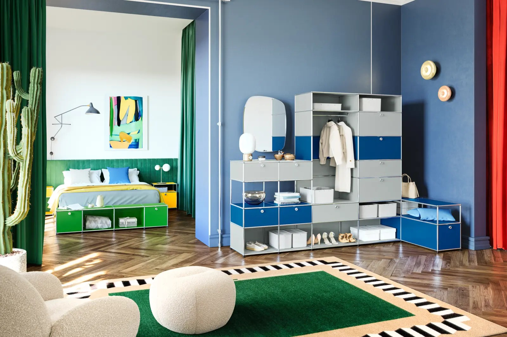

*图：Haller 卧室场景——深蓝/灰 credenza 视听柜置于电视下方，系统从办公进入居家的典型用法。图源：[USM 官方 Haller 系统页](https://www.usm.com/en/collections/usm-haller-system/usm-haller)。*

### 市场规模的判断口径

第三方机构对模块化家具的统计口径差异较大，以下只作方向性参考。Mordor Intelligence 的宽口径"模块化家具"市场 2026 年约 916 亿美元、2031 年约 1,278.8 亿美元、CAGR 6.9%；Statifacts 的窄口径"模块化搁架单元"2025 年约 160 亿美元、2035 年约 285 亿美元、CAGR 6.0%；Growth Market Reports 的"模块化搁架系统"2025 年约 87 亿美元、CAGR 6.8%；Market Research Intellect 的"收纳与模块化家具"2025 年约 132.3 亿美元、CAGR 7.2%。四组数字从 87 亿到 916 亿美元，说明该品类无统一统计口径。USM 所处的高端设计级模块化收纳系统在主流报告中不是独立类目——它被淹没在宽口径"模块化家具"（约 900 亿美元级）与窄口径"模块化搁架"（约 90–160 亿美元级）之间。行业共识增长率约 6–7%/年，属稳健成熟品类，不依赖电商冲动消费，靠设计师指定与项目工程驱动。

### 价格带：2026 年 10 月官方渠道实查

usm.com 美区站直接挂价加购（美元，未注明含税口径）、英区站英镑、瑞士/奥地利配置器 CHF/EUR 挂价、中国站 usm.cn 人民币挂价。以下为 2026-10-26 实查的现行官方挂牌价：

| 型号 | 产品 | 官方价 | 备注 |
|---|---|---|---|
| M21 | Haller Side Table 边几 | US$612 | 官网现行最低挂价之一 |
| Soft Panel 14"/20" | Haller 软包门板配件 | US$303 / US$337 | 配件级入门 |
| P2 | Haller Nightstand 床头柜 | US$1,545 | In-Stock 现货 |
| L18 | Haller Serving Cart 餐车 | US$1,555 | Best Seller |
| O118 | Haller Side Table 边桌 | US$1,809 | Best Seller |
| T59 | Haller 桌（珍珠灰/白层压面） | US$1,965 | 140×75 cm 段 |
| B218 | Haller Media 视听柜（双下拉门） | US$2,472 | 14 英寸下拉门、14 标准色 |
| M | Haller File Pedestal 文件柜 | US$2,472 | Best Seller |
| C2A | Haller Credenza 边柜 | US$3,469 | Best Seller |
| O3 | Haller Media 视听柜 | US$3,598 | Best Seller |
| EC4 | Haller Wardrobe 衣帽间柜 | US$4,131 | Entryway 场景 |
| E2 | Haller Credenza 边柜 | US$4,268 | Best Seller |
| G118F | Haller File Storage 文件收纳柜 | US$4,963 | |
| H2 | Haller Shelving 书架系统 | US$5,858 | Best Seller |
| H25/H85/H66 | Haller Glass Showcase 玻璃展柜 | US$12,388 / 14,036 / 16,509 | 上探档 |
| O1 | Haller Media 视听柜（英区） | £871.97 | USM UK 在线商城 |
| Kitos M | 机械升降办公桌 W1750×D750（英区样品原价） | £2,825 | 样品 Sale 折后 £1,450；美区按项目询价 |
| — | 配置器典型 Sideboard（瑞士） | CHF 5,418–9,336 | shops.usm.com |
| — | Haller 置物柜 H74×W152.3 cm 纯白（中国） | ¥17,165.83 | usm.cn |

价格带结构：Haller 官方零售入口从边几 US$612、床头柜 US$1,545 起；常规边柜/视听柜主流成交带 US$2,500–6,000；整墙书架与玻璃展柜上探 US$12,000–16,500；中国官网单柜 ¥17,165 起。Kitos 升降桌按项目询价，美区无公开挂价，英区样品原价 £2,825。经销商渠道参照：smow 的 Haller Sideboard 自 CHF 1,382 起、Vitrine 玻璃柜自 €2,689、Highboard M €1,852；瑞士二手/翻新渠道 Modulaire AG 自 CHF 822 起——二手市场的存在本身是系统耐用性的价格证据。

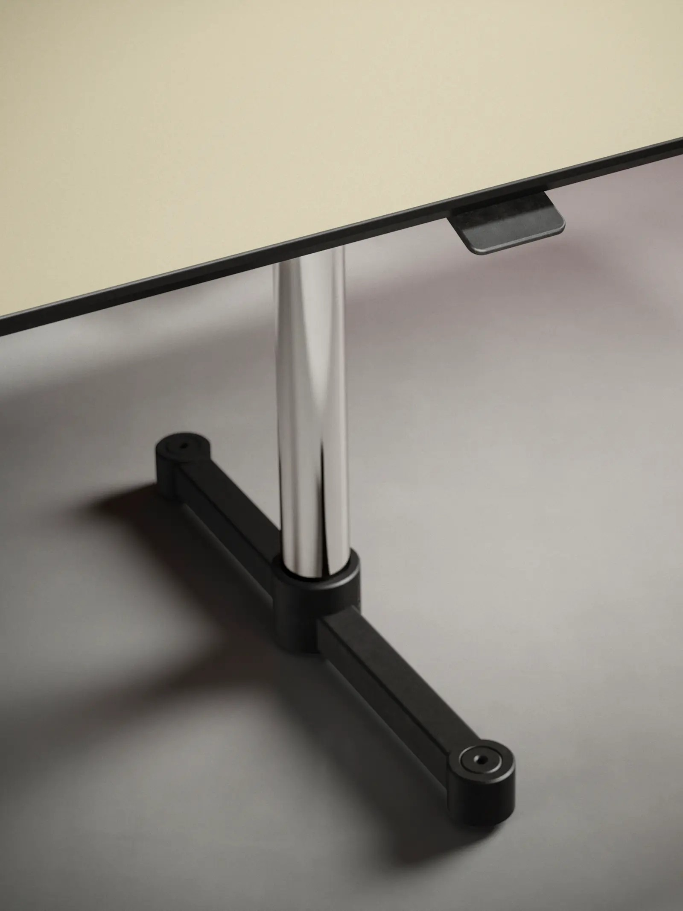

*图：Kitos 桌腿/底座结构特写——镀铬钢管桌腿，办公桌系统与 Haller 柜体共用同一金属语言。图源：[USM 官方 Kitos M 产品页](https://www.usm.com/en-uk/collections/usm-kitos-desks/usm-kitos-m)。*

### 渠道结构

渠道分四路。一是官网电商与配置器：usm.com 主站提供在线配置器（Configurator，支持从零搭建与 AR 实景预览），区域商城为美区 us.usm.com（美元挂价加购）、英区 uk.usm.com（英镑，含 Sample Sale 样品专区）、瑞士/奥地利 shops.usm.com（CHF/EUR）、中国站 usm.cn（人民币挂价）；线上以现货 In-Stock 与样品为主，定制整柜走配置器询单。二是自营 Showroom 共 8 家：Bern（总部）、Hamburg、Munich、London、Paris、Tokyo、Shanghai、New York（28–30 Greene Street）；首家展厅 1998 年开在汉堡。三是授权经销商网络：官方口径"70 国 900 多家授权销售伙伴"，欧洲零售端代表为 smow 等，美国有 The Future Perfect 等。四是 B2B 办公/合同业务：Kitos 升降桌、Collaborate 协作系列、整层办公空间项目交付，价格按项目询。中国市场：上海展厅 2026 年 4 月随静安区永源浜街区开街，是首个中国官方展厅（USM Trading (Shanghai) Co., Ltd，永源路 2068 号 C 座 2 楼 201 室，MHPD 设计，"connector"主题），媒体口径入门款 3,400 元起、高端款单价 3.9 万元；无官方天猫/京东旗舰店的检索证据，线上以 usm.cn 与上海展厅、经销商为主。

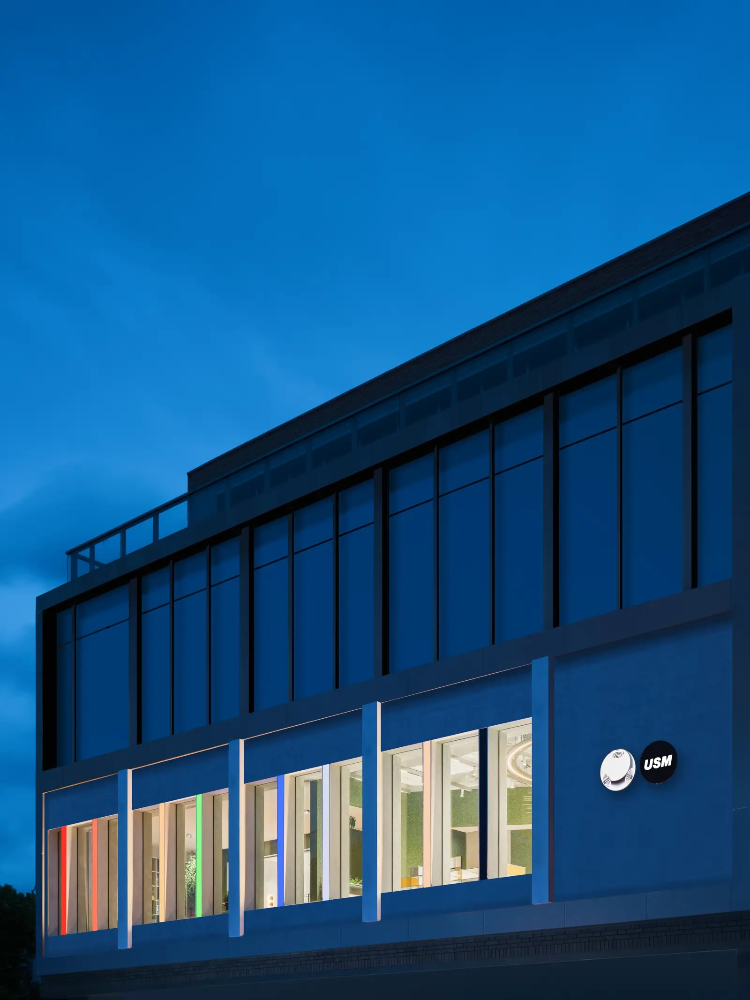

*图：USM 上海展厅（静安区永源路 2068 号）——2026 年 4 月随永源浜街区开街的首个中国官方展厅。图源：[USM 官方上海展厅故事页](https://www.usm.com/en/stories/new-usm-showroom-in-shanghai)。*

## 05 User 用户与场景：设计师、业主与一次买齐

### 决策链：四方参与的采购结构

USM 的购买决策结构与大多数高端设计品牌相似，但多了一层"系统"属性带来的长期性。定者是建筑师与室内设计师——Haller 系统以钢球节点模数体系进入图纸阶段，官方把展厅定义为"现有与潜在客户的支持平台"，B2B 办公项目（合同业务、整层办公空间交付）是设计师指定的主场景；买者是高净值住宅业主与企业/机构采购方——前者在搬家或装修时"一次买齐、终身可改"整墙收纳，后者采购办公室、展厅与酒店项目；用者是长期居住者与办公室使用者——系统的核心卖点是家具可随家庭结构变化拆改：加模块、换门板、搬家重组。二手市场（Modulaire AG 等专营翻新 USM 的商家）活跃，证明其耐用与流通性。此外还有入门尝鲜客，用 600–1,800 美元买一件 Haller 小件体验系统。

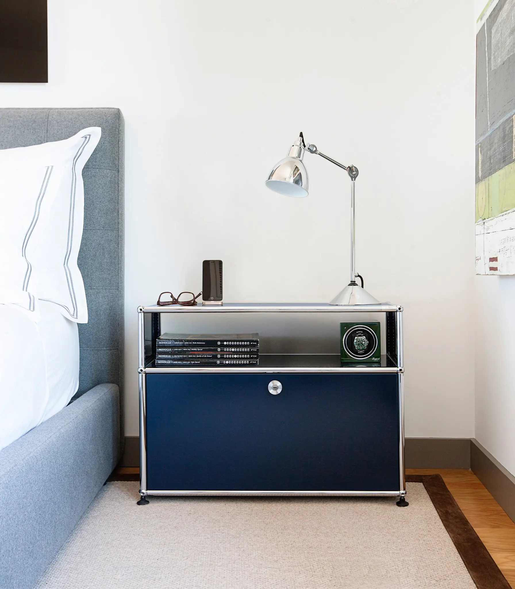

*图：Haller 卧室灵感场景——白/蓝 console 柜与床头柜组合，"买者用者"在居家场景中的日常形态。图源：[USM 官方 Haller 系统页](https://www.usm.com/en/collections/usm-haller-system/usm-haller)。*

> 术语注释：JTBD（Jobs to Be Done，用户任务）——用户"雇佣"产品完成的功能、情感与社会任务。
> 术语注释：CEP（Category Entry Points，品类入口）——用户首次意识到需求、接触品类的具体场景与渠道。

### 四类场景中的任务与入口

| 场景 | 核心 JTBD | 主要 CEP | 典型型号/入口 |
|---|---|---|---|
| 住宅整墙收纳/视听柜 | 买一套"30 年不淘汰、可随搬家重组"的钢质收纳系统 | 官网配置器在线搭积木 → AR 工具看进自己房间 → 展厅/经销商下单 | Haller 柜类/书架、Haller E |
| 设计师项目指定 | 在图纸阶段给客户一个模数开放、可扩展、有瑞士制造背书的系统 | 8 家展厅 + 900 多家授权销售伙伴的规格书与样板色卡 | Haller 系统、Kitos |
| 办公整层交付 | 合同业务：文件柜、升降桌、协作桌一体化 | B2B 销售直签，Kitos 按项目询 | Kitos M/E、Haller 系统 |
| 入门尝鲜 | 用 600–1,800 美元买一件 Haller 小件体验系统 | us.usm.com In-Stock 区边几/床头柜直邮 | M21、P2、O118 |

渠道入口的特殊性在于：官网同时承担"配置器＋AR 预览＋在线商城"三重功能，但大件整柜仍依赖展厅与经销商完成测量、报价与交付；线上商城以现货与样品为主，定制整柜走配置器询单。USM 的购买体验是"慢决策、重交付"——价格不菲、无冲动消费入口，配置器把"设计自己的系统"变成购买前奏。

## 06 Positioning 定位：一颗球头与一套六十年的系统

### 参照系与目标人群

USM 的参照系不是北欧的温暖木质设计，而是设计博物馆体系与工业化建筑的交汇：Vitsœ（Dieter Rams 的 606 墙挂系统）、Vitra（Eames 馆藏再版）、String 与 Montana 这些"系统型"家具品牌，以及现代主义建筑本身。目标人群三层：为"瑞士制造＋模数系统＋可拆改"付费的高净值住宅业主与机构；在项目图纸阶段指定系统的设计师；以及把系统当作"工业设计收藏"的入门客。三者的共同点是都在买"确定性"——工艺的确定性、兼容的确定性、时间价值的确定性。

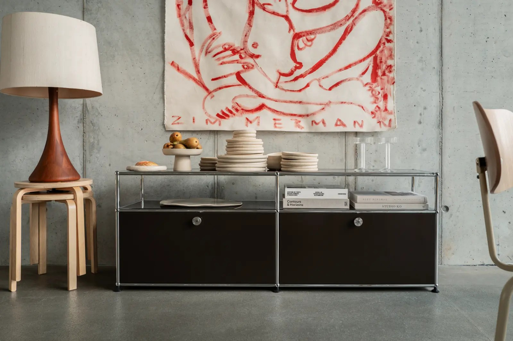

*图：Haller 起居空间——橙/蓝/白模块柜与休闲椅组合，系统型家具在生活场景中的"非品牌感"呈现。图源：[USM 官方 Haller 系统页](https://www.usm.com/en/collections/usm-haller-system/usm-haller)。*

### 差异点与共同点

> 术语注释：POD（Point of Difference，差异点）——品牌相对竞品独有的、被消费者认可的差异。
> 术语注释：POP（Points of Parity，基准点）——在品类中必须具备、否则无法入围的共性能力。

USM 的 POD 有三个。一是钢球节点结构本身：一颗六孔镀铬黄铜球连接六根钢管，无需焊接、任意方向扩展，是系统形态上独有的工程特征，也是"模块化信念"的物证。二是跨代兼容：1960 年代早期生产的部件可与今天新购部件直接组合——官方叙事"可随代际需求演变"（adapts to use over generations）在这一事实上落地，二手市场因此成立。三是瑞士单一产地：全产品线在 Münsingen 制造，"Swiss made"与三价铬、无溶剂喷粉构成制造背书。POP 同样是三项：喷粉钢/镀铬的制造品质、2 年有限质保、全球 900 多家销售伙伴的交付网络——这三点是入围设计师候选清单的入场券，但只靠它们，USM 就只是另一家办公家具商。

### 从品牌承诺到产品证据的链

USM 的承诺链是："一套以系统而非单件为基础的钢质家具，必须做到结构可扩展、零件跨代兼容、表面历久弥新，并能连续生产六十年。"官方表述把它讲得更直接："Modularity is not just a gimmick of USM furniture, it's a belief system."（模块化不是噱头，是信念体系。）落到产品：球心距模数网格让任意模块可互换拼接；面板在喷粉钢、玻璃、木皮、油毡、Fenix 与布艺 Soft Panel 之间自由切换；镀铬框架不随面板颜色变化；铰链开合测试 40,000 次以保证无异响。这套证据链的完整度，是 USM 与"北欧模块化"标签下其他品牌的区分核心——它不靠造型新鲜度，靠的是系统兼容性与时间可累积。

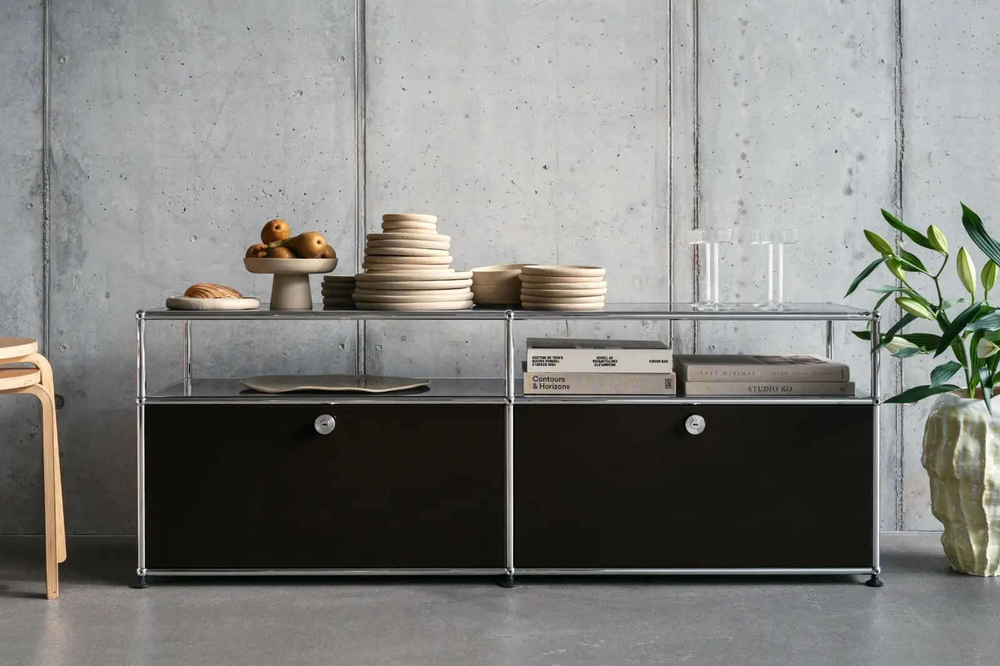

*图：Haller 深棕/暗色 credenza 边柜——哑光喷粉表面与镀铬框架的对比，材料证据链的一例。图源：[USM 官方 Haller 系统页](https://www.usm.com/en/collections/usm-haller-system/usm-haller)。*

## 07 Product 产品：从球头节点到软包面板的六条线

### 产品组合与命名逻辑：一条从五金到软包面板的线

USM 的产品组合由一条主线贯穿：把 1965 年球头节点系统确立的钢质模块语言，逐级扩展品类——从柜类/书架的收纳系统，到桌类、照明电气集成（Haller E）、办公升降桌（Kitos）、收纳配件（Inos）、隐私屏风与软包面板（Soft Panel）。命名体系以系列为单位：Haller/Haller E/Haller Tables 属柜体与桌体主线，Kitos 属办公桌线，Inos 属配件线，Soft Panel 属面板组件线；年份沿革上，1965 为设计定稿并申请专利的年份、1969 为量产年、2001 为 MoMA 馆藏年（非产品发布年）、2017 为 Haller E 发布年、2025 为 Soft Panel 米兰首发年（2026 年 1 月正式供货）。现行产品线六条，每条都是同一套"球头节点＋钢管框架＋面板"语言的变体。

### USM Haller 系统：一颗球头搭起的模块系统

Haller 系统的形态在 1965 年定稿后几乎未变：镀铬钢管构成框架，球头节点连接，喷粉钢板或玻璃面板嵌入。官方对其核心的描述是"the elegant and ingenious ball connector"（优雅而巧妙的球接件）。系统的尺寸基准是"球心到球心"（ball centre to ball centre）的网格尺寸，不是外包尺寸；最常见的单元格宽 75 cm、高 35 cm、深 35 cm，宽高深三个方向可独立选择，向上、向侧面可"几乎无限"接长。系统可拆解重组，不固定为单件家具——官方与画册口径为"adapted and reconfigured"（可改造、可重组）。从 30 厘米高的床头柜到整墙书架，再到整层办公室与 55 平方米的钢玻璃私宅，同一套模块语言在尺度上连续放大。

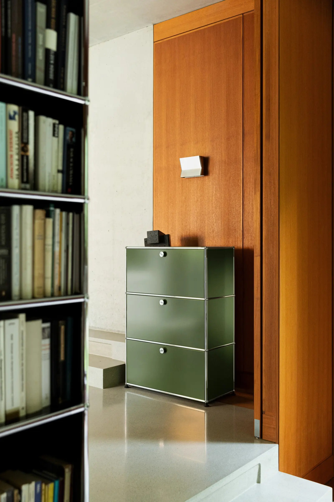

*图：Haller 橄榄绿边柜——喷粉钢板面板与镀铬钢管框架，1965 年定稿形态的现行延续。图源：[USM 官方 Haller 系统页](https://www.usm.com/en/collections/usm-haller-system/usm-haller)。*

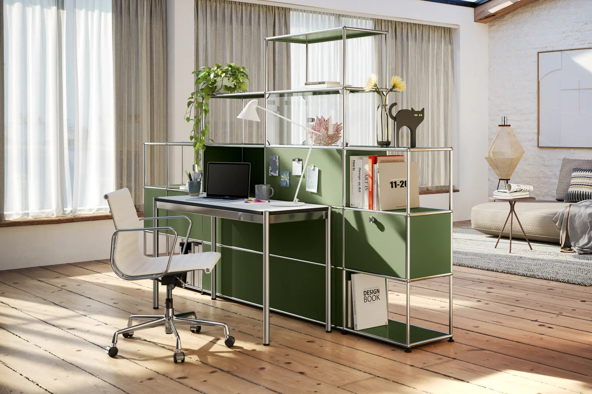

*图：Haller 居家办公场景——橄榄绿柜体与书桌组合，系统从办公进入住宅的标准用法。图源：[USM 官方 Haller 系统页](https://www.usm.com/en/collections/usm-haller-system/usm-haller)。*

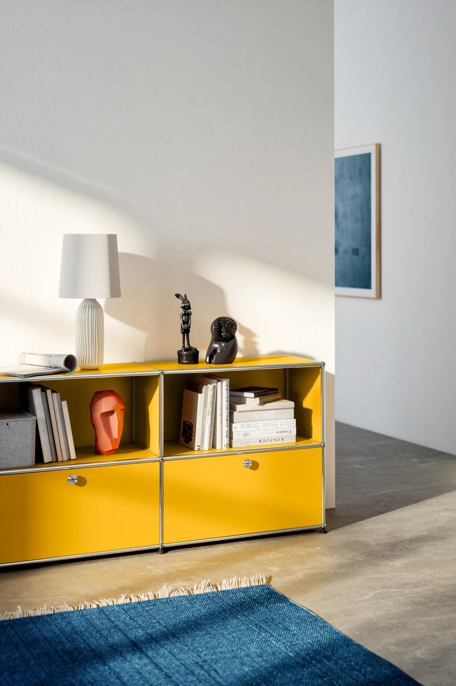

*图：Haller 黄/红/蓝拼色开放书架——官方 Selection 2023 封面画面，模块化的色彩自由度。图源：[USM 官方 Haller 系统页](https://www.usm.com/en/collections/usm-haller-system/usm-haller)。*

### Kugelkupplung 球头连接件：系统的技术原点

系统核心是一颗镀铬黄铜球（ball connector）：球径约 25.4 mm、重约 47 克，六个方向各钻一个 M8 螺纹孔，六根直径约 19 mm 的镀铬钢管从六个方向旋入球体，无需焊接即可在三维空间任意方向接出框架。官方称其专利于 1965 年提交申请（"Parts of the system were patented in 1965"），具体专利号未在公开数据库检出。发明归属是 Paul Schärer Jr. 与 Fritz Haller 二人共同开发，MoMA Design Store 商品页统一著录设计师为"Paul Schaerer and Fritz Haller"。系统自 1960 年代至今零件兼容——早期生产的部件可与今天新购部件直接组合，这是"可随代际需求演变"叙事的技术基石。

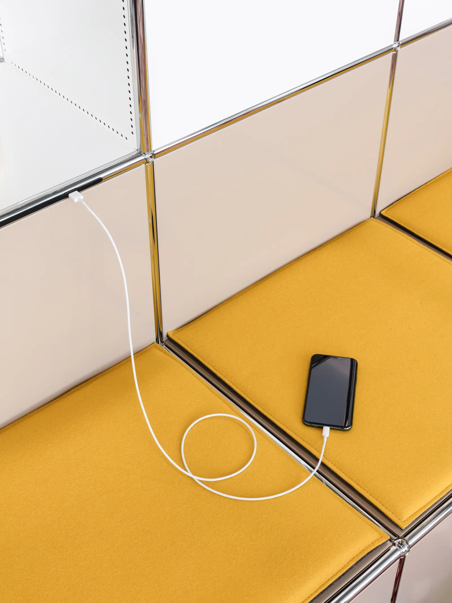

*图：Haller 结构特写——金色喷粉面板角部与镀铬钢管节点，Kugelkupplung 球节/钢管框架的局部呈现。图源：[USM 官方故事页](https://www.usm.com/en/stories/creative-since-1965)。*

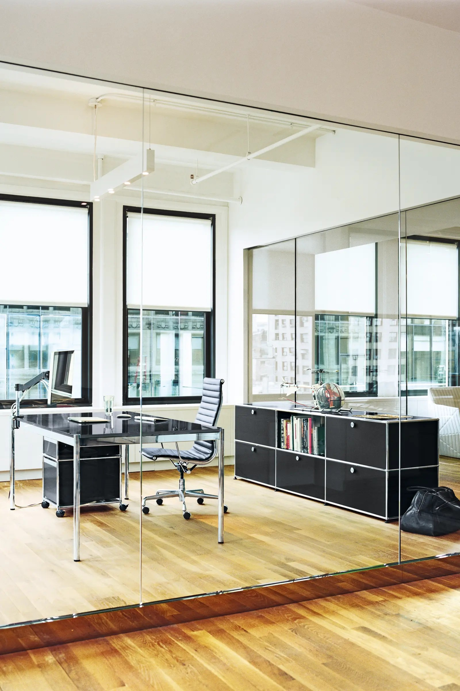

*图：Haller 系统设计语言黑白线稿——组件与框架结构示意，模块化逻辑的技术图表达。图源：[USM 官方 Haller 系统页](https://www.usm.com/en/collections/usm-haller-system/usm-haller)。*

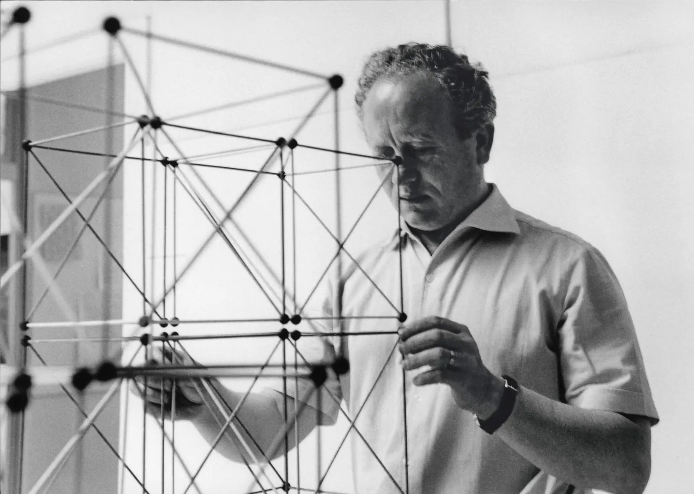

*图：USM 历史档案黑白照——工程师组装钢球节点与钢管三维网格框架模型，球头结构的早期开发现场。图源：[USM 官方故事页](https://www.usm.com/en/stories/creative-since-1965)。*

### 组件与型号体系：球心距网格上的自由组合

Haller 不是单件家具，而是一套组件库：储物柜/边柜（下拉门、抽屉、开放格、带锁单元）、书架/展示架（含斜搁板）、桌类（层压面、油毡面、玻璃面、木皮面）、小推车/边几、文件柜与衣帽间柜；美国官网型号采用字母＋数字编码（如 R2 书架、G118F 文件柜、T69 桌、H2 书架、B218 视听柜），中国/欧洲官网按功能命名。组件可跨系列混合——书架、桌、柜共用同一框架与球节。附件线另含 USM Inos 毛毡收纳盒、2022 年发布的机电锁 Lock C（配套手机 App 管理柜体）与 2026 年的 Soft Panel 磁吸软包面板。

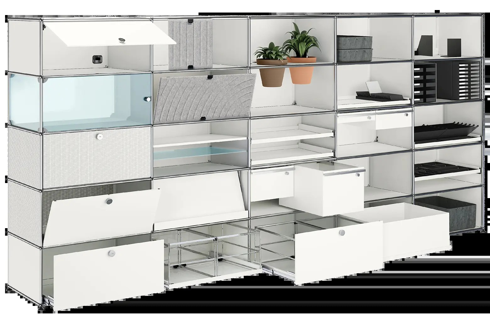

*图：Haller 组件/选项黑白展开图——门板、抽屉、面板、搁板等组件选项，组件库的完整视图。图源：[USM 官方 Haller 系统页](https://www.usm.com/en/collections/usm-haller-system/usm-haller)。*

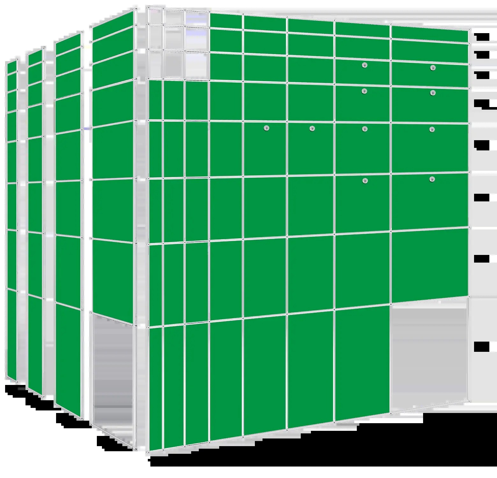

*图：Haller 网格尺寸图——球心距模数示意（绿色线稿），宽 75/50/37.5 cm、高深按 35 cm 模数叠加。图源：[USM 官方 Haller 系统页](https://www.usm.com/en/collections/usm-haller-system/usm-haller)。*

### 颜色体系：低饱和色板上的模块语言

现行标准色板为 14 种（美国官网口径，其中 7 色提供 Quick Ship 快速发货；中国官网标注 15 种，区域口径差 1）。已核实的色号含 RAL 标准色与非标品牌色：纯白 RAL 9010、浅灰 RAL 7035、中灰、石墨黑 RAL 9011、钢蓝 RAL 5011、龙胆蓝 RAL 5010、橄榄绿 RAL 6003、金黄、纯橙、陶土红等。1960 年代首批 Haller 系统采用亮绿色漆面，此后逐步加色，发展为今天从 Pure White 到 Golden Yellow、Ruby Red 的色板。框架与球节永远为镀铬银色，不随面板颜色变化——黑、白、铬三色组合是品牌识别的基础。2025 年起的 Soft Panel 布艺面板另有一套 10 色系，与金属面板色板并行。

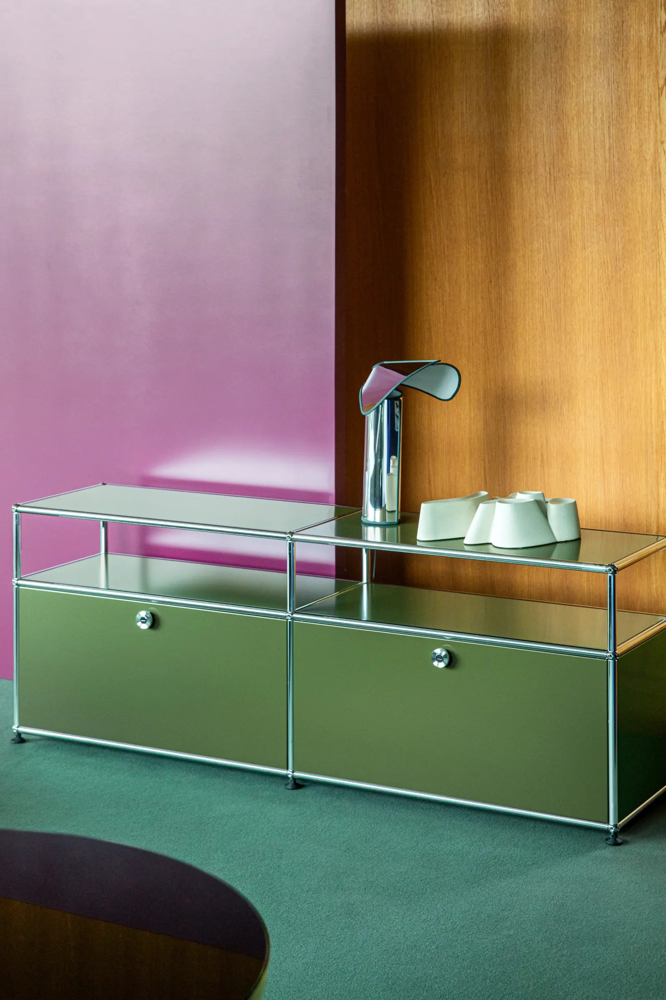

*图：Haller 橄榄绿＋柔粉拼色面板边柜——低饱和色板下的双色组合，面板色自由搭配的例证。图源：[USM 官方 Haller 系统页](https://www.usm.com/en/collections/usm-haller-system/usm-haller)。*

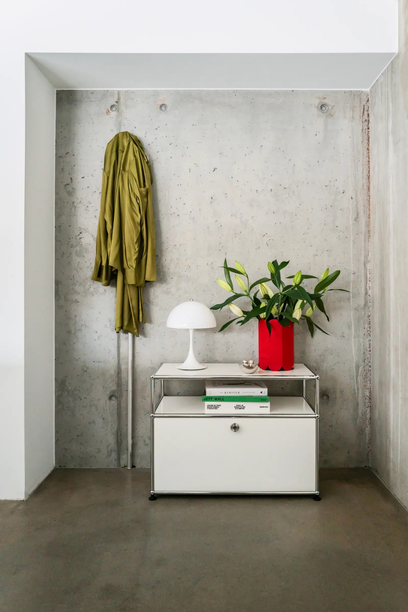

*图：Haller 蓝/橙拼色开放书架＋抽屉组合——品牌色板中高饱和色对的使用。图源：[USM 官方 Haller 系统页](https://www.usm.com/en/collections/usm-haller-system/usm-haller)。*

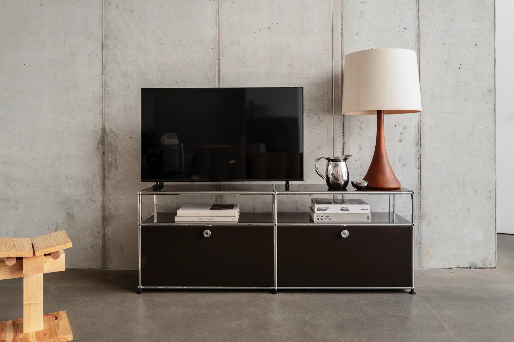

*图：Haller 客厅场景——黄色 credenza 与单人扶手椅，金色在生活空间中的呈现。图源：[USM 官方 Haller 系统页](https://www.usm.com/en/collections/usm-haller-system/usm-haller)。*

### USM Haller Tables：桌体的四档体系

Haller Tables 是系统在桌体上的应用，官方现行分四档：Classic（经典桌）、Plus（扩展桌）、Advanced（高级办公桌）与 Side Table（边几/边桌）。桌面表面可选合成树脂防火板（laminate，珍珠灰/浅灰）、天然油毡（linoleum，黑/灰/鹅卵石灰/淡紫/炭色）、高耐磨 Fenix（Bianco Kos/Grigio Londra）、木皮（天然漆橡木/黑漆橡木/白油橡木）与透明玻璃；玻璃桌面最长至 2000 mm。桌体与柜体共用镀铬钢管框架与球头节点，边几 M21（US$612）与边桌 O118（US$1,809）是系统在美区的入门与主力价位。

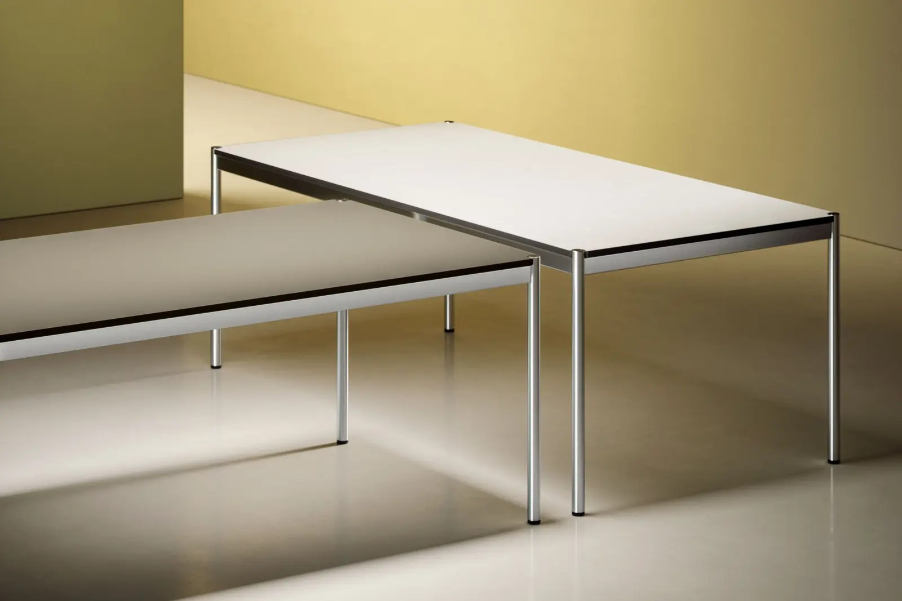

*图：Haller Tables Classic 经典桌——白色桌面与镀铬框架，桌体线的基础形态。图源：[USM 官方 Haller Tables 页](https://www.usm.com/en/collections/usm-haller-tables)。*

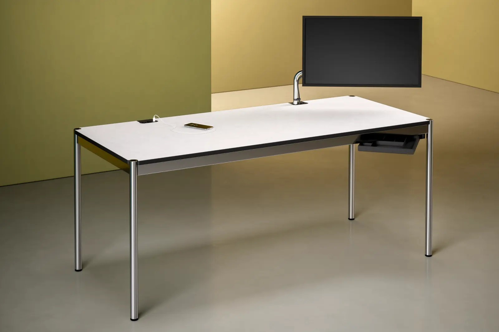

*图：Haller Tables Plus——扩展功能桌体。图源：[USM 官方 Haller Tables 页](https://www.usm.com/en/collections/usm-haller-tables)。*

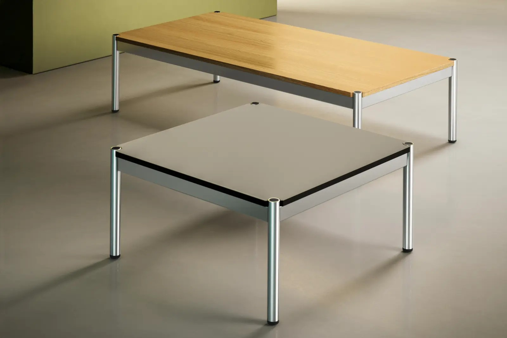

*图：Haller Side Table 边几——系统最小形态之一，入门尝鲜的核心型号（美区 US$612 起）。图源：[USM 官方 Haller Tables 页](https://www.usm.com/en/collections/usm-haller-tables)。*

### USM Haller E（2017）：把光与电写进结构

2017 年发布的 Haller E 把照明与电力直接集成进家具结构：通过 e-Balls、e-Connectors 与 e-Tubes 让结构本身导通 24V 低压电流，LED 灯带嵌入面板边缘，e-USB 充电器（5V/6.5W）藏在柜体内，无外露线材。LED 提供暖白 2700K 与冷白 5700K 两档。系统获 2017 年 FX Design Awards Lighting Product 奖与 2019 年 German Design Award（办公家具类）。Haller E 的意义在于：把"家具结构"与"电气基础设施"合而为一，是模块系统在 21 世纪的功能扩展——柜体、书架与书桌在安装时即自带照明与充电。

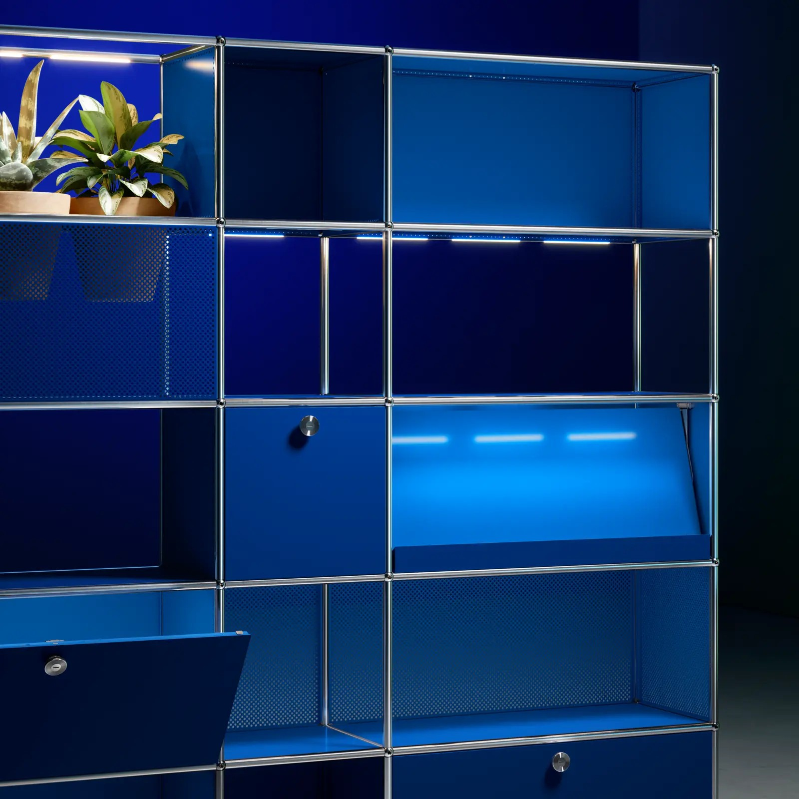

*图：Haller E 官方主视觉——蓝色柜体集成 LED 灯带发光整机，光直接写入结构。图源：[USM 官方 Haller E 产品页](https://www.usm.com/en/collections/usm-haller-system/usm-haller-e)。*

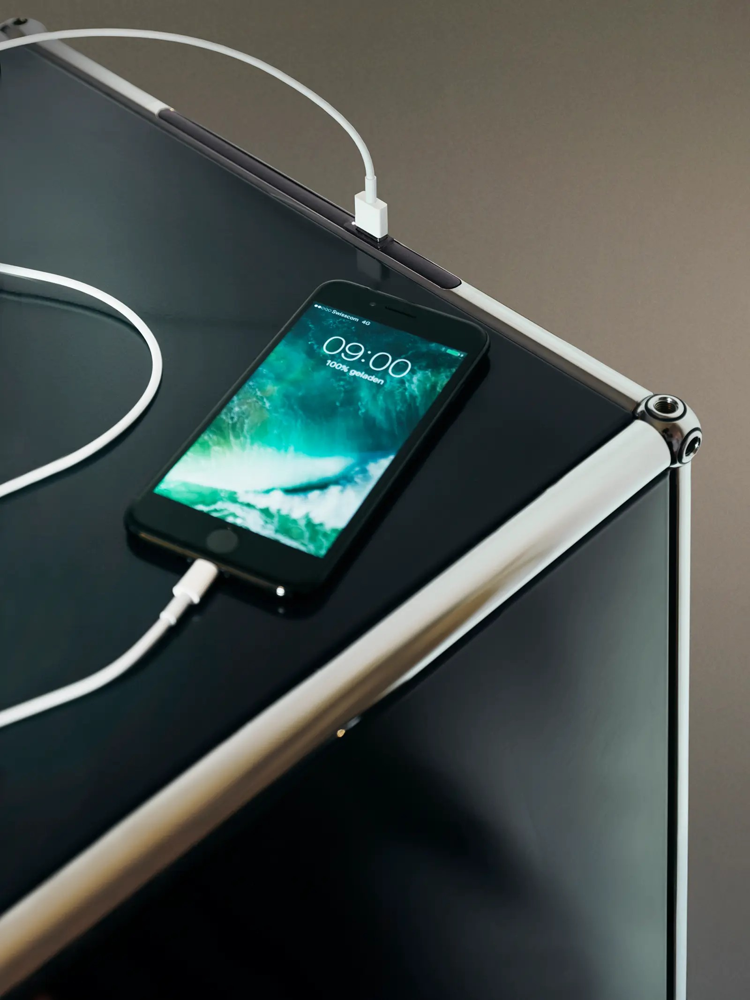

*图：Haller E e-USB 给手机充电——黑色面板与结构件走线，电气基础设施藏于柜体。图源：[USM 官方 Haller E 产品页](https://www.usm.com/en/collections/usm-haller-system/usm-haller-e)。*

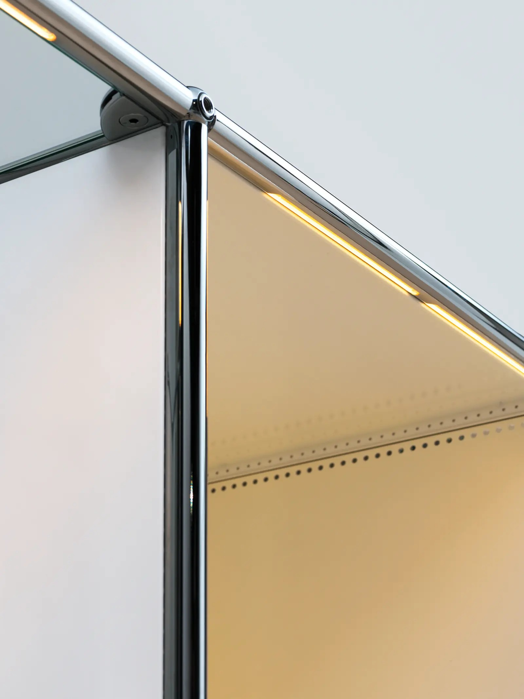

*图：Haller E 点亮细节——面板边缘 LED 灯带与镀铬节点，24V 低压电流经结构件导通。图源：[USM 官方 Haller E 产品页](https://www.usm.com/en/collections/usm-haller-system/usm-haller-e)。*

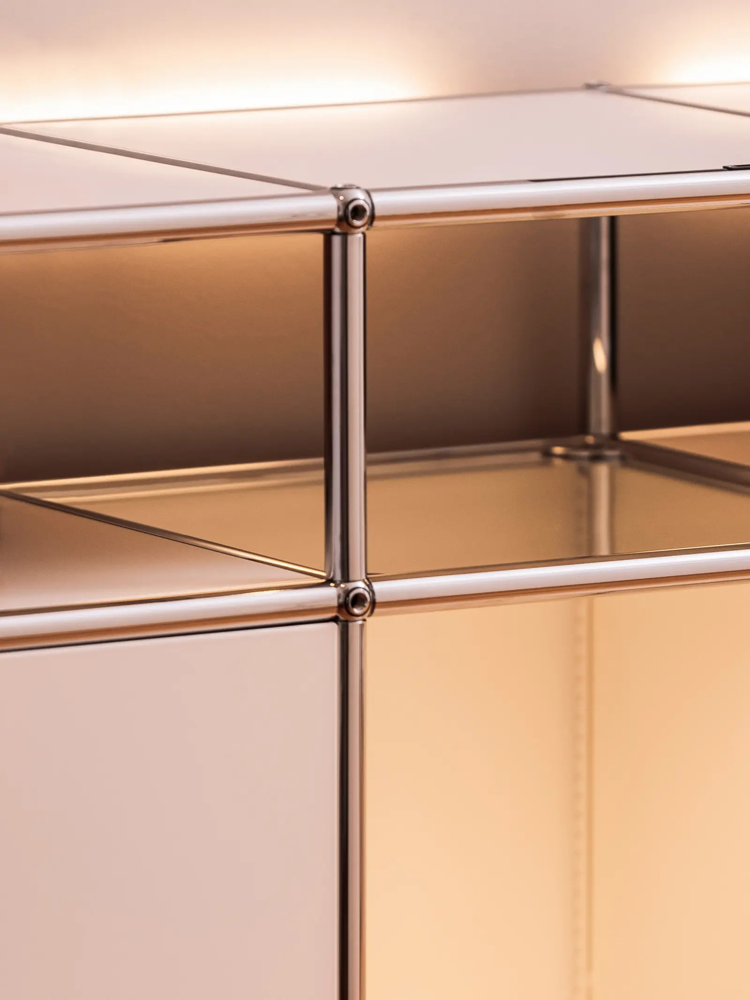

*图：Haller E 玻璃面板柜体角部——玻璃与镀铬框架、电气结构件的交接。图源：[USM 官方 Haller E 产品页](https://www.usm.com/en/collections/usm-haller-system/usm-haller-e)。*

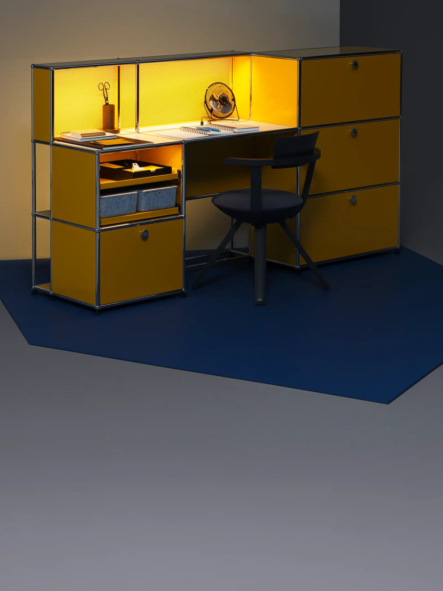

*图：Haller E 书桌场景——黄色暖调桌面与 LED 照明，居家办公的电气化模块组合。图源：[USM 官方 Haller E 产品页](https://www.usm.com/en/collections/usm-haller-system/usm-haller-e)。*

### USM Kitos：机械升降的办公桌系统

Kitos 是 Haller 办公体系下的桌子/办公桌系统，官方 Collections 归入"USM Kitos Desks"，面向共享工位（desk sharing）与动态单人办公。档案记录将 Kitos 的设计者记为 Fritz Haller 与 Paul Schärer、启动于 1965 年（Architonic 著录），与 Haller 同源；产品至迟 2007 年已获 GREENGUARD 认证，Kitos M 至迟 2018 年进入 Cradle to Cradle 认证名单。现行子型号五档：Kitos M（纯机械拉力弹簧连续高度调节，无电力消耗，调节速度约 1 秒、官方称比电动快 10 倍，高度范围 700–1200 mm，桌面尺寸含 1800/900、1750/750、1600/800 mm，另有 M Plus 版桌面可前推并内嵌配件适配点）、Kitos E（电动调节，全伸高保持稳定）、Kitos Meeting（超大尺寸会议桌，可选穿线孔）、Kitos E Freestanding（圆形/方形独立桌）与 Kitos Classic（技术型工位/会议桌）。桌面表面与 Haller 桌体一致：防火板、油毡、Fenix、木皮。Kitos M 英区样品原价 £2,825，美区按项目询价。

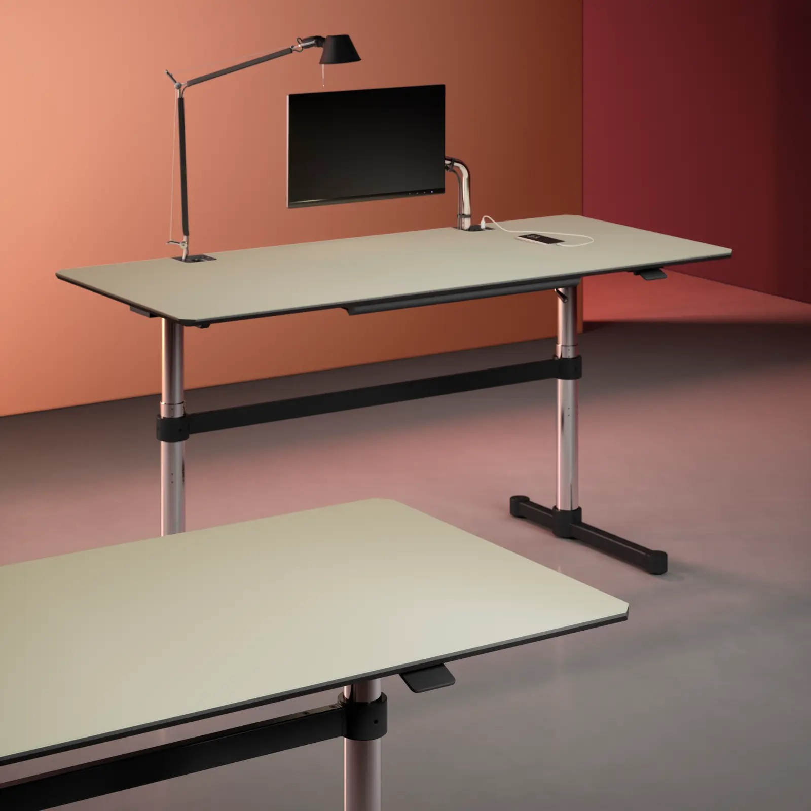

*图：Kitos M 官方主视觉——蓝/橙办公场景整机，机械拉力弹簧连续升降的现行形态。图源：[USM 官方 Kitos M 产品页](https://www.usm.com/en-uk/collections/usm-kitos-desks/usm-kitos-m)。*

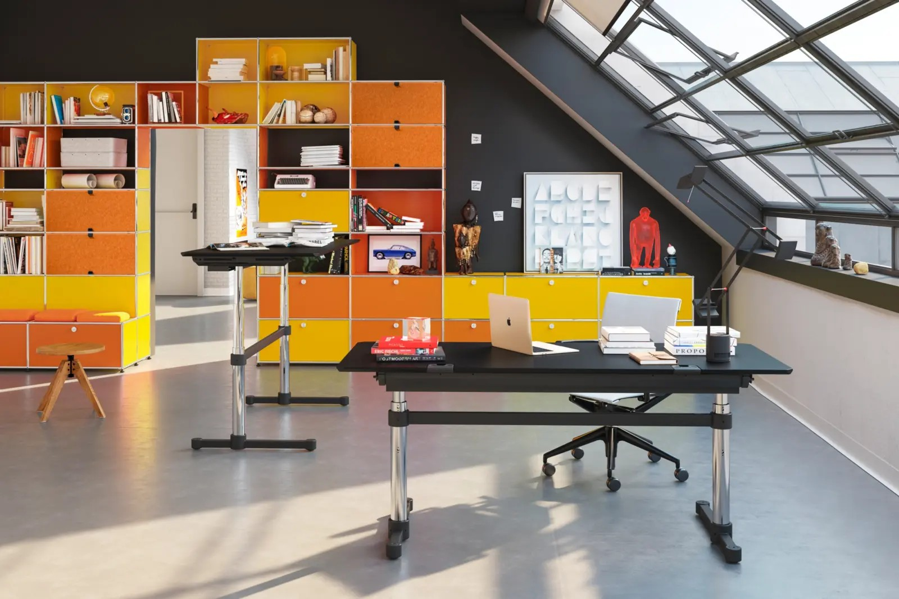

*图：Kitos 办公室多彩场景——橙/蓝/黄办公桌组合，共享工位与动态办公的典型布置。图源：[USM 官方 Kitos M 产品页](https://www.usm.com/en-uk/collections/usm-kitos-desks/usm-kitos-m)。*

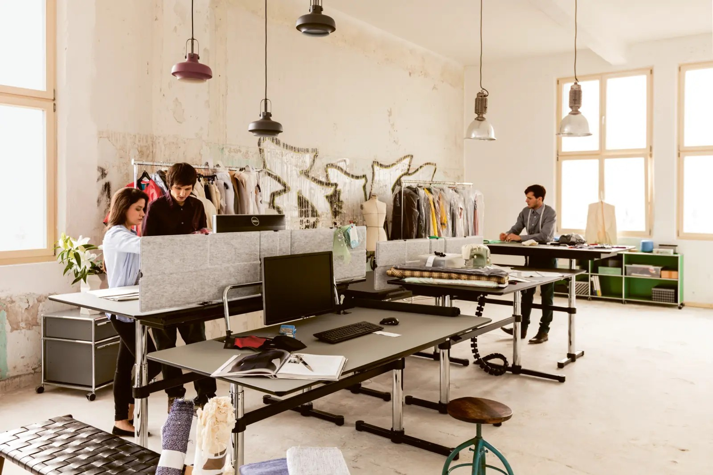

*图：Kitos 站立办公场景——机械升降的立姿使用，无功耗调节的核心卖点。图源：[USM 官方 Kitos M 产品页](https://www.usm.com/en-uk/collections/usm-kitos-desks/usm-kitos-m)。*

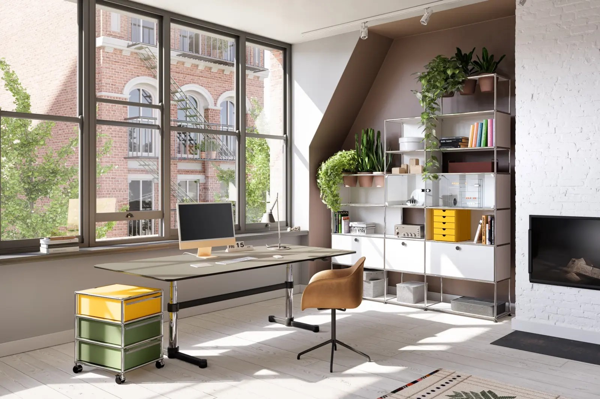

*图：Kitos M 居家办公场景——橄榄绿桌面与镀铬腿，办公桌进入住宅的用法。图源：[USM 官方 Kitos M 产品页](https://www.usm.com/en-uk/collections/usm-kitos-desks/usm-kitos-m)。*

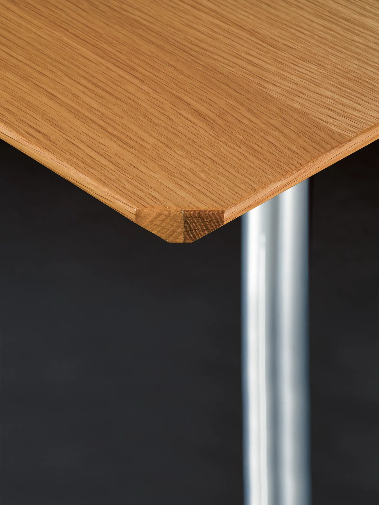

*图：Kitos 桌面材质特写——天然橡木烤漆木皮与镀铬桌腿，桌面表面对比的一例。图源：[USM 官方 Kitos M 产品页](https://www.usm.com/en-uk/collections/usm-kitos-desks/usm-kitos-m)。*

### USM Inos：抽屉内的收纳配件

Inos 是 USM 的收纳配件线：毛毡收纳盒（Inos Box，红/绿等色）与抽屉内分隔盒组（Inos Drawer Set），用于在 Haller 抽屉与开放格内细分收纳。它与柜体共用同一套色板与模块思维——把"系统"从柜体尺度延伸到柜内尺度。Inos 是系统完整性的补充件：没有它，Haller 是"柜子"；有了它，Haller 才是"收纳系统"。

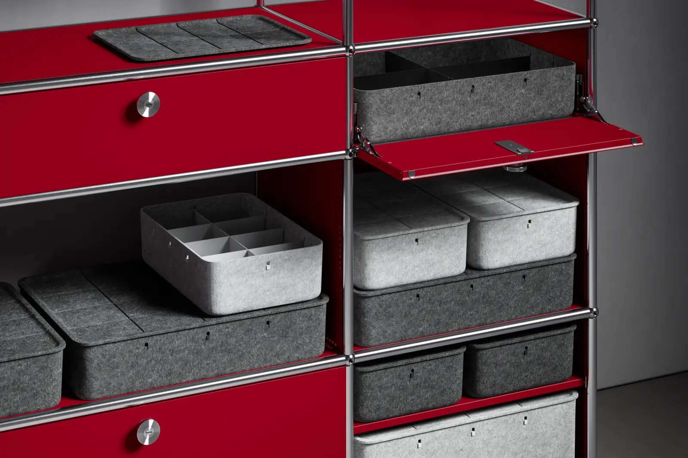

*图：USM Inos 毛毡收纳盒——红/绿等色毛毡盒叠放，系统配件线的代表。图源：[USM 官方 Collections 页](https://www.usm.com/en/collections)。*

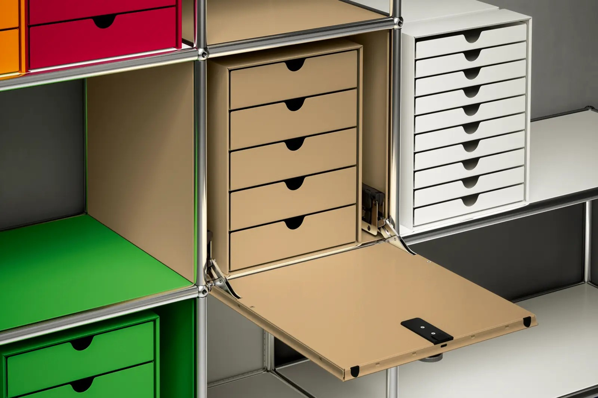

*图：USM Inos 抽屉内分隔盒组——绿/橙分隔盒拉出状态，系统从柜体尺度延伸到柜内尺度。图源：[USM 官方 Collections 页](https://www.usm.com/en/collections)。*

### USM Haller Soft Panel（2026）：磁吸软包面板

Soft Panel 是 Haller 60 周年的创新组件，2025 年 4 月米兰设计周首发，2026 年 1 月 7 日起经授权销售伙伴正式供货（英国官网另称 2025 年 9 月起售，两处口径并存）。磁吸纺织面板以四颗磁铁直接吸合到圆管结构上，免安装、可翻折；材料为高品质合成纤维，含 40% 回收 Seaqual 海洋塑料纤维，并具吸音改善空间声学的功能。三尺寸（750×350、500×350、350×350 mm）、三纹理（斜纹、弧形、直纹）、十色；Mono Panel（双面同纹同色）与 Duo Panel（一面直纹一面光面、双色组合）两种规格。开发合作方为法国设计师 Marc Venot，最终设计由美国设计工作室 JOBA（主导者 Kevin Jones）完成。这是 USM 面板家族中第一个非金属、非玻璃的材料——把"软"引入一贯"硬"的系统。

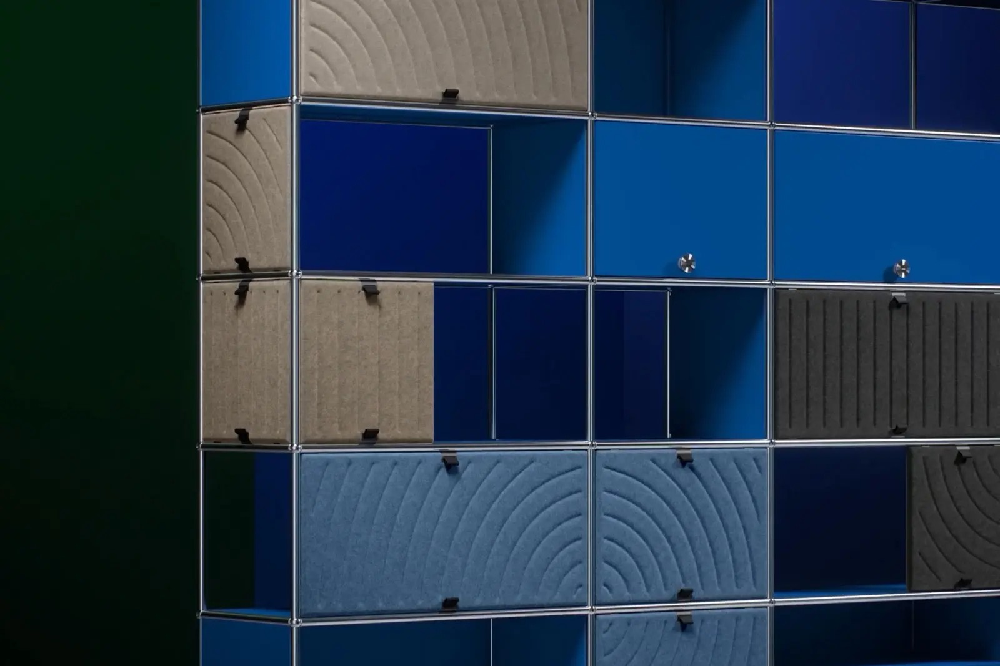

*图：Soft Panel 官方主视觉——白色柜体上磁吸橙/红/绿布艺面板组合，2026 年正式供货。图源：[USM 官方 Soft Panel 故事页](https://www.usm.com/en/stories/usm-haller-soft-panel-news)。*

*图：Soft Panel 色样——多色布艺面板立样，10 色系中的一组。图源：[USM 官方 Soft Panel 故事页](https://www.usm.com/en/stories/usm-haller-soft-panel-news)。*

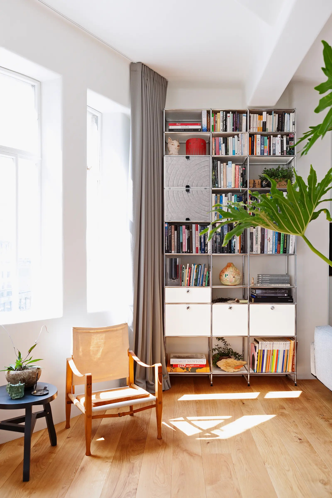

*图：Soft Panel 用于书架——灰色磁吸布艺面板嵌于搁架，吸音功能件在收纳系统中的应用。图源：[USM 官方 Haller 系统页](https://www.usm.com/en/collections/usm-haller-system/usm-haller)。*

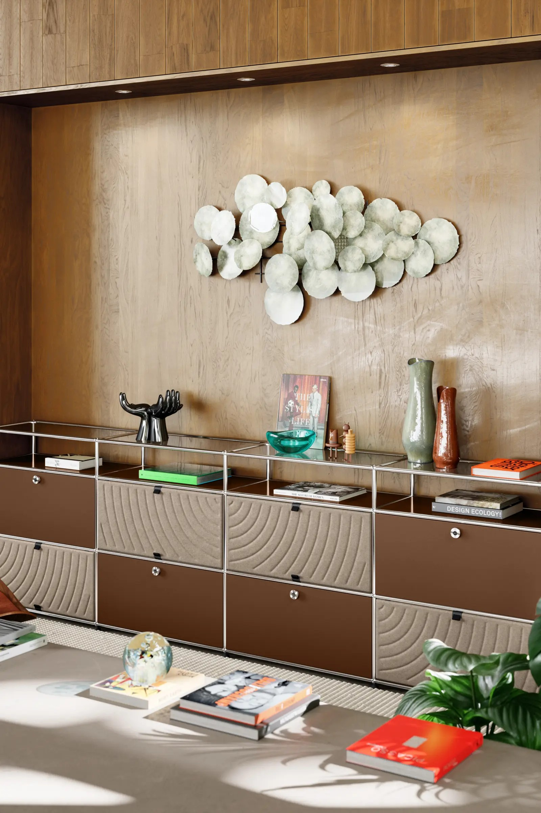

*图：Soft Panel 布艺纹理特写——斜纹/弧形/直纹三种纹理之一，含 40% Seaqual 回收海洋塑料纤维。图源：[USM 官方 Soft Panel 故事页](https://www.usm.com/en/stories/usm-haller-soft-panel-news)。*

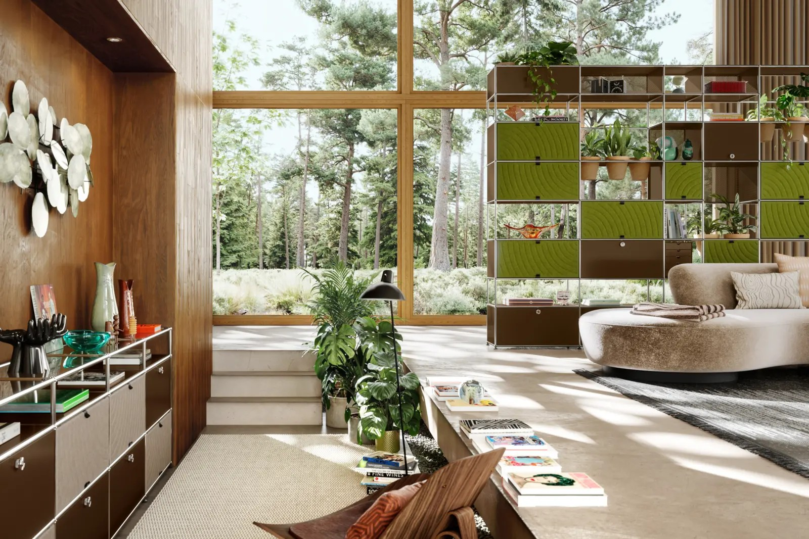

*图：Soft Panel 居家场景——棕/绿色布艺面板客厅，软包材料进入住宅空间的用法。图源：[USM 官方 Soft Panel 故事页](https://www.usm.com/en/stories/usm-haller-soft-panel-news)。*

### 六十周年与跨界：Haller 60、Labubu 与腕表

2025 年 4 月，Haller 60 周年装置在米兰设计周 Spotti Showroom 亮相，主题"Connected by our dreams"，同步发布含 100 个原创配置的 LookBook；Soft Panel 作为周年创新组件同期首发。跨界合作自 2022 年起密集展开：Daniel Arsham 的"Veiled Console Chair"覆盖式雕塑化边桌椅（2022 米兰）、THE SKATEROOM × Claudia Comte 滑板艺术限量（2023 米兰，每版 50 件手工签名）、Armando Cabral 的 Nkyinkyim 系列（2025 首章、2026 年 7 月第二章"Nkyinkyim A Casa"，8 件可组合家具配葡萄牙手工羊毛织物，2026 年初在里斯本 MAAT 展出）、Buchanan Studio 的 Tessellate 系列（11 件几何图案家具，2025）、龙家升（Kasing Lung，The Monsters/Labubu 创作者）的"Wonderland of the Monsters"（2026 米兰设计周，限量收藏件"Beautiful Thing!"——艺术家装饰的 USM 展示柜内置 Labubu"Bob"玩偶与迷你 USM 座椅，附签名证书），以及真力时（Zenith）的 DEFY Chronograph USM 特别版腕表（2026 年 10 月，表盘首次同置 USM 四色：金黄、纯橙、绿、龙胆蓝）。这些合作共同的特征是：不改变系统本体，而以限量件与装置为系统引流。

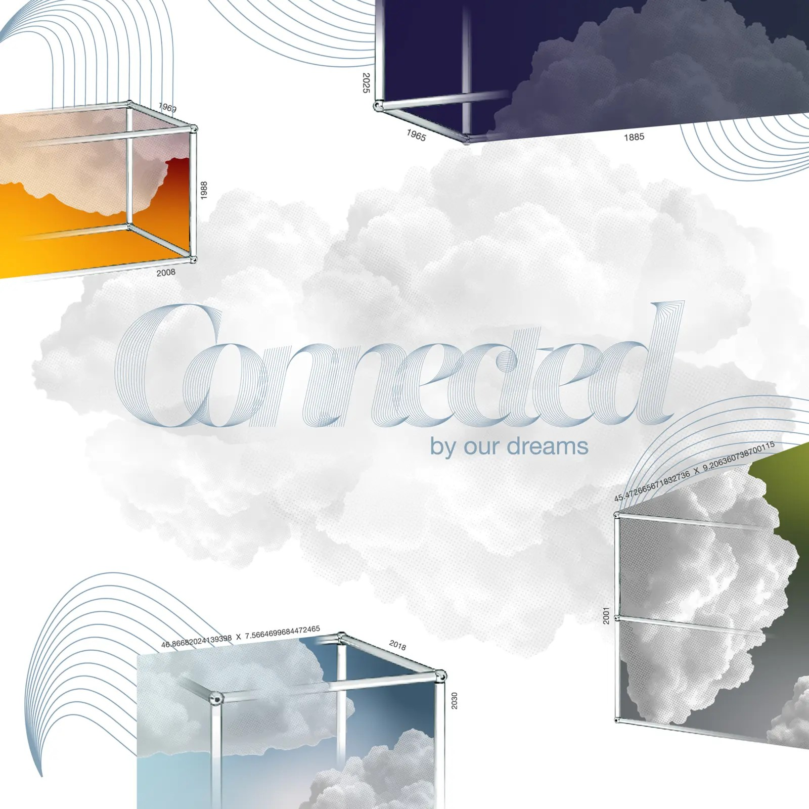

*图：2025 米兰设计周 Haller 60 周年装置主视觉"Connected by our dreams"——Spotti Showroom，云朵与玻璃柜组成的周年装置。图源：[USM 官方米兰设计周故事页](https://www.usm.com/en/stories/usm-at-milan-design-week-2025)。*

*图：2026 米兰设计周"Wonderland of the Monsters"（USM × 龙家升）官方主视觉——限量收藏件"Beautiful Thing!"装置。图源：[USM 官方故事页](https://www.usm.com/de-de/magazin/wonderland-of-the-monsters)。*

## 08 Aesthetics 美学：镀铬、喷粉钢与低饱和色板

### 视觉识别与字标：圆球与灰底的系统感

USM 的视觉识别围绕系统本身展开：封面字标为灰底正圆内白色斜体"USM"加右侧灰色"Modular Furniture"字样；官网与印刷品另用镀铬球＋黑圆"USM"锁版。识别系统刻意保持"工程感、非时尚品"的气质：没有渐变、没有插画化的生活方式渲染，产品图一律白底或真实场景直出；官网、产品册与色卡共用同一套大留白、中性灰与低饱和色语言——与产品本身的"无品牌感中性"形成闭环。设计评论常把这种状态描述为"无品牌感"，USM 官方未直接使用该词。

### 色彩与材料情绪：低饱和基底与点状高饱和

色彩策略是"低饱和基底＋点状高饱和"：14–15 种标准色中，黑、白、铬为识别基础，灰阶与橄榄绿、钢蓝承担"工具感"，金黄、纯橙、龙胆蓝、陶土红承担"记忆点"。色板在不同品类间严格统一——柜体、桌体、配件与软包面板共用一个色系逻辑，因此橄榄绿柜体与橄榄绿毛毡盒在同一个空间里天然成套。材料情绪上，哑光喷粉钢承担"工业感"，镀铬承担"精密感"，玻璃承担"通透感"，木皮与油毡承担"居住感"，2026 年的布艺 Soft Panel 则第一次引入"柔软层"。

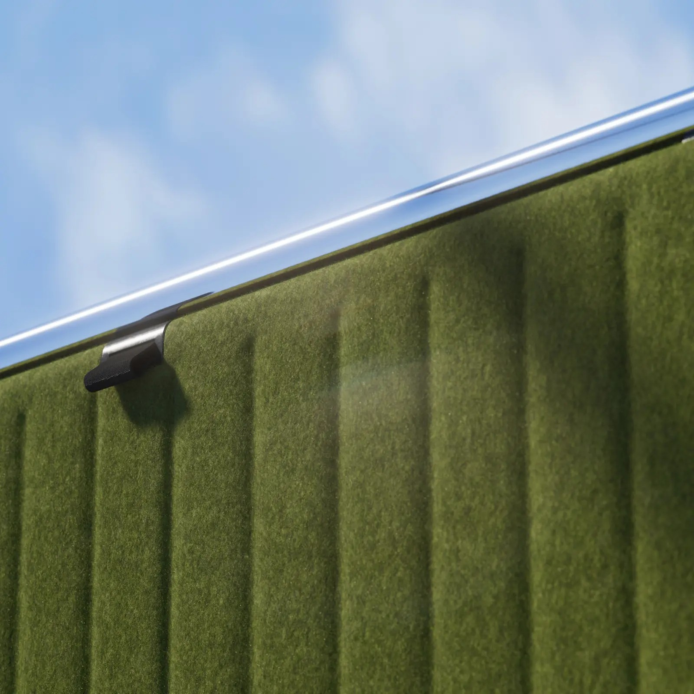

*图：Soft Panel 竖纹绿色面板 keyvisual——软包布艺作为新"材料层"加入系统，低饱和色板在纺织物上的呈现。图源：[USM 官方 Soft Panel 故事页](https://www.usm.com/en/stories/usm-haller-soft-panel-news)。*

### 形态、比例与空间：球心距网格上的秩序

USM 的形态语法是模数化的：球心距网格（宽 75/50/37.5 cm、高深 35 cm 模数）决定一切比例，圆柱钢管、平板面板与球头节点三种原型反复出现，几乎不用曲线与有机形。比例上偏"工程尺度"而非"家具尺度"——柜体的厚薄、桌面的大小都由网格决定，而非审美直觉。细节语言高度一致：外露的镀铬节点、可见的管件、面板边缘的锐利折角，把"结构即装饰"当成设计语言本身——这与把接缝藏起来的高端家具美学正相反。整墙陈列时，模块的重复本身构成空间秩序，展厅（如伯尔尼总部展厅）以整墙 Haller 系统作为空间主轴。

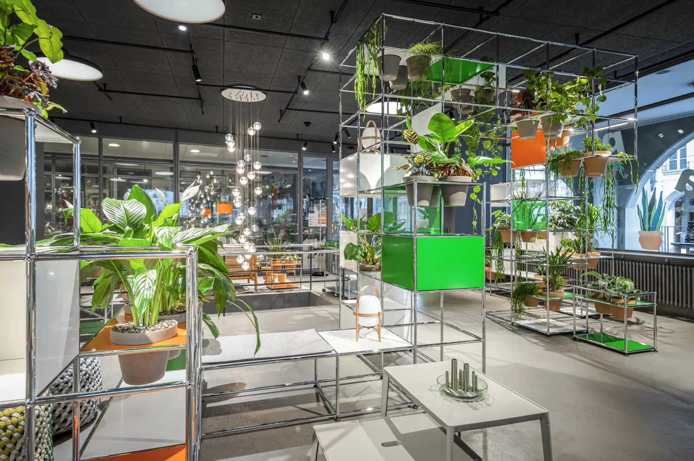

*图：Bern 总部自营展厅室内——整墙 USM Haller 系统陈列与绿植，模块重复构成空间秩序。图源：[USM 官方 Showrooms 页](https://www.usm.com/en/how-to-buy/showrooms)。*

### 光线与表面：哑光与镀铬的对照

USM 的表面语言建立在两组对照上：哑光喷粉钢（微颗粒"softly grained"质感）与高光镀铬（镜面反射）并置，形成"工业物在光下的两种存在"；玻璃面板与钢面板并置，形成通透与封闭的对照。Haller E 把这种语言推进到"光本身"：LED 沿面板边缘发光，镀铬节点在暗处成为星点。官方环保口径与表面直接相关：喷粉"无溶剂、无铅等重金属"，镀铬"近全部为三价铬"（较六价铬环境危害低）。

## 09 Design 设计：建筑模块思想缩到家具尺度

### 设计哲学：系统而非单件

USM 的设计哲学源自一次"建筑尺度到房间尺度"的移植：1961 年 Paul Schärer Jr. 委托 Haller 设计新工厂时，要求建筑本身就是一个可随生产流程扩张、重组的钢结构模块体系；1962 年开发的家具系统是同一套模块思想在房间尺度上的产物——"家具像建筑一样，不是围绕单件家具、而是围绕一套可改造、可重组的钢模块系统建立"（not built around individual parts but a system of steel modules that could be adapted and reconfigured）。官方手册对设计理念的转述是："Haller 的想法是把基于现代主义美学的家具做到极致，使其像他的建筑一样能适应各种需求与多次变化。"这是 USM 官方手册的表述，非 Haller 本人原话。官方核心价值页把这条哲学讲得更直接："Modularity is not just a gimmick of USM furniture, it's a belief system."（模块化不是噱头，是信念体系。）

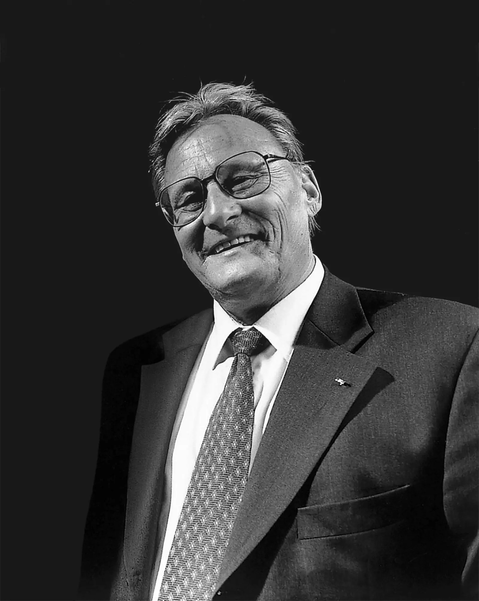

*图：USM 历史档案黑白肖像（官方故事页配图，页面未具名）——家族掌门时期的企业形象。图源：[USM 官方故事页](https://www.usm.com/en/stories/creative-since-1965)。*

### 设计信念的形成：建筑师与工程师的二人组

USM 的设计决策权不在外部明星设计师手中，而在"建筑师＋工程师"的组合里：Fritz Haller 提供建筑模块的思想框架，Paul Schärer Jr. 提供金属加工与工程落地的能力，两人自 1962 年起共同开发，1965 年定稿。此后的系统演进同样遵循"系统内部生长"而非"大师加入"的逻辑——2017 年 Haller E 的电气化、2022 年 Lock C 的机电化、2025 年 Soft Panel 的软包化，都由公司内部团队与受邀工作室完成（Soft Panel 为法国设计师 Marc Venot 与 JOBA 工作室）。品牌没有"某位大师的风格"，只有"Haller 系统的语言"；外部合作者（Arsham、Cabral、Buchanan、龙家升）只能做限量支线与装置，不进入主线产品。Haller 系统是 Fritz Haller 唯一的家具设计作品，这条"唯一性"也成为设计史叙事的锚点。

### CMF 体系：钢为基座的材料金字塔

> 术语注释：CMF（Color-Material-Finish，色彩-材料-表面处理）——设计中对产品色彩、材质与表面质感的系统化组合决策。

材料金字塔以钢为基座：镀铬钢管承担框架（铬色恒定、不随面板变化），喷粉钢板承担面板主体（14–15 色、哑光）；玻璃面板承担通透层（单格安全玻璃，托架黑或镀铬）；木皮、油毡与 Fenix 承担桌面与居住层（天然漆橡木、黑漆橡木、白油橡木、油毡五色、Fenix 两色）；Inos 毛毡承担柜内柔软层；2026 年 Soft Panel 布艺承担表面柔软层（40% Seaqual 回收海洋塑料、吸音）；声学面板与穿孔金属面板承担功能层。表面处理几乎只用哑光与镀铬两类——USM 拒绝装饰性高光，因为哑光钢在几十年后会显旧，而"显旧得体面"正是其时间叙事的材料基础。环保工艺与材料直接绑定：喷粉无溶剂无重金属、镀铬近全部三价铬、钢高度可回收、组件可拆可逆兼容。

*图：Münsingen 生产车间内景——钢桁架屋顶与大面积钢窗的空阔厂房，Haller 模块化建筑体系的首个落地项目。图源：[USM 官方德文品牌史](https://www.usm.com/de-ch/ueber-usm/geschichte)。*

### 制造：Münsingen 单一产地与机器人＋工匠

全产品线在瑞士伯尔尼附近 Münsingen 工厂生产（官方原文：All USM products are manufactured at the factory in Münsingen, near Bern in Switzerland）。厂区规模官方手册称厂房楼面 50,000 平方米，瑞士媒体 Encore 2018 年实地报道称厂区 22,439 平方米、欧洲进口钢卷上机后裁剪/冲孔/折弯，两处数字口径不同（占地 vs 楼面），并存。自动化与手工的边界：官方称"训练有素的工匠与前沿机器人协同"，2011 年引入 Schröder 钣金自动化加工中心用于钢卷钣金处理；质量测试以数据背书——每扇门铰链开合测试 40,000 次以保证无异响。员工规模约 500 人（英文现行口径；德文历史缓存 400 余人）。"Swiss made"直接出现在官网产品页与 Trade 页表述中。

*图：Münsingen 工厂装配场景——工人组装黄色喷粉面板的 Haller 带轮车，钢管框架成摞待装。图源：[USM 官方故事页](https://www.usm.com/en/stories/creative-since-1965)。*

*图：Münsingen 总部厂区现代外观——白色/钢框玻璃长厂房与草坪，1965 年厂房群的当代状态。图源：[USM 官方故事页](https://www.usm.com/en/stories/creative-since-1965)。*

### 品牌主张对照表

| 品牌主张（官方表述） | 官方证据 | 产品证据 |
|---|---|---|
| 永恒、可持续、可随代际需求演变的设计 | 官网开篇 | 1960 年代部件可与今天新购部件直接组合 |
| 模块化不是噱头，是信念体系 | 官方 Our Values 页 | 球心距模数网格、跨系列组件混搭 |
| 不是围绕单件、而是围绕一套钢模块系统 | 官方 Our Story | 柜/桌/书架/办公桌共用球头节点 |
| 可持续设计的世界领导者 | 官方自我定位 | Cradle to Cradle 认证线占营收 92% 以上、SBTi 目标 |

## 10 Experience 体验：配置器、展厅与 14–16 周交期

### 体验机制：配置器、展厅、Trade 程序与质保

USM 的体验体系建立在"设计自己的系统"这一前奏之上。官网在线配置器（Configurator）提供 3D 交互搭建，分 Storage Configurator 与 Table Configurator，支持从零开始或从经典款模板改起、以"Configurator code"保存与回溯、AR 实景预览看进自己房间；美区口径定制件交付周期 14–16 周。8 家自营展厅（Bern、Hamburg、Munich、London、Paris、Tokyo、Shanghai、New York）同时承担"文化空间与客户支持平台"双重功能，内部工作站、会议室、接待区与厨房均用 USM Haller 搭建，驻店专家用高级建模软件按客户需求设计、可多次改方案。B2B/Trade 程序面向设计师与建筑师，提供 AutoCAD 2D/3D、SketchUp、Revit 模型与规划工具，官方称提供"从设计到安装及之后"的全流程服务。质保为 2 年有限质保（自交付起，不含表面状况、正常磨损与疏忽）；官方明确支持欧洲活跃的二手市场，作为耐用叙事的一部分。

*图：纽约 28–30 Greene Street 自营展厅——古典立面联排建筑，8 家自营展厅之一。图源：[USM 官方 Showrooms 页](https://www.usm.com/en/how-to-buy/showrooms)。*

### 体验的口碑结构

正面证据：官方可持续页与第三方报道共同支撑"耐用、可修、可改"的体验承诺——铰链 4 万次开合测试、零件跨代兼容、翻新二手市场活跃、平均司龄国际 11.5 年/瑞士总部 15.5 年（员工稳定性间接反映交付质量）。负面证据：中国媒体曾报道 2024 年上海新天地旗舰店相关纠纷（第三方转述，细节待官方复核）。综合看，USM 的口碑结构是"工程品质背书强、零售体验依赖展厅与经销商深度服务"——与它"配置器＋展厅＋900 家伙伴"的渠道结构一致，大件定制走项目制交付，是家族制造企业的典型服务半径。

## 11 Competition 竞品：模块收纳赛道里的设计博物馆阵营

### 模块收纳竞品矩阵

USM 的竞品不是普通家具品牌，而是同为"系统型"的设计博物馆级品牌。2026-10-26 各品牌官网或主流经销商现行挂价对照：

| 品牌 | 结构原理 | 材质 | 入门价 | 整柜/整墙价 | 与 USM Haller 重叠 | 错位 |
|---|---|---|---|---|---|---|
| USM Haller | 钢球接头＋钢管框架 | 钢（喷粉/镀铬）+ 玻璃/木皮/油毡面板 | 边几 US$612 | 边柜 US$3,500–5,900；玻璃展柜 US$12,000+ | — | — |
| Vitsœ 606 | 铝轨墙挂 | 阳极氧化铝 | 搁板 €95/块、柜体 €855 起 | 整墙方案按模块累加 | 书架/收纳系统 | 无落地柜体；Dieter Rams 遗产叙事；按年摊还定价话术 |
| Vitra（收纳线） | 馆藏再版单品 | 钢/木/塑料 | Corniche £55 | ESU 搁架 £2,124–2,785 | 同为设计博物馆级品牌 | 非模数系统；营收主体是椅/沙发 |
| String | 薄钢板壁挂搁架 | 薄钢板 | DWR 扩展件 US$297 起 | 带抽屉落地架 €1,195 起 | 壁挂收纳 | 价格约 USM 1/3；轻薄、大众高端 |
| Montana | MDF 立方体拼柜 | 16 mm 喷漆 MDF | 基础模块 €937 | 整墙方案 €4,804 起 | 可拼柜收纳、设计师指定 | 彩色 MDF vs 钢；高饱和色彩矩阵 |
| Muuto Stacked | 壁挂叠放模块 | 板材/木 | 单模块 €175 | Bookcase 8 €2,548 | 年轻住宅收纳 | 入门价仅 USM 1/10；柔和北欧、轻量 |

### 竞品定位与收束判断

Vitsœ 606（德国，Dieter Rams 1960）是墙挂铝轨系统，官方"honest pricing"单一全球价目表，以"按年摊还"定价话术著称；Vitra（瑞士）的收纳线是馆藏再版单品（ESU 搁架 £2,124–2,785），非模数系统；String（瑞典，1949）是薄钢板壁挂搁架，价格带约为 USM 的 1/3–1/2；Montana（丹麦，1972）是 16 mm 喷漆 MDF 彩色立方体，单价与 USM 落地柜接近但材质与色彩逻辑错位；Muuto Stacked（丹麦，2006）单模块 €175 起，入门价约为 USM 的 1/10。USM Haller 在"落地式钢质模数柜体"这一形态上没有同形态直接对手——Vitsœ 在墙上、String 轻薄壁挂、Montana 是彩色 MDF、Muuto 轻量叠板、Vitra 不做系统。真正的竞争发生在"设计师指定清单"内部：客户预算给定后，USM 常与 Vitsœ 606、Montana System 三选一；USM 的价格带显著高于 String/Muuto，接近或高于 Vitsœ。

## 12 Strategy 战略：从窗五金到可持续设计领导者

### 定位演进：五金杂货铺 → 模块系统 → 生活系统

USM 的定位经历了四个阶段。1885–1960：乡村五金杂货铺与窗五金制造商——金属加工能力与"什么都能做"的杂业传统；1962–1969：建筑师＋工程师联合开发，家具系统从家族自用走向量产，首单即巴黎罗斯柴尔德银行 600 工位；1970–2000：全球办公家具供应商——子公司进入德国、法国、美国，系统成为欧洲办公室的常见配置；2000 年后：从"办公家具"转向"workplace or home"的通用模块化生活系统——官方表述"永恒、可持续、可随代际需求演变的设计，无论在工作场所还是在家中"（timeless, sustainable design that evolves with our needs, generation after generation, whether in the workplace or at home）。2020 年代的品牌叙事把系统推向居家：卧室只售收纳/床头柜/斗柜/搁架（无床产品线），客厅场景、居家办公与"making places home"手册构成居家化证据。

### 可持续战略：2030 完全循环

USM 的可持续战略有明确时间线：官方愿景 2030 年成为完全循环企业（fully circular company）；减排目标经 SBTi 批准，以 2021 为基准年，2030 年前范围 1+2 绝对温室气体减排 42%、范围 3 减排 25%；认证方面，Haller 与 Kitos M 两条线占营收 92% 以上，获 Cradle to Cradle 认证（2018 年起），四条主线均获 GREENGUARD 低排放认证（官方年份口径 2007/2008 并存）；工艺上，三价铬替代六价铬、喷粉无溶剂无重金属、钢可高度回收、组件可拆可逆兼容。社会维度：国际平均司龄 11.5 年、瑞士总部 15.5 年，性别薪酬平等，Fondation USM 非营利基金会资助文化与科学项目（含扶持有色人种新锐设计师的 HUE+MAN Design Competition 与年度 USM Design Grant）。

### 标杆项目与文化影响力

官方项目史清单中的标杆项目全部为顶级建筑师作品中的办公配置：1969 巴黎罗斯柴尔德银行（600 工位）、1975 米兰 Mondadori（Oscar Niemeyer）、1995 巴黎法国国家图书馆（Dominique Perrault，办公室全部采用）、2004 伦敦瑞士再保险总部"小黄瓜"（Foster + Partners，15 层）、2005 纽约 MoMA 新馆（谷口吉生，办公室）、2007 纽约 Bank of America Tower（CookFox，10 层）、2014 巴黎路易威登基金会（Frank Gehry，办公室）。这套"顶级建筑师作品里的 USM"清单构成 B2B 权威叙事，与 MoMA 永久馆藏、1988 年应用艺术作品认定共同构成文化背书组合。治理层面：家族企业第四代管理，Alexander Schärer 2000 年起任 CEO，未上市、未引入外部投资者；近年动作包括 2019 年 Münsingen 总部"future offices"混合办公空间、2021 年"A world of plants"植物面板系列、2022 年 Lock C 机电锁、2025 年 Haller 60 周年、2026 年 Soft Panel 供货——节奏慢于快时尚家具品牌，与"系统长期主义"的定位一致。

## 13 视频与访谈资料

- USM 官方品牌史（Our Story，1885–2030 时间线全文）：[usm.com/en/about/our-story](https://usm.com/en/about/our-story)
- USM 官方故事页"Creative since 1965"（球头节点与工厂影像）：[usm.com/en/stories/creative-since-1965](https://www.usm.com/en/stories/creative-since-1965)
- USM Haller 系统官方产品页（配置器入口）：[usm.com/en/collections/usm-haller-system/usm-haller](https://www.usm.com/en/collections/usm-haller-system/usm-haller)
- 家族私宅 das Buchli 专站（建筑史与翻修记录）：[buchli.usm.com](https://www.buchli.usm.com/)
- IGNANT 2017 年 USM 工厂实地访谈（1963 厂房与 1965 Pavilion 建筑逻辑）：[ignant.com](https://www.ignant.com/2017/05/03/the-philosophical-furniture-systems-of-usm-haller/)
- Encore Magazine 2018 年 Münsingen 工厂实地报道（PDF）：[encore-mag.ch](https://encore-mag.ch/wp-content/uploads/april2018-1.pdf)
- TEC21 2021 年 das Buchli 翻修专文（PDF）：[bernhard-furrer.ch](https://www.bernhard-furrer.ch/wp-content/uploads/2021/10/BE-Mu%CC%88nsingen-Haus-Buchli-_-TEC21_34_2021_gesamt_low-res.pdf)

## 14 来源与延伸阅读

### 官方一手来源

- USM 官方品牌史（多语言时间线，1885/1920/1961/1962/1965/1969/1975/1988/1994/2001 节点）：[usm.com/de-ch/ueber-usm/geschichte](https://www.usm.com/de-ch/ueber-usm/geschichte)
- USM 官方 Our Story 页（最新叙事口径）：[usm.com/en/about/our-story](https://usm.com/en/about/our-story)
- USM Haller 系统/Haller E/Haller Tables/Kitos M/Soft Panel/Showrooms/Sustainability 官方页面（价格与产品口径 2026-10-26 实查）：[usm.com](https://www.usm.com/en/)
- 官方中国站（人民币挂价与上海展厅信息）：[usm.cn](https://www.usm.cn/)
- das Buchli 专站：buchli.usm.com；Fondation USM 基金会：fondation-usm.ch

### 馆藏、档案与认证

- MoMA 建筑与设计永久馆藏（USM Haller，2001）：[moma.org](https://www.moma.org/collection/)
- Cradle to Cradle Certified（Haller/Kitos M，2018 起）、GREENGUARD（四条主线）：[c2ccertified.org](https://www.c2ccertified.org/) / [greenguard.org](https://www.greenguard.org/)
- SBTi 目标（以 2021 为基准年，范围 1+2 −42%、范围 3 −25%，2030）：[sciencebasedtargets.org](https://sciencebasedtargets.org/)

### 设计媒体与第三方

- Architonic（Kitos 设计者著录）：[architonic.com](https://www.architonic.com/)
- IGNANT 工厂访谈（2017）、Encore Magazine（2018，PDF）、TEC21 das Buchli 专文（2021，PDF）
- 市场口径：Mordor Intelligence（模块化家具 2026 约 916 亿美元/CAGR 6.9%）、Statifacts、Growth Market Reports、Market Research Intellect——四组口径差异见正文，方向性参考

## 15 分析附录

### 产品组合矩阵

| 产品线 | 形态 | 首年版（设计/量产） | 现行状态 | 材质/色板 | 07 章配图 |
|---|---|---|---|---|---|
| USM Haller System | 柜/书架/收纳/办公 | 1965 定稿/1969 量产 | 主线在产 | 喷粉钢 14–15 色＋镀铬框架＋玻璃/木皮/油毡/Fenix 面板 | 4 张 |
| Haller E | 电气化柜体/书架 | 2017 发布 | 在产 | 同上＋LED 2700K/5700K、e-USB 5V/6.5W | 5 张 |
| Haller Tables | 桌/边几 | 与 Haller 同期 | 在产 | 防火板/油毡/Fenix/木皮/玻璃桌面 | 3 张 |
| Kitos Desks | 办公桌/升降桌 | 1965 启动（档案著录） | 在产 | 与 Haller 同桌面体系；M/E/Meeting/Freestanding/Classic | 5 张 |
| Inos | 毛毡盒/抽屉分隔件 | 现行配件 | 在产 | 毛毡红/绿等色 | 2 张 |
| Soft Panel | 磁吸布艺面板 | 2025 米兰首发/2026-01 供货 | 在产 | 合成纤维 40% Seaqual 回收海洋塑料；3 尺寸/3 纹理/10 色 | 5 张 |
| 附件/集成 | Lock C 机电锁、隐私屏风 | 2022（Lock C） | 在产 | 机电、织布 | 随文 |
| 跨界限量 | Arsham/Cabral/Buchanan/龙家升/Zenith | 2022–2026 | 限量 | 艺术家定制 | 2 张（装置） |

### CMF 速查

| 层 | 材料 | 表面 | 色板 | 备注 |
|---|---|---|---|---|
| 框架 | 钢管 | 镀铬 | 铬色恒定 | 直径约 19 mm；球心距网格 |
| 节点 | 黄铜球 | 镀铬 | 铬色恒定 | 25.4 mm/47 g；六孔 M8 |
| 面板 | 钢板 | 无溶剂喷粉 | 14–15 色 | 哑光、微颗粒质感 |
| 通透层 | 单格安全玻璃 | 光面 | 透明 | 托架黑或镀铬 |
| 居住层 | 木皮/油毡/Fenix | 哑光 | 天然漆橡木等 | 桌面体系 |
| 柔软层 | Soft Panel 布艺 | 织物 | 10 色 | 40% Seaqual 回收海洋塑料；吸音 |
| 柜内层 | Inos 毛毡 | 织物 | 红/绿等 | 抽屉细分收纳 |

### 关键事实证据登记

| 事实 | 证据级别 | 来源 |
|---|---|---|
| 1885 年 Ulrich Schärer 创立金属作坊 | A（官方一手） | usm.com 官方时间线（多语言页） |
| 1965 年球头连接件定稿并申请专利、新厂揭幕 | A | 官方时间线（1965 节点三事） |
| 1969 年量产、巴黎罗斯柴尔德银行 600 工位首单 | A | 官方 Our Story/时间线 |
| 2001 年 USM Haller 入藏 MoMA 永久馆藏 | A | 官方时间线＋MoMA Design Store 著录 |
| 1988 年德国法院认定应用艺术作品 | A（转引官方） | 官方 Our Story（"1988 work of applied art"） |
| 球接件直径约 25.4 mm/约 47 克 | B（媒体转述，官方未单列规格） | 设计媒体/官方手册口径 |
| Kitos 设计者著录 Fritz Haller & Paul Schärer、1965 启动 | B（第三方档案） | Architonic 著录（官方现行页未单列） |
| 专利号 | 待核实 | 公开专利数据库未检出 |
| 营收（2017 约 2 亿瑞士法郎） | C（第三方转述） | 媒体转述，官方未确认 |
| 员工 500 人 vs 400 余人 | B（官方两版本口径并存） | 官方英文现行页 vs 德文历史缓存 |
| "systems, not products"标语 | C（媒体转述） | 官网未检出，正文未采用 |

### 待核实事项清单

- 1965 年专利申请的具体专利号（公开数据库未检出）
- "USM"缩写含义：官方 Origin 页口径为 Ulrich Schärer + Münsingen，未发现 1901 年更名节点（官方多语言时间线均无）
- 工厂文保状态：das Buchli 私宅获官方修缮专站与 TEC21 专文，工厂本身的州级文保级别未见官方明确著录
- 员工规模口径（英文现行 500 余人 vs 德文历史缓存 400 余人）随扩张并存，无统一最新值
- 营收与利润不公开披露（第三方 2017 约 2 亿瑞士法郎未获官方确认）
- Fondation USM 年度资助金额等基金会运营数字未公开
- Daniel Arsham 2022 联名、World of Plants 2021 系列的官方产品页已下线（404），细节以媒体记录为准
- Haller 60 周年 LookBook（100 配置）为实体印刷物，未发现全文在线版
- 2024 年上海新天地旗舰店相关纠纷为中国媒体转述，官方未发布说明

