# ABOUT VIPP

更新于 2026-10-23  ·  基于 v4.4

目录

|  |  |
|---|---|
| [01 开篇](#01-开篇) | [09 Design 设计：把日常功能物做成可感知的设计体验](#09-design-设计把日常功能物做成可感知的设计体验) |
| [02 品牌概述](#02-品牌概述) | [10 Experience 体验：让你睡进产品里的品牌](#10-experience-体验让你睡进产品里的品牌) |
| [03 Brand 品牌：从 Randers 金属作坊到 MoMA 与设计宇宙](#03-brand-品牌从-randers-金属作坊到-moma-与设计宇宙) | [11 Competition 竞品：北欧同侪与微型建筑赛道](#11-competition-竞品北欧同侪与微型建筑赛道) |
| [04 Category 品类与市场：窄而贵的钢制生活品牌](#04-category-品类与市场窄而贵的钢制生活品牌) | [12 Strategy 战略：从垃圾桶到民宿矩阵的五级跳](#12-strategy-战略从垃圾桶到民宿矩阵的五级跳) |
| [05 User 用户与场景：定者买者用者与住客](#05-user-用户与场景定者买者用者与住客) | [13 视频与访谈资料](#13-视频与访谈资料) |
| [06 Positioning 定位：一件用了几十年的日常物件](#06-positioning-定位一件用了几十年的日常物件) | [14 来源与延伸阅读](#14-来源与延伸阅读) |
| [07 Product 产品：从一只脚踏桶到一座可居住的钢壳](#07-product-产品从一只脚踏桶到一座可居住的钢壳) | [15 分析附录](#15-分析附录) |
| [08 Aesthetics 美学：哑光黑的工业语言与自然野景](#08-aesthetics-美学哑光黑的工业语言与自然野景) |  |

## 01 开篇

1939 年，丹麦日德兰半岛小城 Randers，美发沙龙老板 Marie Nielsen 对丈夫说：\"Holger，我的沙龙需要一个废纸桶，你能给我做一个吗？\"金属作坊主 Holger Nielsen 用车间里的手艺做出第一只脚踏垃圾桶，取名 Vipp——家族认为名字来自丹麦语 vippe（倾斜、翘起），形容桶盖一开一合的翘动。这只桶在 1950 年代成为丹麦牙医诊所的标准配置，却要再等五十年，才会被一个不打算用它装垃圾的地方看中。

1992 年 Holger 去世后，小女儿 Jette Egelund 接管公司，金属厂里只剩她和另一名员工。她是一位没有商科学位的社工，却做了一件改变品牌命运的事：把这只原本卖给诊所的工业桶，带进伦敦 The Conran Shop 的货架。2009 年 11 月，Vipp 脚踏桶进入纽约 MoMA 建筑与设计永久馆藏——官方原话是\"唯一一个它被严格当作装饰的地方\"（the only place where it functions strictly as décor）。2014 年秋，Vipp Shelter 落在瑞典湖边：一间 55 平方米的黑色钢壳，CEO Kasper Egelund 本想\"把预制房像货架产品一样卖\"，结果一台也没卖出去，却意外开启了品牌的民宿矩阵。

本报告要回答的问题是：一件 87 年前为理发店做的日常物件，如何长成一个\"设计宇宙\"——从垃圾桶到厨卫配件、灯具、家具、模块化厨房，再到 55 平方米的微型建筑和横跨五国的民宿；一个只有约 60 名员工的家族企业，如何在被集团收购潮包围的北欧设计界里，保持 100% 家族持有、拒绝上市；以及\"80 多年生产同一件产品\"这件事本身，如何成为品牌的存在理由与护城河。

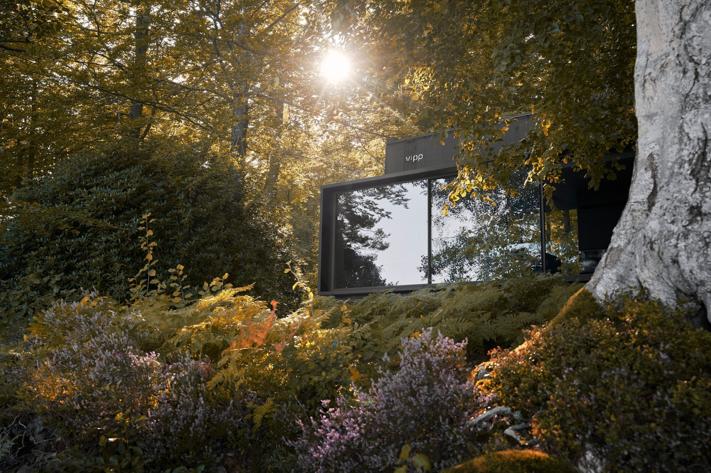

*图：Vipp Shelter 临湖外观：黑色钢壳 pod 架于桩基之上、面向瑞典 Lake Immeln 湖面，是品牌从\"配件商\"转向\"可居住设计物\"的标志性产品。图源：[Vipp 官方品牌史页](https://vipp.com/en/world-of-vipp/our-story/heritage/from-marie-to-moma-and-beyond)。*

## 02 品牌概述

Vipp 是 1939 年由金属工匠 Holger Nielsen 在丹麦 Randers 创立的家族设计品牌，现由第三代 Egelund 家族 100% 持有。它以一件脚踏垃圾桶（pedal bin）为原点，延展为垃圾桶、厨卫配件、灯具、家具、模块化厨房与微型建筑的全线\"工业感钢制生活方式\"品牌；2009 年脚踏桶进入纽约 MoMA 永久馆藏，2014 年起以 Shelter 与遍布全球的民宿（Guesthouses）把\"产品体验\"变成住宿。官方自述品牌为\"the basis of an entire design universe\"（一个完整设计宇宙的基础）。

| 项目 | 内容 |
|---|---|
| 品牌名 | Vipp（维普）· [https://vipp.com](https://vipp.com) |
| 国家/地区 | 丹麦（1939 年创立于日德兰半岛 Randers；总部 Snorresgade 22, 2300 哥本哈根 S） |
| 成立时间 | 1939 年第一只脚踏桶（法人 VIPP DESIGN A/S 1997 年注册，1999 年更名 VIPP A/S） |
| 创始人 | Holger Nielsen（约 1914–1992，金属旋压/车工出身，1932 年彩票中车卖车换车床起家） |
| 代表性设计人物 | Morten Bo Jensen（2006 年起首席设计师，in-house 团队）；Jette Egelund（第二代掌门）、Kasper Egelund（CEO，第三代）、Sofie Christensen Egelund（品牌设计识别，第三代） |
| 官方理念 | \"Rather than creating more, we create better\"（与其创造更多，不如创造更好）；\"80 多年生产同一件产品是我们的存在理由\"；品牌史自述从一只桶长成\"设计宇宙\" |
| 品牌归属 | 100% Egelund 家族持有（JE-Holding / KE-Holding / SCE-Holding 三家家族控股 ApS）；未上市、未被任何集团收购 |
| 核心业务 | 脚踏垃圾桶、厨卫配件、灯具、家具、模块化厨房（V1–V4）、户外系列、微型建筑与民宿（Vipp Guesthouses / Vipp Residences） |
| 经典产品 | Vipp Pedal Bin（1939）、Vipp Lighting（2017 首发）、The Chair Vipp451（2019，首椅）、Vipp Cabin 家具系列（2020）、Vipp Shelter（2014 建成/2015 发布） |

## 03 Brand 品牌：从 Randers 金属作坊到 MoMA 与设计宇宙

### 1932：彩票、车床与 Randers 金属作坊

1932 年春，17 岁的 Holger Nielsen 在 Randers 体育场看本地足球队比赛时，凭一张入场券附送的彩票赢得了一辆汽车。他没有驾照，索性把车卖掉，把钱投资在一台金属车床上，随后在 Randers 建起自己的金属作坊。他的学徒工种是金属旋压工/车工（丹麦语 metaldrejer）——这个身份决定了他此后一生都在\"车\"金属：旋压、冲压、焊接。官方品牌史把这段起点写得极简：\"In 1932, 17-year-old Holger Nielsen won a car in a lottery. But with no driver's license, he decided to sell it and invest the money in a metal lathe.\"（1932 年，17 岁的 Holger Nielsen 在抽奖中赢了一辆汽车；没有驾照，他决定卖掉它，把钱投在一台金属车床上。）

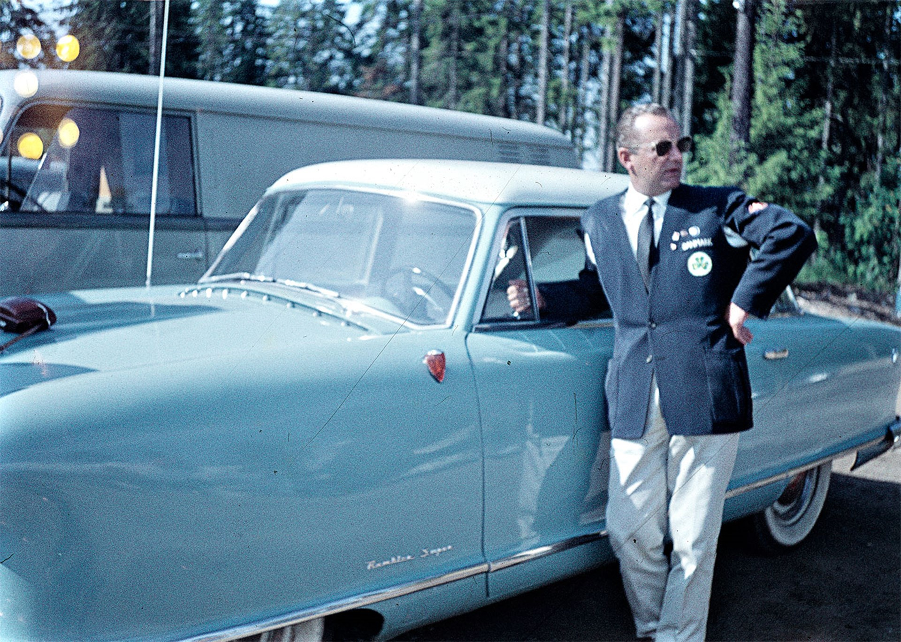

*图：创始人 Holger Nielsen 肖像——金属旋压工出身，1932 年彩票中车、卖车换车床，在 Randers 建起金属作坊。图源：[Vipp 官方品牌史页](https://vipp.com/en/world-of-vipp/our-story/heritage/from-marie-to-moma-and-beyond)。*

### 1939：Marie 的理发店与第一只脚踏桶

1939 年，妻子 Marie Axelsen 在 Randers 开了一家女子美发沙龙，向 Holger 提出那个著名的请求：\"我需要一个废纸桶，你能给我做一个吗？\"Holger 在车间里做出第一只脚踏桶，MoMA 馆藏页补充了细节：他一共做了三只放进店里，理发店的客人——本地牙医、医生的太太们——看到后开始为自己的诊所订购。MoMA 著录的用途史明确：\"Although initially used primarily in medical offices, Vipp bins proved well-suited for domestic use as well.\"（虽然最初主要用于医疗诊所，Vipp 桶后来被证明同样适合家庭使用。）命名方面，官方措辞谨慎：小女儿 Jette 认为名字来自丹麦语 vippe（倾斜、翘起），MoMA 称之为拟声词——这是家族口述解释，不是 Holger 本人留下的定论。

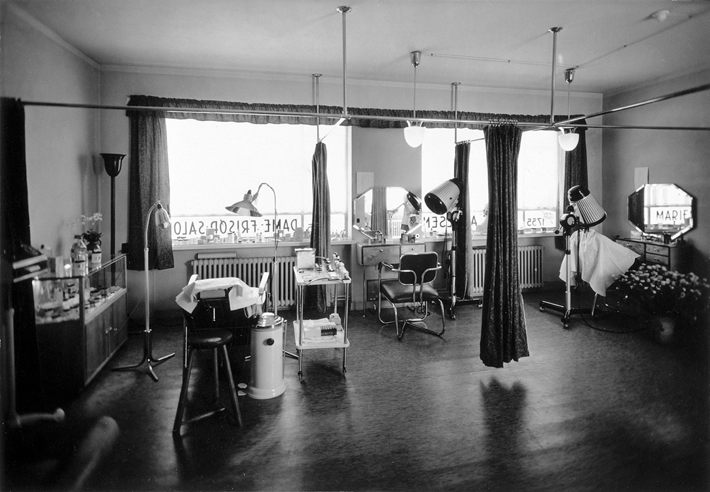

*图：Marie Nielsen 的理发店外观——1939 年第一只 Vipp 脚踏桶的诞生地，也是品牌 B2B 起点的来源：客人从这里把桶带进诊所。图源：[Vipp 官方品牌史页](https://vipp.com/en/world-of-vipp/our-story/heritage/from-marie-to-moma-and-beyond)。*

### 1949–1991：深拉工艺与丹麦诊所的五十多年

1940 年代末，不锈钢深拉（deep-drawing）工艺成熟，Holger 投资液压机，把桶盖从旋压改为冲压的圆拱顶（domed lid）——今天 Vipp15 的经典造型就此定型；MoMA 同时馆藏了 1939 与 1949 两个版本。此后四十多年，生产一直在 Randers 的小作坊里继续，产品几乎完全面向牙医、医生、理发店等专业 B 端市场。官方口径：\"by the 1950s the Vipp bin had become a regular feature in clinics and other businesses throughout Denmark\"（到 1950 年代，Vipp 桶已成为丹麦各地诊所与商业场所的常见配置）。坊间流传的\"1980 年代停产、家族转售\"在本轮检索的官方与二手来源中均无记录——真正的危机节点是 1992 年 Holger 去世。

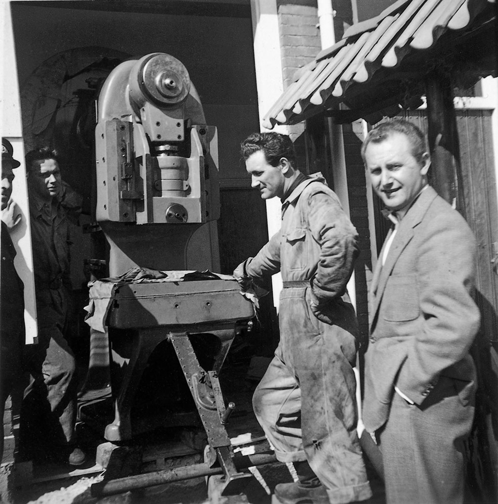

*图：Randers 早期金属工厂车间——从 1939 年到 1990 年代初，Vipp 桶在这里连续生产了四十多年。图源：[Vipp 官方品牌史页](https://vipp.com/en/world-of-vipp/our-story/heritage/from-marie-to-moma-and-beyond)。*

### 1992：Jette 接手与 B2B 转 B2C

1992 年初 Holger 去世，Marie 本打算把工厂卖掉，小女儿 Jette Egelund 接手——公司只剩她和另一名员工。Jette 的职业背景是社工（social worker），没有正式商科学位；WSJ 杂志 2018 年报道她接手时公司\"只做两款产品，都是翻盖垃圾桶\"。她的目标是把 Holger 的设计从商业场所带进私人住宅：走访斯堪的纳维亚高端设计店屡屡被拒，直到伦敦与巴黎的 The Conran Shop 下单，官方历史页称\"Jette knew she was on the right track\"（Jette 知道她走对了路）。1998 年因设备老化，部分生产外包到丹麦 Lolland 岛，同年她把两个孩子 Sofie 与 Kasper 带入公司。

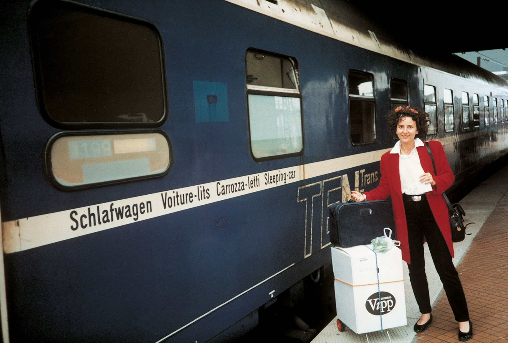

*图：第二代掌门 Jette Egelund 1992 年接手时的工厂场景——从一名员工起步，把 B2B 的诊所桶转向 B2C 的私人住宅市场。图源：[Vipp 官方品牌史页](https://vipp.com/en/world-of-vipp/our-story/heritage/from-marie-to-moma-and-beyond)。*

### 1995–2009：Conran Shop 与 MoMA 馆藏

1995 年 Conran Shop 的订单打开了国际设计零售渠道；2004 年公司迁入哥本哈根一处百年皇家印刷厂旧址，并第一次外聘外部设计师开发新产品（皂液器、毛巾系列）；法人实体沿革上，1997 年 3 月注册为 VIPP DESIGN A/S、1999 年更名 VIPP A/S、2005 年起固定在 Snorresgade 22。2009 年 11 月，Vipp 脚踏桶被纽约 MoMA 建筑与设计永久馆藏收编，著录为\"Holger Nielsen. Pedal Bin (model 15). 1939\"，object number 1332.2009，捐赠方为制造商；MoMA 策展人 Chay Costello 的评价被官方转载：\"It's a true humble masterpiece. The no-frills industrial aesthetic and efficient pedal exemplify good design.\"（一件真正的谦逊杰作，朴素的工业美学与高效的脚踏机构是良好设计的范例。）值得注意的是：Vipp 的美国代理团队承认，进入 MoMA 馆藏是他们主动向策展与零售部门争取的结果——这是品牌运作，不是偶然的荣誉。

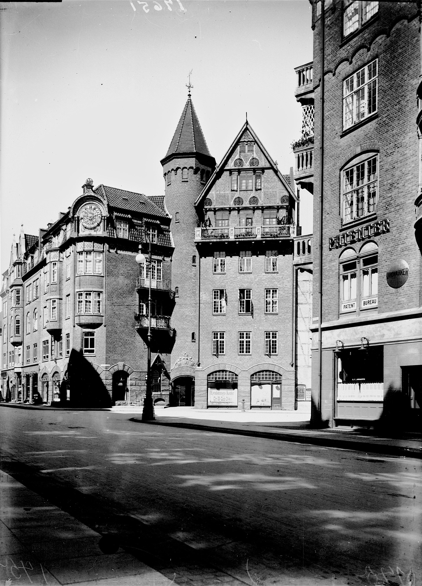

*图：哥本哈根博物馆的 Vipp 展览现场——2009 年 MoMA 馆藏后，品牌以博物馆体系背书开展叙事。图源：[Vipp 官方品牌史页](https://vipp.com/en/world-of-vipp/our-story/heritage/from-marie-to-moma-and-beyond)。*

### 2011–2014：模块化厨房、首个概念店与权力交接

2011 年，Vipp 推出第一套模块化厨房（V1 Kitchen），同年晚些时候在哥本哈根市中心开出首家概念店——官方时间线说\"Based on the simple aesthetic and functionality of Holger's design, we created our first modular kitchen in 2011\"（基于 Holger 设计的简洁美学与功能，我们在 2011 年创造了第一套模块化厨房）。也是在这一年，Jette 把 CEO 交给儿子 Kasper（WSJ 杂志口径\"handed over the reins to Kasper in 2011\"；丹麦公司登记中 Kasper 的法定 Direktør 身份更新于 2022 年底，两处口径并陈）。2014 年秋，Vipp Shelter 在瑞典 Lake Immeln 落下——一个被官方后来称为\"误判的商业想法\"（misjudged business idea）的起点。

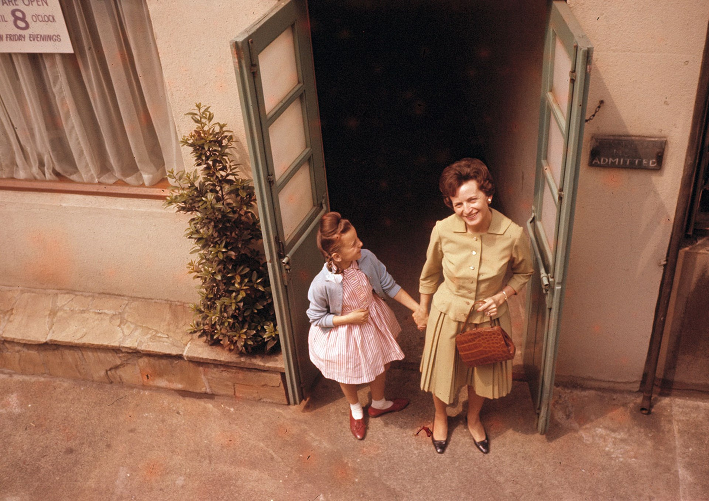

*图：第二代掌门 Jette Egelund 与创始人妻子 Marie 的合影——1992 年接班、2011 年交棒给儿子 Kasper 的家族传承节点。图源：[Vipp 官方品牌史页](https://vipp.com/en/world-of-vipp/our-story/heritage/from-marie-to-moma-and-beyond)。*

### 2014–2026：Shelter、民宿矩阵与第三代治理

Shelter 的初衷是\"把预制房像货架产品一样卖\"，市场反应热烈、赢得奖项，\"但我们一台也没卖出去\"（We didn't sell a single unit）——唯一一台售出的 Shelter 买家在西弗吉尼亚。品牌随后把策略从\"卖小屋\"转为\"开民宿\"（Reluctantly, Vipp made a U-turn. Instead of selling Shelters, they began renting it out），由此发展出今天的 Vipp Guesthouses 民宿矩阵：2026 年 10 月已覆盖瑞典、丹麦、挪威、拉脱维亚、法国、意大利、美国、墨西哥、澳大利亚塔斯马尼亚等地，官方口径在\"13 处目的地、第 11 家开业\"之间并存（不同页面统计口径不同）。治理结构上，截至 2026 年 10 月公司仍由 Jette、Kasper、Sofie 三人通过三家家族控股 ApS 全资持有，无任何外部财务投资者——坊间\"2014 年 Nordic Capital 入股\"的说法在 Nordic Capital 官网投资组合与丹麦 CVR 登记中均无对应记录；2026 年 6 月董事长换任为 Mikkel Vendelin Olesen，约 60 名员工，2025 财年净利润约 1,819 万丹麦克朗。

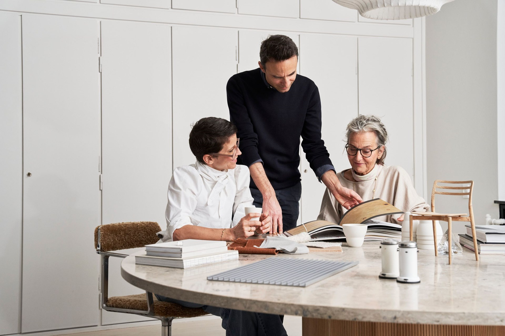

*图：第三代 Egelund 家族合影（Kasper Egelund 与 Sofie Christensen Egelund）——CEO 与品牌设计识别负责人，2026 年公司仍由家族三家控股公司全资持有。图源：[Vipp 官方品牌史页](https://vipp.com/en/world-of-vipp/our-story/heritage/from-marie-to-moma-and-beyond)。*

## 04 Category 品类与市场：窄而贵的钢制生活品牌

### 品类定义：两个采购逻辑不同的口径

Vipp 对外销售的真实业务要拆成两个口径看。**口径一：北欧高端家居配件与生活方式用品**——这是营收主体。起点是 1939 年的脚踏垃圾桶，现延展为一条\"工业感钢制生活方式\"产品线：六档容量的脚踏桶家族、开口桶与办公桶、卫浴配件、灯具、家具、模块化厨房。采购方式是消费者或设计师按件下单，官网 D2C 直接挂价发货，单价从约 95 欧元（微缩桶摆件）到数万美元的厨房/家具不等；这一口径买的是\"一件能用三十年、朋友会问的工业设计物件\"，溢价来自 MoMA 馆藏背书与三代家族的钢作传统。**口径二：微型建筑/预制小屋**——这一口径 Vipp 自己已经退出销售、转做了酒店：2014 年落下的黑色钢壳小屋本意是把房子当产品卖，最终只售出一台，此后品牌把这台钢壳转为民宿出租，并延伸出民宿矩阵与共有制度假屋（Vipp Residences）。任何档案里若写\"Vipp 卖微型住宅\"，都应改写为\"Vipp 2014 年试水预制住宅销售失败后，将钢壳小屋转化为品牌体验型民宿矩阵\"。

### 市场规模的判断口径

第三方机构对这两个市场的统计口径差异很大，以下只作方向性参考。北欧家居装饰市场（Home Décor）2023 年收入约 25.1 亿欧元、2023–2028 年 CAGR 约 3.7%（Statista）；丹麦家具消费市场约 275 亿丹麦克朗（约 37 亿欧元）。微型住宅（tiny house）赛道则是\"十亿美元级、低速增长\"的细分：Mordor Intelligence 估 2025 年全球约 13.6 亿美元（窄口径，轮式/微型可居住单元），Market Data Forecast 给到 61.7 亿美元（宽口径，含模块化小屋）——两个数字差近 5 倍，说明该赛道无统一统计口径。行业共识是：高端设计预制屋的死穴不是设计、不是价格，而是物流、基础配套与各地建筑法规——Vipp 官方自述\"巨大的物流障碍\"正是这一点。Vipp 自身是典型\"窄而高\"的家族设计公司：2025 财年净利润约 1,819 万丹麦克朗、税前利润约 2,445 万、净资产约 2.37 亿，约 60 名员工，年营收量级估计在 2–3 亿丹麦克朗区间（注册数据未直接披露营业额，缺口如实标注）。

### 价格带：2026 年 10 月官方渠道实查

vipp.com 官网 D2C 直接挂价（欧洲主站欧元计价、美国站美元计价），以下为 2026-10-23 实查的现行官方挂牌价（未含税差与运费）：

| 型号（编号） | 产品 | 官方欧元价 | 备注 |
|---|---|---|---|
| Vipp12 | Pedal Bin 3 L | From €195 | 最小脚踏款 |
| Vipp13 | Pedal Bin 4 L | From €265 | 浴室入门（美区 USD 335） |
| Vipp14 | Pedal Bin 8 L | From €285 | 美区 USD 375 |
| Vipp15 | Pedal Bin 14 L | From €355 | 对应 MoMA 馆藏 model 15 的现行尺寸 |
| Vipp16 | Pedal Bin 18 L | €415 | 厨房主力款，10 年质保，碳足迹 25kg CO₂ |
| Vipp17 | Pedal Bin 30 L | From €515 | 现行线最大脚踏款 |
| Vipp18 | Open Top Bin 22 L（敞口） | €305 | 无脚踏 |
| Vipp19 | Open Top Bin 60 L（敞口） | €415 | 北欧经销商价约 €356 |
| Vipp52 | Office Bin 35 L | €275 | 带滚轮 |
| Vipp3 | Pedal Bin Miniature 微缩摆件 | €95 | 礼品/收藏款 |
| Vipp524 | Wall Spot 壁灯 | €265 | 灯具入门款 |
| Vipp521 | Desk Lamp 台灯 | From €399 | 可调臂 |
| Vipp525 | Floor Lamp 落地灯 | €535 | |
| Vipp526–528 | Pendant 吊灯 | From €329 | 三尺寸 |
| Vipp530 | Table Lamp 台灯 | €345 | 拉绳款 |
| Vipp591/592 | Sculpture Table Lamp | €539 | 玻璃+大理石，检索时小号缺货 |
| Vipp9 | Soap Dispenser 皂液器 | €105 | 定制泵头 |
| Vipp9W | Soap Dispenser Wall 壁挂 | €115 | 锁定机构 |

价格带的结论：Vipp 没有百元人民币级的入门灯，壁灯起步即 265 欧元；与 Muuto、Normann Copenhagen 等北欧同侪相比单价明显偏上，与它的\"钢制工业＋MoMA 背书\"定位一致。微型建筑方面，黑色钢壳民宿作为产品已无官方报价（历史报价：2015 年首发 US$580,000–585,000 不含运输安装、2017 年 €485,000）；现行可查价格是民宿房价——民宿工作日 €1,000/最少 2 晚、周末 €1,200/2 晚，哥本哈根 Chimney House 从 €1,000/晚起，塔斯马尼亚 Tunnel 从 AUD 970/晚起。需要注意：这是\"住一晚\"的价格，与\"买一栋\"是两回事。

### 渠道结构

Vipp 的渠道分四路：一是 **D2C 官网电商**——vipp.com 多语言多国家站直接挂价、加购下单，官方条款明确\"官网订单按面向终端消费者的直营交易处理\"，配送欧洲与美国走 UPS、丹麦走 GLS；二是**自营旗舰/展厅**——哥本哈根 Vipp Home（Ny Østergade 34，约 125–150 平方米，按真实居家场景陈列）、总部 Vipp Campus（Snorresgade 22，2005 年起）、纽约 Vipp Studio（39 Lispenard Street）、上海旗舰店（2022 年 9 月开业，509 平方米，当时全球最大零售空间，由 Scandi Trading 运营）；三是**全球经销商网络**——官网 Store Locator 分 Retail Partner 与 Preferred Partner 两档，覆盖布拉格、奥斯陆、维尔纽斯、伦敦、赫尔辛基、苏黎世、巴黎等欧洲主要城市；四是**民宿即渠道**——14 处 Guesthouses 是官方口中的\"进入我们设计宇宙的门户\"（a doorway into our design universe），客人在真实厨房/浴室里用全套 Vipp 产品后反向转化购买。中国市场现状：上海旗舰店在营、无官方天猫/京东旗舰店（线上以平行进口与买手店为主），官方中文内容有限。

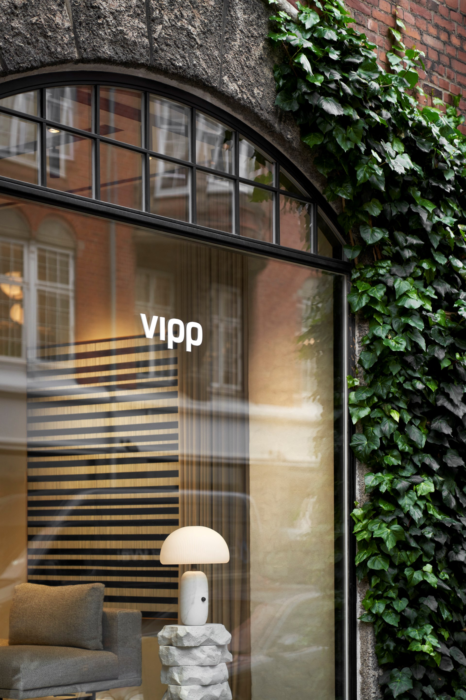

*图：Vipp Home 哥本哈根旗舰店门面（Ny Østergade 34）——按真实居家场景陈列的 125 平方米概念店，是品牌 D2C 零售的母本。图源：[Vipp 官方品牌史页](https://vipp.com/en/world-of-vipp/our-story/heritage/from-marie-to-moma-and-beyond)。*

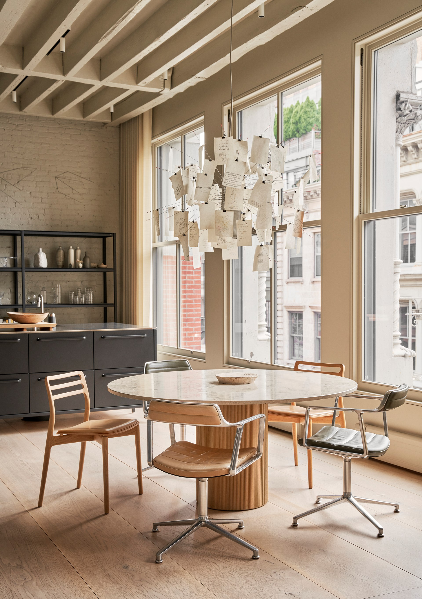

*图：Vipp Studio 纽约展厅——第三代 Sofie 与丈夫 Frank 2014 年起常驻纽约拓展美国市场。图源：[Vipp 官方品牌史页](https://vipp.com/en/world-of-vipp/our-story/heritage/from-marie-to-moma-and-beyond)。*

## 05 User 用户与场景：定者、买者、用者与住客

### 决策链：四方参与的采购结构

与大多数高端设计品牌\"定者、买者、用者分离\"不同，Vipp 因为民宿业务多了一方——**住客**。定者是建筑师与室内设计师，他们在项目里指定 Vipp 厨房与全屋方案，北欧买手店（Finnish Design Shop、Skandium、Nomart）与 3daysofdesign 设计周是他们的触点；买者是高净值住宅业主与高端酒店/民宿运营方，客单价从单件陈设（一只垃圾桶、一盏壁灯）到整套厨房的数万美元级工程；用者/体验者是民宿客人——他们住一晚 1,000 欧元的钢壳民宿，在真实厨房里摸到脚踏桶的阻尼、冲孔灯的光，回家后反向到官网或上海店购买，这是 Vipp 独有的\"用者→买者\"转化漏斗；此外还有礼品/收藏客，以 95 欧元的微缩桶与 MoMA 馆藏叙事为入口。

> 术语注释：JTBD（Jobs to Be Done，用户任务）——用户\"雇佣\"产品完成的功能、情感与社会任务。
> 术语注释：CEP（Category Entry Points，品类入口）——用户首次意识到需求、接触品类的具体场景与渠道。

### 四类场景中的任务与入口

| 场景 | 核心 JTBD | 主要 CEP | 典型型号/入口 |
|---|---|---|---|
| 住宅自购 | 买一件\"能传代、有博物馆背书、朋友会问\"的工业设计物 | 设计媒体刷灵感 → vipp.com 查价下单 → 旗舰店看实物 | 脚踏桶、厨卫配件、灯具 |
| 设计师配单 | 在图纸阶段指定有工艺故事、有规格书的钢制方案 | 3daysofdesign 展位、买手店、官网规格页 | V1–V4 厨房、家具线 |
| 民宿住客 | 在真实产品环境里体验\"设计宇宙\"，回家后转化购买 | Guesthouses 预订页、社交媒体实拍 | Shelter、Cold Hawaii、Tunnel 等 14 处 |
| 礼品/收藏 | 买一件\"博物馆同款\"作为文化礼物 | MoMA 馆藏叙事、微缩桶、Art Bins 艺术桶 | Vipp3 微缩桶、限量联名色 |

值得注意的体验差异：Vipp 的购买体验是\"慢决策、重交付\"——官网直接下单但价格不菲、无冲动消费入口；真正被反复讨论的购买触点反而是\"住过之后\"。官方把这种体验定义为：\"the basis of an entire design universe\"——你买的不是一个垃圾桶，而是一整套可被感知的工业设计语言。

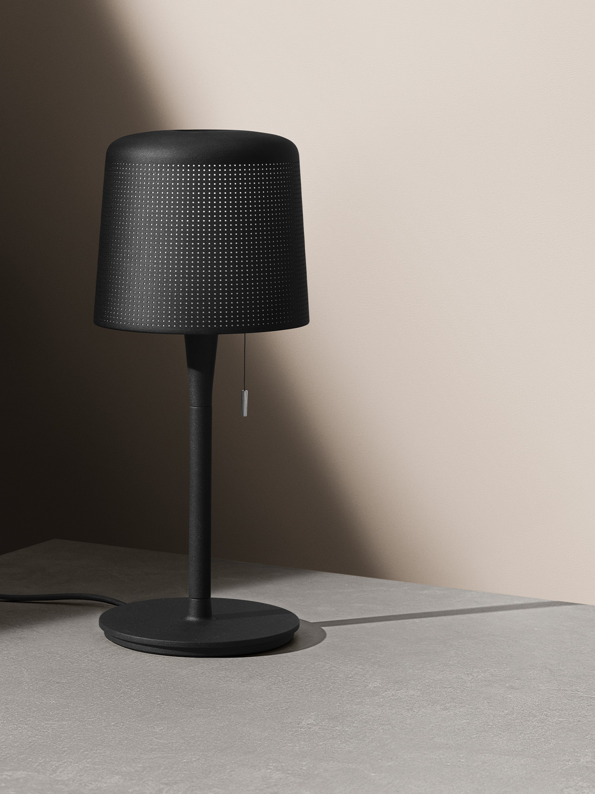

*图：Vipp530 台灯室内场景——\"设计礼/单件陈设\"类购买的核心产品形态：冲孔金属灯罩与哑光玻璃漫射。图源：[Vipp 官网 Table Lamp 产品页](https://vipp.com/en/products/table-lamp)。*

## 06 Positioning 定位：一件用了几十年的日常物件

### 参照系与目标人群

Vipp 的参照系不是北欧的\"温暖木质\"设计（Muuto、&Tradition 的柔和木色与圆角），也不是经典丹麦现代主义（Fritz Hansen、Louis Poulsen 的 Arne Jacobsen/Poul Henningsen 遗产），而是更接近 Brabantia 一类的**工业钣金谱系**——脚踏机构、哑光钢、圆柱桶身——但被设计博物馆体系（MoMA）抬进了高端设计范畴。目标人群三层：为\"博物馆同款＋工艺故事\"付费的高净值自购者；为住宅与商业项目指定钢制方案的设计师；以及被民宿体验转化的住客。三者的共同点是都在买\"确定性\"——工艺的确定性、耐用的确定性、时间价值的确定性。

### 差异点与共同点

> 术语注释：POD（Point of Difference，差异点）——品牌相对竞品独有的、被消费者认可的差异。
> 术语注释：POP（Points of Parity，基准点）——在品类中必须具备、否则无法入围的共性能力。

Vipp 的 POD 有三个。一是**\"80 多年生产同一件产品\"**：官方招聘页原文\"More than 80 years of production of the same product is our raison d'être and differentiator\"（80 多年生产同一件产品是我们的存在理由与差异化）——脚踏桶的外形从 1939 年延续至今，只改容量与颜色，这在快迭代的北欧设计界近乎孤例。二是**MoMA 馆藏背书**：2009 年入藏时官方那句\"唯一被严格当作装饰的地方\"，既承认了它的日常属性，又把它变成唯一进入 MoMA 建筑与设计馆藏的丹麦工业桶。三是**体验式零售**：14 处民宿与共有制度假屋，把\"用产品\"变成\"睡在产品里\"——这是任何展厅都做不到的完整体验。POP 同样是三项：喷粉钢与不锈钢的制造品质、10 年延长保修、全球 D2C 与经销商网络——这三点是入围设计师候选清单的入场券，但只靠它们，Vipp 就只是另一家北欧配件商。

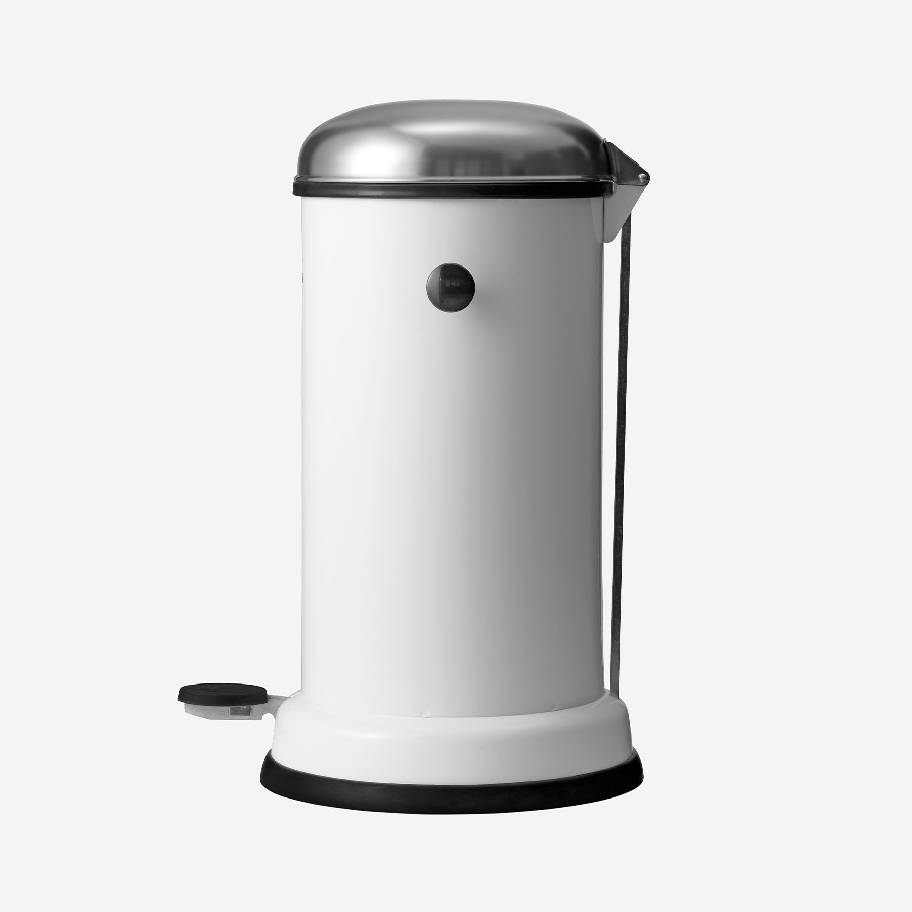

*图：Vipp15 白色脚踏桶场景照——14 升款对应 MoMA 馆藏 model 15 的现行尺寸，\"同一件产品生产 80 多年\"的定位证据。图源：[Vipp 官网 Pedal Bin 产品页](https://vipp.com/en/products/pedal-bin-14-l-4-gal)。*

### 从品牌承诺到产品证据的链

Vipp 的承诺链是：\"一件值得做的日常物件，必须做到结构、声音、触感、耐用性全部可被感知，并且能连续生产 80 年。\"落到产品：脚踏桶的缓降阻尼（damper mechanism）让盖子顺滑闭合、底部橡胶圈保护地板、可拆卸镀锌内胆便于清洁，官方责任页专列\"Designed for repair\"（为维修而设计）；喷粉钢\"highly durable and resistant to daily wear and tear\"（高度耐用、抗日常磨损）；V1 厨房的喷粉面板黑/灰/白三色提供明确的表面质感差异（黑灰为微纹理、白为光滑哑光）。这套证据链的完整度，是 Vipp 与\"北欧设计\"标签下其他品牌的区分核心——它不靠造型新鲜度，靠的是工艺可感知与时间可累积。

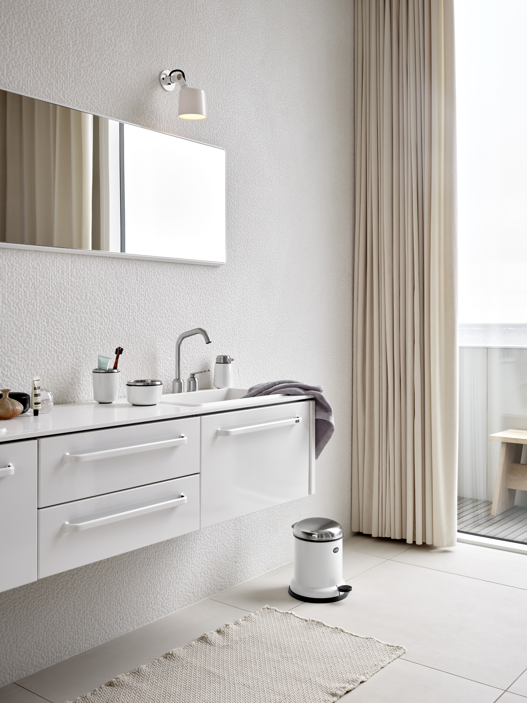

*图：Vipp14 白色脚踏桶场景——8 升小尺寸段的日常存在，底部橡胶圈与可拆卸内胆等\"功能细节即情感来源\"的例证。图源：[Vipp 官网 Pedal Bin 产品页](https://vipp.com/en/products/vipp14-bin)。*

## 07 Product 产品：从一只脚踏桶到一座可居住的钢壳

### 产品组合与命名逻辑：一条从桶到厨房的线

Vipp 的产品组合由一条主线贯穿：把 1939 年脚踏桶的同一套工艺语言（喷粉钢、静音机构、可维修、长期主义）逐级放大体积——从 30 厘米高的桶，到 2.4 米高的厨房柜，再到 55 平方米的钢壳建筑。CEO Kasper Egelund 的官方表述是：\"Going from offering just accessories, today Vipp's portfolio extends from a bin to a sofa and from a hook to a kitchen.\"（从只做配件开始，如今 Vipp 的组合从一只桶延伸到一张沙发、从一个挂钩延伸到一间厨房。）命名体系为\"Vipp + 编号\"：12–19 为垃圾桶、5xx 为灯具、4xx–6xx 为家具、7xx 为户外；年份均标设计/首发年。产品线：垃圾桶、厨卫配件、灯具、家具、模块化厨房（V1–V4）、户外系列、微型建筑与民宿。

### Vipp Pedal Bin（1939，Holger Nielsen）：从理发店到 MoMA 的品牌原点

这只桶的设计背景与起源前文已述：1932 年彩票中车换车床、1939 年为妻子理发店做桶、1950 年代成为丹麦诊所标配。2009 年 11 月它进入 MoMA 建筑与设计永久馆藏，著录为\"Pedal Bin (model 15), 1939\"；MoMA 策展人称之为\"a true humble masterpiece\"（一件真正的谦逊杰作）。现行在售版本的结构（以 18 升款为例）：桶身 powder-coated steel（喷粉钢）或不锈钢、可拆卸内桶、确保气密关闭的桶盖、缓降阻尼机构、底部橡胶圈；30 升款内桶为镀锌钢。历史标本（MoMA 著录）为镀铬钢/喷粉/电镀钢加橡胶与塑料。2010 年 Nordic Design 的报道称每只桶由最多 42 个组件构成、由熟练工匠手工装配、一名员工每小时装配六只（此口径距今 16 年，当前组装地待核实）。Vipp 官方不强调 Red Dot/iF 奖项——本轮在奖项数据库未检到获奖记录，品牌史只强调 MoMA 馆藏。

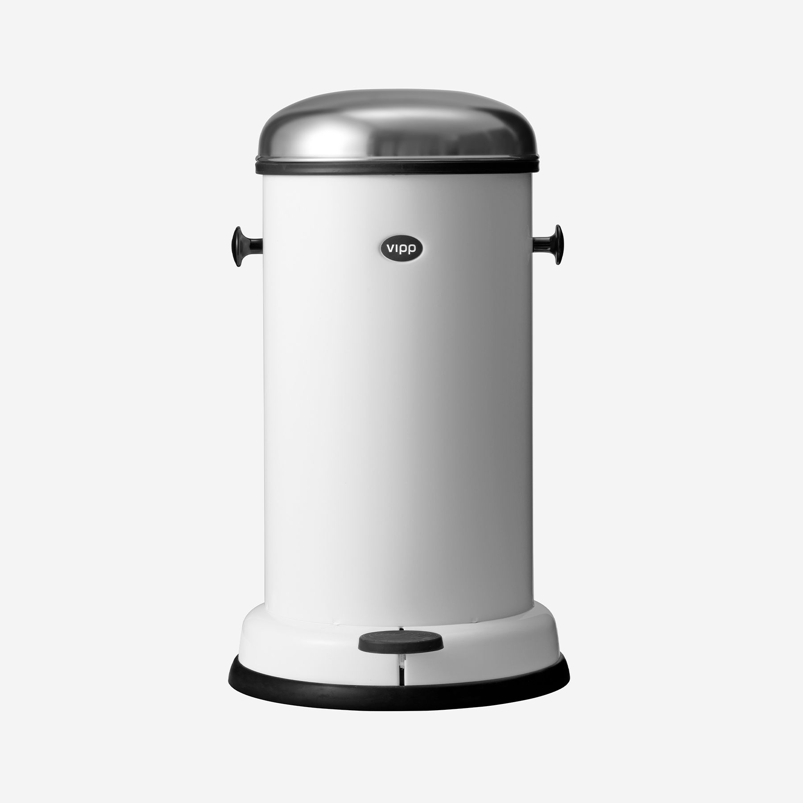

*图：Vipp15 Pedal Bin 14 升白色版官方白底整机——不锈钢圆拱顶盖、脚踏机构与圆柱桶身，1939 年造型的现行延续。图源：[Vipp 官网 Pedal Bin 产品页](https://vipp.com/en/products/pedal-bin-14-l-4-gal)。*

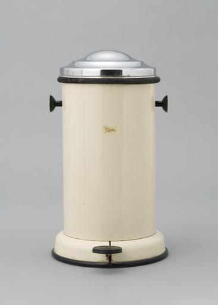

*图：MoMA 永久馆藏\"Pedal Bin (model 15), 1939\"（object 1332.2009，© Kasper Egelund）——米色桶身与镀铬圆拱顶盖；注：此图为 MoMA 官网缩略图（高分辨率原图受馆方防护未能自动获取）。图源：[MoMA 馆藏页](https://www.moma.org/collection/works/130957)。*

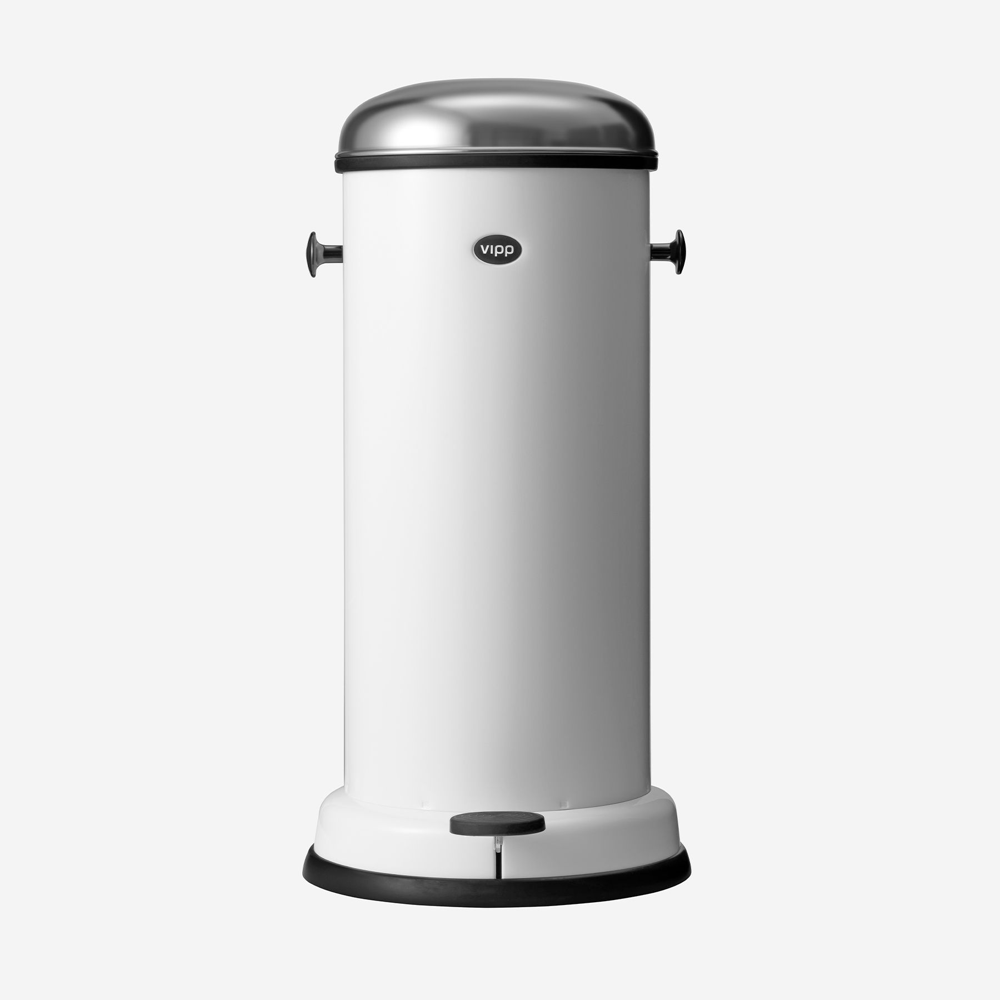

*图：Vipp16 Pedal Bin 18 升白色版官方白底整机——厨房主力款，黑色旋钮侧把手与不锈钢圆拱顶盖。图源：[Vipp 官网 Pedal Bin 产品页](https://vipp.com/en/products/pedal-bin-18-l-5-gal)。*

*图：Vipp 脚踏桶家族全景（Vipp12–17 六档容量并排）——同一造型语言、六种容量，\"一条从桶到厨房的线\"的起点。图源：[Vipp 官网垃圾桶分类页](https://vipp.com/en/categories/bins)。*

### 垃圾桶家族全谱：从 3 升到 30 升的六档体系

现行脚踏桶家族为六档容量：Vipp12（3 L，€195 起）、Vipp13（4 L，€265 起）、Vipp14（8 L，€285 起）、Vipp15（14 L，€355 起）、Vipp16（18 L，€415）、Vipp17（30 L，€515 起）——**现行产品线没有 50 升脚踏桶**（任务假设\"Bin 50\"经核实不存在，最大脚踏款为 30 升）。规格差异：Vipp16 直径 29.0 × 高 62.0 cm、重 5.45 kg；Vipp17 直径 32.5 × 高 73.0 cm、重 9.85 kg。敞口桶与办公桶并行：Vipp18（22 L 敞口，€305）、Vipp19（60 L 敞口，€415）与带滚轮的办公桶 Vipp52（35 L，€275），后者是 B2B 办公市场的遗留型号；收纳类则有 Laundry Bin、垃圾桶衬袋与微缩桶 Vipp3（€95，官方按礼品/陈设定位）。

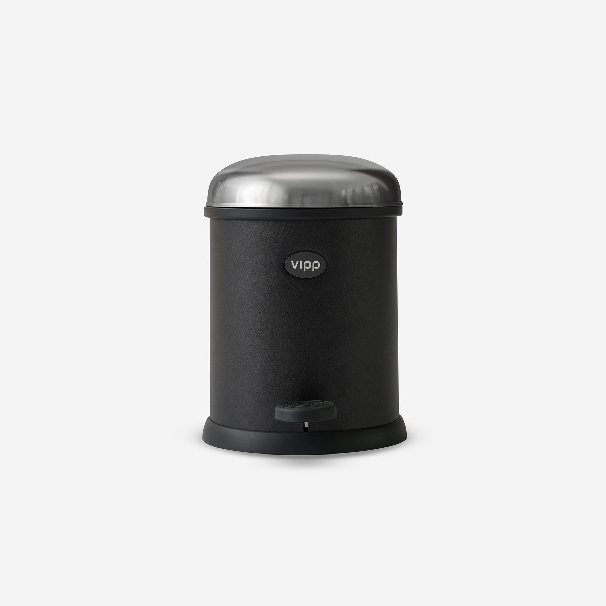

*图：Vipp12 Pedal Bin 3 升黑色版官方白底整机——六档容量中的最小款，浴室与书桌场景的入口型号。图源：[Vipp 官网 Pedal Bin 产品页](https://vipp.com/en/products/pedal-bin-3-l)。*

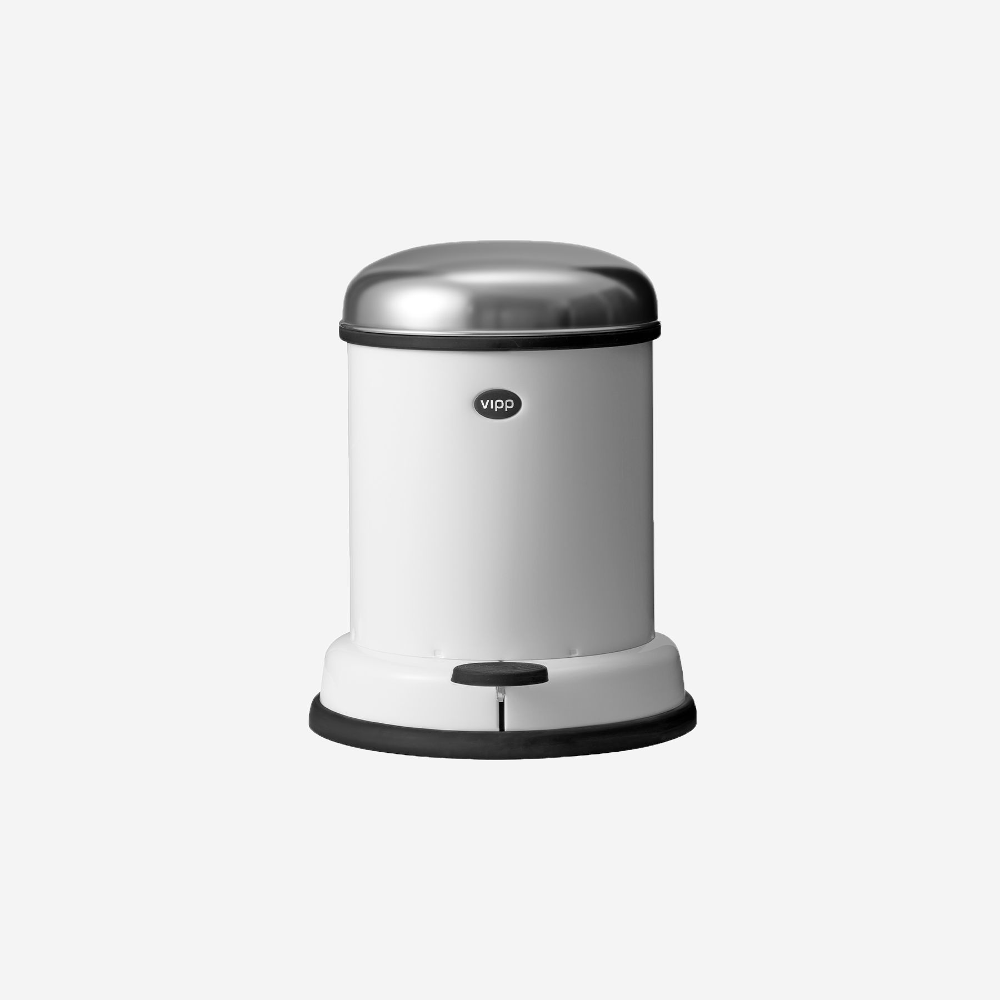

*图：Vipp14 Pedal Bin 8 升白色版官方白底整机——入门三段中的中位容量。图源：[Vipp 官网 Pedal Bin 产品页](https://vipp.com/en/products/vipp14-bin)。*

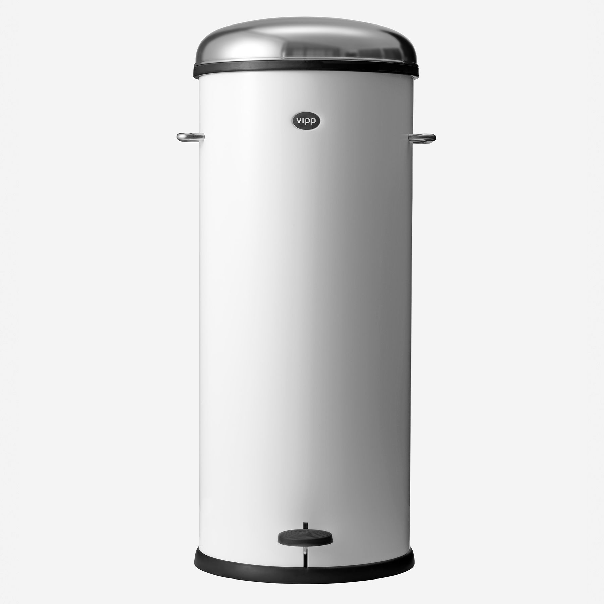

*图：Vipp17 Pedal Bin 30 升白色版官方白底整机——现行脚踏桶家族的最大容量款。图源：[Vipp 官网 Pedal Bin 产品页](https://vipp.com/en/products/pedal-bin-30-l)。*

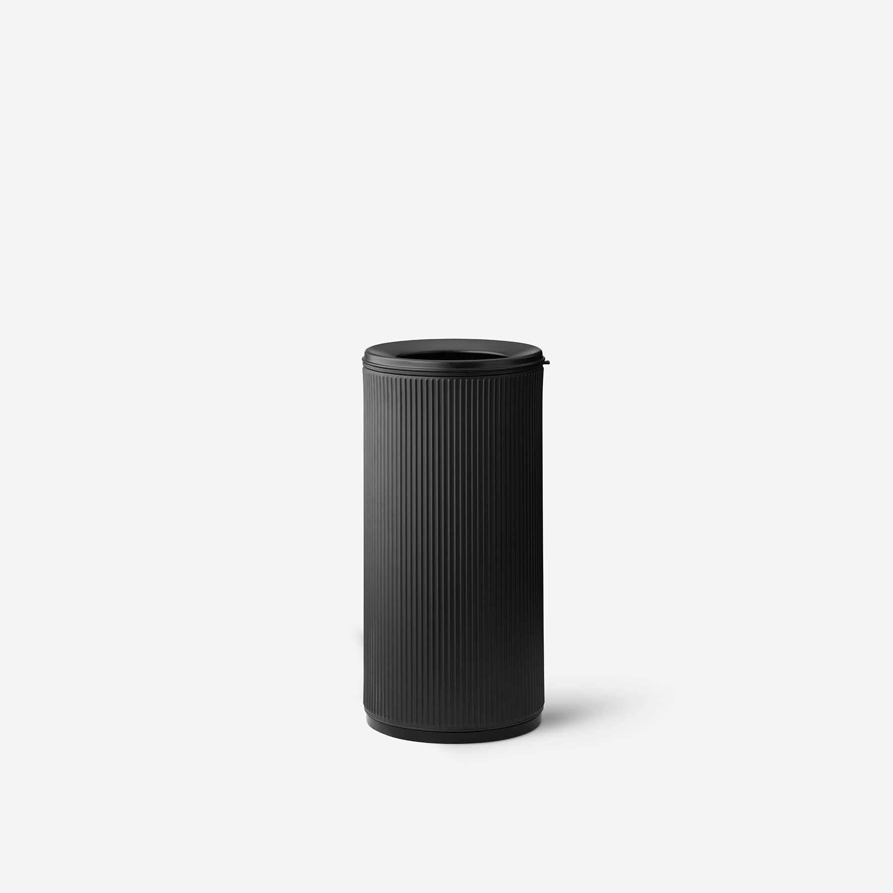

*图：Vipp18 Open Top Bin 22 升黑色敞口桶——无脚踏、掀盖开启，与脚踏桶并行的开口桶支线。图源：[Vipp 官网垃圾桶分类页](https://vipp.com/en/categories/bins)。*

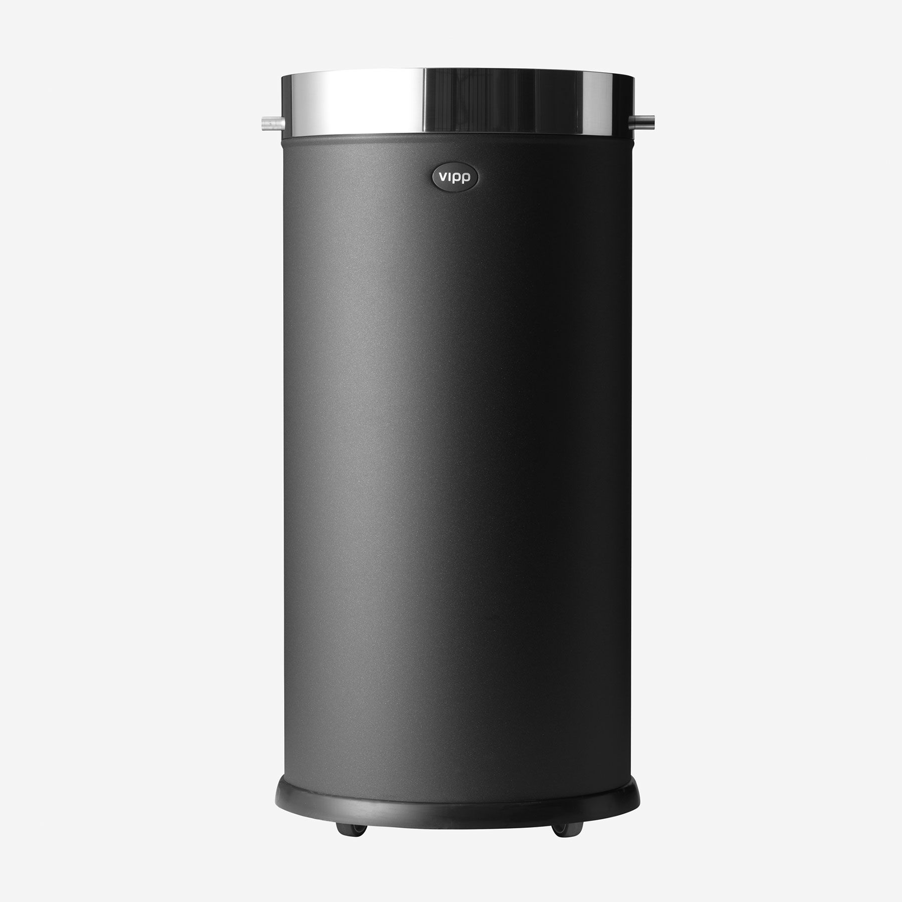

*图：Vipp52 Office Bin 35 升办公桶——带滚轮的 B2B 遗留型号，延续 1950 年代诊所/办公室渠道。图源：[Vipp 官网垃圾桶分类页](https://vipp.com/en/categories/bins)。*

### 色彩、再生与 85 周年不锈钢系列

颜色是 Vipp 家族化的第二层语言：黑色与白色为长期标准色，暖调米色（Holger's Beige）在品牌史中多次回归，2022 年起以\"Back To Beige\"再引入；2024 年为品牌 85 周年推出不锈钢原色系列（Stainless Steel Collection），包含脚踏桶、皂液器、纸巾架等，刻意强调\"没有颜色也是一种颜色\"的工业原色感。可持续支线以 Rubbish 桶为代表：桶身采用 70% 回收塑料＋30% 木屑的复合材料，相比同尺寸钢桶减少约 3.7 公斤钢材用量、约 75% 再生材料占比，官方把它定义为\"可持续版脚踏桶\"；环保认证上，Vipp 持有 FSC 与 V-Label（素食）标识。艺术支线 Art Bins 自 2005 年起每年邀请艺术家改装脚踏桶，累计超过 150 位艺术家参与，合作名单含 Karim Rashid、Yoko Ono、Calvin Klein、Philippe Starck 等。

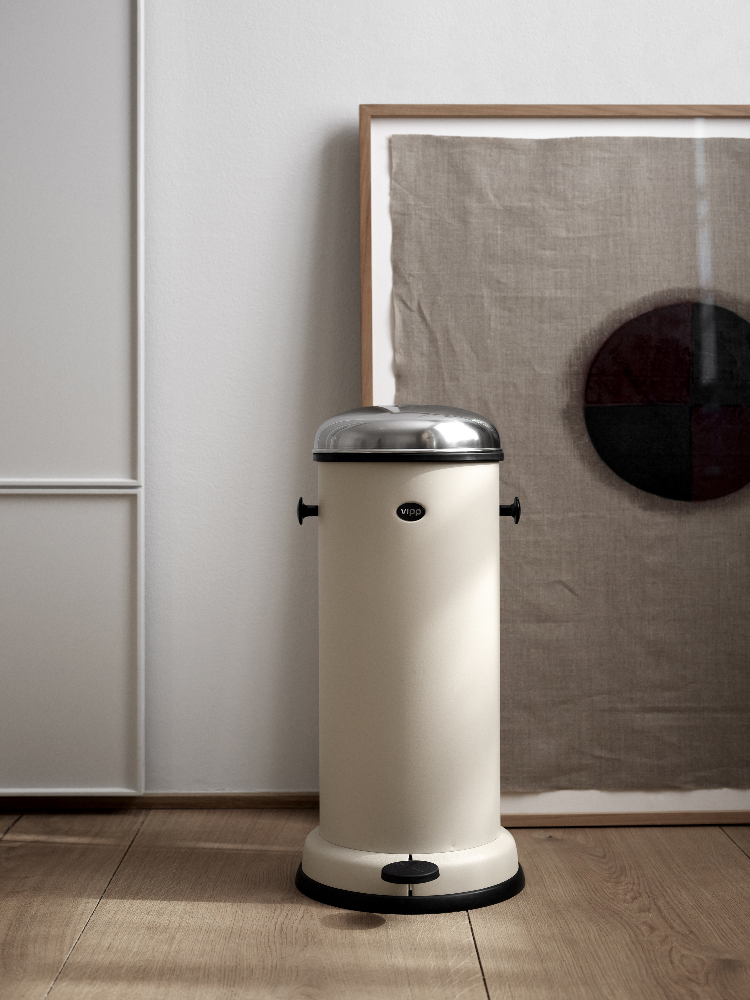

*图：Vipp16 米色脚踏桶场景照——暖调米色是品牌史中反复回归的\"Holger's Beige\"色，2022 年以 Back To Beige 重新引入。图源：[Vipp 官网 Pedal Bin 产品页](https://vipp.com/en/products/pedal-bin-18-l-5-gal)。*

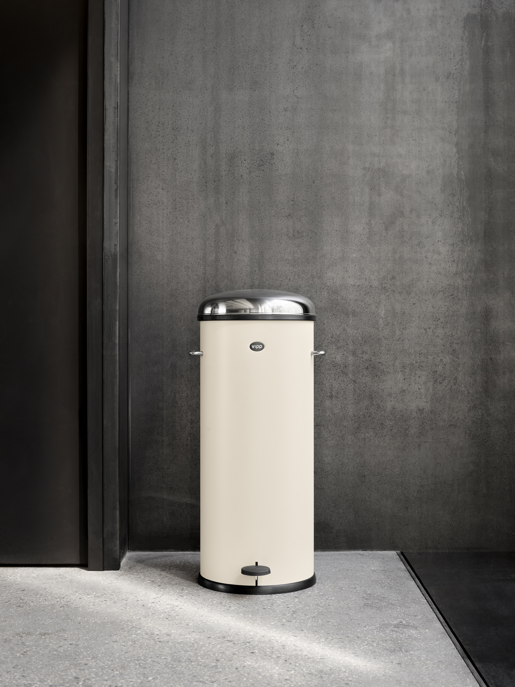

*图：Vipp17 米色脚踏桶场景照——米色系的 30 升大容量版本。图源：[Vipp 官网 Pedal Bin 产品页](https://vipp.com/en/products/pedal-bin-30-l)。*

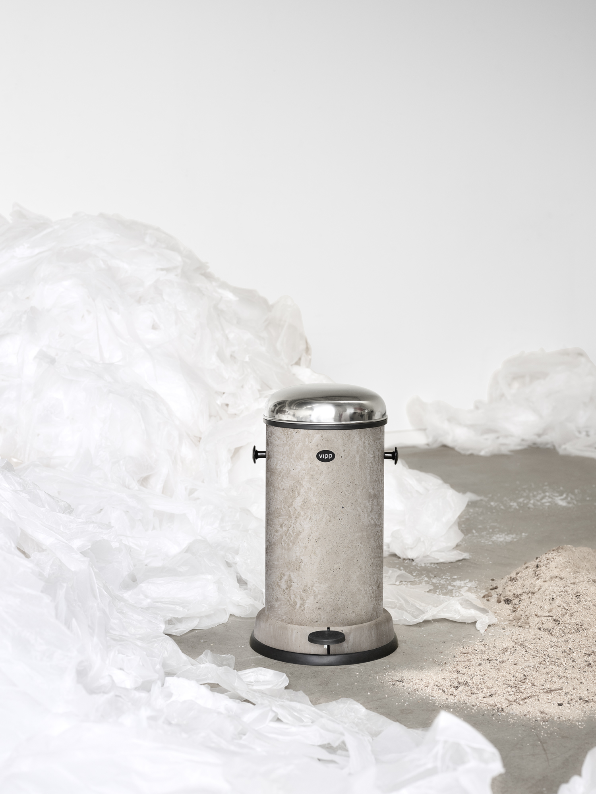

*图：Rubbish 可持续版脚踏桶——70% 回收塑料＋30% 木屑复合材料，相对钢桶减约 3.7 公斤钢、约 75% 再生占比。图源：[Vipp 官网 Rubbish 产品页](https://vipp.com/en/products/rubbish)。*

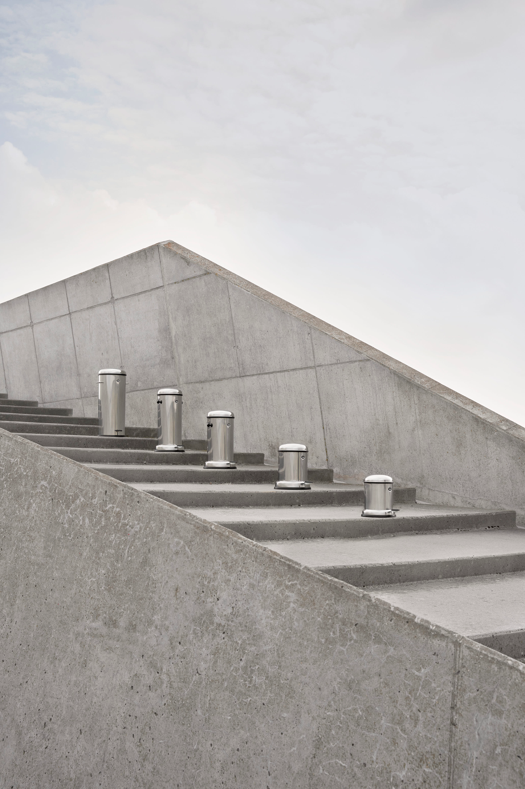

*图：2024 年 85 周年不锈钢系列组合（脚踏桶与卫浴配件）——以不锈钢原色回应品牌钢作传统。图源：[Vipp 官网不锈钢系列页](https://vipp.com/en/collections/stainless-steel-collection)。*

### Vipp Lighting（2017，内部团队）：冲孔灯罩的工业灯族

Vipp 灯具家族于 2017 年 11 月 29 日首发（任务假设\"2000 年代\"经核实为误——灯具是品牌 2011 年厨房、2014 年 Shelter 之后才真正启动的品类），归属品牌内部设计团队而非外部设计师；首席设计师 Morten Bo Jensen 2006 年加入、毕业于 Aalborg 工业设计专业，主导灯具与家具线。官方品牌手册称灯具\"打磨了五年以上\"才上市。家族形态高度统一：冲孔金属灯罩（perforated metal shade）＋磨砂哑光玻璃漫射件＋细金属杆/臂，灯具点亮时光从冲孔与玻璃双重透出。首代三款：Table Lamp 530（€345，拉绳开关、E14 光源、重 3.3 kg）、Desk Lamp 521（€399 起，可调臂、指旋螺丝锁定、实心底座）、Pendant 526–528（€329 起，三尺寸）。灯具命名为\"功能优先\"：不叫艺术灯，叫桌灯、台灯、吊灯、壁灯、落地灯。

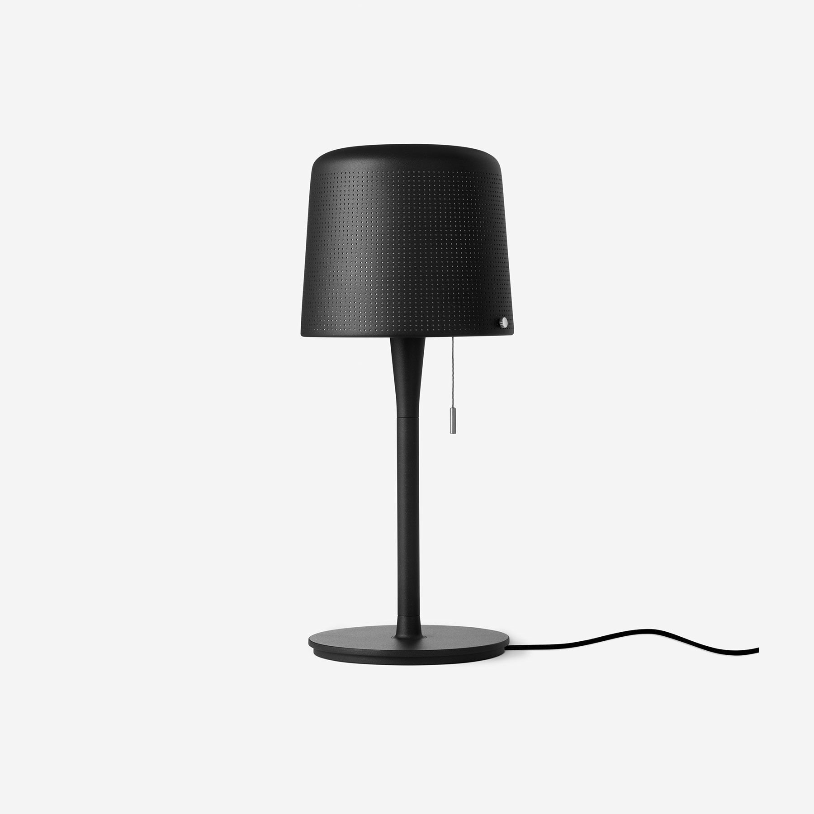

*图：Vipp530 Table Lamp 黑色版官方白底整机——冲孔金属灯罩＋哑光玻璃漫射＋拉绳开关，灯具家族首代形态。图源：[Vipp 官网 Table Lamp 产品页](https://vipp.com/en/products/table-lamp)。*

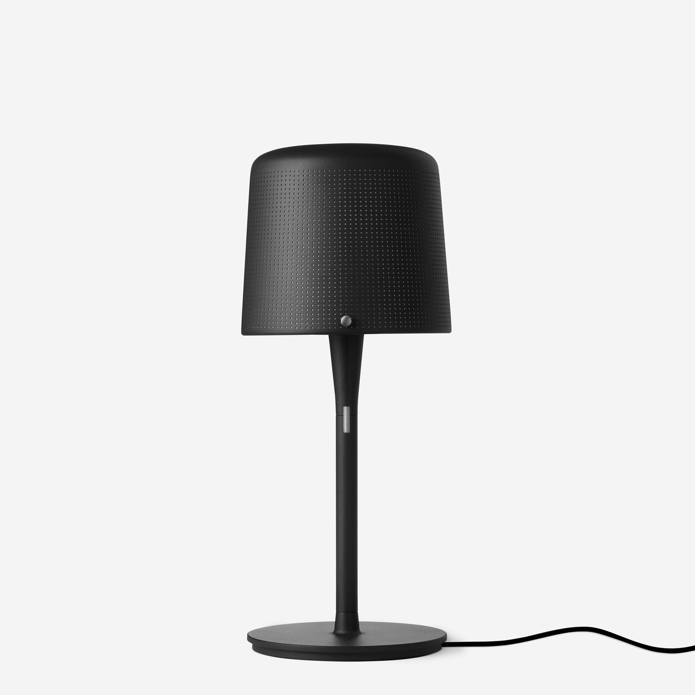

*图：Vipp530 桌灯点亮场景——冲孔灯罩透光与磨砂玻璃漫射的\"工业戏剧\"。图源：[Vipp 官网 Table Lamp 产品页](https://vipp.com/en/products/table-lamp)。*

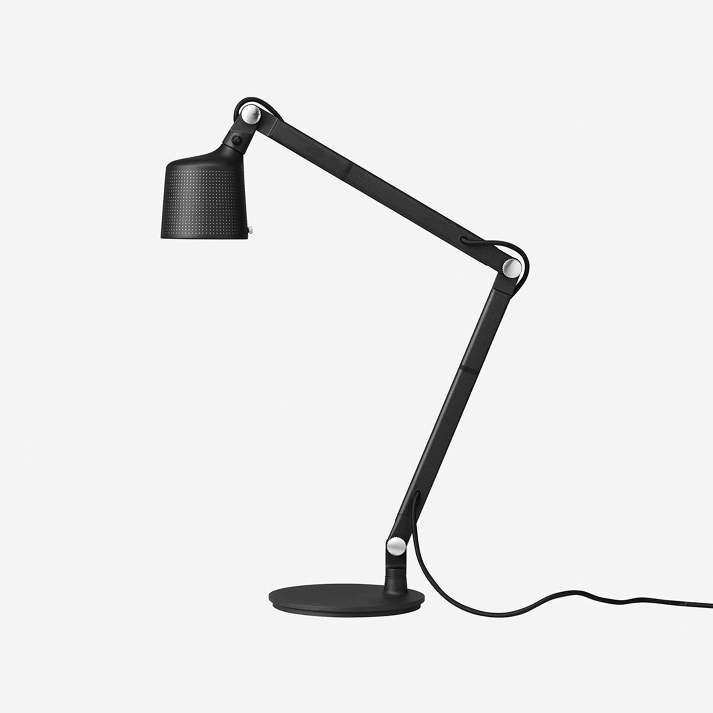

*图：Vipp521 Desk Lamp 可调臂台灯黑色版——指旋螺丝锁定角度、实心底座，功能优先的\"工作灯\"定位。图源：[Vipp 官网 Desk Lamp 产品页](https://vipp.com/en/products/desk-lamp)。*

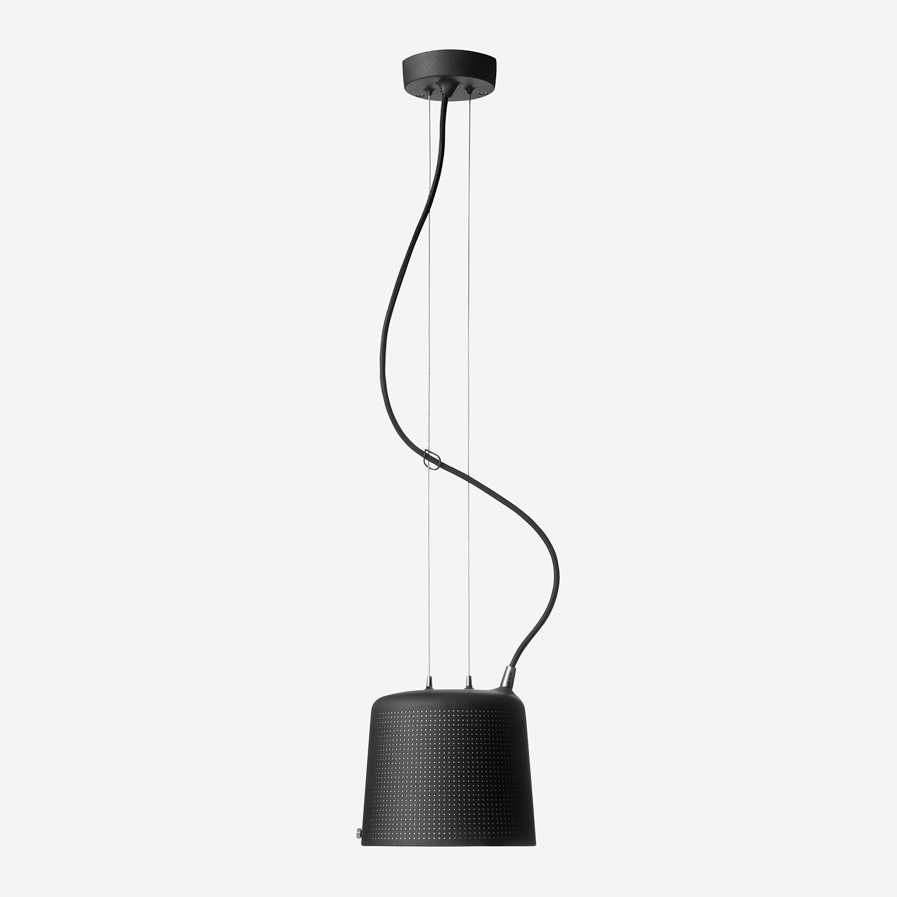

*图：Vipp526 Pendant 吊灯小尺寸版——冲孔灯罩吊灯的三尺寸家族中最小的 526。图源：[Vipp 官网 Pendant 产品页](https://vipp.com/en/products/pendant)。*

### 灯具家族扩展：壁灯、落地灯、纸灯与雕塑灯

灯具家族此后逐年扩展：Wall Spot 524（€265，灯具入门款，暖灰/黑/白）与 Floor Reading Lamp 525（€535，落地阅读灯）延续冲孔灯罩语言；2020 年代加入 Paper Pendant 586（€535）与 Paper Floor Lamp 581（€735）的\"纸灯\"支线——白纸灯罩配深色橡木底座，是家族中唯一偏离金属语言的灯具；2023 年 9 月 16 日发布 Sculpture 系列（Table Lamp 591/592、Pendant 595），吹制乳白玻璃悬于实心大理石基座之上，官方把它定义为\"介于雕塑与灯之间的物件\"，Sculpture 桌灯官网欧元价未直接挂出（官方丹麦站零售价约 DKK 4,050，口径并存待核实）。灯具配色与垃圾桶体系打通：黑、白、暖灰与 2024 年起的不锈钢原色。

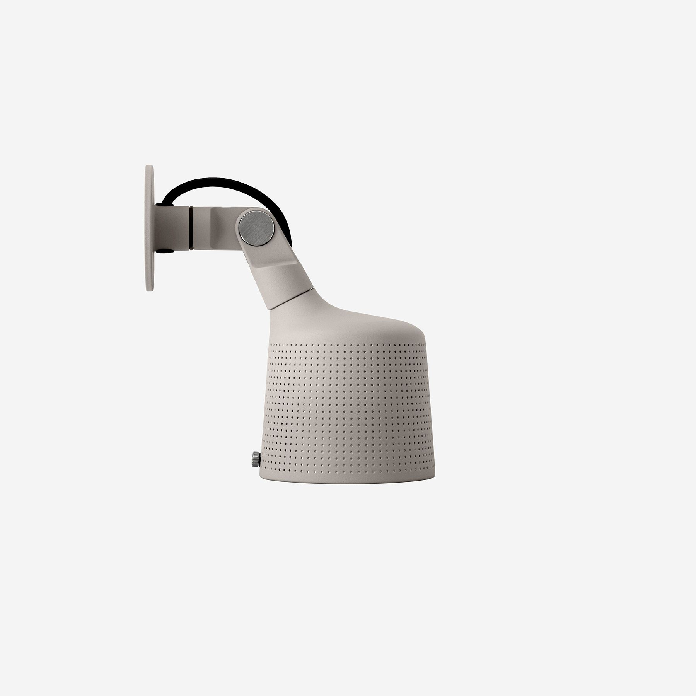

*图：Vipp524 Wall Spot 暖灰色官方白底整机——灯具家族最小最便宜的入口款（€265）。图源：[Vipp 官网 Wall Spot 产品页](https://vipp.com/en/products/wall-spot)。*

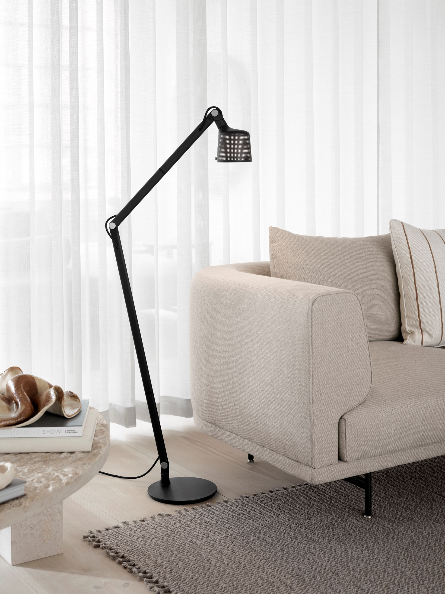

*图：Vipp525 Floor Reading Lamp 落地阅读灯——冲孔灯罩与可调臂的落地版本。图源：[Vipp 官网 Lighting 分类页](https://vipp.com/en/categories/lighting)。*

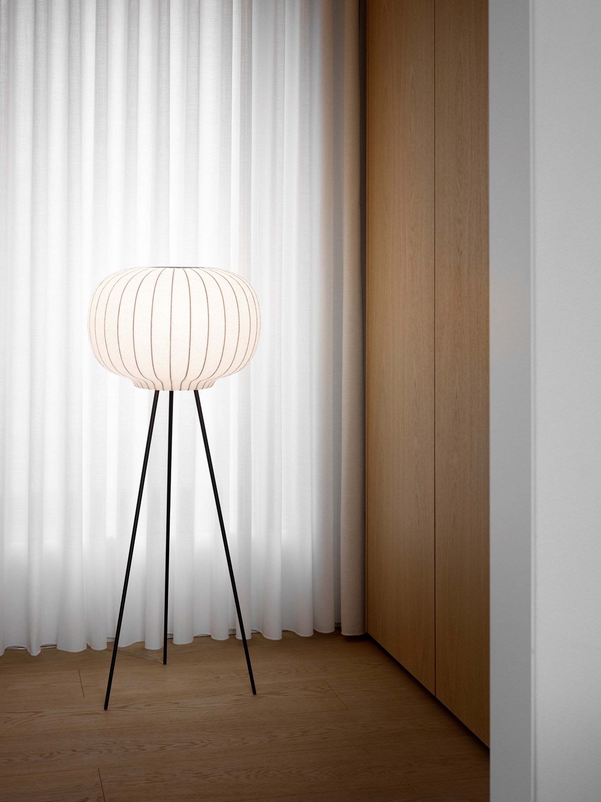

*图：Vipp581 Paper Floor Lamp 纸灯落地灯——深色橡木底座与纸灯笼罩，家族中偏离金属语言的支线。图源：[Vipp 官网 Lighting 分类页](https://vipp.com/en/categories/lighting)。*

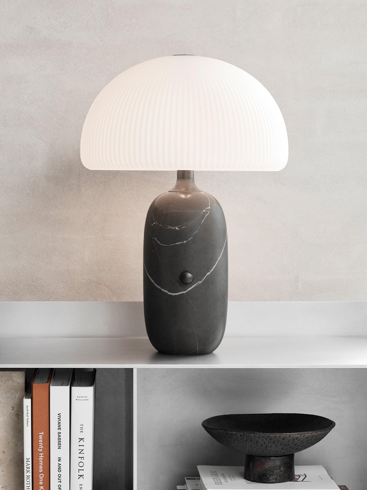

*图：Vipp592 Sculpture Table Lamp——吹制乳白玻璃悬于深色大理石基座，2023 年 9 月发布的\"介于雕塑与灯之间\"的物件。图源：[Vipp 官网 Sculpture Table Lamp 产品页](https://vipp.com/en/products/sculpture-table-lamp)。*

### 厨卫配件：与脚踏桶共用基因的浴室件

配件线的逻辑是\"把脚踏桶的设计基因缩小\"：Vipp9 Soap Dispenser 皂液器（€105，喷粉钢桶身＋不锈钢定制泵头＋黑色橡胶底座）、Vipp9W 壁挂皂液器（€115，可取下注液、锁定机构防误触）、Vipp7 Toothbrush Holder 牙刷杯（喷粉钢＋可拆卸橡胶内隔＋防滑底）、Vipp11 马桶刷、镜子与纸巾架。它们与脚踏桶共用同一套语言——圆柱桶身、哑光钢、静音机构（缓降/阻尼）、可拆卸内胆便于清洁——因而在浴室里与脚踏桶并排放置时，视觉上是\"同一个家族\"而非\"垃圾桶的衍生品\"。官方把它们统称为 bathroom collection 并参与配色体系（黑白米暖灰与不锈钢色）。

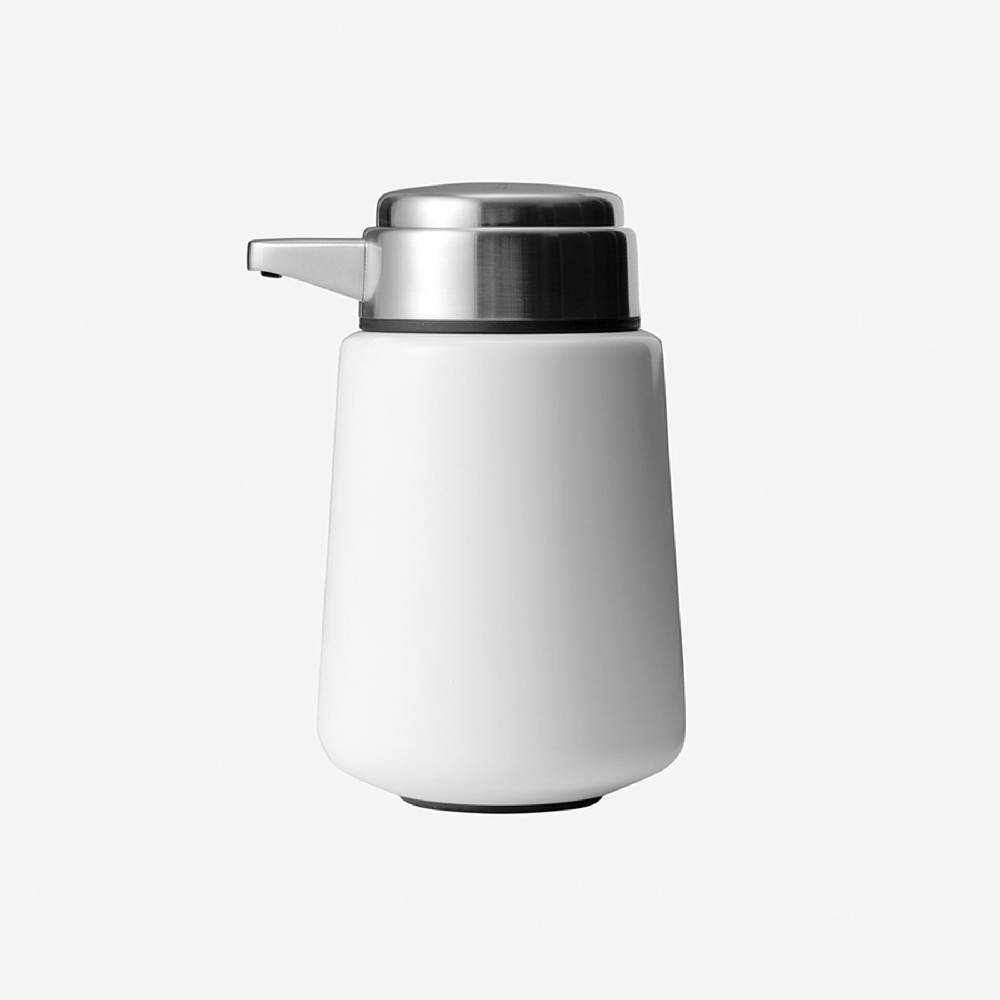

*图：Vipp9 Soap Dispenser 白色版官方白底整机——喷粉钢桶身＋不锈钢定制泵头，与脚踏桶共用圆柱钢桶语言。图源：[Vipp 官网 Soap Dispenser 产品页](https://vipp.com/en/products/soap-dispenser)。*

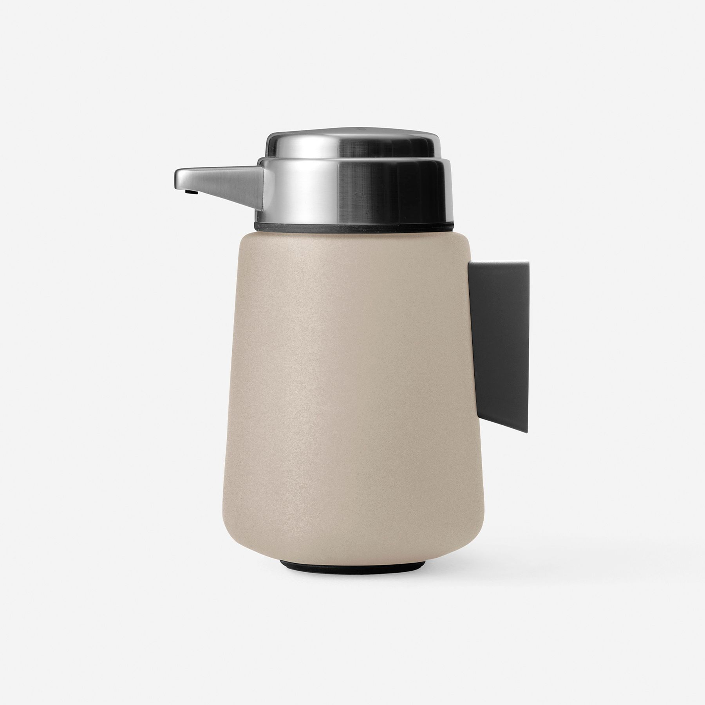

*图：Vipp9W Soap Dispenser Wall 米色版——可取下注液、锁定机构，壁挂配件支线。图源：[Vipp 官网 Soap Dispenser Wall 产品页](https://vipp.com/en/products/soap-dispenser-wall)。*

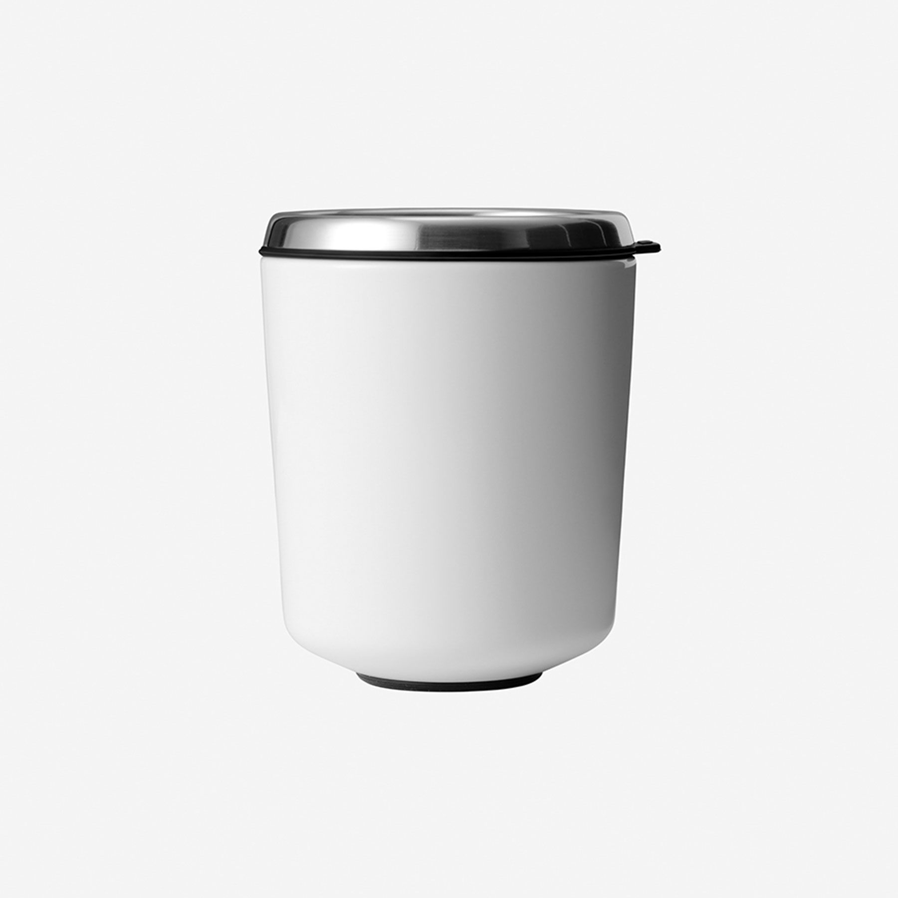

*图：Vipp7 Toothbrush Holder 白色版——喷粉钢＋可拆卸橡胶内隔，浴室配件家族一员。图源：[Vipp 官网 Toothbrush Holder 产品页](https://vipp.com/en/products/toothbrush-holder)。*

### Vipp Kitchen（2011 起）：喷粉钢模块化厨房

2011 年推出的模块化厨房是品牌从\"配件\"走向\"家居工程\"的第一级：V1 以喷粉钢面板（黑/灰/白三色、黑灰微纹理、白光滑哑光）与不锈钢台面构成，按项目报价而非零售挂价；随后 V2（浅橡木门板，自然感支线）、V3（阳极氧化竖纹铝，冷调）与 V4（拉丝不锈钢）构成四代方案。结构上以分类抽屉（5 个可拆卸分格）为记忆点，官方宣传\"同一套钢制体系可组合出数十种配置\"。厨房是 Vipp 在 Shelter、民宿矩阵之前的\"工程化\"练习——它教会品牌做面板、五金、接缝与项目交付，也决定了 2014 年做 Shelter 时选择工厂预制而非现场施工。

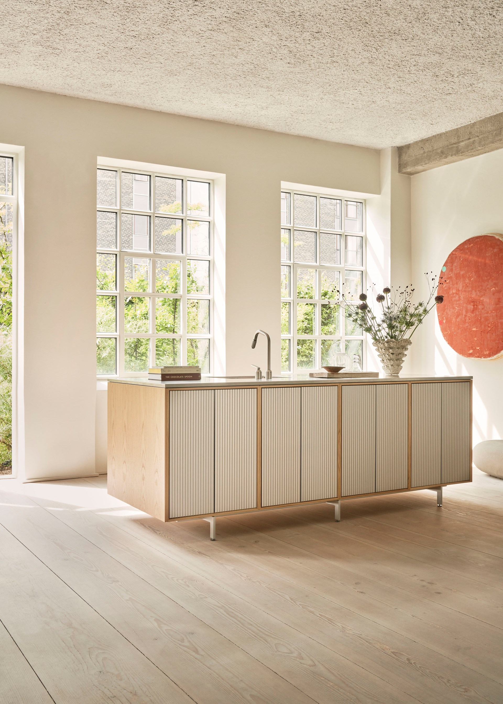

*图：Vipp V2 Kitchen 浅橡木门板模块化厨房——2011 年厨房线中较\"自然感\"的一代方案。图源：[Vipp 官网 Lighting 分类页](https://vipp.com/en/categories/lighting)（品牌物料图）。*

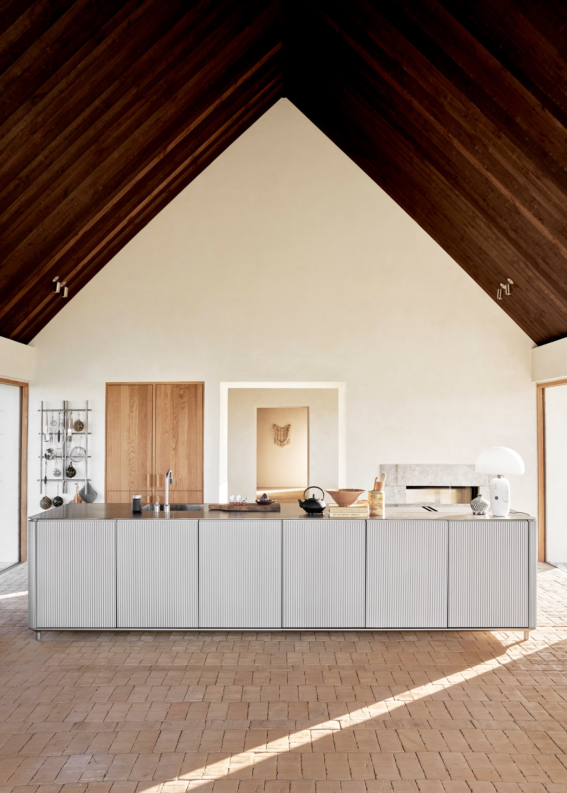

*图：Vipp V3 Kitchen 阳极氧化铝门板冷调厨房——Cold Hawaii 民宿同款方案，铝材竖纹表面。图源：[Vipp 官方品牌史页](https://vipp.com/en/world-of-vipp/our-story/heritage/from-marie-to-moma-and-beyond)。*

### Vipp Shelter（2014 建成、2015 发布）：55 平方米的可居住设计物

Shelter 是 Vipp 品牌史里最具戏剧性的一件\"产品\"。2014 年秋它建于瑞典 Lake Immeln 湖畔（55 平方米、重约 24 吨、钢与玻璃构成），2015 年公开发售（Dezeen 2017 年报道报价 US$580,000–585,000 不含运输安装，2017 年另一口径 €485,000）；2017 年 Dezeen 报道为 \"battery-charging station for humans\"（人类的充电站），内部可住 2 人、含燃木壁炉、厨房、卫生间与卧榻阁楼；官方称生产周期约 6 个月、现场拼装 3–5 天，pilotis 桩基离地以保护地景。但它是商业上的\"失败\"：官方自述\"selling prefab homes like products off the shelves was a misjudged business idea\"（把预制房当货架产品卖是一个被误判的商业想法），全球仅售出 1 台。Vipp 随后的 U-turn 是把它变成民宿：如今 Shelter 作为 Vipp Guesthouses 的第一处物业出租（工作日 €1,000/最少 2 晚、周末 €1,200/2 晚），并由此长出了 14 处民宿矩阵。注意档案口径：Shelter 不是\"在售预制住宅\"，而是\"品牌体验型民宿的原点\"。

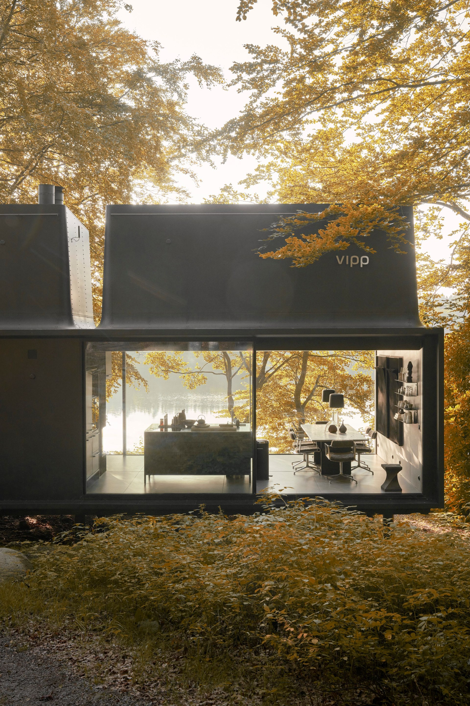

*图：Vipp Shelter 秋季外观——黑钢 pod 架于桩基之上、悬于瑞典 Lake Immeln 湖岸林景。图源：[Vipp 官方品牌史页](https://vipp.com/en/world-of-vipp/our-story/heritage/from-marie-to-moma-and-beyond)。*

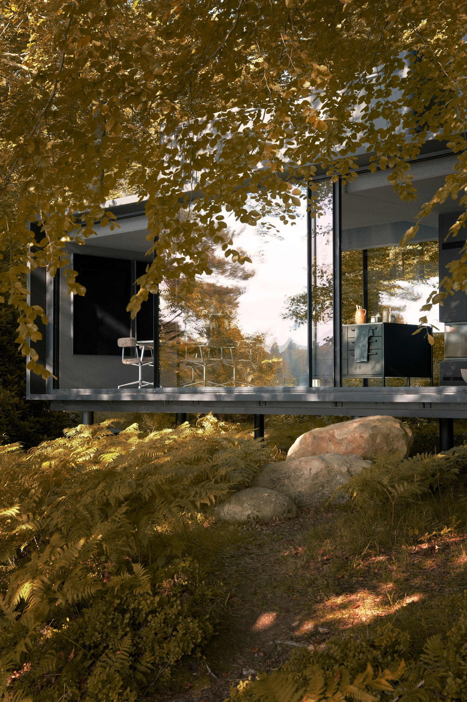

*图：Vipp Shelter 外观细节——钢结构与玻璃立面的交接，pilotis 桩基离地。图源：[Vipp 官网 Shelter 民宿页](https://vipp.com/en/world-of-vipp/our-guesthouses/vipp-shelter)。*

*图：Vipp Shelter 内部客厅——整面落地窗面向湖面，室内为全套 Vipp 产品。图源：[Vipp 官网 Shelter 民宿页](https://vipp.com/en/world-of-vipp/our-guesthouses/vipp-shelter)。*

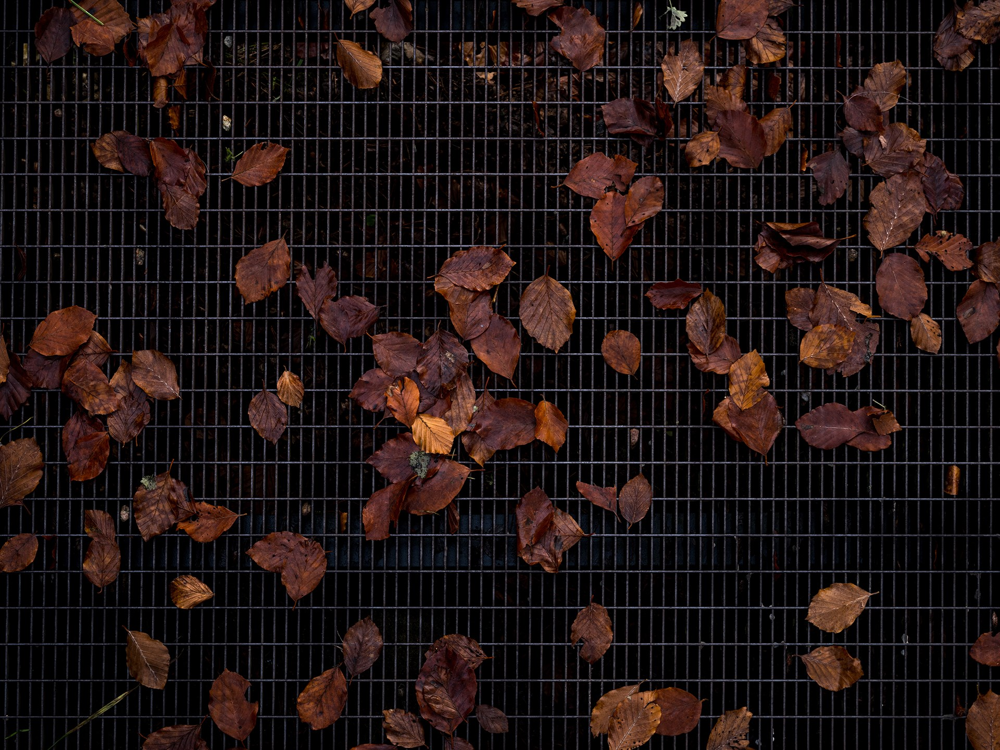

*图：Vipp Shelter 内部厨房区（Rasmus Hjortshøj 摄影）——55 平方米内完整嵌入 Vipp 厨房系统，\"在真实产品里过夜\"体验的核心。图源：[Vipp 官网 Shelter 民宿页](https://vipp.com/en/world-of-vipp/our-guesthouses/vipp-shelter)。*

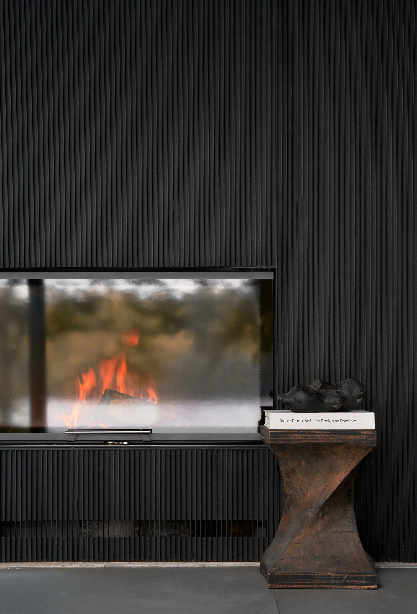

*图：Vipp Shelter 内部壁炉区——燃木壁炉与卧榻阁楼的起居核心。图源：[Vipp 官网 Shelter 民宿页](https://vipp.com/en/world-of-vipp/our-guesthouses/vipp-shelter)。*

### 家具线（2019 起）：从第一把椅子到实木 Cabin 系列

2019 年 Vipp 推出品牌史上第一把椅子 The Chair（Vipp451）：粉喷铝框架＋苯胺真皮座面，官方称\"打磨了五年\"、首发价约 €865 起；同年 Lounge Chair 456 加入（喷粉铝框架与黑色真皮，呼应 Shelter 的黑色钢壳视觉）。2021 年 Swivel Chair 452/453 发布（360° 旋转、雕塑感铝壳、驼色织物标准版与 Montafon 羊毛特别版 €1,095），与 451/456 是三个不同型号、勿混。2020 年 9 月推出首个实木家具系列 Cabin（深色橡木＋纸绳＋大理石台面）：Cabin Chair 481、Cabin Lounge 488（€1,995）、Cabin Round Table 495（Ø150 灰色大理石＋深橡木底座）；软包系列 Lodge 以绵羊皮/织物覆盖 Lounge 466（€4,095）与 Low Back 469（€3,395）；客厅线另有 Sofa 632 与 Cabinet System 675 浅橡木柜体。家具线共同点：钢/铝框架承托软包或实木，表面保持哑光与中性色——是垃圾桶工艺语言向\"坐与储\"的延伸。

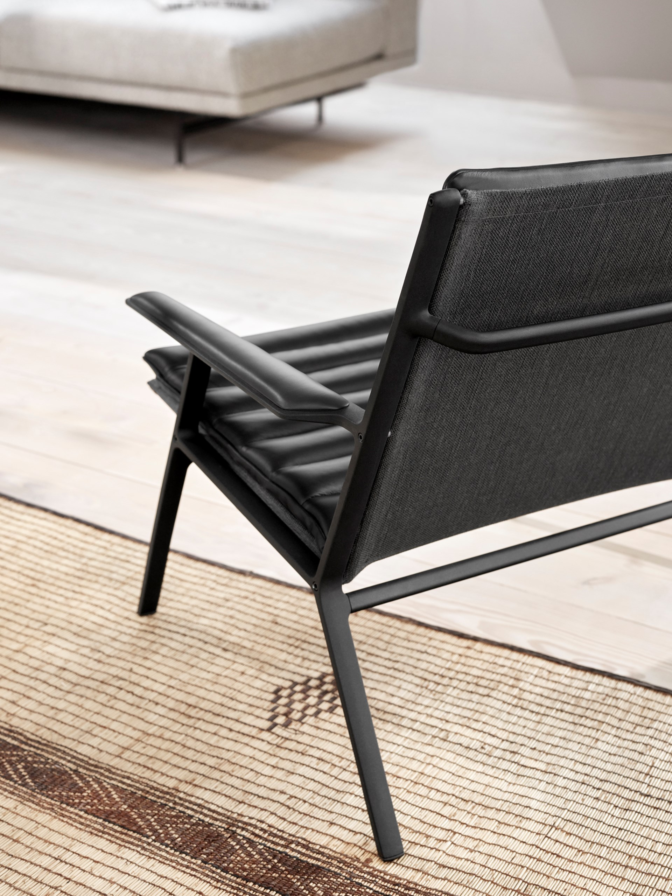

*图：Vipp Lounge Chair 456（2019）——喷粉铝框架＋黑色真皮，呼应 Shelter 黑色钢壳的家具线代表。图源：[Vipp 官网 Seating 分类页](https://vipp.com/en/categories/seating)。*

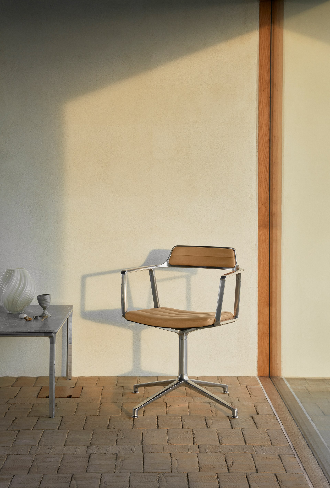

*图：Vipp Swivel Chair 452（2021）——360° 旋转、雕塑感铝壳，驼色织物标准版。图源：[Vipp 官网 Seating 分类页](https://vipp.com/en/categories/seating)。*

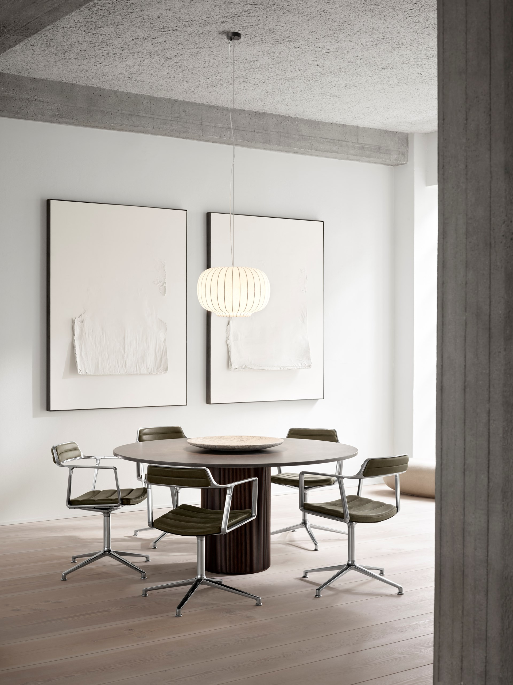

*图：Vipp Cabin Round Table 495——Ø150 灰色大理石台面＋深色橡木底座，2020 年首个实木系列的代表。图源：[Vipp 官方品牌史页](https://vipp.com/en/world-of-vipp/our-story/heritage/from-marie-to-moma-and-beyond)。*

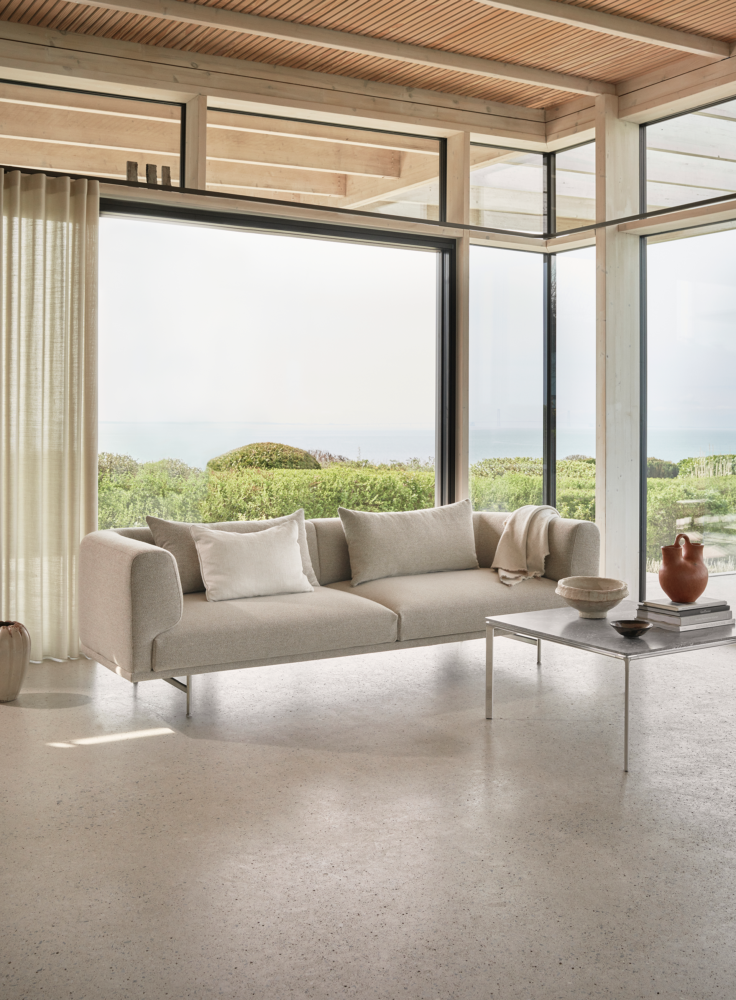

*图：Vipp Sofa 632（Chimney Brook 系列）——米色与栗色织物双人沙发，客厅线代表作。图源：[Vipp 官方品牌史页](https://vipp.com/en/world-of-vipp/our-story/heritage/from-marie-to-moma-and-beyond)。*

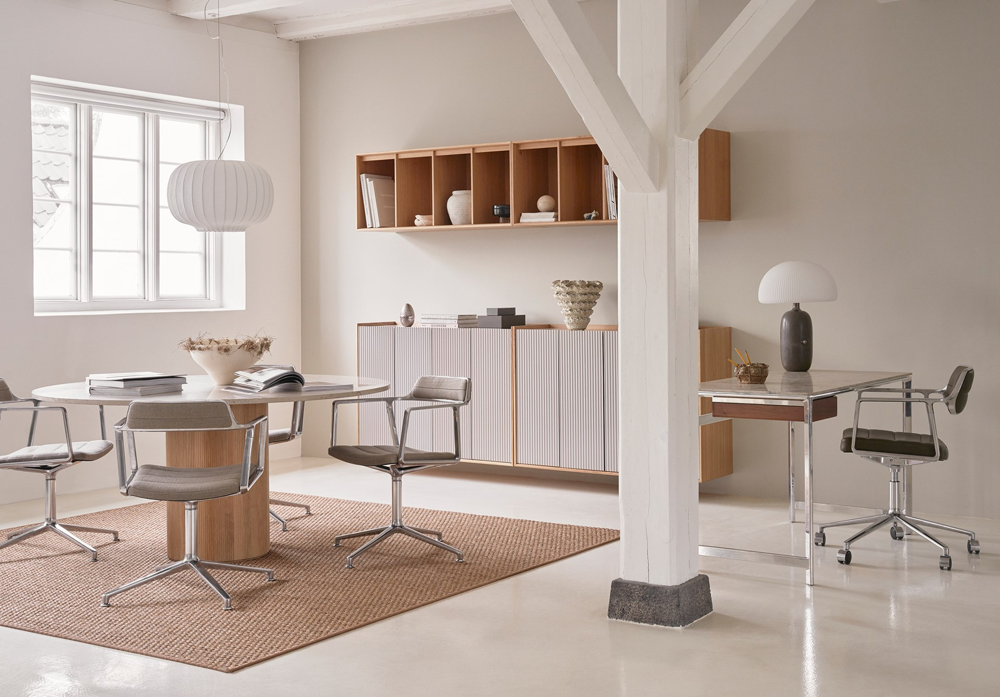

*图：Vipp Cabinet System 675——浅橡木柜体系统，家具线向\"储\"的延伸。图源：[Vipp 官方品牌史页](https://vipp.com/en/world-of-vipp/our-story/heritage/from-marie-to-moma-and-beyond)。*

### 户外系列（2024 Open-Air）：柚木与仿藤的户外家族

2024 年 Vipp 发布首个户外系列 Open-Air：首次引入柚木（teak）、聚藤（polyrattan 仿藤）与 100% PP 户外织物——材质体系第一次离开金属与橡木。系列含 Open-Air Chair 711（€595，造型母本可追溯至 451）、Lagrasse 710（€325，可叠放）、Two-Seater 721（€665）、茶几 714 与 Open-Air Kitchen 741/742 户外厨房单元。官方定位是\"把 Vipp 的耐用哲学搬到户外\"，回应 Shelter 民宿与 Cold Hawaii 等海滨物业的户外需求。

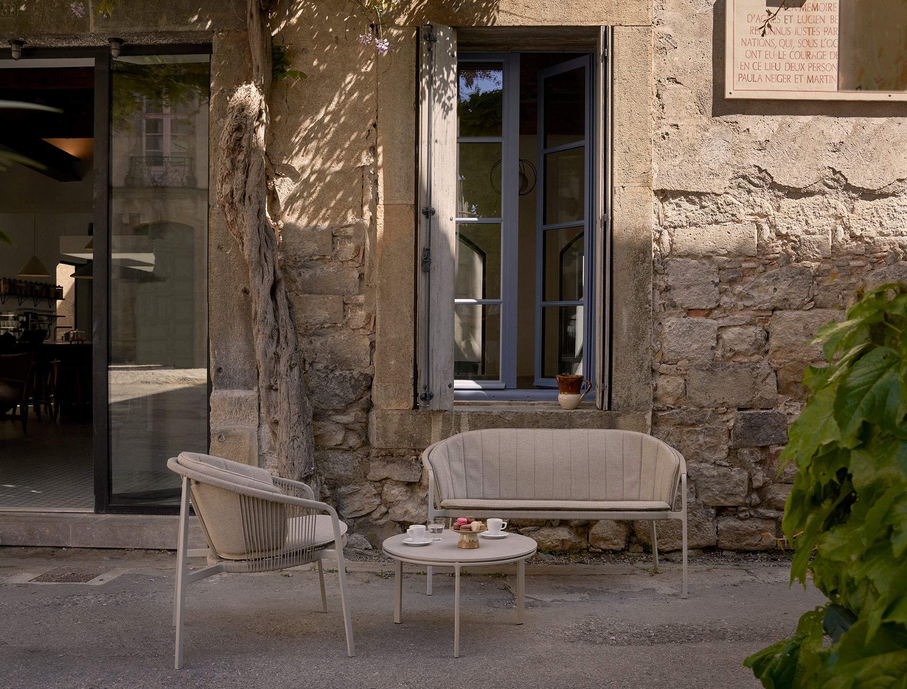

*图：Vipp Open-Air 户外组合（721 双人椅＋712 椅＋714 茶几）——2024 户外系列，柚木与仿藤材质首次进入家族。图源：[Vipp 官方品牌史页](https://vipp.com/en/world-of-vipp/our-story/heritage/from-marie-to-moma-and-beyond)。*

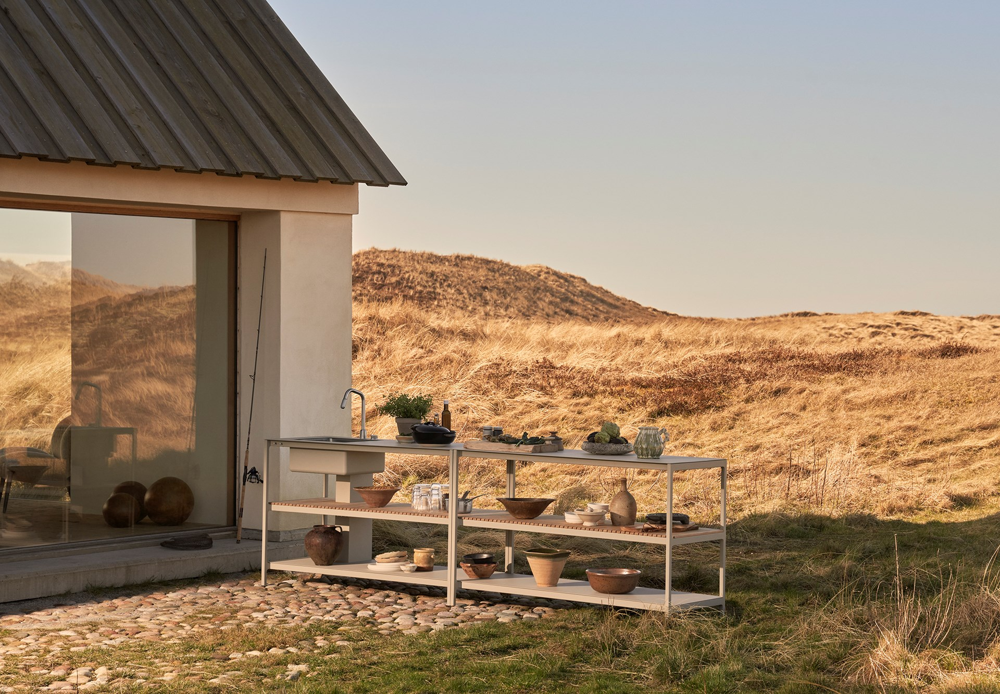

*图：Vipp Open-Air Kitchen 741/742 户外厨房单元——把模块化厨房语言搬到户外。图源：[Vipp 官方品牌史页](https://vipp.com/en/world-of-vipp/our-story/heritage/from-marie-to-moma-and-beyond)。*

## 08 Aesthetics 美学：哑光黑的工业语言与自然野景

### 视觉识别与字标：Sofie 时代的钢感 Logo

Vipp 的视觉识别由第三代 Sofie Christensen Egelund 主导：官方品牌史记录她自 2000 年起负责品牌设计识别，现任她的字标（衬线体 Vipp 全小写/首字母大写变体）与\"钢板感\"的排版一起，构成品牌在印刷品、包装与官网上的识别核心。识别系统刻意保持\"工业品、非时尚品\"的气质：没有渐变、没有彩色插画、没有生活方式化的过度柔光，产品图一律白底或真实场景直出。官网、产品册与民宿页面共用同一套大留白、中性灰与哑光黑的语言——与产品本身形成闭环。

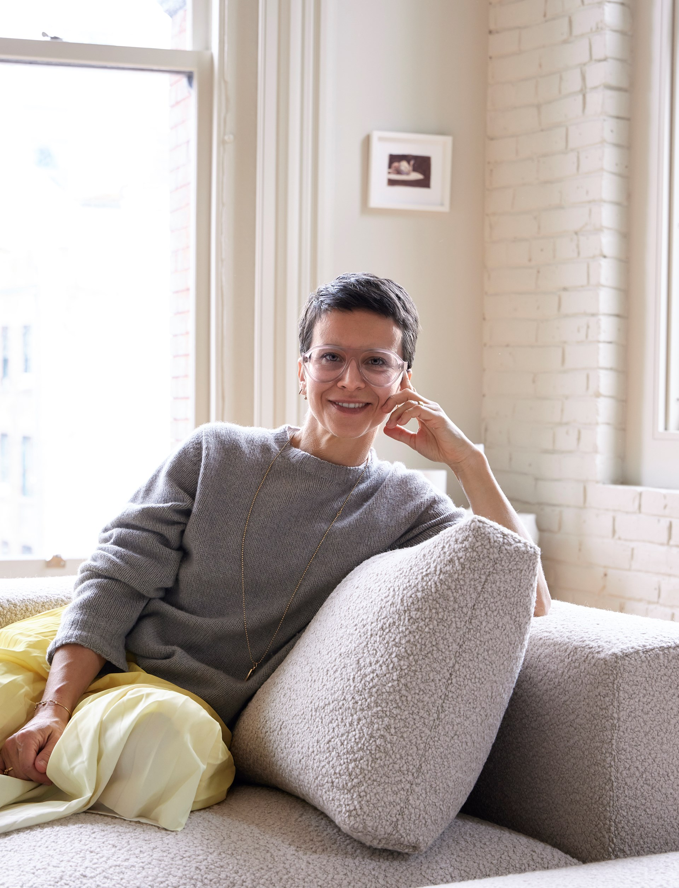

*图：第三代 Sofie Christensen Egelund 肖像——自 2000 年起主导 Vipp 品牌设计识别，字标与视觉系统出自她手。图源：[Vipp 官方品牌史页](https://vipp.com/en/world-of-vipp/our-story/heritage/from-marie-to-moma-and-beyond)。*

### 色彩与材料情绪：中性基底上的色彩回归

Vipp 的色彩策略是\"中性基底＋点状回归\"：黑、白、暖灰为常驻色，米色（Holger's Beige）在品牌史里多次出现与隐退——2022 年官方以 Back To Beige 重新引入，并在 85 周年不锈钢系列中让\"无彩色\"（金属原色）登场。配色在不同品类间严格统一：垃圾桶、卫浴、灯具、家具共用一个色板，因此米色脚踏桶与米色壁挂皂液器在浴室里天然成套。材料情绪上，哑光喷粉钢承担\"工业感\"，不锈钢原色承担\"工具感\"，橡木与大理石承担\"居住感\"，三者按产品线分层使用，不混搭。

*图：Vipp12 米色脚踏桶细节——暖调米色在钢质表面的质感呈现，Back To Beige 色系的一例。图源：[Vipp 官网 Pedal Bin 产品页](https://vipp.com/en/products/pedal-bin-3-l)。*

*图：Vipp16 白色脚踏桶场景——白色在家庭环境中的存在方式：白色是 Vipp 最接近\"隐形\"的颜色。图源：[Vipp 官网 Pedal Bin 产品页](https://vipp.com/en/products/pedal-bin-18-l-5-gal)。*

### 形态、比例与空间：圆柱、平板与细框架

Vipp 的形态语法是几何化的：圆柱（桶身、灯杆）、平板（柜门、桌台）、细金属框架（椅、沙发、灯臂）三种原型反复出现，几乎不用曲线与有机形。比例上偏\"工具尺度\"而非\"家具尺度\"——皂液器与脚踏桶是工业容器比例，家具线则把细框架与厚软包并置，制造\"轻盈骨架承托沉重表面\"的张力。细节语言高度一致：外露的指旋螺丝、可见的接缝、刻意保留的五金件，把\"组装感\"当成设计语言的一部分——这与把接缝藏起来的高端家具美学正相反。

*图：Vipp521 Desk Lamp 桌面生活场景——可调臂与指旋螺丝的\"工作工具\"比例，几何化形态的代表。图源：[Vipp 官网 Lighting 分类页](https://vipp.com/en/categories/lighting)。*

*图：Vipp524 Wall Spot 墙面安装——最小款冲孔灯罩在墙面上的\"点光源\"存在方式。图源：[Vipp 官方品牌史页](https://vipp.com/en/world-of-vipp/our-story/heritage/from-marie-to-moma-and-beyond)。*

### 光线、阴影与展陈：开与关之间的工业戏剧

Vipp 灯具最被反复讨论的美学时刻是\"开与关之间\"：关闭时是哑光钢与冲孔的雕塑物件，点亮时光从冲孔透出形成星点光斑、磨砂玻璃把直射光变成柔光。品牌官网大量使用\"同场景开/关两拍\"的影像（如 Vipp521 的 OFF/ON 对照），把\"光线开关本身\"变成体验内容。展陈美学上，民宿场景承担了最重要的陈列功能：Shelter 的湖景落地窗、Cold Hawaii 的海滨客厅、哥本哈根店的居家客厅——产品不是摆在展厅，而是摆进\"野景＋真实生活\"的画面里，这是 Vipp 视觉区别于北欧同侪的最大特征。

*图：Vipp521 Desk Lamp 关灯状态（Jette 01 OFF）——关闭时是哑光钢雕塑物件。图源：[Vipp 官网 Desk Lamp 产品页](https://vipp.com/en/products/desk-lamp)。*

*图：Vipp521 Desk Lamp 点亮状态（Jette 01 ON）——冲孔透光与磨砂玻璃漫射同时出现。图源：[Vipp 官网 Desk Lamp 产品页](https://vipp.com/en/products/desk-lamp)。*

*图：Vipp526 Pendant 吊灯场景——吊灯在室内上方的光线与阴影关系。图源：[Vipp 官网 Pendant 产品页](https://vipp.com/en/products/pendant)。*

### 触感与感官层：声音、阻尼与表面

Vipp 的\"高级感\"很大程度来自声音与阻尼：脚踏桶的缓降机构让盖子安静闭合（官方称 damper mechanism）、底部橡胶圈消除金属与地面的磕碰声；皂液器泵头与壁挂锁定机构提供明确的操作反馈。表面处理分层：哑光喷粉钢呈微颗粒\"softly grained\"质感、白色为光滑哑光、不锈钢原色保留拉丝痕迹；真皮（苯胺皮、绵羊皮）与织物（驼色、米色、栗色）提供唯一柔软的触觉层。官方责任页\"Designed for repair\"还规定了一个触觉之外的承诺：所有结构件可拆卸维修——耐用性本身成为可被触摸的信任。

*图：Vipp7 牙刷杯 Cold Hawaii 浴室细节——喷粉钢在卫浴场景中的触感存在。图源：[Vipp 官网 Toothbrush Holder 产品页](https://vipp.com/en/products/toothbrush-holder)。*

*图：Vipp9W 壁挂皂液器 Farmhouse 浴室场景——壁挂配件与浴室材质的并置。图源：[Vipp 官网 Soap Dispenser Wall 产品页](https://vipp.com/en/products/soap-dispenser-wall)。*

## 09 Design 设计：把日常功能物做成可感知的设计体验

### 设计哲学三问：功能、时间与情感来源

Vipp 的设计哲学可以从三组问题概括，均来自官方表述与已核实的产品行为：**一、功能先于形式**——官方\"Rather than creating more, we create better\"与灯具\"打磨五年才上市\"说明新品是功能缺口驱动而非造型驱动；**二、时间先于潮流**——\"80 多年生产同一件产品\"意味着产品必须能在几十年后仍然成立，因此设计拒绝短期审美；**三、情感来自工艺细节而非装饰**——缓降阻尼的静音闭合、底部橡胶圈、可拆卸内胆这些功能细节，承担了高端设计通常由造型承担的\"高级感\"。产品家族把这三问贯彻到从 30 厘米桶到 55 平方米建筑：Shelter 的每处五金、厨房的每个抽屉分格，都以\"是否值得被做成一件能传代的设计\"为验收标准。

*图：Holger 与 Marie Nielsen 在 Randers 作坊院中——\"一件日常物件值得被认真做\"这一哲学的最早现场。图源：[Vipp 官方品牌史页](https://vipp.com/en/world-of-vipp/our-story/heritage/from-marie-to-moma-and-beyond)。*

### 设计信念的形成：家族三代而非设计师个人

Vipp 与多数意大利/北欧设计品牌的最大区别是：设计决策权在家族内部，而非外部明星设计师。Jette 1992 年接手时确立\"把 Holger 的设计带进住宅\"的方向；Morten Bo Jensen 2006 年加入后作为首席设计师执行，但产品方向、命名、材料决策由家族（Jette、Kasper、Sofie）把关；Sofie 自 2000 年起控制视觉识别。这意味着品牌没有\"某位大师的风格\"，只有\"Vipp 的语言\"——外部设计师（如为 Art Bins 联名的艺术家）只能做限量支线，不进入主线产品。品牌史把 2009 年 MoMA 入藏视为\"被外部权威认证的时刻\"，但设计信念本身早在 1992 年就已成型：一件平凡的桶，值得被做成有工艺、有声音、能传代的东西。

*图：Jette Egelund 肖像——1992 年接手时确立品牌设计方向：把 Holger 的设计从诊所带进住宅，是 Vipp 设计信念的奠基人。图源：[Vipp 官方品牌史页](https://vipp.com/en/world-of-vipp/our-story/heritage/from-marie-to-moma-and-beyond)。*

### CMF 体系：喷粉钢为核心的材料金字塔

> 术语注释：CMF（Color-Material-Finish，色彩-材料-表面处理）——设计中对产品色彩、材质与表面质感的系统化组合决策。

Vipp 的材料金字塔以**喷粉钢（powder-coated steel）**为基座：黑色与暖灰色为微颗粒质感（官方描述 softly grained）、白色为光滑哑光，覆盖垃圾桶、卫浴、灯具与厨房面板；**不锈钢原色**（拉丝/抛光）承担工具感支线（85 周年系列、V4 厨房）；**阳极氧化铝**用于 V3 厨房门板；**橡木与大理石**进入 Cabin 家具与 V2 厨房的居住感层；**真皮（苯胺皮、绵羊皮）与织物（驼色、米色、栗色）**提供唯一柔软层；**吹制玻璃（Sculpture 灯、灯具磨砂漫射件）与纸张（Paper 灯）**负责光的漫射。色彩规则前面已述：中性基底＋点状回归（米色、不锈钢色），全品类共用一个色板。表面处理几乎只用哑光——Vipp 拒绝高光，因为高光在几十年后会显旧，而哑光钢只会显旧得更体面。

*图：喷粉钢表面细节——哑光微颗粒质感，Vipp 材料体系的基座层。图源：[Vipp 官方品牌史页](https://vipp.com/en/world-of-vipp/our-story/heritage/from-marie-to-moma-and-beyond)。*

*图：Swivel Chair 452 Curly Edition——卷曲绵羊皮特别版，材料金字塔中\"柔软层\"的代表。图源：[Vipp 官网 Swivel Chair 产品页](https://vipp.com/en/products/swivel-chair-453)。*

### 制造：从 Randers 作坊到丹麦工厂

Vipp 的制造史是一条\"丹麦化\"的路线：1939–1990 年代在 Randers 作坊完成金属加工与组装；1998 年设备老化后部分生产外包至丹麦 Lolland 岛；2005 年迁入哥本哈根 Snorresgade 22 后，组装与品质控制在总部完成。工艺核心是深拉（deep-drawing）与喷粉（powder-coating）：桶盖的圆拱顶由金属深拉一次成型，喷粉在哑光层下形成防刮耐用的表面。2010 年 Nordic Design 报道每只桶由最多 42 个组件构成、由熟练工匠手工装配、一名员工每小时装配六只（此口径距今 16 年，当前组装地、员工数与流程细节待核实）。公司规模约 60 名员工（官方招聘页\"a team of 60 colleagues\"），是典型的\"小团队＋高自动化工艺＋手工装配关键环节\"结构。

*图：Vipp 定制工艺车间——金属加工与手工装配环节，小团队＋关键手工的制造结构。图源：[Vipp 官方品牌史页](https://vipp.com/en/world-of-vipp/our-story/heritage/from-marie-to-moma-and-beyond)。*

### 品牌主张对照表

| 品牌主张（官方表述） | 官方证据 | 产品证据 |
|---|---|---|
| \"Rather than creating more, we create better\" | 官网品牌哲学、CEO 访谈 | 灯具打磨五年才上市；新品节奏慢于北欧同侪 |
| \"80 多年生产同一件产品是我们的存在理由\" | 官方招聘页 The Vipp Way | Vipp15 外形延续 1939 年、MoMA 藏 1939/1949 两版 |
| \"Designed for repair\"（为维修而设计） | 官方 Responsibility 页 | 结构件可拆卸、10 年延长保修 |
| \"the basis of an entire design universe\" | 官方品牌史 | 一条工艺语言覆盖桶→厨→灯→家具→建筑 |

## 10 Experience 体验：让你睡进产品里的品牌

### 品牌体验观：\"进入设计宇宙的门户\"

Vipp 的体验哲学是把\"产品陈列\"升级为\"产品生活\"：官方把民宿矩阵称为\"进入我们设计宇宙的门户\"（a doorway into our design universe）——客人不是参观展厅，而是在 Shelter 的厨房里做早餐、在 Cold Hawaii 的客厅里点开 Vipp521、在浴室里用 Vipp9W 壁挂皂液器。这种体验的不可替代性在于：任何展厅都无法同时检验静音阻尼、灯光层次、家具耐久与\"住一晚\"的整体感受。体验的终点是转化——官方访谈与媒体都确认，民宿客人与访客是 Vipp 复购与口碑的核心来源。

*图：Vipp Home 概念店内的办公空间——\"按真实生活而非展柜陈列\"的体验哲学的室内版本。图源：[Vipp 官方品牌史页](https://vipp.com/en/world-of-vipp/our-story/heritage/from-marie-to-moma-and-beyond)。*

### 具体机制：D2C、旗舰店、民宿与保修

体验的落地机制分五层。**D2C 直营**：vipp.com 多国站直接挂价下单（欧洲/美国 UPS、丹麦 GLS），官方条款明确按终端消费者直营处理——价格统一、无中间商加价，但也不提供冲动消费的折扣场景。**旗舰店与展厅**：哥本哈根 Vipp Home（125–150 平方米真实居家场景）、总部 Vipp Campus、纽约 Studio、上海旗舰店（509 平方米、2022 年开业、Scandi Trading 运营）与设计周展位（3daysofdesign）承担线下触达。**民宿矩阵**：截至 2026 年 10 月约 13–14 处 Guesthouses 覆盖瑞典、丹麦、挪威、拉脱维亚、法国、意大利、美国、墨西哥、澳大利亚（塔斯马尼亚）等地，含 Shelter、Cold Hawaii、Tunnel、Palazzo Monti 合作项目，房价从 €1,000/2 晚（Shelter 工作日）到 €1,000/晚（哥本哈根 Chimney House）不等。**共有制度假屋**：2024 年启动的 Vipp Residences 让多家庭共享一处 Vipp 精装度假屋，是民宿矩阵的\"众筹化\"延伸（Kasper 官方 Q&A 确认概念）。**保修与售后**：官方 5–10 年质保（垃圾桶 10 年延长保修）、\"Designed for repair\"承诺结构件可维修。

*图：哥本哈根 3daysofdesign 设计周 Vipp 展位——设计师与买手的关键触点之一。图源：[Vipp 官方品牌史页](https://vipp.com/en/world-of-vipp/our-story/heritage/from-marie-to-moma-and-beyond)。*

*图：Vipp9 皂液器黑色浴室场景——民宿与旗舰店里的高频接触产品，客人在真实使用中体验阻尼与泵头反馈。图源：[Vipp 官网 Soap Dispenser 产品页](https://vipp.com/en/products/soap-dispenser)。*

### 兑现与断裂：口碑的两面

正面证据（北欧专业评测）：瑞典 Testkollen 与 Produktbetyg 等北欧测试媒体把 Vipp 脚踏桶评为\"投资级\"（10 年保修、钢构扎实、机构耐用），这是品牌在日用五金语境下最硬的质量背书；官方 Responsibility 页同时给出 Rubbish 桶的减碳数据（相对钢桶减约 3.7 kg 钢、约 75% 再生占比）作为可持续承诺。负面证据（个体消费者反馈）：Wanderlog 上单个用户给 Vipp Home 旗舰店打 2/5 分——抱怨门店不处理国际配送、补寄地址出错（C 级个体证据，样本量 1，仅作风险提示，不作为普遍结论）；Trustpilot 实时评分本轮因 robots.txt 拦截未能采集。综合判断：Vipp 的口碑结构是\"权威评测强、个体客服体验偶有断裂\"——与它\"官网直营＋旗舰店+民宿\"的轻渠道结构一致，客服半径较浅是家族小体量的真实代价。

*图：Cold Hawaii 民宿客厅场景——整套 Vipp 家具/灯具的\"可过夜\"陈列，体验转化的核心空间。图源：[Vipp 官网 Sculpture Table Lamp 产品页](https://vipp.com/en/products/sculpture-table-lamp)（品牌物料图）。*

*图：Cold Hawaii 民宿卧室——灯具与家具在卧室场景中的组合。图源：[Vipp 官网 Lighting 分类页](https://vipp.com/en/categories/lighting)。*

*图：Palazzo Monti 合作民宿——艺术家驻留项目与民宿矩阵的交汇，Vipp 把体验半径从家居延伸到文化空间。图源：[Vipp 官方品牌史页](https://vipp.com/en/world-of-vipp/our-story/heritage/from-marie-to-moma-and-beyond)。*

## 11 Competition 竞品：北欧同侪与微型建筑赛道

### 北欧同侪矩阵

Vipp 真正的竞品不是德国垃圾桶品牌，而是同一价格带的北欧生活品牌——它们都做\"北欧设计生活方式\"，但归属与打法不同：

| 品牌 | 归属 | 定位 | 价格带 | 品类宽度 | 与 Vipp 的重叠与错位 |
|---|---|---|---|---|---|
| HAY | MillerKnoll（2018 起） | 大众高端的丹麦设计、色彩明快 | 中 | 极宽（家具/灯/配件/文具） | 价格错位：HAY 入门远低于 Vipp；风格错位：彩色柔性 vs 哑光钢 |
| Muuto | 独立（家族/私募） | 斯堪的纳维亚柔和现代 | 中 | 宽 | 风格错位：圆角木色 vs 工业钢；渠道重叠：北欧买手店与设计周 |
| Normann Copenhagen | 独立 | 趣味、色彩、斯堪的纳维亚 | 中 | 宽 | 风格错位；同样 D2C 挂价但入门价更低 |
| Ferm Living | 独立 | 装饰导向、家居美学 | 中高 | 中宽 | 触感错位：软装饰 vs 硬钢件 |
| Audo Copenhagen | Design Holding（原 Menu＋by Lassen 2023 合并） | 安静奢华、新品频繁 | 中高 | 中宽 | 最接近的\"价格带＋静奢\"对手；但 Audo 有集团资源、Vipp 无 |
| &Tradition | 3 Days Design 相关/私募 | 经典再版＋当代 | 中高 | 宽 | 风格错位：木与织物 vs 钢；价格重叠区存在 |

结论：没有一家北欧同侪同时做到\"钢制工业＋MoMA 馆藏＋民宿体验＋D2C 直营\"的组合——HAY 有宽度与价格、Audo 有集团与静奢、Muuto 有柔和北欧感，但 Vipp 独占了\"一件桶能进 MoMA\"的叙事与\"住进产品里\"的体验。

### 微型建筑赛道

Shelter 所在的\"高端预制小屋\"赛道（Vipp 已退出销售、只做民宿）有明确的价格参照：荷兰 KODA（Compact 约 €71,900、Loft Extended 约 €119,900 起）；美国 LivingHomes/Plant Prefab（约 $460–700/平方英尺）；欧洲 Tiny House Mobile（€24,900–33,900 起）。对比可见：Vipp 2015 年 Shelter 的 US$580,000–585,000 定价是赛道顶端的 2–5 倍——这个价格带本身说明它从未真正把自己当\"住宅产品\"卖，而是当\"可居住的设计装置\"卖；而官方承认的失败恰恰证明了：可居住的设计装置没有住宅产品的流通性。

### 收束判断

Vipp 的竞争壁垒不在价格（它不便宜但也不最贵），而在三条不可复制的资产：**博物馆体系背书（MoMA 唯一丹麦工业桶）、民宿体验矩阵（睡进产品里）、家族长期主义（80 年同一产品）**。风险同样清楚：家族小体量（约 60 人）在面对 Audo（集团资源）与 HAY（集团渠道）时没有弹药优势；如果它开始追赶\"年度新品数量\"，就会丢掉\"打磨五年\"的叙事——取舍是战略的核心问题，下一章展开。

## 12 Strategy 战略：从垃圾桶到民宿矩阵的五级跳

### 五级跳：一件产品的七十年扩张

| 阶段 | 年份 | 关键动作 | 战略意义 |
|---|---|---|---|
| 0 | 1939 | Holger 为理发店做第一只脚踏桶 | 功能原点：B2B 工业配件 |
| 1 | 1992 | Jette 接手、Conran Shop 订单 | 渠道跃迁：诊所 B2B → 设计零售 B2C |
| 2 | 2009 | MoMA 永久馆藏 | 权威跃迁：日常物件 → 博物馆级设计 |
| 3 | 2011 | 第一套模块化厨房＋首家概念店 | 品类跃迁：配件 → 家居工程 → 空间 |
| 4 | 2014 | Shelter 建成（2015 发售） | 形态跃迁：产品 → 可居住建筑（商业失败） |
| 5 | 2014–2024 | Shelter 转民宿 → 14 处 Guesthouses | 模式跃迁：卖产品 → 卖体验 |
| 6 | 2024–2026 | Open-Air 户外系列、Vipp Residences 共有制 | 增长极：新材料线＋众筹化度假屋 |

### 技术路线与产品规划

Vipp 的产品规划遵循\"同一工艺语言逐级放大\"：喷粉钢面板从垃圾桶（30 cm）→ 厨房柜（240 cm）→ Shelter（55 m²），材料体系则逐年扩展——钢（1939）→ 铝/不锈钢（V3/V4 厨房）→ 橡木/大理石（Cabin 2020）→ 真皮/织物（Lodge/软包）→ 纸张（Paper 灯）→ 柚木/仿藤/PP（Open-Air 2024）。规划节奏刻意慢于北欧同侪：灯具家族 2017 年才首发、家具线 2019 年起、户外 2024 年才出现——\"慢\"本身是品牌定位的一部分，也符合\"Rather than creating more\"的官方哲学。微型建筑线已明确不再作为产品线扩张（Shelter 教训），转为民宿资产与体验入口。

### 定位演进与品牌影响力

定位从\"钢制工业配件商\"（1939–1992）→\"有博物馆背书的北欧生活品牌\"（2009–2014）→\"可居住的体验公司\"（2014 至今）逐级上移；官方叙事始终咬住两个锚点：MoMA 馆藏（文化权威）与\"80 多年同一件产品\"（时间权威）。影响力坐标：产品进入 MoMA 建筑与设计馆藏（唯一丹麦工业桶）；Shelter 获 Dezeen、WSJ 杂志、Inhabitat 等设计媒体专题报道（\"battery-charging station for humans\"）；上海旗舰店 2022 年开业时被环球网等中文媒体作为\"北欧设计登陆中国\"报道；民宿矩阵覆盖五国以上，成为设计酒店的常客；Pencil Factory 等品牌空间（哥本哈根旧铅笔厂）承担文化策展。注意避免混淆：Vipp（家具品牌）与挪威移动支付 Vipps MobilePay 是两家无关公司。

### 关键取舍与风险

**一、家族独立 vs 集团化**：2024–2026 年北欧设计界集团化加速（Audo 归 Design Holding、HAY 归 MillerKnoll），Vipp 保持 100% 家族持有、无外部投资（\"Nordic Capital 入股\"查无实据），好处是方向自主、坏处是渠道与供应链弹药有限。**二、体验资产 vs 重资产**：14 处民宿既是营销也是成本，Shelter 的教训（物流、法规、只卖 1 台）证明\"预制房当货架产品\"不可行，民宿矩阵是该资产的正确变现。**三、慢节奏 vs 增长压力**：营收未公开（估计 2–3 亿 DKK 区间）、2025 财年净利润约 1,819 万 DKK，家族公司没有上市公司的季度增长压力，但新品节奏慢也意味着一旦某个品类（如灯具）被竞品快速跟进，差异化窗口有限。**四、可持续叙事**：Rubbish 桶（70% 回收塑料＋30% 木屑）与\"Designed for repair\"是可持续承诺的实际载体，但整体碳中和路线图官网未完整披露（待核实）。**五、治理换届**：2026 年 6 月董事长换任 Mikkel Vendelin Olesen，2026 年 9 月新设全资子公司 VIPP Residences ApS——治理与资产结构在持续调整，需跟踪。

## 13 视频与访谈资料

- 官方品牌史（From Marie to MoMA and Beyond，含时间线图与家族影像）：[vipp.com 品牌史页](https://vipp.com/en/world-of-vipp/our-story/heritage/from-marie-to-moma-and-beyond)
- Vipp Residences 官方品牌故事（Kasper Egelund 访谈式 Q&A）：[vippresidences.com](https://vippresidences.com/en/about-us/our-story)
- The Vipp Way（品牌价值观与团队文化页，\"80 多年同一件产品\"出处）：[vipp.com The Vipp Way](https://vipp.com/en/join-us/the-vipp-way)
- Gessato 对首席设计师 Morten Bo Jensen 的访谈：[gessato.com](https://www.gessato.com/behind-design-morten-bo-jensen/)
- WSJ Magazine 2018 年 Vipp 家族特稿（PDF）：[kom-kbh.dk 转载](https://kom-kbh.dk/wp-content/uploads/2018/03/WSJ.-Mag-Vipp.pdf)
- Dansk Erhverv 杂志 Sofie & Frank Egelund 纽约之家访谈：[danskerhverv.dk](https://www.danskerhverv.dk/dansk-erhverv-magasinet/01-23/3.-generation-i-vipp-er-flyttet-til-new-york-sofie-og-frank-egelunds-hjem-er-ogsa-deres-showroom/)
- Vipp 品牌手册 PDF（灯具打磨五年等细节）：[pdf.archiexpo.com](https://pdf.archiexpo.com/pdf/vipp/vipp-brand-brochure/52826-378393.html)

## 14 来源与延伸阅读

**官方一手（vipp.com）**
- 品牌史/时间线：[From Marie to MoMA and Beyond](https://vipp.com/en/world-of-vipp/our-story/heritage/from-marie-to-moma-and-beyond)（含 Shelter、MoMA、家族史全文与全部历史图）
- 民宿矩阵：[Vipp Guesthouses](https://vipp.com/en/world-of-vipp/inspiration/spaces/vipp-guesthouses)、[Shelter 民宿页](https://vipp.com/en/world-of-vipp/our-guesthouses/vipp-shelter)、[Tunnel](https://vipp.com/en/world-of-vipp/our-guesthouses/vipp-tunnel)
- 产品与价格：[Bins 分类](https://vipp.com/en/categories/bins)、[Lighting 分类](https://vipp.com/en/categories/lighting)、[Seating 分类](https://vipp.com/en/categories/seating)、[Table Lamp](https://vipp.com/en/products/table-lamp)、[Desk Lamp](https://vipp.com/en/products/desk-lamp)、[Pendant](https://vipp.com/en/products/pendant)、[Wall Spot](https://vipp.com/en/products/wall-spot)、[Sculpture Table Lamp](https://vipp.com/en/products/sculpture-table-lamp)、[Soap Dispenser](https://vipp.com/en/products/soap-dispenser)、[Toothbrush Holder](https://vipp.com/en/products/toothbrush-holder)
- 材料/责任/质保：[Materials](https://vipp.com/en/materials)、[Responsibility](https://vipp.com/en/responsibility)、[Warranty](https://vipp.com/en/warranty)、[Terms](https://vipp.com/en/terms-and-conditions)、[Join us（60 人）](https://vipp.com/en/join-us)

**馆藏与档案**
- MoMA 馆藏 Pedal Bin model 15（1939）：[moma.org/works/130957](https://www.moma.org/collection/works/130957)（含策展人 Chay Costello 评语与 1949 版 [works/130958](https://www.moma.org/collection/works/130958)）

**公司登记（丹麦 CVR）**
- VIPP A/S（CVR 19997049）：[find-virksomhed.dk](https://find-virksomhed.dk/firma/vipp-a-s-19997049)、[ownr.dk 股东/董事会](https://ownr.dk/companies/public-profile/19997049)、[virmo.dk 2025 财务](https://virmo.dk/firma/19997049-vipp-as)

**设计媒体与第三方（B/C 级）**
- Dezeen 2017-05-15 Shelter 报道：<https://www.dezeen.com/2017/05/15/vipp-prefabricated-shelter-cabin-battery-charging-station-humans/>
- Inhabitat 2015（$580,000）：<https://inhabitat.com/vipp-shelter-is-a-prefab-plug-and-play-getaway-that-can-be-placed-just-about-anywhere/>
- Stylepark 厂商页：<https://www.stylepark.com/en/manufacturer/vipp>
- 环球网上海旗舰店报道：<https://m.huanqiu.com/article/4Ag9sQucejr>
- Wanderlog 差评（C 级个体）：<https://wanderlog.com/place/details/3789958/vipp-home--store--showroom>
- Testkollen 北欧评测：<https://www.testkollen.se/pedalhink>

## 15 分析附录

### 产品组合矩阵（2026 年现行线）

| 品类 | 型号范围 | 价格带（官方欧元） | 首发/年份 | 状态 |
|---|---|---|---|---|
| 脚踏桶 | Vipp12–17（3–30 L） | €195–515 | 1939 设计 | 在售、六档 |
| 敞口桶/办公桶 | Vipp18/19、Vipp52 | €275–415 | 1950s 起 | 在售 |
| 微缩摆件 | Vipp3 | €95 | 近年 | 在售 |
| 厨卫配件 | Vipp7/9/9W/11、镜、纸巾架 | €105–115 | 2004 起 | 在售 |
| 灯具 | 521/524/525/526–528/530/581/586/591/592/595 | €265–735 | 2017 首发 | 在售 |
| 家具 | 451/452/453/456、Cabin、Lodge、632、675 | €865–4,095 | 2019 起 | 在售 |
| 厨房 | V1–V4 | 项目报价 | 2011 起 | 在售 |
| 户外 | Open-Air 7xx、741/742 | €325–665 | 2024 | 在售 |
| 微型建筑 | Shelter | 无在售报价 | 2014/2015 | 仅民宿出租 |
| 民宿 | 13–14 处 Guesthouses | €1,000/2 晚起 | 2014 起 | 运营中 |

### CMF 速查

| 层 | 材料 | 表面 | 产品例 |
|---|---|---|---|
| 基座 | 喷粉钢 | 黑/灰微颗粒、白光滑哑光 | 垃圾桶、灯具、厨卫、厨房 |
| 工具 | 不锈钢 | 拉丝/原色 | 85 周年系列、V4 厨房 |
| 工程 | 阳极氧化铝 | 竖纹 | V3 厨房 |
| 居住 | 橡木、大理石 | 哑光木、磨石 | Cabin 系列、V2 厨房、495 桌 |
| 柔软 | 真皮、织物 | 苯胺/绵羊皮、驼/米/栗 | 451、Lounge、Lodge、632 |
| 光学 | 玻璃、纸张 | 吹制乳白、磨砂、纸罩 | Sculpture、灯具、Paper 灯 |
| 户外 | 柚木、聚藤、PP | 天然木、仿藤、户外织物 | Open-Air 系列 |

### 关键事实证据登记（A/B/C 分级）

| 关键事实 | 来源 | 等级 |
|---|---|---|
| 1932 年彩票中车、卖车换车床、Randers 作坊 | vipp.com 官方品牌史 | A |
| 1939 年第一只脚踏桶为 Marie 理发店制作 | vipp.com 官方品牌史＋MoMA 馆藏页 | A |
| 2009-11 MoMA 馆藏 Pedal Bin model 15（object 1332.2009） | MoMA 馆藏页（works/130957） | A |
| Shelter 2014 建成、2015 公开发售、2017 年报道 US$580,000–585,000 | Dezeen/Inhabitat/WSJ Mag；官方 guesthouse 页 | A（建筑年份）/B（报价） |
| \"We didn't sell a single unit\"＋转民宿（misjudged business idea） | vipp.com 官方 guesthouse/品牌史页 | A |
| 截至 2026-10 仍 100% 家族持有（JE/KE/SCE 三家控股 ApS） | ownr.dk/CVR；Nordic Capital 官网无记录 | A（无外部 PE 为推断，置信度高） |
| \"Frank Nielsen\"不存在、Sofie 丈夫为 Frank Christensen Egelund | ownr.dk 董事会登记 | A |
| 灯具 2017-11-29 首发、归属内部团队（Morten Bo Jensen 2006 起） | 官方产品页/品牌手册/Gessato 访谈 | A |
| 现行垃圾桶为 Vipp12–17、无 Bin 18/Bin 50 | vipp.com Bins 分类页 | A |
| 2025 财年净利约 1,819 万 DKK、净资产约 2.37 亿、约 60 人 | virmo.dk/官方招聘页 | A（财务）/B（口径） |
| 上海旗舰店 2022-09-01 开业、509 m²、Scandi Trading 运营 | 环球网/官方 | B |
| 无 Red Dot/iF 获奖记录 | 奖项数据库检索无命中 | B（未证伪完全，谨慎） |
| Wanderlog 2/5 差评（客服/配送） | Wanderlog 单条 | C（个体证据） |

### 待核实清单（成稿时未闭环的项目）

1. Holger Nielsen 生年（MoMA 记 1917 vs 官方倒推 1914/1915），卒年 1992 一致。
2. \"Vipp\"命名词源仅家族口述（Jette 推测 vippe 倾斜），MoMA 称拟声词，非 Holger 定论。
3. 2024/2025 财年营收未公开（注册数据不披露营业额），净利 1,819 万 DKK 为 2025 财年口径。
4. 当前组装地与喷粉工艺量化参数（\"42 组件/每小时 6 只\"为 2010 年二手口径）。
5. Holger's Beige 米色的具体回归年份（2022 Back To Beige 为官方口径，最早引入年待核实）。
6. 灯具家族各型号首发年份官网未统一标注（家族整体 2017-11-29 首发已确认）。
7. Lodge 软包系列首发年与 Sofa 632/Cabinet 675 具体首发年（官方页未标，型号与年份来自分类页核对）。
8. Vipp Cabin（2020 黑色松木板木屋）的官方规格/价格未定位（区别于 Cabin 家具系列）。
9. Vipp Residences 的具体项目清单与运营数据（官方 Our Story 页口径有限）。
10. Trustpilot 实时评分因 robots.txt 拦截未采集。
11. Art Bins 艺术桶完整合作名单（150+ 艺术家，Karim Rashid/Yoko Ono/Calvin Klein/Starck 已确认）。
12. Palazzo Monti 合作项目的起止与内容（官方品牌史收录，细节待核实）。
13. 中国线上渠道（天猫/京东官方旗舰店）未发现，属缺口而非结论。
14. Sculpture 桌灯官网欧元价未挂出（官方丹麦站 DKK 口径并存）。
15. MoMA 高清馆藏图受馆方防护仅得缩略图（366×512、9.3 KB），报告采用此版本并如实标注。

（全文完）

